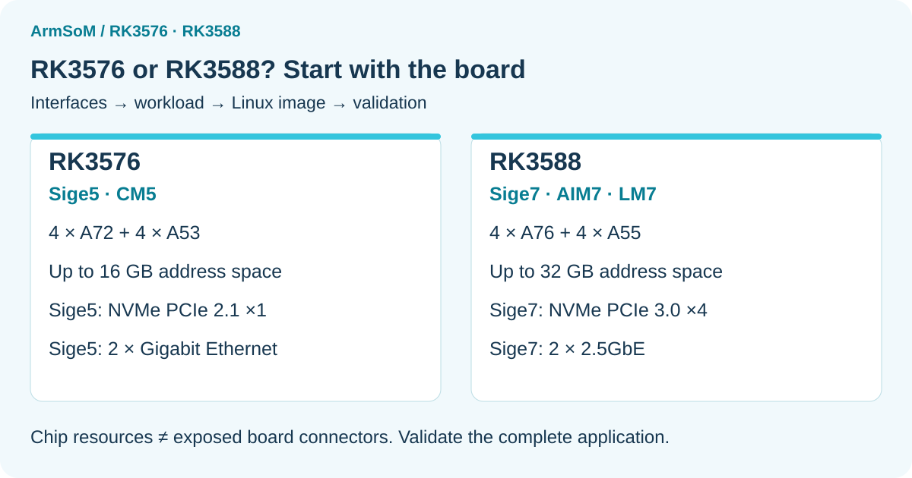
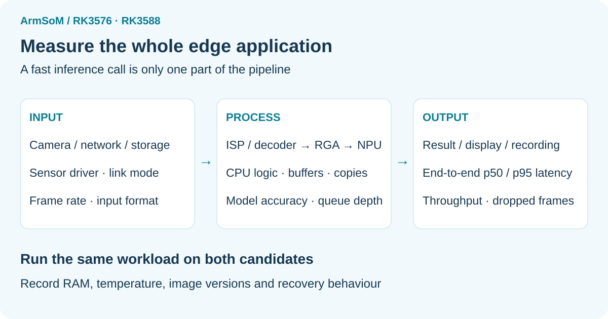

**Choose RK3576 when the interfaces exposed by Sige5 or CM5, a memory requirement within 16 GB, and your measured application workload fit the design. Evaluate RK3588 when you need the wider memory subsystem, Sige7’s PCIe 3.0 ×4 NVMe connection and dual 2.5GbE, or more CPU/GPU headroom for concurrent workloads.** Both platforms advertise 6 TOPS; that number alone cannot decide which will run your application better.

This guide connects chip specifications to ArmSoM boards, Linux software and an acceptance procedure. It uses published documentation checked on 18 November 2026; the workload recommendations are engineering guidance, not results of an ArmSoM comparative benchmark. Actual operating modes depend on the board revision, carrier and BSP.



## 1. What actually differs between RK3576 and RK3588?

| Item | RK3576 | RK3588 | What to check in your project |
|---|---|---|---|
| CPU | 4× Cortex-A72 + 4× Cortex-A53 | 4× Cortex-A76 + 4× Cortex-A55 | CPU time for application logic, preprocessing, databases and containers |
| GPU | Mali-G52 MC3 | Mali-G610 MC4 | Graphics driver, compositor, API support and the real display workload |
| NPU | Two cores; advertised 6 TOPS INT8 with a sparsity qualification | Three cores; advertised 6 TOPS | Model conversion, supported operators, precision, core scheduling and latency |
| Memory interface | 2×16-bit; LPDDR4/4X/5; up to 16 GB address space | 4×16-bit; LPDDR4/4X/5; up to 32 GB address space | The memory actually fitted to the board and peak application usage |
| PCIe | PCIe 2.1 resources, including multiplexed interfaces | PCIe 3.0 plus additional PCIe resources | Exposed lanes, carrier routing, shared PHYs and negotiated link speed |
| Media | ISP, RGA, hardware codecs and multiple display interfaces | ISP, RGA, hardware codecs, multiple displays and HDMI RX | Codec-specific limits, sensor drivers and supported simultaneous modes |
| NPU software family | RKNN-Toolkit2 / RKNPU2 | RKNN-Toolkit2 / RKNPU2 | A compatible conversion tool, runtime and kernel driver for each target |

Chip-level facts come from the [RK3576 specifications](https://www.rock-chips.com/a/en/products/RK35_Series/2024/1212/2033.html), [RK3588 specifications](https://www.rock-chips.com/a/en/products/RK35_Series/2022/0926/1660.html) and the datasheets discussed in our [RK3576 guide](/articles/rk3576-datasheet-v10/) and [RK3588 guide](/articles/rk3588-datasheet-v14/). They are not a list of connectors available on every product.

The memory bus is wider on RK3588, but this is not a promise of twice the application throughput. DRAM type and clock, cache behaviour, memory copies and competing clients all affect usable bandwidth. Similarly, the CPU core names do not establish a fixed performance multiplier or a power-consumption comparison.

For video, distinguish **decode, encode and display output**. RK3588’s detailed specification lists different maxima for H.265 and AV1; an “8K” label does not apply to every codec. RK3576’s older full datasheet and newer brief also present video limits differently. Select a specific codec, profile, bit depth, resolution and frame rate, then validate it on the intended image rather than combining the highest numbers from different documents.

## 2. Sige5 versus Sige7: compare the connectors you can use

For an SBC prototype, board routing is more immediately useful than the full SoC block diagram. The current [Sige5 manual](https://docs.armsom.org/armsom-sige5) and [Sige7 manual](https://docs.armsom.org/armsom-sige7) provide these distinctions:

| Board item | ArmSoM Sige5 | ArmSoM Sige7 |
|---|---|---|
| Processor | RK3576 | RK3588 |
| Listed RAM configurations | 8/16 GB, 32-bit LPDDR4X | 8/16/32 GB, 64-bit LPDDR4/4X |
| NVMe socket | M.2 Key M, PCIe 2.1 ×1 | M.2 Key M, PCIe 3.0 ×4 |
| Wired networking | 2× Gigabit Ethernet | 2× 2.5 Gigabit Ethernet |
| Camera connectors | 2× four-lane MIPI CSI | 2× four-lane MIPI CSI |
| Display interfaces | HDMI, USB-C DisplayPort and MIPI DSI | HDMI, USB-C DisplayPort and MIPI DSI |
| Board footprint | 92 × 62 mm | 92 × 62 mm |

A PCIe 3.0 ×4-capable SSD can negotiate a slower, narrower connection in another host. Its advertised desktop performance does not carry over to Sige5’s ×1 link. Both manuals identify the M.2 socket as NVMe; do not buy an M.2 SATA drive merely because the connector looks similar.

For Sige7’s 2.5GbE ports, the switch, cable and peer must also support the negotiated mode. Two ports do not automatically provide one twice-as-fast connection. Likewise, two CSI connectors do not establish camera compatibility: verify the sensor driver, lane wiring, power rails, clock, device tree and ISP tuning.

The shared board dimensions simplify early enclosure planning, but do not establish identical mounting clearances, connector positions or electrical pin compatibility. Confirm the mechanical drawings before reusing a case.

## 3. From a development board to CM5, AIM7 or LM7

An SBC already provides connectors and much of the surrounding circuitry. A compute module moves part of that integration onto your carrier.

| Product | Platform and format | Appropriate starting point |
|---|---|---|
| [CM5](https://www.armsom.org/cm5) | RK3576; 55 × 40 mm module | A compact custom carrier for a terminal, gateway or vision device |
| [AIM7](https://www.armsom.org/aim7) | RK3588; 260-pin SO-DIMM module | A removable compute module on a validated carrier |
| [LM7](https://www.armsom.org/lm7) | RK3588; 45 × 50 mm LGA module | A soldered module integrated into a production carrier |

The [CM5 documentation](https://docs.armsom.org/armsom-cm5) distinguishes V1.3 LPDDR5 and V2.0 LPDDR4X configurations. “RK3576 supports LPDDR5” does not mean every Sige5 or CM5 uses LPDDR5. Confirm the ordered SKU and revision.

For [AIM7](https://docs.armsom.org/armsom-aim7), check its pinout and the validated carrier configuration; a matching module outline does not guarantee compatibility with every Jetson carrier or with CUDA software. For [LM7](https://docs.armsom.org/armsom-lm7), include assembly, carrier signal integrity, power sequencing and repair strategy in the decision. Moving from an SBC to a module still requires new device-tree and peripheral validation.

## 4. Select by the whole application

### Camera AI and industrial inspection

A camera pipeline includes capture, ISP processing or decoding, resizing/colour conversion, inference and postprocessing. Start with Sige5 when its camera paths and memory budget meet the prototype requirements. Consider Sige7 when additional concurrent services, frame buffering or CPU/GPU processing make those resources limiting. Neither choice guarantees a particular number of AI camera streams.

Measure the time from frame arrival to a usable result, including queues and memory transfers. A low inference time can coexist with poor end-to-end latency if CPU resizing or frame copies dominate. The [RKNN-Toolkit2 repository](https://github.com/airockchip/rknn-toolkit2) lists both platforms, but each model must be converted and checked for the intended target.

### NAS, data logging and network gateways

Sige5 is worth evaluating when dual Gigabit Ethernet and a single-lane NVMe connection meet the requirement. Sige7 offers a stronger starting point for a design needing dual 2.5GbE and a wider NVMe connection. These are interface differences, not measured file-transfer rates.

Include encryption, filesystem behaviour, small-file access, SSD temperature and power-loss recovery in the trial. A SATA controller in the chip specification does not turn an NVMe-only board socket into a SATA socket.

### HMI, kiosks and display terminals

For a terminal with a defined screen configuration, prove the panel timings, touch input, compositor and hardware video path first. Evaluate RK3588 when the actual graphics or concurrent display workload requires more headroom. Do not infer support for a particular multi-display arrangement from the total number of SoC display engines; connectors may share resources and the BSP must support the combination.

### Containers and edge services

For a gateway running a database, message broker and inference service, budget memory for the OS, model, frame buffers, filesystem cache and peak queues together. RK3588 products offering 32 GB may be useful when a measured memory requirement exceeds 16 GB. Containers do not remove hardware dependencies: GPU, NPU and media access still rely on the host kernel, device permissions and compatible userspace libraries.

## 5. Choose the Linux image before freezing the hardware

“Linux boots” and “all accelerators work in my application” are different acceptance points. Start from the image recommended for the exact board in [ArmSoM’s getting-started documentation](https://docs.armsom.org/getting-started), then record its kernel and package versions.

| Software layer | Verify before committing to a design |
|---|---|
| Bootloader, kernel and device tree | Correct board revision, regulator setup, pin multiplexing and enabled peripherals |
| Graphics and display | Kernel driver, Mesa or vendor userspace, compositor and required API versions |
| Video and image processing | MPP/RGA libraries plus the application’s actual acceleration integration |
| NPU | Conversion target, RKNN runtime, driver compatibility and model accuracy |
| Product maintenance | Image updates, security fixes, recovery procedure and an owned release baseline |

[Rockchip MPP](https://github.com/rockchip-linux/mpp) provides media processing components; simply installing FFmpeg or GStreamer does not prove that a chosen build uses them. Check application logs and CPU load while playing representative files. Vendor BSP and upstream-oriented distributions can expose different feature sets even on the same board.

For RKNN-Toolkit2 conversion, use `target_platform="rk3576"` or `target_platform="rk3588"` as appropriate and retain separate model artifacts. Do not assume a converted model, NPU core mask, boot image or device tree can be copied unchanged between the two platforms. Keep the model, calibration data and SDK/runtime versions in the deployment record.

## 6. Inspect a Linux prototype with real commands

The following commands read system information; they do not flash storage or change clock settings. They are examples for a Linux shell, not Android ADB. Availability depends on the image. Missing utilities or restricted permissions are not evidence that hardware is absent.

### Identify the board, OS and memory

```bash
uname -a
cat /etc/os-release
for f in /proc/device-tree/model /proc/device-tree/compatible; do
  if [ -r "$f" ]; then
    printf '\n%s\n' "$f"
    tr '\000' '\n' < "$f"
  fi
done
command -v lscpu >/dev/null 2>&1 && lscpu
free -h
lsblk -o NAME,SIZE,TYPE,FSTYPE,MOUNTPOINT
```

`MemTotal`/`free` report memory available to Linux, which can be below the physical RAM capacity because of reserved regions. `lsblk` identifies the active storage arrangement; it is not a throughput test. Record the hardware revision from the board label as well as these outputs.

### Check PCIe, USB and network links

```bash
command -v lspci >/dev/null 2>&1 && lspci -nn
command -v lsusb >/dev/null 2>&1 && lsusb -t
for d in /sys/bus/pci/devices/*; do
  [ -d "$d" ] || continue
  printf '\n%s\n' "${d##*/}"
  for f in current_link_speed current_link_width; do
    [ -r "$d/$f" ] && { printf '%s: ' "$f"; cat "$d/$f"; }
  done
done
if command -v ethtool >/dev/null 2>&1; then
  for d in /sys/class/net/*; do
    name=${d##*/}
    [ "$name" = lo ] && continue
    printf '\n%s\n' "$name"
    ethtool "$name"
  done
fi
```

The PCIe values are the current link state, not a bandwidth benchmark. Investigate a narrow link, unexpected generation, USB 2.0 fallback or a 100 Mb/s Ethernet negotiation before comparing application performance. If an image lacks these utilities, typical Debian/Ubuntu package names are `pciutils`, `usbutils` and `ethtool`.

### Find camera and display endpoints

```bash
command -v v4l2-ctl >/dev/null 2>&1 && v4l2-ctl --list-devices
if command -v media-ctl >/dev/null 2>&1; then
  for d in /dev/media*; do
    [ -e "$d" ] || continue
    media-ctl -d "$d" -p
  done
fi
for d in /sys/class/drm/card*-*; do
  [ -r "$d/status" ] || continue
  printf '\n%s\n' "${d##*/}"
  cat "$d/status"
  [ -r "$d/modes" ] && cat "$d/modes"
done
```

The existence of `/dev/video*` does not prove that it is your camera: codec devices may also use video nodes. Identify the sensor and media graph, then capture with the board-supported example. An HDMI mode listed by DRM is an advertised mode, not proof that the entire rendering or playback pipeline sustains it. `v4l2-ctl` and `media-ctl` are commonly supplied by `v4l-utils`.

### Observe temperature and frequency during your workload

```bash
for d in /sys/class/thermal/thermal_zone*; do
  [ -r "$d/temp" ] || continue
  printf '%s ' "${d##*/}"
  [ -r "$d/type" ] && tr '\n' ' ' < "$d/type"
  cat "$d/temp"
done
for d in /sys/devices/system/cpu/cpufreq/policy*; do
  [ -d "$d" ] || continue
  printf '\n%s\n' "${d##*/}"
  for f in scaling_governor scaling_cur_freq scaling_max_freq; do
    [ -r "$d/$f" ] && { printf '%s: ' "$f"; cat "$d/$f"; }
  done
done
```

Thermal-zone temperatures are normally in millidegrees Celsius; the cpufreq values shown are in kHz. Zone names and exposed files depend on the BSP. These readings are snapshots, not measured electrical power or proof of throttling. Repeat observations under the same workload and correlate frequency changes with temperature and latency.

## 7. Run an acceptance test that can change the decision



Use the same input data, model settings and service configuration on both candidates. Allow board-specific drivers and target-specific model conversion, and record those differences. An example requirement such as “two 1080p camera streams plus event recording” is a test definition, not a claim that either product has already passed it.

| Acceptance area | Record | Typical issue to resolve |
|---|---|---|
| Functional coverage | Every required peripheral and simultaneous mode | Connector present but driver or shared resource unavailable |
| Application performance | Sustained throughput, p50/p95 latency and queue depth | CPU preprocessing or buffer copies dominate NPU time |
| Memory and storage | Peak memory, swap activity, write behaviour and free space | Working set or recording bursts exceed the budget |
| Sustained operation | Workload duration, ambient conditions, enclosure and temperatures | Heat or power limits change performance after warm-up |
| Recovery and updates | Reboot, peripheral reconnection and rollback results | A successful lab run cannot be reproduced after an update |

Set pass/fail limits from the product requirement before testing. Compare total system cost, including cooling, storage, power supply and carrier work; no general “RK3576 always uses less power” conclusion follows from the chip name.

## 8. Common selection questions

### Does the same 6 TOPS mean the same AI performance?

No. RK3576’s stated figure includes a sparsity condition, and model/operator support, data movement and scheduling also matter. Compare the same model’s accuracy and end-to-end latency on the intended software stack.

### Can I reuse a Sige5 image on Sige7?

Use the correct image for each board. Application source or portable containers may be reusable, but boot components, device trees and accelerator libraries need platform-specific validation.

### Is RK3588S interchangeable with RK3588 here?

No. RK3588S has different peripheral resources. This comparison’s Sige7 PCIe and network statements describe Sige7, not CM7S or Sige7S. See the separate [RK3588S guide](/articles/rk3588s-chip-guide/) before selecting those products.

### Which ArmSoM product should I start with?

Start with [Sige5](https://www.armsom.org/sige5) or [Sige7](https://www.armsom.org/sige7) to validate accessible peripherals and software. Move toward CM5, AIM7 or LM7 when the carrier, size and manufacturing requirements are clear. Keep the actual board manual beside the requirement table throughout that transition.

## 9. Continue with the implementation guides

- [RK3576 chip architecture and application planning](/articles/rk3576-chip-guide/)
- [RK3588 chip architecture and application planning](/articles/rk3588-chip-guide/)
- [RKNN2 versus RKNN3: choose the correct NPU software stack](/articles/rockchip-npu-rknn2-rknn3-getting-started/)
- [Rockchip MPP development guide](/articles/089-rockchip-mpp/)
- [Armbian projects with Sige5 and Sige7](/articles/sige5-sige7-armbian-projects/)
