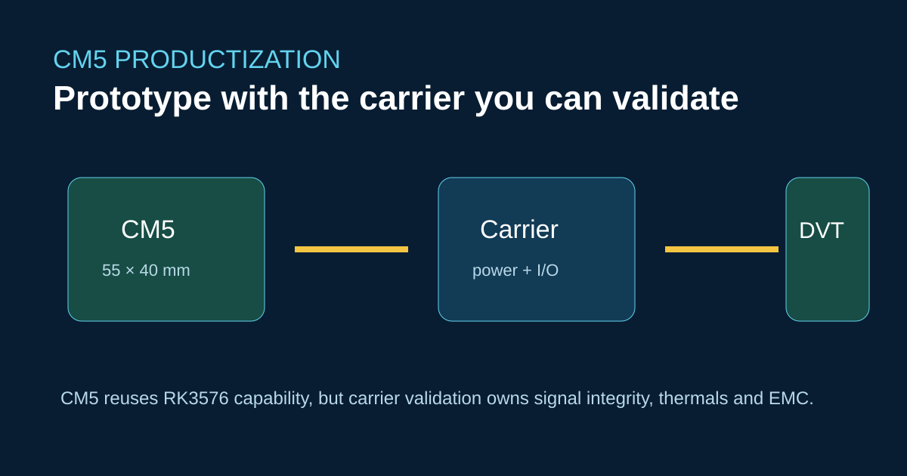
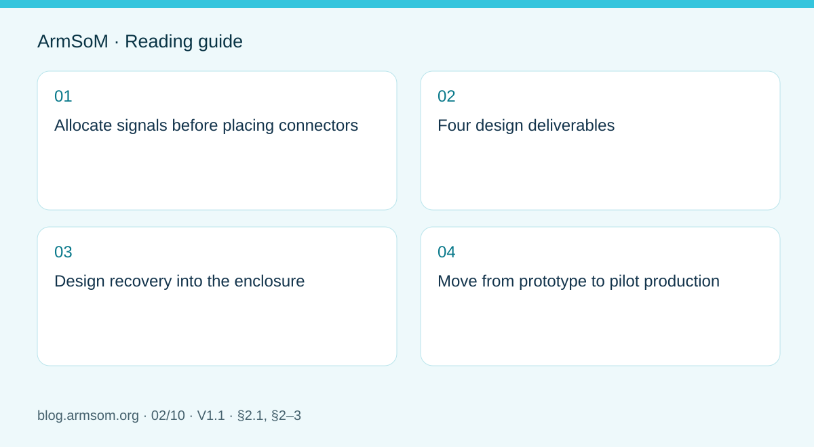

# ArmSoM CM5 Carrier-Board Design: From Raspberry Pi Prototype to Product



The CM5 is a 55 × 40 mm RK3576 compute module. It can shorten a product schedule, but it moves risk into the carrier: power sequencing, high-speed routing, connector selection, thermal transfer and manufacturing test.

## Bring-up order

Start with power rails and serial console. Add one high-speed interface at a time, then validate USB, PCIe, camera, display and Ethernet under load. Keep a revisioned pin map; do not copy a Raspberry Pi schematic by signal name alone.

```bash
uname -a
cat /proc/device-tree/model
dmesg | grep -iE 'pcie|usb|dwc3|eth|drm'
```

ArmSoM notes a CM5 v1.2 pin-21 issue fixed in v1.3; production documentation should lock the module revision and test the affected net.

## Why it is not a drop-in

The module has RK3576 compute and documented CSI/PCIe/USB resources, but a custom carrier defines the actual connectors and electrical behavior. Jetson Nano carrier assumptions, CUDA dependencies and boot tooling do not transfer.

## References

- [CM5 product introduction](https://docs.armsom.org/armsom-cm5)
- [CM5-IO companion board](https://docs.armsom.org/armsom-cm5-io)
- [RK3576 overview](https://docs.armsom.org/blog/rk3576-sbc)

## Pre-publication check

- [ ] Freeze module revision and pin map.
- [ ] Include SI, thermal and EMC validation ownership.
- [ ] Test recovery and factory programming on the carrier.

<!-- hardware-design-series expansion -->



## Scope and sources

This is a task-focused engineering guide, not a page-by-page translation of the complete PDF. Source examples are not ArmSoM measurements. Check voltages, pins, SDK/BSP and kernel against the actual board revision.

**Rockchip:** `RK3576_Hardware_Design_Guide_V1.1_20240528_CN.pdf` · V1.1 · §2.1, §2–3

## Allocate signals before placing connectors

For each requirement, record function, signal, module pin, supply domain, software configuration and test method. A camera needs control, clock, reset and power as well as CSI data. A display also needs touch, backlight and sequencing. Matching connector shapes do not establish electrical compatibility.

The RK3576 guide defines chip constraints; CM5 documentation defines the module boundary; the carrier schematic defines the connection. Do not reproduce DDR or core-power circuits already implemented on the module. A Raspberry Pi migration requires checks of pin assignments, power, mechanics, drivers and images rather than a shape-based drop-in claim.

## Four design deliverables

| Deliverable | Question it must answer |
| --- | --- |
| Pin assignment | Any mux conflicts, reserved-pin misuse or voltage mismatch? |
| Power budget | Are module and peripheral peak loads and startup covered? |
| PCB constraints | What impedance, length budget, reference plane and connector apply to each interface? |
| Test matrix | How will boot, recovery, heat, concurrency and power loss be tested? |

Chapters 2–3 of the source provide a review structure, but values must match the interface and topology. Do not assign the entire reference-board channel budget to the carrier: the module, board-to-board connector and cable also consume it.

## Design recovery into the enclosure

Fix serial access, recovery controls and programming contacts before freezing mechanics. The assembled product should retain a controlled recovery path. Establish an image on a known-good module and IO board, then move the same module, image and peripherals to the new carrier.

After first boot, test USB hotplug, storage, display changes and cameras separately, then combine them into a representative workload. Retain failures, supply conditions and ambient temperature, not only successful screenshots.

## Move from prototype to pilot production

Freeze module revision, BOM, connector part numbers, stackup and image. Record serial numbers and results per unit. Treat successful boot, working interfaces and sustained-load stability as separate checks. Reassess affected tests after changing module revisions or peripherals.

CM5 lets a project focus on its own interfaces, enclosure and application while using integrated compute and memory. It does not establish compatibility with every third-party carrier, and this article does not claim hardware validation.

## Source illustration

[](/assets/hardware-design-series/rk3576-en.png)

Original from the English document, shared by EN/RU/DE. Reference design, not an ArmSoM board schematic.

`RK3576_Hardware_Design_Guide_V1.1_20240528_EN.pdf` · PDF p. 22.

## Products and development resources

- **CM5** — [Product page](https://www.armsom.org/cm5) · [Documentation](https://docs.armsom.org/armsom-cm5)

## Continue this series

- [RK3576 hardware bring-up: minimum system and first-power checks](/articles/rk3576-hardware-bringup/)
- [RK3576 high-speed interfaces: review schematics and PCB together](/articles/rk3576-high-speed-interface-design/)
- [RK3588S hardware design: from a reference circuit to a CM7s carrier](/articles/rk3588s-cm7s-carrier-design/)
- [RK3588 edge-AI hardware: plan power, cooling and expansion together](/articles/rk3588-edge-ai-hardware-design/)
- [RK3588 high-speed PCB review: stackup, impedance and routing](/articles/rk3588-high-speed-pcb-review/)
- [RK3506 industrial HMI hardware: choosing a CM1 or Forge1 development path](/articles/rk3506-industrial-hmi-hardware/)
- [RK3308 hardware variants: compatibility checks for P2 Pro audio projects](/articles/rk3308-hardware-variant-compatibility/)
- [RK3588S versus RK3588S2: what to check before a hardware revision](/articles/rk3588s-rk3588s2-hardware-differences/)
- [Rockchip prototype to production: process requirements and test records](/articles/rockchip-hardware-production-checklist/)
