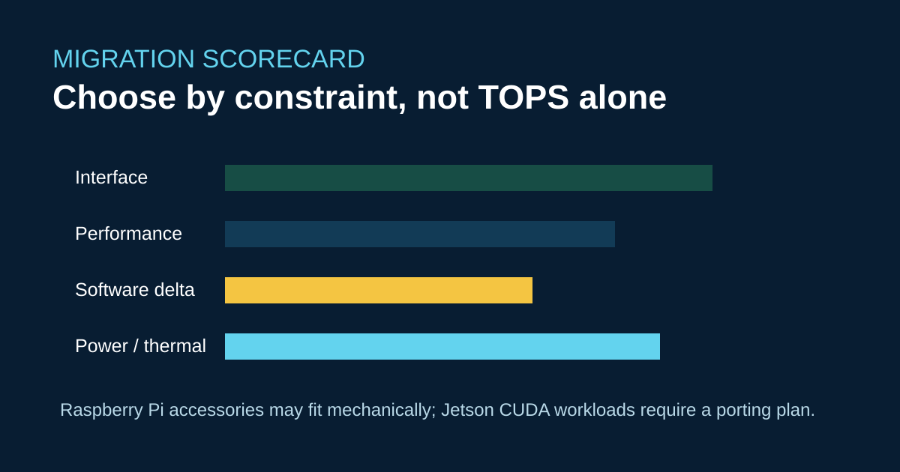

# ArmSoM Migration Scorecard: Sige5, Sige7, CM5 and Forge1



The best replacement is the board that minimizes total engineering risk. Start with interfaces and software, then use CPU/GPU/NPU figures as constraints—not as a promise of application performance.

## Four candidate profiles

- **Sige5 / RK3576:** complete SBC, dual Gigabit Ethernet, 6 TOPS INT8 NPU, 4K-class media, 5–23 V input.
- **Sige7 / RK3588:** higher CPU/media headroom, up to 32 GB memory, 8K-class codec capabilities, more demanding thermal validation.
- **CM5 / RK3576:** 55 × 40 mm module for a custom carrier; carrier design becomes the main risk.
- **Forge1 / RK3506J:** industrial control and HMI, 512 MB DDR3L, dual 100 Mb Ethernet, RS485/CAN, -40 °C to 85 °C.

Use this worksheet before ordering production units:

```text
interface fit = connectors + voltage + timing + driver evidence
software delta = BSP + device tree + AI runtime + update/recovery
field cost = thermal + EMC + test fixtures + service plan
```

Raspberry Pi accessories may reduce mechanical work, but BCM numbering and libcamera assumptions still require a port. Jetson CUDA/TensorRT applications require a deliberate Rockchip/RKNN migration and accuracy/latency re-validation.

## References

- [Sige5](https://docs.armsom.org/armsom-sige5)
- [Sige7](https://docs.armsom.org/armsom-sige7)
- [CM5](https://docs.armsom.org/armsom-cm5)
- [Forge1](https://docs.armsom.org/zh/armsom-forge1)

## Pre-publication check

- [ ] Fill the scorecard with measured interface and workload evidence.
- [ ] Price software migration and field recovery, not only BOM cost.
- [ ] Keep “compatible,” “portable” and “drop-in” as separate claims.
