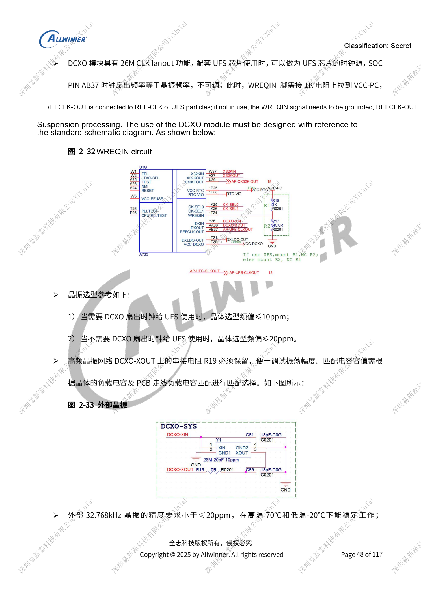
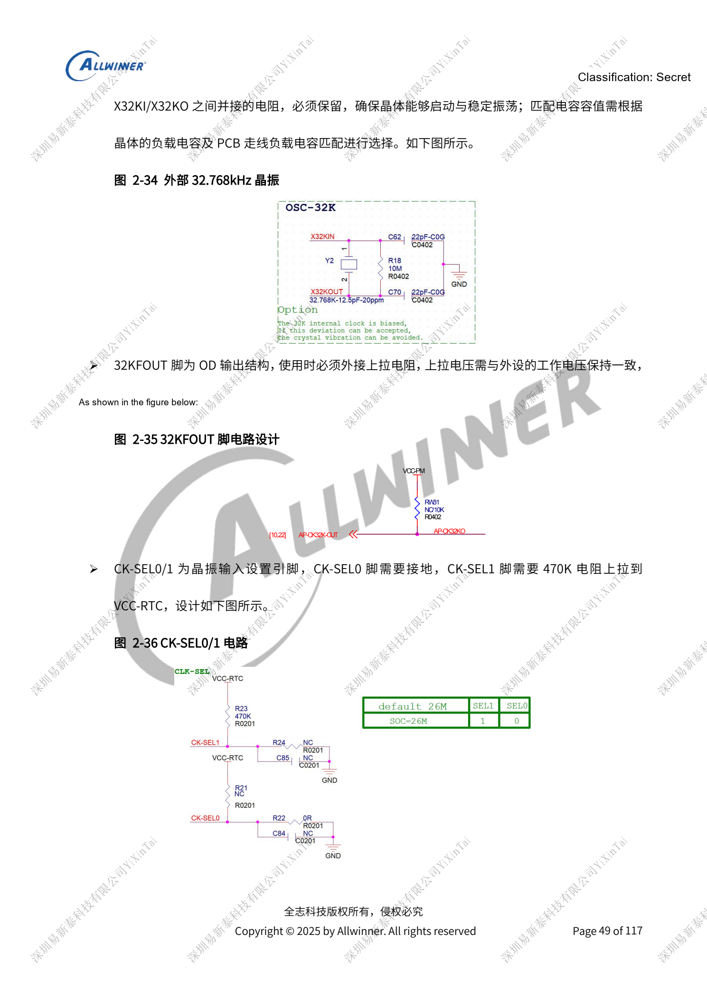
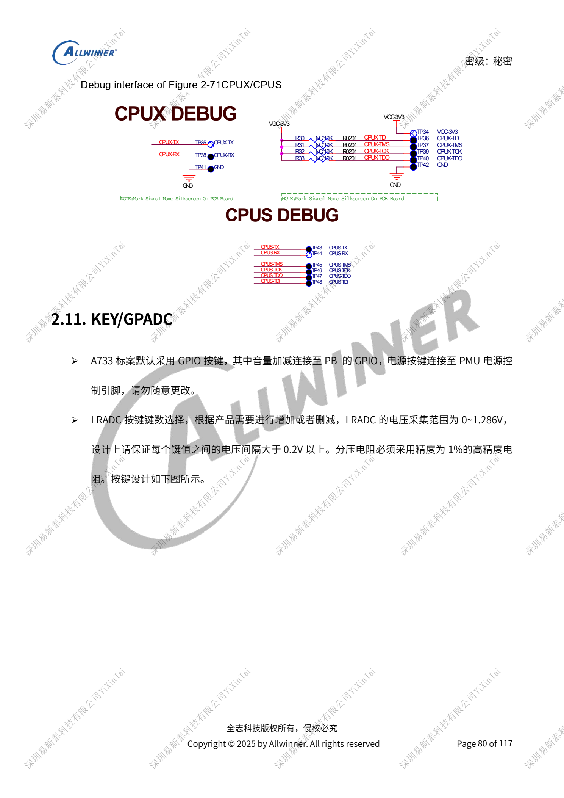

# A733 clocks and recovery: 26MHz, GPIO domains and FEL

This is a source-based hardware design topic for platform reference; no corresponding ArmSoM board is confirmed. Parameters are source references, not ArmSoM measurements. Check silicon revision, PCB, SDK/BSP, kernel, firmware and peripheral specifications before implementation.

The A733 source is a V0.9 draft; parameters and software support may change. It is not a final production commitment.

**Design draft V0.9 §2.3, §2.10–2.11; PDF 45–54, 80–83**

## Do not reuse the H618 24MHz circuit

This A733 draft specifies 26MHz only. AB37 fanout equals the crystal frequency and is not adjustable: ≤10ppm for UFS, otherwise ≤20ppm. With REFCLK-OUT, pull WREQIN to VCC-PC through 1kΩ; otherwise ground WREQIN and leave REFCLK-OUT open. Retain XOUT resistance and select capacitors from crystal CL and PCB parasitics. Ground CK-SEL0; pull CK-SEL1 to VCC-RTC through 470kΩ. Open-drain 32KFOUT needs a peripheral-compatible pull-up. Precise wake timing uses an external 32.768kHz crystal, reference ≤20ppm and stable operation from -20 to 70°C.

## Boot and debugging pins

High JTAG-SEL permits software PF/PB selection; low forces PB. Leave TEST open without a long stub. Low FEL requests flashing; retain 1nF on FEL/GPADC keys. AP-RESET/AP-NMI each retain 1nF, with open-drain NMI pulled to VCC-RTC. Keep CPUX JTAG or UART; prefer PF debugging, reserve PB UART0 jumpers, and expose CPUS PL/PM test points for standby issues. Preserve UBOOT/FEL or volume-plus-POWER recovery. LRADC is 0–1.286V with >0.2V key spacing and 1% dividers; GPADC separately specifies 12-bit resolution, 10-bit accuracy and 0–AVCC range.

## GPIO domains and boot side effects

PL/PM are always-on CPUS domains, reference PL=3.3V and PM=1.8V. Wake interrupts and pull-ups must stay in the correct powered domain. PL0/1 is the PMIC, charger and Type-C control bus, with internal 4.7kΩ and reference external 2.2kΩ pull-ups, not an arbitrary peripheral bus. PC/PF emit storage probes during boot and must not directly control amplifiers, LEDs or sensors. Pull-ups follow their IO domain; supply changes require matching software voltage configuration to avoid backfeed and standby leakage.

## Reference figures

These reference-page captures retain the original Chinese figure labels. No matching English edition was found; all four languages use the Chinese originals. Text parameters and steps remain copyable; captures support checking. Page numbers are physical PDF pages.

## Choosing an ArmSoM platform

For an ArmSoM project, select a platform through official products and documentation, then verify processor, interfaces and software support anew. A733/H618 circuits are not transferred to another SoC by assumption.

- [ArmSoM](https://www.armsom.org/)
- [ArmSoM Docs](https://docs.armsom.org/)

## Series reading

- [A733 power system: AXP318W, sequencing and charging paths](/articles/a733-power-sequence-pmic-design/)
- [A733 memory design: LPDDR4/4X/5, eMMC and UFS](/articles/a733-ddr-emmc-ufs-design/)
- [A733 display and cameras: multiplexing, power and input bridges](/articles/a733-display-camera-interface-design/)
- [A733 peripherals: USB, PCIe, Wi-Fi, Ethernet and audio](/articles/a733-usb-pcie-network-audio-design/)
- [A733 reliability: ESD, EMI, surge and thermal review](/articles/a733-esd-emi-thermal-review/)
- [A733 · Series index](/articles/a733-hardware-design-series/)
