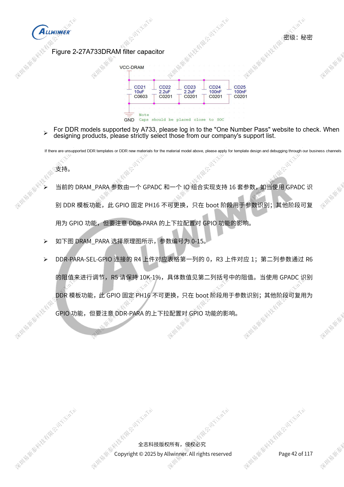
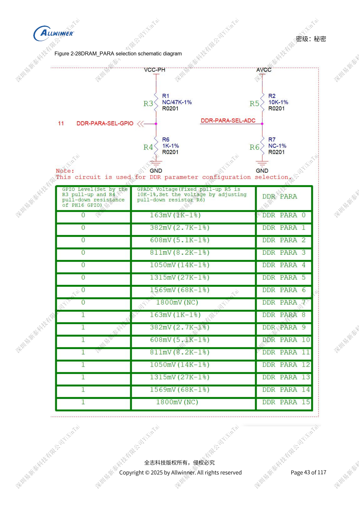
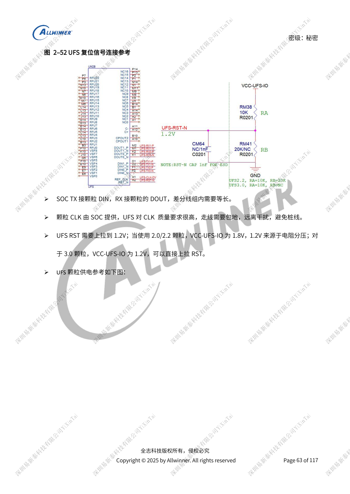

# A733 memory design: LPDDR4/4X/5, eMMC and UFS

This is a source-based hardware design topic for platform reference; no corresponding ArmSoM board is confirmed. Parameters are source references, not ArmSoM measurements. Check silicon revision, PCB, SDK/BSP, kernel, firmware and peripheral specifications before implementation.

The A733 source is a V0.9 draft; parameters and software support may change. It is not a final production commitment.

**Design draft V0.9 §2.2, §2.4–2.6; PDF 41–44, 55–65**

## Equal DDR voltages do not make rails interchangeable

Choose type, chip selects and width before selecting a matched schematic/PCB template; preserve reference designators. Differential impedance is 85Ω, single-ended 50Ω. SoC SZQ uses a 120Ω, 1% pull-down; the device-side reference is 240Ω, 1% to VCC-VDDQ, subject to the actual memory. GPADC plus fixed PH16 selects 16 DRAM_PARA sets numbered 0–15. Later GPIO reuse must account for boot straps. Retain capacitor footprints and debugging provisions until validation permits changes.

## eMMC and SD have different constraints

HS200/HS400 require 1.8V VCCQ and PC domain with monotonic startup. HS400 at 200MHz recommends <1000mil; the general section separately allows <2000mil and ≤300mil mismatch to CLK. Do not substitute the general limit for the faster mode. Use 33Ω at the SoC clock, 50Ω routing and floating NC/RFU. SD3.0 needs both 3.3V/1.8V supplies for internal switching. Clock shunt capacitance ≤15pF; TVS ≤5pF for SD3.0 and <35pF for SD2.0; retain 1kΩ on DET. Metal card trays need soft start; do not replace supply protection with a simple 0Ω link.

## Match UFS generation before wiring power

The interface has two lanes, up to 11.6Gbps/lane in the draft; UFS3.1 is limited to storage functionality. UFS2.0/2.2 uses VCCQ2=1.8V and VCC=3.3V; 3.0/3.1 uses VCCQ=1.2V and VCC=2.5V default, optionally 3.3V. Configure DC8SET and PMIC outputs together. TX connects to DIN and RX to DOUT. RST targets 1.2V, requiring a divider for the 1.8V IO design. Shield the SoC-provided clock without stubs. Supply ripple <5%, traces >30mil and at least 600mA capacity. Unused UFS signals may float, but required supplies remain powered.

## Parameter reference

| Item | Source reference |
| --- | --- |
| Supply domain | LPDDR4 / LPDDR4X / LPDDR5 |
| VCC-DRAM: DCDC7 | 1.1V / 1.1V / 1.05V |
| VCC-DRAML: DCDC6 | 0.8V / 0.6V / 0.5V |
| Device VCC-VDDQ | DCDC7 1.1V / DCDC6 0.6V / DCDC6 0.5V |
| LPDDR5 VDD2L | ELDO1 0.9V |
| Device / SoC 1.8V | CLDO1 / CLDO3 |

## Reference figures

These reference-page captures retain the original Chinese figure labels. No matching English edition was found; all four languages use the Chinese originals. Text parameters and steps remain copyable; captures support checking. Page numbers are physical PDF pages.

## Choosing an ArmSoM platform

For an ArmSoM project, select a platform through official products and documentation, then verify processor, interfaces and software support anew. A733/H618 circuits are not transferred to another SoC by assumption.

- [ArmSoM](https://www.armsom.org/)
- [ArmSoM Docs](https://docs.armsom.org/)

## Series reading

- [A733 power system: AXP318W, sequencing and charging paths](/articles/a733-power-sequence-pmic-design/)
- [A733 clocks and recovery: 26MHz, GPIO domains and FEL](/articles/a733-clock-gpio-recovery-design/)
- [A733 display and cameras: multiplexing, power and input bridges](/articles/a733-display-camera-interface-design/)
- [A733 peripherals: USB, PCIe, Wi-Fi, Ethernet and audio](/articles/a733-usb-pcie-network-audio-design/)
- [A733 reliability: ESD, EMI, surge and thermal review](/articles/a733-esd-emi-thermal-review/)
- [A733 · Series index](/articles/a733-hardware-design-series/)
