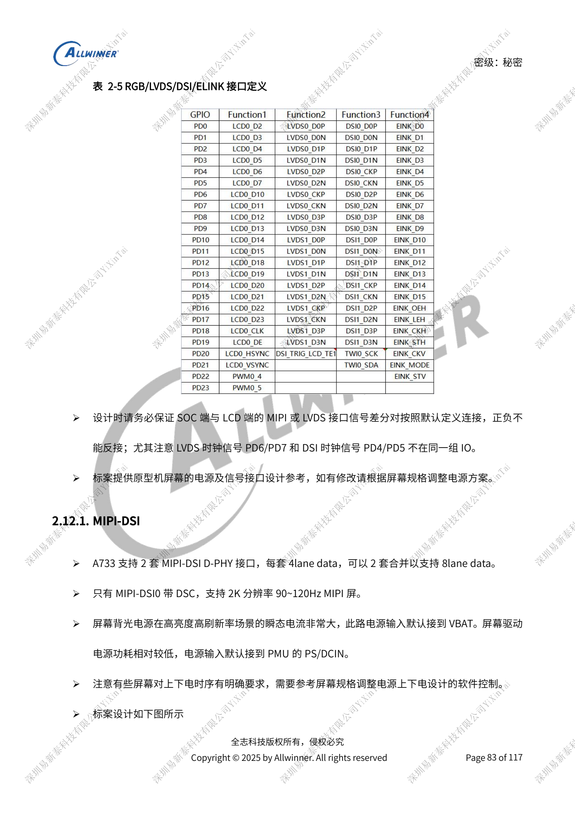
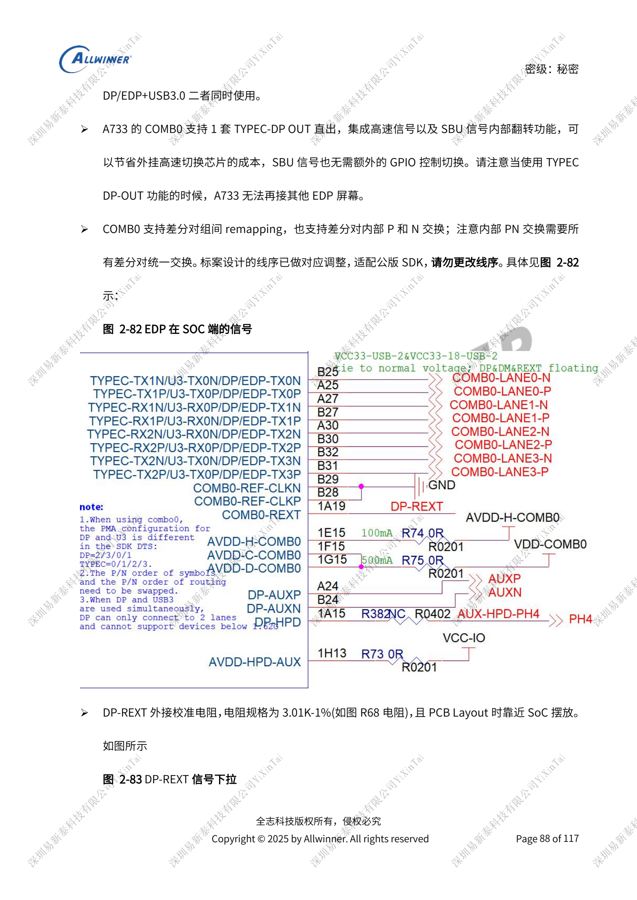
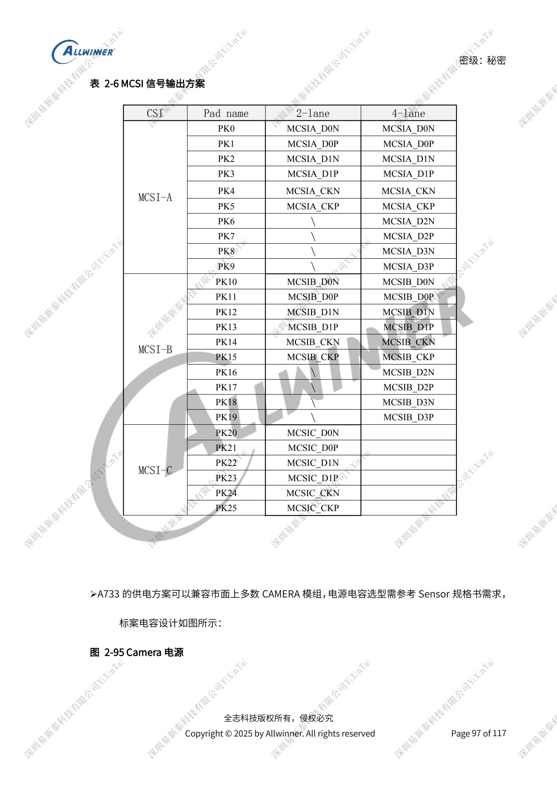

# A733 display and cameras: multiplexing, power and input bridges

This is a source-based hardware design topic for platform reference; no corresponding ArmSoM board is confirmed. Parameters are source references, not ArmSoM measurements. Check silicon revision, PCB, SDK/BSP, kernel, firmware and peripheral specifications before implementation.

The A733 source is a V0.9 draft; parameters and software support may change. It is not a final production commitment.

**Design draft V0.9 §2.12–2.15, §2.18–2.19; PDF 83–100, 102–106**

## Start with a display resource map

Two four-lane MIPI-DSI interfaces can combine into eight lanes; only DSI0 has DSC. Four LVDS sets each have four data lanes: single-link 1366×768@60Hz, dual-link 1920×1080@60Hz. RGB888 spans PD/PB; D0/1/8/9/16/17 are 3.3V signals in another domain. LVDS clock PD6/PD7 differs from DSI clock PD4/PD5; connector similarity does not establish compatibility. SPI incell uses SPI1, but panel pinouts and supplies vary. Backlight PWM is above 20kHz, reference 30–50kHz; assess bright-panel transients with the power design.

## DP and USB share COMB0

DP/eDP exits only through COMB0. Four-lane mode excludes USB3; two-lane mode can coexist. Do not promise Type-C DP-OUT plus a separate eDP panel. Internal lane reversal is supported, but P/N swapping must apply consistently to all differential pairs; the reference order matches the SDK. DP-REXT is 3.01kΩ, 1%; eDP uses 100Ω and 100nF coupling, with a 95Ω reference for shared Type-C USB3/DP. Keep required rails powered even if unused. HDMI OUT 2.0 reaches 4K60; its 0.8V/1.8V stay powered, REXT is 1.62kΩ, 1%, and pairs are 100Ω.

## Cameras and external video input

MCSIA/B each provide four lanes and MCSIC two, reference maximum 2Gbps/lane, alternatively NCSI. Camera reassignment requires software changes. Use 33Ω near the SoC MCLK and reserve capacitance near the connector. Keep AVDD-CSI clean and separate; sharing focus/digital supplies depends on sequence, voltage and current. Retain TWI pull-ups and avoid unrelated shared devices or conflicting simultaneous sensor addresses. A733 has no native HDMI input; the guide uses a CSI bridge with an HDMI1.4 reference maximum. DP input likewise uses an external LT7911D, not a native receiver. The prose calls its output MIPI DSI while referring to CAMERA: verify protocol direction with the bridge documentation.

## Reference figures

These reference-page captures retain the original Chinese figure labels. No matching English edition was found; all four languages use the Chinese originals. Text parameters and steps remain copyable; captures support checking. Page numbers are physical PDF pages.

## Choosing an ArmSoM platform

For an ArmSoM project, select a platform through official products and documentation, then verify processor, interfaces and software support anew. A733/H618 circuits are not transferred to another SoC by assumption.

- [ArmSoM](https://www.armsom.org/)
- [ArmSoM Docs](https://docs.armsom.org/)

## Series reading

- [A733 power system: AXP318W, sequencing and charging paths](/articles/a733-power-sequence-pmic-design/)
- [A733 memory design: LPDDR4/4X/5, eMMC and UFS](/articles/a733-ddr-emmc-ufs-design/)
- [A733 clocks and recovery: 26MHz, GPIO domains and FEL](/articles/a733-clock-gpio-recovery-design/)
- [A733 peripherals: USB, PCIe, Wi-Fi, Ethernet and audio](/articles/a733-usb-pcie-network-audio-design/)
- [A733 reliability: ESD, EMI, surge and thermal review](/articles/a733-esd-emi-thermal-review/)
- [A733 · Series index](/articles/a733-hardware-design-series/)

<!-- editable-source-tables -->

## Appendix: complete MCSI pin mapping

V0.9 · Table 2-6 · PDF 98

| CSI | Pad | 2-lane | 4-lane |
| --- | --- | --- | --- |
| MCSI-A | PK0 | MCSIA_D0N | MCSIA_D0N |
| MCSI-A | PK1 | MCSIA_D0P | MCSIA_D0P |
| MCSI-A | PK2 | MCSIA_D1N | MCSIA_D1N |
| MCSI-A | PK3 | MCSIA_D1P | MCSIA_D1P |
| MCSI-A | PK4 | MCSIA_CKN | MCSIA_CKN |
| MCSI-A | PK5 | MCSIA_CKP | MCSIA_CKP |
| MCSI-A | PK6 | \ | MCSIA_D2N |
| MCSI-A | PK7 | \ | MCSIA_D2P |
| MCSI-A | PK8 | \ | MCSIA_D3N |
| MCSI-A | PK9 | \ | MCSIA_D3P |
| MCSI-B | PK10 | MCSIB_D0N | MCSIB_D0N |
| MCSI-B | PK11 | MCSIB_D0P | MCSIB_D0P |
| MCSI-B | PK12 | MCSIB_D1N | MCSIB_D1N |
| MCSI-B | PK13 | MCSIB_D1P | MCSIB_D1P |
| MCSI-B | PK14 | MCSIB_CKN | MCSIB_CKN |
| MCSI-B | PK15 | MCSIB_CKP | MCSIB_CKP |
| MCSI-B | PK16 | \ | MCSIB_D2N |
| MCSI-B | PK17 | \ | MCSIB_D2P |
| MCSI-B | PK18 | \ | MCSIB_D3N |
| MCSI-B | PK19 | \ | MCSIB_D3P |
| MCSI-C | PK20 | MCSIC_D0N | — |
| MCSI-C | PK21 | MCSIC_D0P | — |
| MCSI-C | PK22 | MCSIC_D1N | — |
| MCSI-C | PK23 | MCSIC_D1P | — |
| MCSI-C | PK24 | MCSIC_CKN | — |
| MCSI-C | PK25 | MCSIC_CKP | — |
