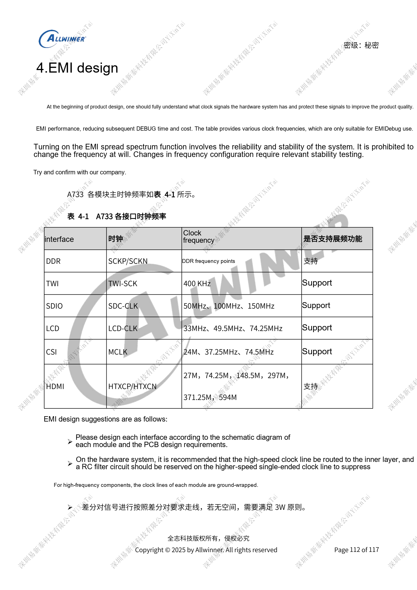
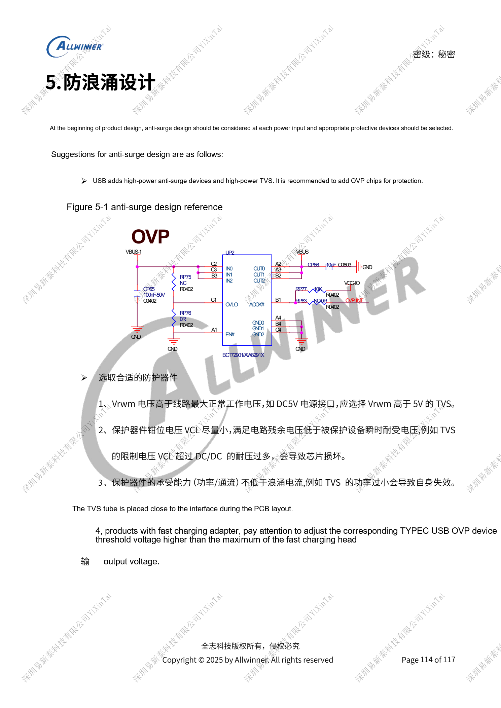

# A733 reliability: ESD, EMI, surge and thermal review

This is a source-based hardware design topic for platform reference; no corresponding ArmSoM board is confirmed. Parameters are source references, not ArmSoM measurements. Check silicon revision, PCB, SDK/BSP, kernel, firmware and peripheral specifications before implementation.

The A733 source is a V0.9 draft; parameters and software support may change. It is not a final production commitment.

**Design draft V0.9 §3–6; PDF 110–116**

## ESD is more than a TVS near a port

Protect exposed headphone, USB, TF, microphone and button circuits. Reserve series resistance on detection pins; SoC reset retains its fixed 1nF. Do not extend unused sensitive TEST pins into long stubs. Put daughterboard protection on the daughterboard and discharge locally to display metal through conductive foam instead of routing ESD through the FPC. Reserve multiple exposed ground pads of at least 25mm² around both PCB faces, via-connected to continuous ground. Display, touch and camera resets and watchdogs are recovery strategies, not proof of ESD qualification.

## Start EMI work with a clock inventory

Route fast clocks on inner layers with source RC provisions, continuous references and shielding. Review differential spacing when shielding is impractical. Avoid components/traces beneath cables; shield long flexes and ground daughterboards effectively. Twist speaker wires. The source clock table supports diagnosis, not arbitrary changes to DDR/display frequency or spread spectrum when a spectral peak appears. Such changes need stability validation. When USB and BMU share DP/DM, place BMU branch resistors near the fork to control stubs.

## Surge and thermal acceptance boundaries

Choose TVS Vrwm above the highest normal operating voltage, clamped residual voltage below device transient tolerance, and power/current capability covering the target surge. Place it at the entrance; select fast-charge OVP thresholds against the highest adapter output. Nominal TVS voltage alone is insufficient. Measure temperature in the actual product and log CPU/DDR throttling or core shutdown with performance changes. DVFS does not replace a thermal path. Sections 3.2 and 6 reference separate PCB and thermal guides without complete routing or thermal-resistance data; this article cannot establish thermal qualification or certification.

## Parameter reference

| Item | Source reference |
| --- | --- |
| Source EMI clock references | TWI 400kHz; SDIO 50/100/150MHz; LCD 33/49.5/74.25MHz; CSI MCLK 24/37.25/74.5MHz; HDMI 27/74.25/148.5/297/371.25/594MHz |

## Reference figures

These reference-page captures retain the original Chinese figure labels. No matching English edition was found; all four languages use the Chinese originals. Text parameters and steps remain copyable; captures support checking. Page numbers are physical PDF pages.

## Choosing an ArmSoM platform

For an ArmSoM project, select a platform through official products and documentation, then verify processor, interfaces and software support anew. A733/H618 circuits are not transferred to another SoC by assumption.

- [ArmSoM](https://www.armsom.org/)
- [ArmSoM Docs](https://docs.armsom.org/)

## Series reading

- [A733 power system: AXP318W, sequencing and charging paths](/articles/a733-power-sequence-pmic-design/)
- [A733 memory design: LPDDR4/4X/5, eMMC and UFS](/articles/a733-ddr-emmc-ufs-design/)
- [A733 clocks and recovery: 26MHz, GPIO domains and FEL](/articles/a733-clock-gpio-recovery-design/)
- [A733 display and cameras: multiplexing, power and input bridges](/articles/a733-display-camera-interface-design/)
- [A733 peripherals: USB, PCIe, Wi-Fi, Ethernet and audio](/articles/a733-usb-pcie-network-audio-design/)
- [A733 · Series index](/articles/a733-hardware-design-series/)
