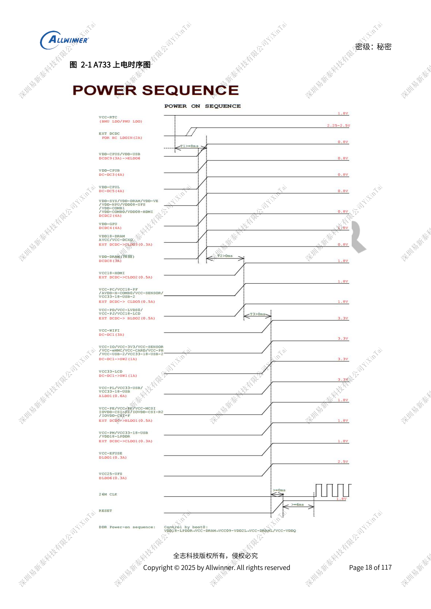
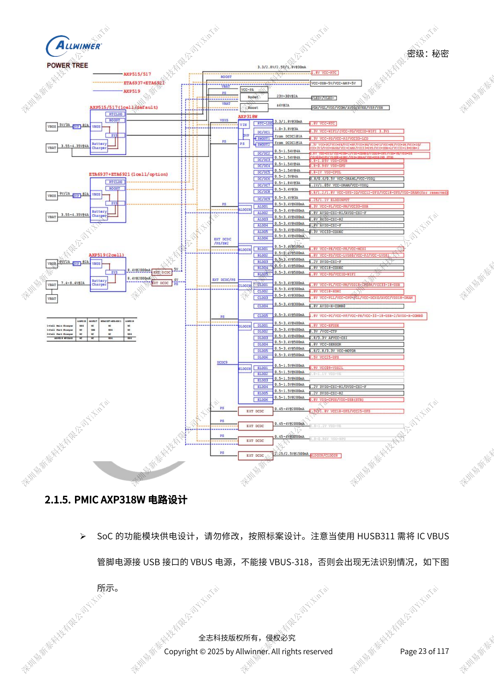
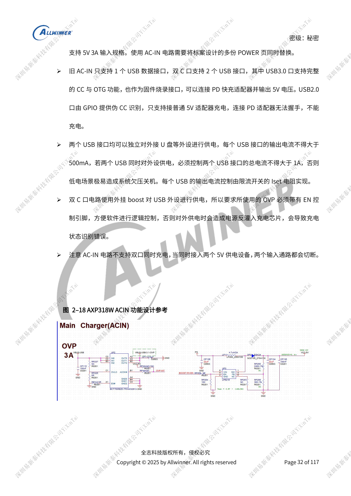

# A733 power system: AXP318W, sequencing and charging paths

This is a source-based hardware design topic for platform reference; no corresponding ArmSoM board is confirmed. Parameters are source references, not ArmSoM measurements. Check silicon revision, PCB, SDK/BSP, kernel, firmware and peripheral specifications before implementation.

The A733 source is a V0.9 draft; parameters and software support may change. It is not a final production commitment.

**Design draft V0.9 §2.1; PDF 17–41**

## Preserve the reference power tree

AXP318W provides nine DCDCs, two switches and 29 LDOs; DCDC2–9 use COT. Do not reorder preprogrammed rails or reassign shared DCXO/PLL supplies simply because voltages match. VCC-RTC rises first and remains powered. Reset releases after three stable supply steps; the main oscillator starts 6ms after PMU_RESET release. BOOT0 enables DDR with VDD18-LPDDR≥VCC-DRAM≥VCC09-VDD2L≥VCC-VDDQ. Software shutdown lowers Reset and waits one STEP before power removal. A 6s hard shutdown or battery removal does not follow this sequence.

## Feedback and stability

DCDC2/3/4/5 feed back from the SoC SYS/CPUB/GPU/CPUL feedback pins. DCDC7 senses at the SoC or DRAM load capacitor, not directly at the PMU output capacitor. COT DCDC2–9 allow one 22µF at the PMU; other bulk capacitors belong at the load. Adding capacitance indiscriminately can upset loop stability. Keep inputs powered even for unused DCDC/LDO outputs. The SW1/SW2 G15/H15 input path must carry at least 2A. ALDO2/3/4 use ALDO1 as input for PSRR; DLDO retains PS input.

## Input, charging and transient loads

Connect HUSB311 VBUS to connector VBUS, not VBUS-318. A validated DCIN–PS bypass belongs only to the corresponding charger/OVP-protected design, never blindly to a chargerless system. The dual-Type-C reference cannot charge through both ports simultaneously. The USB2.0 pseudo-CC port does not negotiate with PD adapters; external power is ≤500mA per port and ≤1A total. AXP515 references 5V/2A; the AXP519 two-cell design defaults to PD 9V/2A, requiring appropriate OVP thresholds. Measure backlight/amplifier transients across battery protection, connector, BMU and PMU. The two-cell design also needs AXP2602 gauging, with IRQ to CPUS rather than directly to system IRQ.

## Parameter reference

| Item | Source reference |
| --- | --- |
| DCDC1/6/7/8/9 inductors | 1µH; 4A; load ≤80%; DCR <100mΩ |
| DCDC2/3/4/5 inductors | 0.33µH; 4A; load ≤80%; DCR <100mΩ |
| Batteryless droop default threshold | 2.8V; software configurable |
| AXP519 inductor reference | 2.2µH; ≥3.5A; load ≤80% saturation current; DCR <100mΩ |

## Reference figures

These reference-page captures retain the original Chinese figure labels. No matching English edition was found; all four languages use the Chinese originals. Text parameters and steps remain copyable; captures support checking. Page numbers are physical PDF pages.

## Choosing an ArmSoM platform

For an ArmSoM project, select a platform through official products and documentation, then verify processor, interfaces and software support anew. A733/H618 circuits are not transferred to another SoC by assumption.

- [ArmSoM](https://www.armsom.org/)
- [ArmSoM Docs](https://docs.armsom.org/)

## Series reading

- [A733 memory design: LPDDR4/4X/5, eMMC and UFS](/articles/a733-ddr-emmc-ufs-design/)
- [A733 clocks and recovery: 26MHz, GPIO domains and FEL](/articles/a733-clock-gpio-recovery-design/)
- [A733 display and cameras: multiplexing, power and input bridges](/articles/a733-display-camera-interface-design/)
- [A733 peripherals: USB, PCIe, Wi-Fi, Ethernet and audio](/articles/a733-usb-pcie-network-audio-design/)
- [A733 reliability: ESD, EMI, surge and thermal review](/articles/a733-esd-emi-thermal-review/)
- [A733 · Series index](/articles/a733-hardware-design-series/)

<!-- editable-source-tables -->

## Appendix: SoC-side decoupling

V0.9 · PDF 53

The source says “or greater”, retained as ≥. Check DC-bias derating, package and reference BOM together; nominal total capacitance does not replace individual parts.

| Rail | Listed capacitors | Reserved |
| --- | --- | --- |
| VDD-CPUB | 2 × ≥22µF; 1 × 10µF; 1 × 4.7µF; 3 × 2.2µF; 2 × 1µF | 1–2 × 100nF |
| VDD-CPUL | 2 × ≥22µF; 1 × 10µF; 1 × 4.7µF; 4 × 2.2µF; 4 × 1µF | — |
| VDD-GPU | 1 × ≥10µF; 4 × 2.2µF | 2–3 × 100nF |
| VDD-VE | 1 × ≥10µF; 1 × ≥4.7µF; 1 × 2.2µF; 1 × 1µF | 1–2 × 100nF |
| VDD-SYS | 2 × ≥22µF; 3 × 10µF; 2 × 4.7µF; 1 × 2.2µF; 3 × 1µF | 3–4 × 100nF |
| VCC-DRAM | 1 × ≥22µF; 1 × 10µF; 1 × 2.2µF; 4 × 1µF | 2–3 × 100nF |
