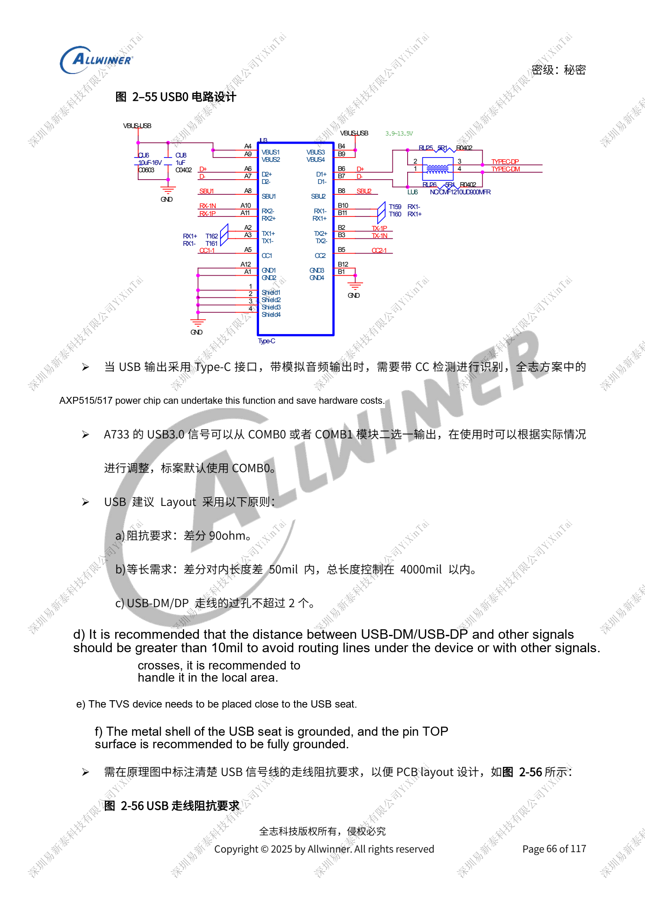
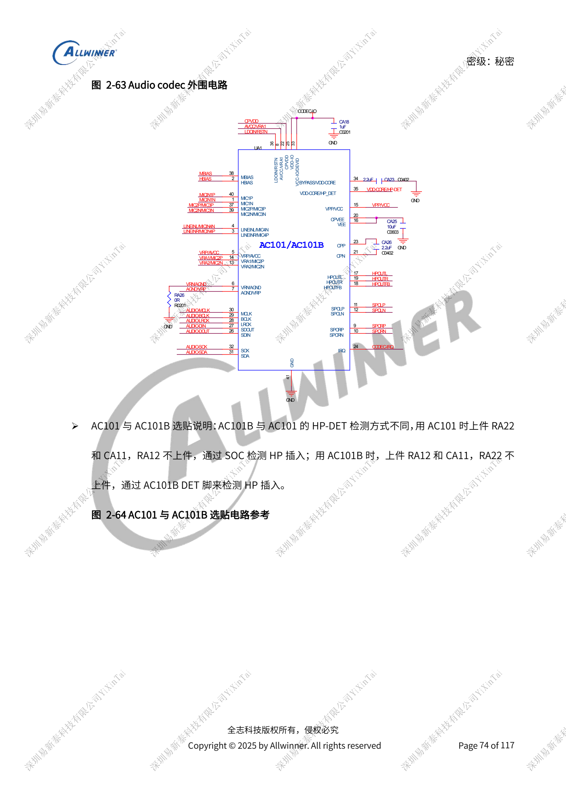
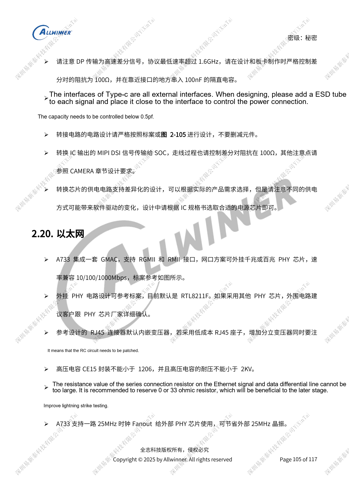
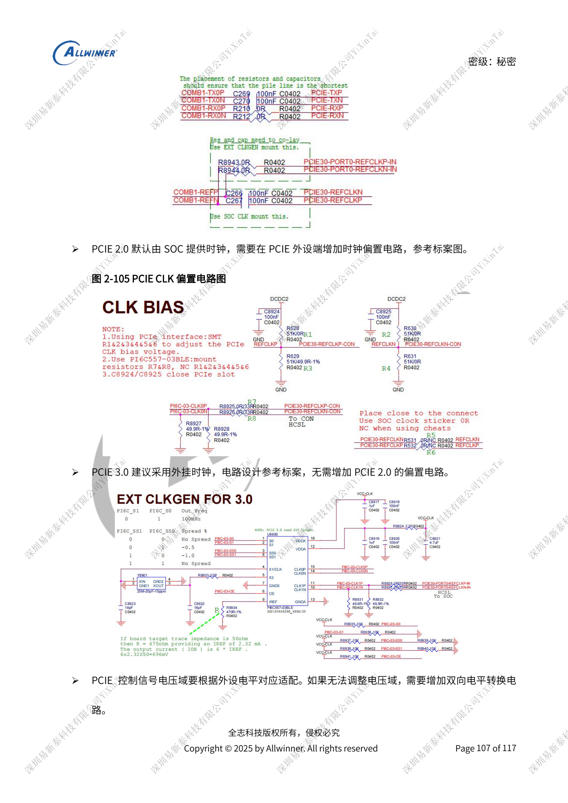

# A733 peripherals: USB, PCIe, Wi-Fi, Ethernet and audio

This is a source-based hardware design topic for platform reference; no corresponding ArmSoM board is confirmed. Parameters are source references, not ArmSoM measurements. Check silicon revision, PCB, SDK/BSP, kernel, firmware and peripheral specifications before implementation.

The A733 source is a V0.9 draft; parameters and software support may change. It is not a final production commitment.

**Design draft V0.9 §2.7–2.9, §2.14, §2.16–2.17, §2.20–2.21; PDF 65–80, 96–97, 101–108**

## USB controllers and PCIe clocks

USB0/1 are USB2.0; USB2-U3 is the up-to-10Gbps USB3.1 path. USB0/2 support OTG, USB1 is host-only, and flashing uses USB0. USB0/1 support wake from sleep; USB2 does not. Standard Type-C combines USB0 with USB2-U3. SuperSpeed can use COMB0/1, default COMB0. Controller numbers are not protocol generations. USB2 DP/DM protection references <5pF, SuperSpeed <1pF; generic 90Ω USB2 routing does not override the shared high-speed diagram at 95Ω. PCIe is one lane, 2.0/3.0: 2.0 uses SoC clock plus endpoint biasing; 3.0 recommends an external clock without that bias circuit.

## Wireless, Ethernet and sensors

Match Wi-Fi SDIO to PG and wake interrupts to PM; the 1.8V 32KFOUT pull-up must survive standby. Cross PCM DOUT/DIN, UART TX/RX and RTS/CTS; connect like-named clocks and sync. Reserve antenna π matching and perform conducted/matching tests on a new board. SDIO CLK uses 33Ω; D0–D3 to CLK mismatch <500mil. GMAC requires an external PHY, reference RTL8211F, with optional 25MHz SoC fanout; an RJ45 without magnetics requires an external transformer. Verify sensor VCC and IOVCC separately, avoid address conflicts and keep standby sensors powered with PL interrupts. GPS is an external module requiring 50Ω RF, startup-current and reset-backfeed review, not an integrated satellite receiver.

## Audio starts with return paths and enable states

AC101 has two ADCs/two DACs; AC101B has three ADCs/two DACs and different headphone-detect stuffing. AEC references AC107. Pull non-TWI amplifier EN low against pops; high-power amplifiers must not load PMU PS/DCIN. Battery-fed amplifiers connect after current sensing. Ground HPOUTFB near the headphone jack; do not insert beads in L/R. External amplifiers without a jack still need feedback and RC networks. Type-C analog-audio switching defaults to USB for flashing and remains powered for standby wake. With DP, the reference uses BCT4690, not incompatible WAS4766C. Validate stuffing and software detection polarity together.

## Reference figures

These reference-page captures retain the original Chinese figure labels. No matching English edition was found; all four languages use the Chinese originals. Text parameters and steps remain copyable; captures support checking. Page numbers are physical PDF pages.

## Choosing an ArmSoM platform

For an ArmSoM project, select a platform through official products and documentation, then verify processor, interfaces and software support anew. A733/H618 circuits are not transferred to another SoC by assumption.

- [ArmSoM](https://www.armsom.org/)
- [ArmSoM Docs](https://docs.armsom.org/)

## Series reading

- [A733 power system: AXP318W, sequencing and charging paths](/articles/a733-power-sequence-pmic-design/)
- [A733 memory design: LPDDR4/4X/5, eMMC and UFS](/articles/a733-ddr-emmc-ufs-design/)
- [A733 clocks and recovery: 26MHz, GPIO domains and FEL](/articles/a733-clock-gpio-recovery-design/)
- [A733 display and cameras: multiplexing, power and input bridges](/articles/a733-display-camera-interface-design/)
- [A733 reliability: ESD, EMI, surge and thermal review](/articles/a733-esd-emi-thermal-review/)
- [A733 · Series index](/articles/a733-hardware-design-series/)
