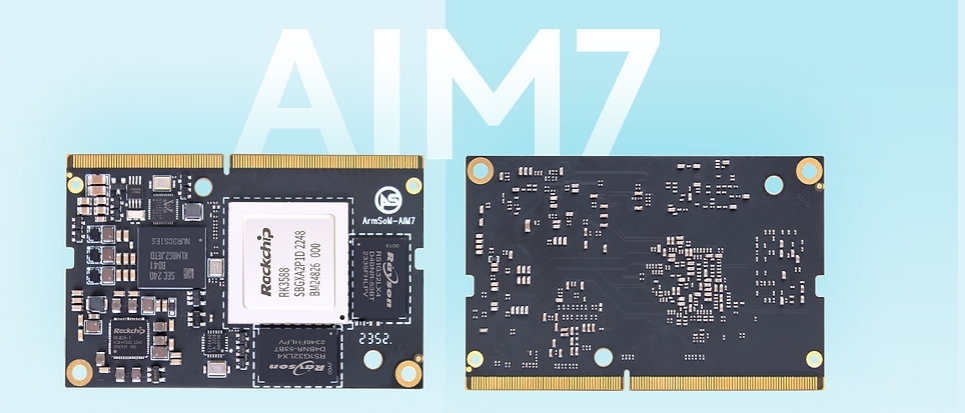

For a project using Jetson Nano or a particular Jetson Orin module, ArmSoM AIM7 offers an RK3588 platform to evaluate. CPU, GPU and NPU serve different roles. Suitability depends on the model, peripherals, software dependencies and complete-system requirements together.

## Nano and Orin are not one compatibility target

AIM7 documentation describes a 260-pin SO-DIMM design and a Jetson Nano compatibility path, while requiring carrier-specific pin, power and peripheral checks. **A matching connector does not prove universal carrier compatibility.**

Orin includes Orin Nano, Orin NX, AGX Orin and other variants. This article does not claim AIM7 is a universal plug-in replacement for them. Identify the exact module first and review its carrier. For an unverified combination, begin software evaluation on a validated AIM7 carrier.

## Projects worth evaluating

Prioritise systems whose business logic runs mainly on a Linux CPU, whose models can be exported and converted, whose camera/display choices remain flexible, and whose performance targets can be tested with real samples. Classification, detection, information terminals and video-event analysis are potential starting points.

A project built around custom CUDA operators, TensorRT plugins or NVIDIA-specific pipelines needs substantially more porting. Do not compare module prices without development, testing and maintenance costs, or promise parity with every Orin model.

## What changes from TensorRT to RKNN?

| Existing component | AIM7 evaluation path |
|---|---|
| Python/C++ application logic | Rebuild and test dependencies on the target Linux system |
| Original trained model | Export a supported representation, then convert with RKNN-Toolkit2 |
| TensorRT engine / CUDA operators | Not directly usable as an RKNN model; adapt backend and operators |
| Camera, display and video pipelines | Review Rockchip drivers and relevant acceleration interfaces |
| Containers | Rebuild for matching architecture, libraries and device access |

Rockchip's documented flow converts models on a development computer and executes them through C/C++ or Python interfaces on the board. Successful conversion is only the start: verify unsupported operators, quantisation accuracy, preprocessing and postprocessing.

## Decide with the same test set

1. Fix the original Jetson model, software versions and real inputs.
2. Record accuracy, P50/P95 latency, throughput, memory and whole-system power.
3. Use the same inputs and acceptance rules on AIM7; compare outputs before speed.
4. Add camera, network, recording and display; measure the full pipeline.
5. Validate sustained load, recovery, updates and rollback.

No replacement performance ratio is invented here. Dividing TOPS figures measured with different precision, sparsity or power modes does not settle suitability. AIM7's value must be established through the application's acceptable results.

## Next step

Collect model structure, input dimensions, peripheral list, current Jetson SKU and performance requirements before choosing AIM7 and a matching carrier. Sige7 can prototype RK3588 software while requirements evolve; LM7 can be considered when the final product needs a soldered module.

## Series and product links

- [RK3588 explained: eight CPU cores, 6 TOPS NPU and high-speed expansion](/articles/rk3588-chip-guide/)
- [Sige7 and LM7: six RK3588 application paths from prototype to product](/articles/sige7-lm7-rk3588-applications/)
- [RK3588 Datasheet V1.4: download, block diagram, package and electrical guide](/articles/rk3588-datasheet-v14/)
- [ArmSoM AIM7](https://docs.armsom.org/armsom-aim7) · [Sige7](https://docs.armsom.org/armsom-sige7) · [LM7](https://docs.armsom.org/armsom-lm7)

## References

- [Rockchip RK3588](https://www.rock-chips.com/a/en/products/RK35_Series/2022/0926/1660.html)
- [ArmSoM AIM7](https://docs.armsom.org/armsom-aim7)
- [ArmSoM Sige7](https://docs.armsom.org/armsom-sige7)
- [ArmSoM LM7](https://docs.armsom.org/armsom-lm7)
- [NVIDIA Jetson modules](https://developer.nvidia.com/embedded/jetson-modules)
- [RKNN-Toolkit2](https://github.com/airockchip/rknn-toolkit2)
