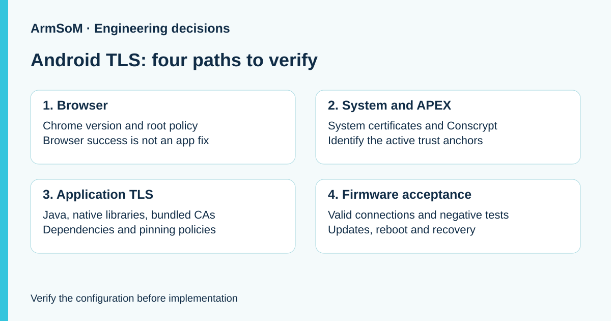

**Maintaining Android trust is about identifying the trust store behind each business connection and delivering the remedy to devices—not merely deleting two files.** Chrome, system TLS and an app with its own certificate bundle can follow different update paths on the same ArmSoM Android device.

This guide is for teams maintaining custom Android firmware. Commands inspect authorized devices and SDKs; they do not document a completed security test on an ArmSoM image. The supplied article is an investigation lead, while advisories, the target branch and application dependencies determine the remedy.



## 1. Establish the incident and the scope of a remedy

Google confirmed the eMudhra intermediate-key incident and described separate blocking mechanisms for Chrome and Android. This does not establish that every Android application has updated. The advisory has received subsequent policy changes; check it again before shipping firmware. [Google security advisory](https://blog.google/security/protecting-chrome-and-android-users-from-compromised-emudhra-intermediate-ca-certificates/)

Distinguish roots, intermediate certificates, public keys and leaf certificates. Cross-signing can place the same key in different chains. Blocking a public-key SPKI and removing a root have different effects and compatibility costs.

The screenshot proposes removing `b74d2bd5.0` and `75680d2e.0`, identifying emSign ECC Root CA - G3 and AAA Certificate Services in that environment. **These filenames are not a universal removal list.** The AAA root may support other legitimate chains; the BSP maintainer must review both effective blocking and collateral impact.

## 2. Inventory devices and application connections

```bash
adb devices
adb shell getprop ro.build.fingerprint
adb shell getprop ro.build.version.release
adb shell getprop ro.build.version.security_patch
adb shell pm list packages com.google.android.gms
adb shell ls -ld /system/etc/security/cacerts
adb shell ls -ld /apex/com.android.conscrypt/cacerts
```

Retain errors: permission denied and a missing path are not security findings by themselves. Android version and patch date identify a build but do not prove its module or backport state. Android 14 and later also require attention to Conscrypt's updatable root store, rather than inspecting only `/system`. [AOSP Conscrypt](https://source.android.com/docs/core/ota/modular-system/conscrypt)

| Connection | What to inspect | Acceptance test |
| --- | --- | --- |
| A webpage in Chrome | Browser version, root policy and blocking updates | Test the target browser |
| Java/Kotlin system TLS | Security provider, APEX and app network configuration | Request through the real app |
| Native or cross-platform component | TLS library, embedded CA bundle and dependency revision | Positive and negative tests with that library |
| Private enterprise service | Private CA, pinning and rotation mechanism | Production and backup certificates |

The presence of `com.google.android.gms` proves neither update delivery nor coverage of every independent TLS stack. Firebase's guidance likewise requires inspecting application dependencies, not just OS updates. [Firebase guidance](https://firebase.google.com/support/guides/compromised-emudhra-intermediate-ca)

## 3. Identify certificates by fingerprint and public key

Inspect candidate certificates taken from the target SDK or its public system-certificate directories on a workstation. `candidate.pem` is the file under investigation, not an instruction to install a new root.

```bash
openssl x509 -in candidate.pem -noout \
  -subject -issuer -serial -dates -fingerprint -sha256
openssl x509 -in candidate.pem -noout -subject_hash_old
openssl x509 -in candidate.pem -pubkey -noout |
  openssl pkey -pubin -outform DER |
  openssl dgst -sha256
```

The first command prints a certificate SHA-256 fingerprint; the third computes SHA-256 over the public-key SPKI. Do not interchange them. Compare with the precise advisory or maintainer list. A subject-hash filename is not a unique identity: matching subjects, collisions and numeric suffixes need consideration. [OpenSSL x509 reference](https://docs.openssl.org/3.0/man1/openssl-x509/)

Locate SDK certificates before parsing them. Searching filenames for `emudhra` is insufficient:

```bash
export SDK_ROOT=/path/to/android-sdk
find "$SDK_ROOT/system/ca-certificates" \
  "$SDK_ROOT/external/conscrypt" \
  -type f \( -name '*.0' -o -name '*.pem' -o -name '*.crt' \) -print
```

Adjust missing directories to the actual branch layout. Inspect the built image and active module too: changing an unused source copy does not change device trust.

## 4. Put the remedy into a maintainable update path

1. Freeze the firmware identity and affected connection list; retain public-certificate fingerprints and build records.
2. Prefer the matching vendor patch or security-component update. Record whether it changes roots, blocks intermediates or updates an application dependency.
3. Check system, APEX and independent bundles, together with signing, AVB and OTA integration.
4. Regress on test devices, roll out in stages and retain recovery procedures and version tracking.

Disabling certificate or hostname verification is not a compatibility fix. Pinning needs rotation, backup keys and failure handling; one pinned certificate is not a permanent solution. [Android Network Security Configuration](https://developer.android.com/privacy-and-security/security-config) can define application trust anchors, but does not repair unrelated processes.

## 5. Validate connections after inspecting files

Observe the chain sent by your own server from a workstation:

```bash
openssl s_client -connect your-server.example:443 \
  -servername your-server.example -showcerts \
  -verify_hostname your-server.example -verify_return_error </dev/null
```

Replace the placeholder with a service you manage. Servers commonly omit roots; displayed order or the last issuer does not alone prove the chain a device selects. A workstation result cannot replace an Android application test.

| Check | Evidence to retain |
| --- | --- |
| Legitimate HTTPS | App, TLS library, hostname, time and result |
| Controlled invalid chain or wrong hostname | Rejection in a lab; file disappearance is insufficient |
| Update and reboot | Active remedy persists without falling back to old trust |
| Recovery and compatibility | Factory reset, backup certificate, OTA service and clock synchronization |

There is no need to attack a public service. A lack of a live affected site does not restrict validation to filenames: maintainers can construct controlled policy tests and exercise failure handling in the real app. Offline products also need a plan for future networking, service and updates.

This guide reworks the [supplied Android CA article](https://mp.weixin.qq.com/s/URwEId_RlZYRRrHSUy5Jig), correcting the general deletion rule, GMS coverage and verification boundaries against official sources. No device certificate was removed and no particular firmware is claimed to be fixed.

## Products and further reading

Start an ArmSoM evaluation with the RK3588-based [Sige7](https://www.armsom.org/sige7), [AIM7](https://www.armsom.org/aim7) or [LM7](https://www.armsom.org/lm7), or the RK3576-based [CM5](https://www.armsom.org/cm5) and [Sige5](https://www.armsom.org/sige5). Check interfaces and available images in the [Sige7](https://docs.armsom.org/armsom-sige7), [CM5](https://docs.armsom.org/armsom-cm5) and [Sige5](https://docs.armsom.org/armsom-sige5) documentation. These links support product selection; they do not certify every SDK combination discussed here.
