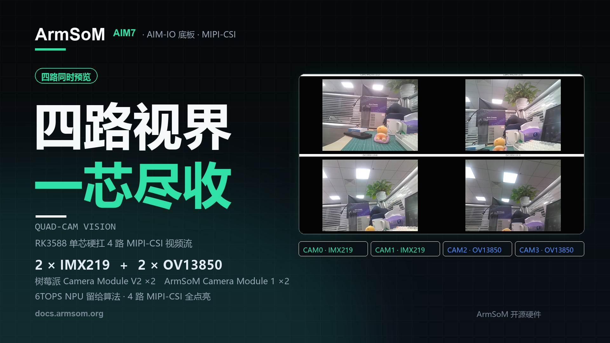
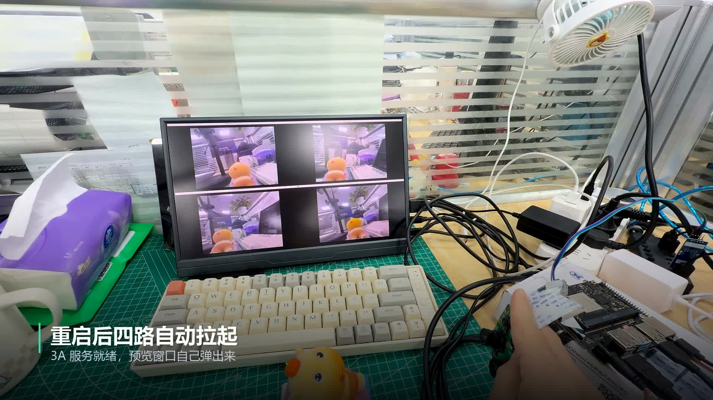

Four cameras, four viewpoints, one display. In this demonstration, **ArmSoM AIM7 with the AIM-IO carrier board** brings two IMX219 and two OV13850 cameras together for simultaneous MIPI-CSI preview on a single RK3588 platform.

For robotics, machine vision and prototypes with several camera positions, this is a practical starting point: connect the views, inspect them together and refine the setup before adding capture, analysis and control software.



## Watch the demo: configuration to four preview windows

<video controls playsinline preload="metadata" width="1920" height="1080" poster="/assets/armsom-aim7-four-camera-preview/cover.jpg" style="display:block;width:100%;height:auto;aspect-ratio:16/9;margin:1.5rem auto;background:#101820" aria-label="Four-camera preview on ArmSoM AIM7: an RK3588 vision prototype">
  <source src="/assets/armsom-aim7-four-camera-preview/demo.mp4" type="video/mp4">
  <a href="/assets/armsom-aim7-four-camera-preview/demo.mp4">Download or play the original demonstration</a>
</video>

*Original ArmSoM demonstration, approximately 34 seconds, with its original Chinese on-screen labels. It shows the documentation, preview program startup and the four live camera views.*

The top two windows show the IMX219 cameras; the bottom two show the OV13850 cameras. Moving a toy in front of the lenses reveals differences in position, scale and occlusion between viewpoints. This helps assess camera placement and coverage, beyond simply checking that one sensor produces an image.

## What is in this four-camera setup?

| Component | Demonstration configuration | Role |
| --- | --- | --- |
| Compute platform | ArmSoM AIM7, Rockchip RK3588 | Camera drivers, image processing and preview application |
| Carrier board | AIM-IO | Camera, display and peripheral connections |
| Top-row cameras | 2 × Raspberry Pi Camera Module V2, IMX219 | Two viewpoints |
| Bottom-row cameras | 2 × ArmSoM Camera Module 1, OV13850 | Two additional viewpoints |
| Display | 1920 × 1080, four equally sized windows | Side-by-side viewing with image aspect ratios preserved |
| Preview output | ISP output scaled to 640 × 480 per camera | Multi-window preview in this example |

AIM7 combines four Cortex-A76 and four Cortex-A55 CPU cores with an NPU rated at up to 6 TOPS (INT8). Connections are exposed through the carrier board. This article concerns the **AIM7 and AIM-IO combination**; wiring and image configuration cannot be assumed to apply to every carrier. [AIM7 product specifications](https://www.armsom.org/aim7)

[](/assets/armsom-aim7-four-camera-preview/demo-still.png)

*The physical setup and four preview windows from the supplied material, retaining the original wiring and screen content.*

## What do the preview figures mean?

The official documentation records approximately **15 FPS for IMX219 and 25 FPS for OV13850** in this configuration. These figures describe the demonstrated image modes, software and display arrangement. They are neither a promise of full-resolution recording on all four cameras nor an AI inference benchmark. [Official four-camera preview instructions](https://docs.armsom.org/zh/armsom-aim7#aim-io-四路摄像头同时预览)

Showing several images at once does not establish hardware frame synchronization between sensors. Stereo measurement, fast-motion analysis, stitching and fusion require separate assessment of timestamps, exposure, triggering, calibration and end-to-end latency.

The video demonstrates capture and preview. It does not establish AI recognition performance, long-duration stability or multi-stream recording throughput. Validate those requirements at the resolution, frame rate, cooling conditions and algorithm load intended for your project.

## Reproduce the workflow: identify devices, then preview

1. Prepare AIM7, AIM-IO, the specified camera modules, matching ribbon cables, a display and the appropriate power supply. Disconnect power before attaching camera ribbons.
2. Select a matching image using the AIM7 documentation. Enable the four camera overlays in `/boot/uEnv/uEnvarmsom-aim7-io.txt` according to the documented wiring, reboot and check detection.
3. Confirm that the IMX219 module name matches `imx219_rpi-camera-v2_default.json` and that the 3A service is running.
4. Download the four-window script from the official documentation. Open its directory in a **terminal within the board's graphical desktop**. This GTK example needs a graphical session; a text-only TTY login does not provide desktop windows.

The official instructions use the following startup commands. Installing dependencies requires access to suitable package repositories:

```bash
sudo apt-get install -y python3-gi gir1.2-gtk-3.0 gir1.2-gstreamer-1.0 gir1.2-gst-plugins-base-1.0
sudo systemctl restart rkaiq_3A.service
python3 aim7-four-camera-preview.py
```

Press `Ctrl+C` to stop. The example uses `/dev/video53`, `/dev/video62`, `/dev/video44` and `/dev/video71`, but device numbers can change between images. Inspect devices with `v4l2-ctl --list-devices` and the topology with `media-ctl -p`, selecting the relevant media device where needed. Update the script for the actual ISP output nodes. The official instructions also state that this four-camera example has not been validated on AIM5.

## Where could four viewpoints take your project?

### Robotics and mobile devices: check coverage first

Place cameras in different directions and inspect whether the chassis blocks their views or leaves gaps as a target moves. The preview helps refine mounting positions before deciding how to implement recognition, tracking or sensor fusion.

### Machine-vision prototypes: inspect different surfaces

Aim cameras at the front, side or assembly area of a workpiece to evaluate lighting, focus and placement. A defect-inspection application still needs representative samples, validated algorithms and triggering. The demonstration provides no detection-accuracy or production-cycle measurements.

### Education and development: follow the imaging pipeline

Using two sensor types on one platform supports experiments with device trees, V4L2 nodes, ISP processing, 3A and GStreamer. Compare single-camera and multi-camera operation, then extend the application to image saving, recording or other tasks.

### Edge AI: add inference after capture works

Once capture is stable, use the [ArmSoM RKNN development guide](https://docs.armsom.org/advanced-manual/rknn-sdk) to deploy supported models. Start by checking correctness and latency on one stream, then add more streams and measure the complete pipeline. The 6 TOPS rating is a hardware specification; model results depend on operators, quantization, input size and resource scheduling.

## Start building your vision application

Use this demonstration to check camera layout and the software pipeline, then develop the capture and processing workflow your application needs.

- [Explore ArmSoM AIM7](https://www.armsom.org/aim7)
- [AIM7, AIM-IO and the four-camera tutorial](https://docs.armsom.org/zh/armsom-aim7#aim-io-四路摄像头同时预览)
- [RKNN model deployment guide](https://docs.armsom.org/advanced-manual/rknn-sdk)
- [Using the local terminal in ArmSoM Server images](/articles/armsom-server-hdmi-tty-console/)

For platform selection or project enquiries, contact [sales@armsom.org](mailto:sales@armsom.org) with your camera count, target resolution, synchronization requirements and intended algorithms so the complete system can be assessed.
