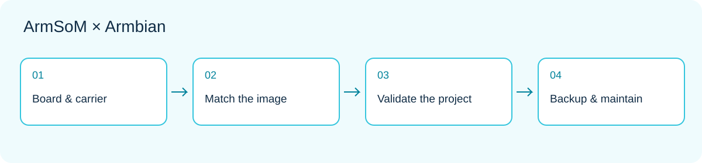

*Development workflow: match hardware and image, then validate the application and maintenance.*

A development board is useful when you can turn its computing and interfaces into a repeatable project. ArmSoM supplies hardware and board documentation; Armbian supplies Linux images and build configurations for several specific platforms. For developers familiar with Debian or Ubuntu, this is a practical route to explore.

This guide is for first-time ArmSoM users and teams planning a desktop, home service or embedded prototype. The workflow is an engineering proposal, not a hardware test report. Always check the current page for the exact target board.

## 1. Understand the three layers

Think of the system in three layers. The board provides computation, power and connections. Boot software, kernel and device tree make the hardware accessible. Linux userspace carries applications, package management and services. Armbian packages several of these pieces into a downloadable or reproducible system. It is not one universal image for every ARM board; sharing a processor does not make carrier boards interchangeable.

Linux knowledge accumulates across projects: start by managing a board over SSH, then add data acquisition, a web dashboard or a background service. Version-control application configuration and business logic while keeping hardware adaptation specific to each model.

## 2. Find the exact platform

At this review, the vendor catalog lists Sige1, Sige3, Sige5, Sige7, AIM7 IO, CM5 IO, CM5 CM4 IO, CM7s IO, W3 and Forge1. These are platform/carrier entries, not interchangeable images. [Check the current catalog](https://armbian.com/vendors/armsom).

The entries carry the Community label. Armbian's rules do not give community images the testing and maintenance commitments of Standard support; fixes from the project are not guaranteed. An available download, a successful boot and complete peripheral support are separate findings. [Support definitions](https://docs.armbian.com/contribute/board-support-rules/).

## 3. Select for the task, not the largest version number

| Question | Effect on the decision |
|---|---|
| Do you need a local screen? | Desktop for interaction; CLI for headless services |
| Which application is essential? | Check architecture, dependencies and distribution |
| Camera, NPU or video acceleration? | Verify driver, runtime and application interface separately |
| Long-running installation? | Plan updates, backup and recovery |
| Which carrier and hardware revision? | Select the matching board image |

Vendor, current and edge describe kernel development paths rather than performance tiers. Minimal versus Desktop is another independent choice. Armbian describes edge and rolling images as testing options, not production choices. Consult the [image guide](https://docs.armbian.com/getting-started/choosing-an-image/) and retain the full image filename and branch used for your trial.

## 4. Download, write and boot

Prepare a supply that meets the board's requirements, reliable storage and a recovery route. Obtain the image and verification information from the matching board page. Write it using Armbian Imager or the documented tool. Writing overwrites the selected medium: confirm its name and capacity and back up existing data. Copying the image file to an ordinary partition is not the same operation.

Keep first boot simple: power, boot medium, wired networking and, if needed, a display or serial adapter at the correct electrical level. Follow the current image's account setup rather than old fixed-password tutorials. Establish basic boot before adding cameras or USB hubs. See the [official starting workflow](https://docs.armbian.com/getting-started/).

## 5. Save a system baseline

These commands inspect the system; they neither exercise every peripheral nor produce a benchmark. Remove hostnames and addresses that do not need to be public before sharing output.

```sh
cat /etc/os-release
uname -r
uname -m
free -h
lsblk -o NAME,SIZE,TYPE,FSTYPE,MOUNTPOINTS
ip -br address
systemctl --failed
```

Keep the results with hardware revision, supply, storage model and image filename. When something fails, ask what changed since the last working run before reinstalling everything. A missing command can reflect a package or init-system difference; it does not establish a hardware fault.

## 6. Complete one small project

A useful first exercise is a device-status page accessible only on the local network. Show a temperature or application state, its update time and service restarts. First use simulated input to validate the page and logging. Then connect a real sensor after checking electrical levels and drivers. Finally handle lost networking, invalid samples and restart recovery.

This separates hardware, application and network faults. Expand later into an MQTT node, automation console or file service. Set one measurable goal—such as avoiding duplicate records after reconnection—instead of installing many services at once.

## 7. Make it maintainable

Back up application data separately from the OS image, limit log growth and record dependencies. Before updating an unattended system, test boot, networking and essential peripherals on spare media or a test device. Arrange a recovery path and maintenance window; indefinitely ignoring security updates is not a version-control strategy.

For a black screen, distinguish missing desktop output from failed boot using network or serial access. Investigate power and media for repeated resets. For a single failing peripheral, examine its logs, device-tree setup and software stack. A useful community report includes reproducible steps, hardware revision and focused logs.

## 8. Choose the next platform

For a prototype with accessible display, networking and storage, explore [Sige5](https://www.armsom.org/sige5) or [Sige7](https://www.armsom.org/sige7). For a compute module in your own carrier, explore [CM5](https://www.armsom.org/cm5). Choose hardware and image together, validate essential interfaces, then add complexity.

## Continue this series

- [Sige5 / Sige7 with Armbian: six Linux projects worth building](/articles/sige5-sige7-armbian-projects/)
- [CM5 with Armbian: from compute-module prototype to a custom Linux device](/articles/cm5-armbian-custom-device/)
