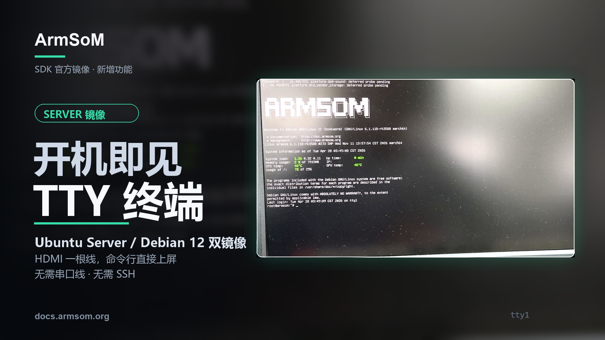
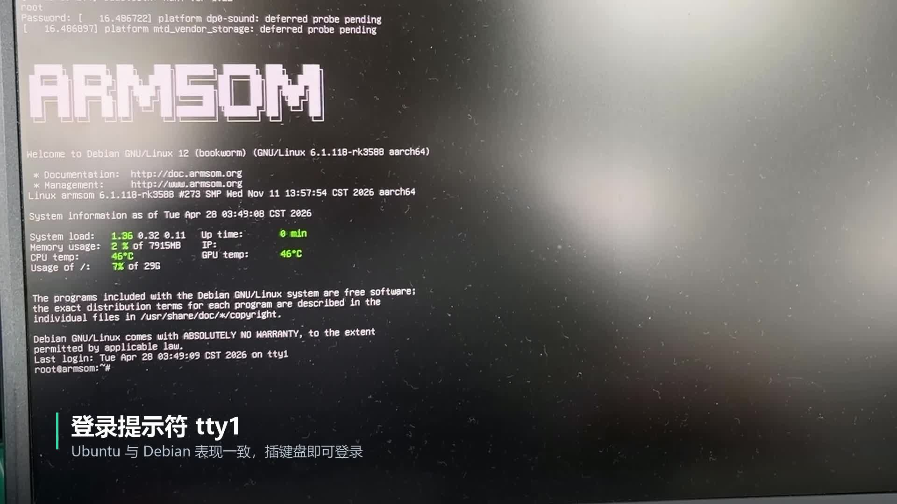

You have just flashed a Server image, but networking is not configured and you do not yet know the board's IP address. How do you log in? This ArmSoM demonstration offers a direct route: **connect an HDMI display and a USB keyboard, sign in to the local TTY and start using Linux.**

Based on ArmSoM's supplied article and footage, this guide introduces local console access for Ubuntu Server / Debian 12 images. The filmed terminal explicitly shows Debian 12; the accompanying material also describes Ubuntu Server. Check the relevant product download notes for supported boards, image versions and default accounts.



## What does the boot-to-terminal video show?

<video controls playsinline preload="metadata" width="1920" height="1080" poster="/assets/armsom-server-hdmi-tty-console/cover.jpg" style="display:block;width:100%;height:auto;aspect-ratio:16/9;margin:1.5rem auto;background:#101820" aria-label="ArmSoM Server local console: log in to Linux with HDMI and a USB keyboard">
  <source src="/assets/armsom-server-hdmi-tty-console/demo.mp4" type="video/mp4">
  <a href="/assets/armsom-server-hdmi-tty-console/demo.mp4">Download or play the original demonstration</a>
</video>

*Original demonstration, approximately 20 seconds, retaining its Chinese on-screen labels. It shows HDMI boot information, service startup and a Shell prompt after logging in to Debian 12.*

Text on the display lets you follow the system's progress. Once the login prompt appears, enter an account and password with the keyboard to reach the local Shell. The footage also shows ArmSoM branding, the system version and status information.

For first-time setup, this means you can inspect the system, find its network address and configure it before establishing SSH. The footage is edited: its 20-second duration is not a cold-boot benchmark. Load, temperature and time values on the display are simply the state shown in that recording.

## Local TTY, SSH or a desktop?

Here, TTY means a local text console from which you can run Linux commands after signing in. `tty1` identifies the virtual console used in the demonstration; other images may use a different console configuration.

| Method | Requirements | Useful tasks |
| --- | --- | --- |
| Local TTY with HDMI and USB keyboard | An image supporting display output and local login, plus suitable board interfaces | First login, network checks and on-site log inspection |
| SSH | Reachable network, available SSH service and valid account | Remote maintenance, deployment and routine administration |
| Graphical desktop | An installed desktop and working display drivers | Windowed applications and graphical tools |

A desktop is not required to execute local commands. Conversely, a TTY does not automatically provide a browser or graphical windows. For a windowed camera preview, select an image with the required graphical environment.

[](/assets/armsom-server-hdmi-tty-console/demo-still.png)

*Debian 12 local console in the original recording. The kernel, account and status values belong to this demonstration, rather than every board or image.*

## What to prepare for the first login

- An official ArmSoM Server image matching the board and supporting an HDMI local console.
- Boot media prepared according to that product's instructions.
- An HDMI display and suitable cable, connected to a display-output port.
- A keyboard connected to a USB Host port and the correct power supply.

Check the display input and cable before powering on. Use the account documented for your image. Password characters normally remain invisible in a Linux terminal. After the first login, change default credentials as required for your deployment.

Continue with the [ArmSoM image resources](https://docs.armsom.org/getting-start/cloud-disk) and [startup and login guide](https://docs.armsom.org/getting-start/startup). A filename containing Ubuntu or Debian does not establish compatibility with every product.

## Start with a few read-only checks

The following are general Linux inspection examples, not captured benchmark output. Run them individually on the board. Availability depends on installed tools; `systemctl` applies to systems using systemd.

```bash
cat /etc/os-release
uname -r
tty
ip -br address
df -h
free -h
systemctl --failed --no-pager
```

| Check | What it tells you |
| --- | --- |
| Distribution and kernel | The actual software versions to match against documentation |
| Current terminal | Whether this session is on a local TTY |
| Network addresses | Whether an address is available for later remote access |
| Storage and memory | Basic capacity and resource state |
| Failed services | Startup issues that may need log inspection |

Once you know the actual network address, configure remote access using the official instructions. You can initialize the device locally and then move to remote maintenance, without making the first login depend on an already-working network setup.

## Three situations where this helps

**First boot on the workbench.** Observe startup, check software versions, storage and networking, then deploy the application. For teaching, put the terminal on a large display and explain commands as they run.

**Initial setup at a project site.** A device that has not yet joined the target network can still be inspected locally. During a network change, the local console also helps you continue configuration if remote connectivity is lost.

**On-site service troubleshooting.** If the system still boots and its local console works, log in to inspect services and logs. Failures before display initialization, or before the system reaches a usable login state, may still require serial debugging. HDMI TTY does not replace every low-level diagnostic tool.

## If no login prompt appears

Check power, monitor input and the HDMI port direction first, then verify the board, image and boot media. If system text appears but there is no usable login prompt, check that image's console configuration. If keyboard input fails, confirm that the keyboard is connected to a USB Host port.

Server and desktop images can behave differently, so this alone does not establish a hardware fault. When contacting support, include the board model, image filename, display connection and visible errors.

## Make local access part of your development workflow

A local TTY makes first login and on-site work more direct. When selecting hardware, consider display, USB, networking and application interfaces together, then choose a matching image.

- [Explore ArmSoM development platforms](https://www.armsom.org/)
- [Explore AIM7 and AIM-IO](https://www.armsom.org/aim7)—check the required Server image and carrier support before purchase or deployment
- [Image resources and downloads](https://docs.armsom.org/getting-start/cloud-disk)
- [Startup, login and remote access](https://docs.armsom.org/getting-start/startup)
- [From terminal access to vision development: the AIM7 four-camera case](/articles/armsom-aim7-four-camera-preview/)

For image or platform selection, contact [sales@armsom.org](mailto:sales@armsom.org) with the board model, graphical-interface requirements and intended on-site workflow.
