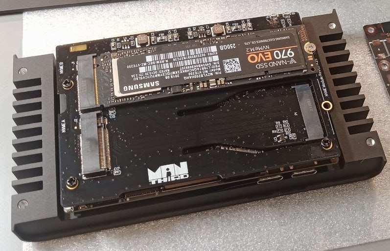
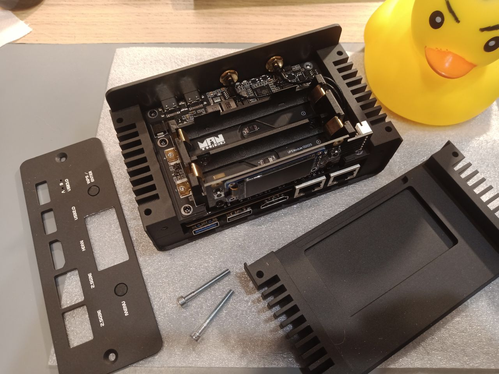
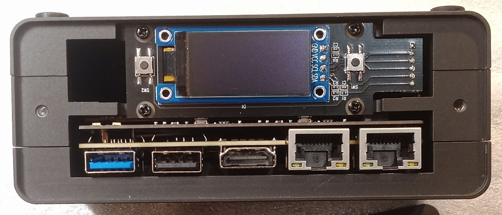
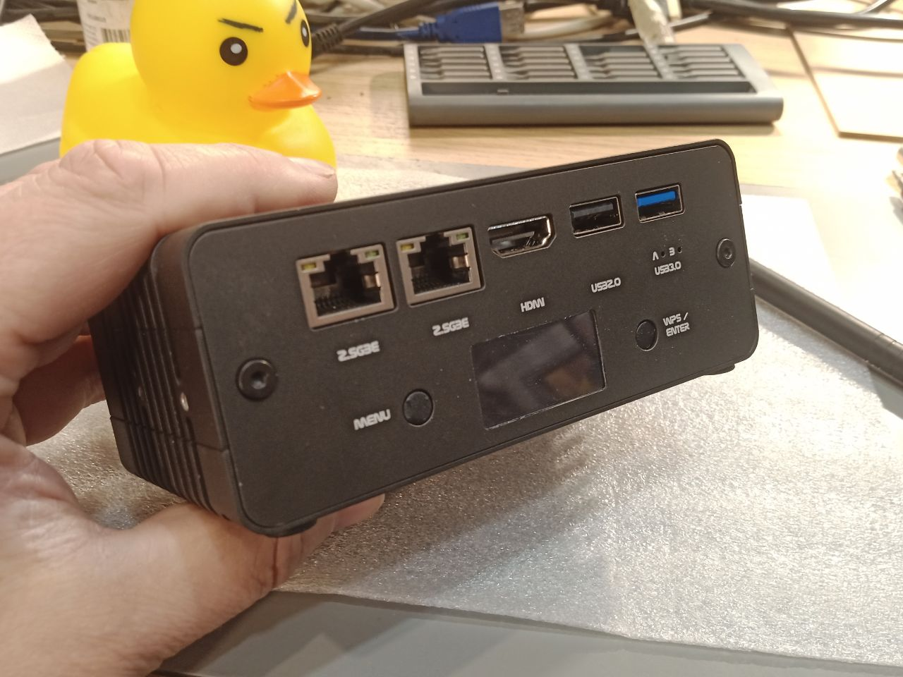
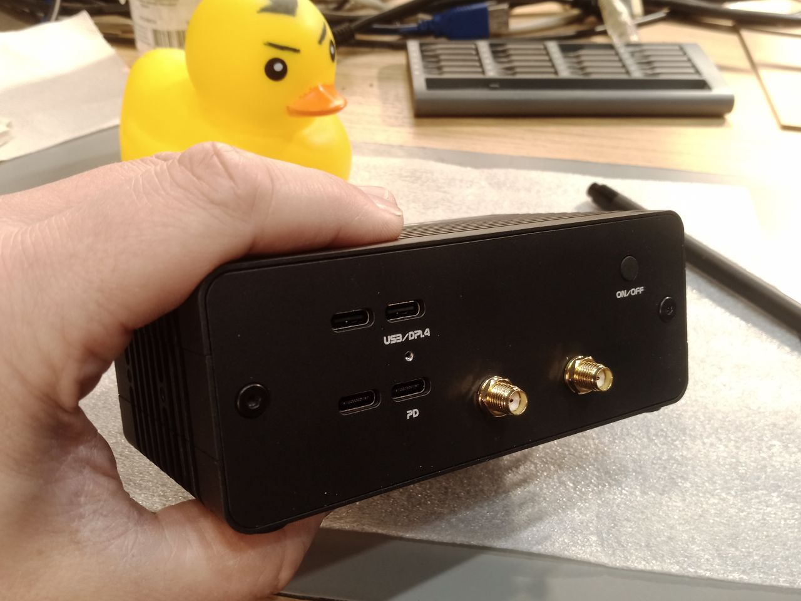
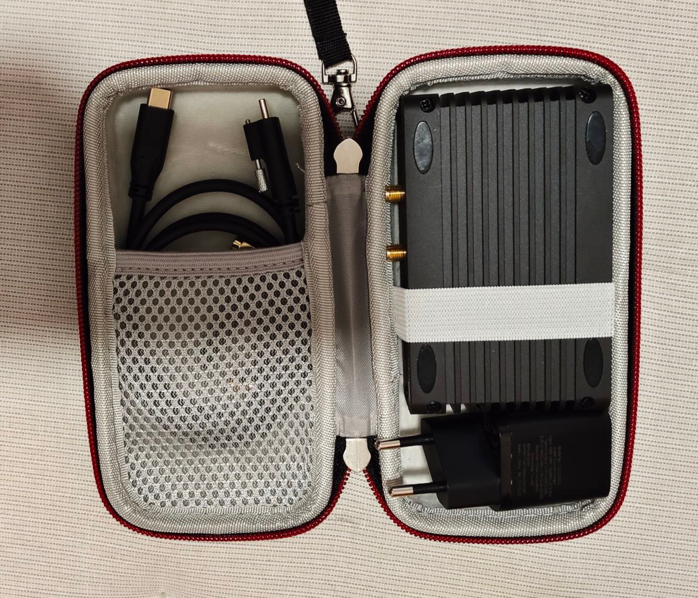
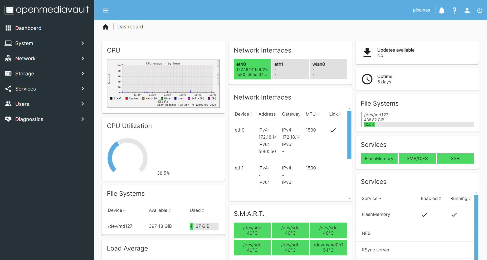

Portable storage can be more than a drive attached to a laptop. Developers in the UberNAS community wanted a small NAS that could travel with its owner, share files over a network and accept battery and display modules as needed. They chose ArmSoM Sige7 as the computing platform, combining dual NVMe expansion, a UPS and an OLED in a modular prototype.

This user story is based on the supplied project material and uses **ArmSoMNAS** as the project name. It focuses on the Sige7-based design. The modules and photographs belong to the user project; they are not accessories supplied as standard with Sige7.

*The compact prototype in a desktop setup, photographed by the project team.*

## From five SATA drives to a smaller NVMe design

The team previously developed a mobile NAS around RK3568 with five M.2 SATA storage positions. For the next design, they wanted a smaller enclosure, NVMe storage and 2.5GbE connectivity. Sige7's two 2.5GbE ports and rear M.2 PCIe 3.0 x4 connector were central to that choice.

Starting from a compact SBC let the team organize storage, power and enclosure design without developing a processor board from scratch. Their effort could go into the dual-drive module, portability and assembly.

## A computing and connectivity foundation

The [official Sige7 documentation](https://docs.armsom.org/armsom-sige7) confirms RK3588, dual 2.5GbE and M.2 PCIe 3.0 x4. For this project, their value is bringing computing, networking and storage connectivity into one compact platform.

| Part | Role in the project |
| --- | --- |
| Sige7 board | Runs Linux and network-storage services |
| Dual 2.5GbE | Supports the design of wired sharing and network connections |
| M.2 PCIe 3.0 x4 | Connects the project's custom Twin NVMe module |
| Modular enclosure | Accommodates combinations with or without UPS and display |

Interface specifications are not file-transfer benchmarks. The material contains no sustained read/write, dual-drive concurrency or link-aggregation results, so throughput should be measured on the complete system.

## Twin NVMe makes storage a separate module

Twin NVMe is an expansion PCB with two M.2 NVMe slots, connected to the M.2 interface on the back of Sige7. Treating storage as a module creates room to refine SSD selection, assembly height and cooling.

*Twin NVMe prototype with one SSD installed and a second slot visible.*

The source describes RAID 0 and RAID 1 as storage options but does not publish the expansion board's PCIe topology, per-drive link width or a complete compatibility list. Two slots must not be read as two independent x4 links. Reproduction starts with the module revision, driver, SSD and system-image requirements.

RAID 0 provides striping and capacity use without single-drive fault redundancy. RAID 1 mirrors data to improve availability after one drive fails. Neither replaces an independent, recoverable backup of important files.

## A UPS for use away from a fixed power supply

The UPS uses two LiFePO4 cells in the 18650 form factor and a smart battery controller based on RP2040, with USB HID communication. The source writes “RPi 2040”; this article uses the conventional chip name, subject to confirmation against the module documentation.

*UPS module and battery holders from the supplied project material.*

The author reports up to about 1.5 hours of operation without restricting storage or network activity. Battery capacity, SSD models, workload and cutoff conditions are not specified. This is the author's description of the prototype, not a standard ArmSoM runtime guarantee.

A next revision should validate power handover, battery reporting and low-battery shutdown together. USB HID support alone does not establish that the complete shutdown path has been implemented.

## OLED and buttons bring status to the device

The display module combines an OLED with two software-defined buttons. On a NAS without a permanently attached monitor, this provides a place for local status and simple interaction.

*OLED and two-button module above the network and USB connectors.*

Network address, battery state and storage state are useful interface directions. They are development suggestions: the supplied material does not list every implemented display page or button action.

## Two configurations, one modular approach

Sige7 plus Twin NVMe forms the smaller desktop-storage prototype. Adding the UPS, OLED and buttons creates a more fully equipped mobile system. Users can select the modules that fit their task instead of always carrying every component.

*Network, USB and display panel of the fully equipped prototype.*

*The other connector panel and enclosure of the fully equipped prototype.*

The prototype uses a finned aluminium enclosure. The case describes passive cooling and also mentions active cooling as a configuration option. Fan requirements depend on SSDs, sustained load, ambient temperature and enclosure design; no thermal test covering those conditions is supplied.

*Prototype and cables in a carrying case, illustrating the portable format.*

The format invites further work on travel file sharing, media archiving, field demonstrations and small homelabs. These are application ideas, not evidence of completed deployments.

## Armbian and OpenMediaVault provide the software base

The project uses Armbian as its Linux base and OpenMediaVault for NAS management. The current [Armbian Sige7 page](https://armbian.com/boards/armsom-sige7) offers images and identifies Community support. The prototype's distribution, kernel and OpenMediaVault versions are unspecified; record them and follow matching documentation when reproducing the setup.

[OpenMediaVault](https://www.openmediavault.org/) provides web-based storage and sharing management. Bringing disks, services and status into one interface helps turn a Linux board into a manageable NAS. RAID, UPS integration and extra features still depend on version and configuration.

*OpenMediaVault reference screenshot supplied with the case. Its multiple drives, capacities, temperatures and uptime are not measurements of this dual-drive prototype.*

## Developing with the community

The author describes how sharing portable-NAS work brought more enthusiasts to UberNAS News and UberNAS Community. Discussions of hardware, software and homelab use give developers feedback from the people who may use their designs.

ArmSoMNAS illustrates a practical path: Sige7 supplies the computing and connectivity foundation, the user develops storage, power and interaction modules, and Linux software and community experience help bring them together.

## Start your own ArmSoMNAS project

Decide how many drives you need, whether operation away from mains power matters, and how backups will work. Then select the board, storage module, power system and enclosure. Validate drive enumeration, sustained copying, temperature, power handover and recovery. This is a user story, not a complete schematic, BOM or reproducible installation script for the expansion hardware.

- [Explore ArmSoM Sige7](https://www.armsom.org/sige7)
- [Read Sige7 hardware and development documentation](https://docs.armsom.org/armsom-sige7)
- [Find Armbian images for Sige7](https://armbian.com/boards/armsom-sige7)
- [Explore OpenMediaVault](https://www.openmediavault.org/)
- [Visit UberNAS Community, linked in the source material](https://t.me/UberNasCommunity)

The case and photographs come from user-supplied UberNAS community material. Original enclosure markings and dashboard content are retained. No new ArmSoM hardware testing was performed, and the prototype is not presented as a standard kit currently on sale.
