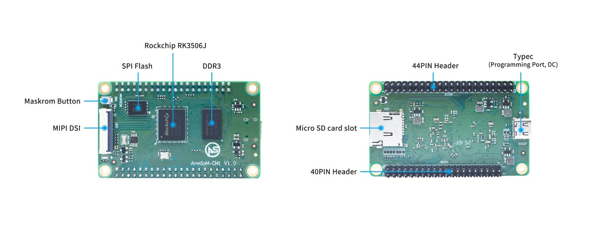

A compute module consolidates processor and basic storage so a product team can focus on interfaces, enclosure and applications. RK3506J-based ArmSoM CM1 targets industrial terminals, display controls and connected equipment. Evaluate with CM1-IO before designing a dedicated carrier.

## Separate the module from the kit

| Item | CM1 module | Kit with CM1-IO |
|---|---|---|
| Processor | RK3506J | Uses CM1 |
| Memory/storage | 256/512MB DDR3L and 256/512MB NAND configurations | Determined by the fitted module |
| Dimensions | 70×42mm | Carrier: 100×70mm |
| Display | MIPI DSI | Validate the selected panel and driver |
| Network | Expansion signals | Dual 10/100 Ethernet, Wi-Fi 5/BT 4.2 |
| USB | Type-C power/programming | Two USB2.0 Host ports |

Ethernet connectors, wireless and two USB Host ports belong to the carrier kit, not the bare module. Documentation lists −40 to 85°C operation; the complete product still needs validation with its power supply, panel, storage and enclosure.

## A dedicated equipment panel

Packaging machines, environmental instruments and measurement terminals often need custom connectors and housings. Let CM1 run UI, settings and communications, with field-signal conditioning and protection on the carrier. Select panel size, backlight power and touch interface together during schematic design.

## An equipment connectivity module

Connect an existing controller through serial or CAN; use Linux for processing, buffering and upload. Define ownership of equipment state, timeout behaviour and offline retention. Bound log growth and avoid making emergency-stop behaviour depend on network services.

## A shared compute core across products

One module can underpin wall panels, desktop instruments and DIN-rail gateways. Application software may be reused, but connector assignment, device trees, cooling and manufacturing tests remain product-specific. Reuse comes from consistent software and verification, not from skipping electrical design.

## From kit to prototype

1. Fix the CM1 configuration, hardware revision and Buildroot image.
2. Validate display, touch, storage, networking and field protocols.
3. Record each signal's multiplexing, voltage, pulls, boot state and protection.
4. Check power-loss recovery, failed-update rollback, watchdogs and log limits.
5. Test temperature, stability and interfaces with final power, enclosure and cables.

Do not infer compatibility from 40-PIN/44-PIN counts. Partial Raspberry Pi 40-pin compatibility on a carrier does not mean the module can directly replace another compute module.

## When CM1 fits

Choose CM1 when custom mechanical and interface design should build on ArmSoM documentation, reference hardware and software resources. For an immediate complete-board prototype, also evaluate Forge1. These are development recommendations, not completed certification or production validation.

## Related articles and official resources

- [RK3506J explained: industrial HMI and connected equipment](/articles/rk3506j-chip-guide/)
- [ArmSoM Forge1: develop industrial gateways, HMI and data acquisition](/articles/forge1-industrial-hmi-gateway/)
- [RK3506B Datasheet V1.0: download, architecture, pins and electrical design](/articles/rk3506b-datasheet-v10/)
- [Rockchip RK3506](https://www.rock-chips.com/a/cn/product/RK35xilie/2025/1208/2125.html)
- [ArmSoM CM1](https://docs.armsom.org/armsom-cm1)
- [ArmSoM Forge1](https://docs.armsom.org/armsom-forge1)
- [ArmSoM](https://www.armsom.org/)
