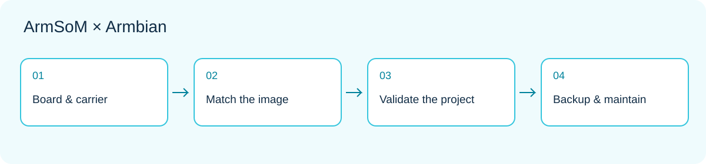

*Official ArmSoM product image; illustrated chip capabilities do not establish complete acceleration support in an Armbian image.*

A compute module becomes useful when a prototype needs a particular enclosure, connector set or power design. ArmSoM CM5 concentrates the computing section on a module, allowing the carrier to follow the product requirements. Armbian board images and build configurations can start software evaluation; a custom carrier still needs its own validation.

This guide describes a path towards a maintainable Linux device. It is not production certification or a claim that every peripheral has been tested in an image. Read the companion image-selection guide before starting a module project.

## 1. Choose module, carrier and image together

CM5 uses RK3576. The module supplies the compute foundation; the carrier determines power, connectors and exposed signals. The same processor does not guarantee identical boot behaviour on different carriers. [CM5 product information](https://www.armsom.org/cm5).

Record module and carrier revisions, memory and storage configuration, display, camera and external-device models. A connection table is more useful than simply writing “CM5”: give each interface a purpose, supply source, signal level, driver dependency and acceptance procedure.

## 2. CM5 IO and CM5 CM4 IO are different targets

| Armbian entry | Build target identifier | Selection principle |
|---|---|---|
| CM5 IO | `armsom-cm5-io` | The CM5 IO reference platform described by its page |
| CM5 CM4 IO | `armsom-cm5-rpi-cm4-io` | The corresponding CM4 IO carrier configuration |

These are not merely alternative download labels. Check the [CM5 IO](https://armbian.com/boards/armsom-cm5-io) and [CM5 CM4 IO](https://armbian.com/boards/armsom-cm5-rpi-cm4-io) pages and match the actual assembly. Both entries currently carry community status. A reference-carrier configuration is not a guarantee for every third-party carrier.

## 3. Begin compatibility assessment at the pins

Matching dimensions or connectors is only the beginning. Review rails, reset and boot signals, display channels, USB roles, PCIe, networking and unused pins. CM5 documentation lists differences from CM4, including display-channel counts. The ability to use a carrier category does not imply feature equivalence.

Compare schematics, module pin assignments and carrier design before deciding which functions to enable. Cameras and displays also involve connection order, power and software drivers. Use the [CM5 hardware documentation](https://docs.armsom.org/armsom-cm5) instead of carrying over another module's image or peripheral configuration.

## 4. Three product prototypes to evaluate

**Equipment-status terminal:** connect display and input on the carrier, then show device state. Start with a read-only page and an offline indication before adding controls. Validate touch mapping, orientation and recovery after abnormal restart. A normal Linux interface is not a real-time safety controller.

**Acquisition gateway:** adapt field interfaces on the carrier while Linux handles normalization, queuing and upload. Separate drivers from business protocols, cap buffers, timestamp records and handle duplicates. Industrial signalling, isolation and surge protection belong to carrier design; an OS image does not add them.

**Edge-vision node:** validate acquisition, inference and network output separately. Compare model results with fixed files before attaching a camera and assessing cooling. NPU and video acceleration require a matching software stack. A CPU reference path helps separate model errors from driver issues.




## 5. Bring up a custom carrier in stages

| Stage | Add one class of variables | Example acceptance condition |
|---|---|---|
| A | Power, boot medium, debug channel | Observable cold boot and restart |
| B | Storage and wired network | Persistent data and stable paths after reboot |
| C | Display, USB or one sensor | Correct enumeration and application input/output |
| D | All essential interfaces together | No unresolved resource conflicts |
| E | Enclosure and final supply | Thermal and recovery behaviour meets the project goal |

If stage B is stable and C fails, investigate the new interface before changing kernel, storage and application simultaneously. Retain a known-bootable image and configuration at each stage so comparisons remain meaningful.

## 6. Make the software reproducible

Record image origin, Armbian source revision, board target, kernel branch, device-tree changes and application dependencies together. Do not retain only one storage card with many undocumented manual edits. Every configuration change needs a reason, associated hardware and a way back.

These read-only commands record the environment; they do not build or replace boot files:

```sh
cat /etc/armbian-release
uname -a
cat /proc/device-tree/model
lsblk -o NAME,SIZE,TYPE,FSTYPE,MOUNTPOINTS
systemctl --failed
```

The device-tree model file may omit a trailing newline. If a file is absent, check the image and environment first. For custom builds, follow the current instructions linked from the specific board page, pin the source revision and validate the output. Do not combine commands for unrelated releases, branches and carriers.

## 7. Installation and updates need recovery

Before migrating to internal storage, confirm the supported boot flow and target medium. Back up data and preserve a way to enter debug or recovery mode. Do not assume every eMMC, NVMe or SPI combination follows one procedure.

An update test must cover boot, network, application data, peripherals and service permissions—not just a new version string. Make recovery an acceptance criterion: restore the previous application if an update fails, and rebuild from documentation if media fails. Continue evaluating security updates rather than treating a frozen baseline as permanent maintenance suspension.

## 8. Expand from one prototype to several devices

Separate configuration templates from per-device identities. Generate or assign independent credentials during provisioning; do not clone a shared private key and fixed network identity across every device. Expose readable version information so support staff can identify the hardware/software combination.

Retain module/carrier revisions, image hash, build source, application version, essential peripherals, test results and rollback instructions. Community images provide an evaluation entry point, not a production service agreement. Long-term delivery requires an explicit maintenance owner and resources for update validation.

## 9. Start with a reference, customize deliberately

Explore [CM5 configurations](https://www.armsom.org/cm5) and the [CM5-IO documentation](https://docs.armsom.org/armsom-cm5-io). Get the essential application working on a known assembly before changing carrier and peripherals one at a time. This keeps customisation failures attributable.

The module lets you concentrate on distinctive interfaces and product behaviour; Armbian offers a Linux evaluation starting point. The benefit is not avoiding validation, but having a clear baseline that makes each validation step easier.

## Continue this series

- [ArmSoM × Armbian: from image selection to your first Linux project](/articles/armsom-armbian-getting-started/)
- [Sige5 / Sige7 with Armbian: six Linux projects worth building](/articles/sige5-sige7-armbian-projects/)
