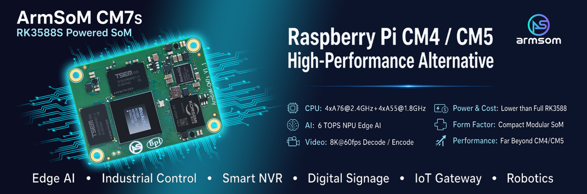
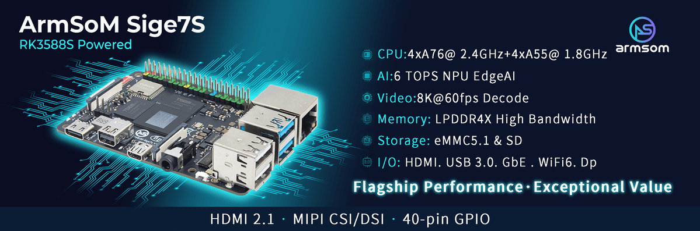

Choosing an RK3588S platform starts with the product format: do you need an assembled board with external connectors, or a compute module inside your own hardware? **Sige7S supports a quick application start; CM7S supports carrier customization.** This is not a ranking of computing performance.

## Choose the development route

| Requirement | Starting point | Work to plan |
|---|---|---|
| Linux application or demonstration | Sige7S | Image, cooling, peripherals and application validation |
| Custom enclosure and connectors | CM7S + custom carrier | Power, signal integrity, device tree and system validation |
| Early software for a module-based product | CM7S + CM7S-IO | Validate on the carrier, then migrate to custom hardware |

CM7S documentation specifies a 55 × 40 × 1.6 mm module and three 100-pin board-to-board connectors. A module lets the carrier focus on application interfaces. Similar dimensions do not establish compatibility with Raspberry Pi CM4/CM5 carriers: verify connectors, pin assignments and power before considering a substitution.

## Sige7S: focus first on the application

The Sige7S documentation lists Gigabit Ethernet, Wi-Fi 6, HDMI, USB and an expansion header. This makes it a candidate for an edge inference terminal, display controller or Linux prototype. Select cameras and displays from the board connector and driver requirements, not the silicon maximum.

For example, the documented Sige7S DP connection uses two lanes and is rated up to 4K60. That is a different configuration from the four-lane maximum in the chip datasheet. Camera and DSI lane counts, cables and drivers also need checking.

## CM7S: build the carrier around your device

Evaluate software with CM7S-IO, then develop a carrier for the required enclosure and peripherals. Preserve validated software versions during migration, but revalidate the device tree, power sequence and interfaces.

Keep module and carrier supplies distinct: CM7S documentation specifies 5V input; CM7S-IO specifies 12V DC input. Do not connect the carrier input voltage directly to module power pins. The documentation also flags CN2 pins 2 and 4 on CM7S v1.1; confirm the actual revision and errata before design.

## Five checks before ordering

1. Confirm the delivered RAM and eMMC configuration.
2. Verify which display, camera and expansion interfaces are exposed.
3. Match image, kernel, NPU runtime and peripheral drivers.
4. Validate peak power, cooling, enclosure and ambient conditions.
5. Record production image, recovery procedure and hardware revision.

Sige7S documentation contains differing dimension entries. Use mechanical files for the actual revision rather than either value for enclosure design. This is selection guidance, not a measured performance comparison.

## Further reading and product resources

- [RK3588S explained: eight CPU cores, a 6 TOPS NPU and ArmSoM platforms](/articles/rk3588s-chip-guide/)
- [RK3588S edge AI and multimedia: planning a product with CM7S or Sige7S](/articles/rk3588s-edge-ai-multimedia/)
- [RK3588S Datasheet V1.3: download, block diagram and hardware reading guide](/articles/rk3588s-datasheet-v13/)

### Products and development resources

- [CM7S](https://www.armsom.org/cm7s) · [CM7S Docs](https://docs.armsom.org/armsom-cm7s)
- [Sige7S](https://www.armsom.org/sige7s) · [Sige7S Docs](https://docs.armsom.org/armsom-sige7s)
- [Rockchip RKNN-Toolkit2](https://github.com/airockchip/rknn-toolkit2) · [RKNN-LLM](https://github.com/airockchip/rknn-llm)
