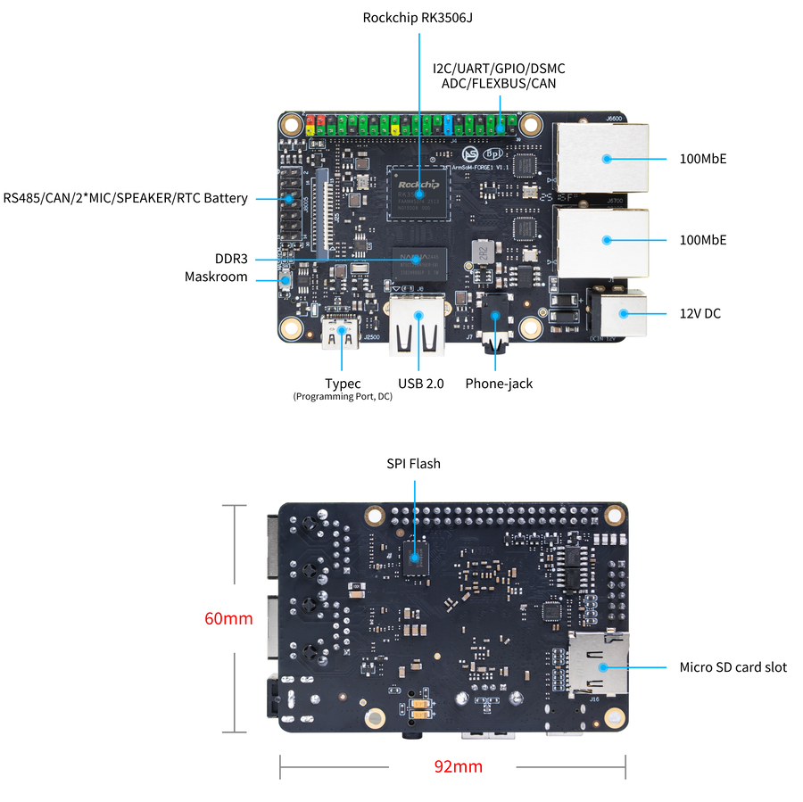
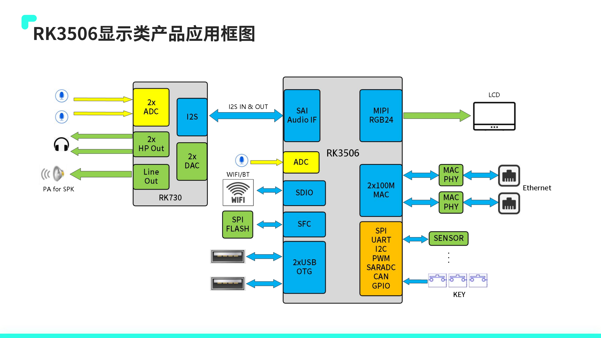
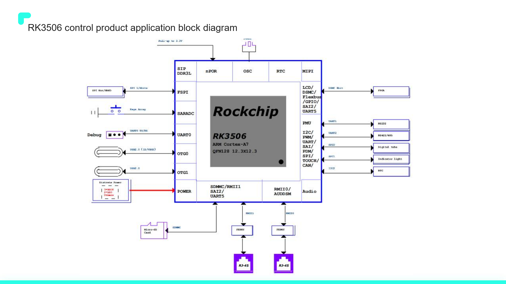
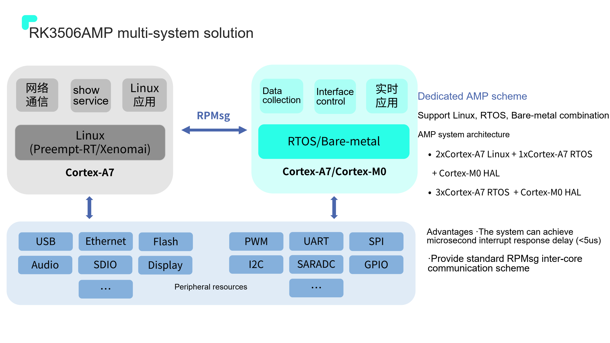
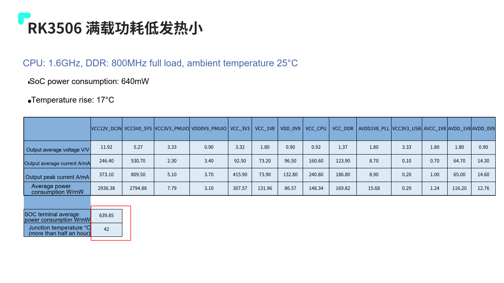

Industrial development starts by making displays, equipment communication and application software operate together reliably. ArmSoM Forge1 integrates RK3506J with common board interfaces for HMI, gateways and acquisition terminals. A later custom product can be evaluated around CM1.

## What the board provides

Forge1 specifications list 512MB DDR3L, 512MB NAND, dual Fast Ethernet, MIPI DSI, USB2.0 Host and RS485/CAN resources in a 92×62mm board. Power options are DC 12V/1A or Type-C 5V/2A; follow the board manual for connection details.

The software description lists Buildroot, Linux 6.1, RT-Thread 4.1, AMP, Preempt-RT/Xenomai and LVGL. This describes official resources, not proof that every downloadable image enables everything simultaneously. Confirm the image, kernel configuration and examples before testing.

## HMI that serves the equipment

Build status, settings, alarm history and maintenance pages. Drive them with real equipment data and measure touch response during communication load. Decouple acquisition from rendering, bound update size and avoid large image decoding or frequent writes disrupting interaction.

Display integration needs panel timing, drivers and touch support. A 2D engine does not automatically accelerate any UI library; verify the rendering backend and driver path.

## A gateway between field devices and networks

Use RS485 or CAN for equipment communication and two Ethernet interfaces for field and upstream networks. Modbus and MQTT are software options to evaluate, not claims that all protocols ship in the factory image.

Define polling cycles, timeouts, retries, buffer limits and deduplication. Check termination, grounding, isolation, surge protection and cables. Interface names do not replace complete-system EMC validation.

## Traceable acquisition

Timestamp states, counts and alarms, with bounded offline buffering and periodic upload. Specify behaviour when network time is unavailable, retain configuration versions and test unexpected power loss. Analogue, thermocouple or high-voltage inputs need suitable external acquisition and isolation circuits.

## Evaluate real-time behaviour

Linux, real-time patches and AMP offer different approaches. Support for a real-time architecture does not guarantee a worst-case response time. Exercise networking, display and storage concurrently, recording latency distribution and maximum values. Decide whether critical loops need an independent controller from system timing and failure requirements.

## Where Forge1 fits

Forge1 suits early board-interface and application validation; CM1 suits a later custom carrier. The board's documented −40 to 85°C range does not automatically apply to a complete product with a display. The official page contains both NAND specifications and eMMC boot wording: this series follows the NAND specification and leaves actual boot-media verification to the delivered revision.

The official interface illustration labels 92×60mm, while the specification table states 92×62mm. This discrepancy is retained: use the delivered revision’s mechanical drawing for enclosures and mounting, not dimensions taken from a promotional image.

## Extend the plan with the RK3506 application presentation

This supplement uses the 34-page `RK3506 产品应用方案介绍_V1.2.2_20240903(1).pdf`. Its cover is dated 2024.08.29, different from the filename; both identify the same supplied file. The following is an editorial project guide, not an ArmSoM reproduction of vendor benchmarks.

Page 12 distinguishes RK3506G2, RK3506B and RK3506J. G2 has embedded 128MB DDR3L, while B/J use external DDR, with J positioned for industrial temperatures. Official Forge1 and CM1 information identifies RK3506J; G2 memory and EVB connections must not be transferred directly to these products.

*RK3506 display-application diagram — Original Chinese figure; no corresponding English figure was found in this batch. `RK3506 产品应用方案介绍_V1.2.2_20240903(1).pdf`, PDF p. 5.*

## Turn six use cases into engineering tasks

| Source application | First measurable objective | Remaining integration work |
| --- | --- | --- |
| Appliance control | Settings, alarms and configuration recovery after power loss | Panel driver, certification, sleep and wake policy |
| Handheld POS | Barcode input alongside the business UI | Camera/scanner, battery management and security requirements |
| Building intercom | Audio/video call, echo path and reconnection | Audio algorithms, camera, network and speaker design |
| PLC control | Reproducible cycle-time and jitter measurements | Real-time driver, task isolation, failure handling and field bus |
| Industrial HMI | Touch, redraw and acquisition together | Panel timing, backlight, interference immunity and UI budget |
| Industrial gateway | Local buffering, forwarding and remote maintenance | Protocols, isolation, logs and update rollback |

These are development directions, not applications guaranteed in the default Forge1 image. Forge1 supports board-level evaluation; a product needing custom connectors, dimensions or industry interfaces can then evaluate a CM1 carrier.

*RK3506 control-application diagram — Original Chinese figure; no corresponding English figure was found in this batch. `RK3506 产品应用方案介绍_V1.2.2_20240903(1).pdf`, PDF p. 6.*

## Software video and UI share CPU resources

Page 19 lists H.264/MJPEG software decoding at reference rates of 720P 30FPS or 480P 60FPS, explicitly showing 90% utilization of two Cortex-A7 cores. This is not a low-overhead dedicated decoder claim. Exercise decoding, scaling, UI, communication and audio concurrently, recording frame rate and touch latency.

The presentation lists Linux Kernel 6.1, RT-Thread 4.1, LVGL and RGA acceleration, plus differential OTA, A/B partitions and fast boot. Availability depends on the SDK, image and configuration. Its “boot within 3 seconds” demonstration is not a guarantee for a user application.

## Compare real-time results under matching conditions

*RK3506 AMP task allocation example — Original Chinese figure; no corresponding English figure was found in this batch. `RK3506 产品应用方案介绍_V1.2.2_20240903(1).pdf`, PDF p. 22.*

Page 22 shows AMP arrangements including `2× Cortex-A7 Linux + 1× Cortex-A7 RTOS + Cortex-M0 HAL`, with RPMsg. This can separate networking/UI from responsive tasks, but shared memory, peripheral ownership and failure recovery still need design.

The approximately 62µs Preempt-RT loaded latency on p. 23 uses cyclictest on an isolated core, stress-ng load, CPU 1300MHz and DDR3 800MHz. Page 24 separately gives an EtherCAT reference of 90µs jitter at a 1ms cycle. The `<5us` interrupt response on p. 22 is a different metric; these values cannot be combined into a real-time guarantee.

## Separate SoC, board and peripheral power

*Vendor load-power conditions and measurement boundaries — Original Chinese figure; no corresponding English figure was found in this batch. `RK3506 产品应用方案介绍_V1.2.2_20240903(1).pdf`, PDF p. 29.*

Under the vendor's CPU 1.6GHz, DDR 800MHz and 25℃ ambient conditions, p. 29 reports about 640mW SoC power and a 17℃ temperature rise. Its 12V input table separately gives about 2936.38mW. The measurement boundaries differ: 640mW must not be advertised as total Forge1 board power.

Likewise, p. 28's 109mW IDLE, 200mW static desktop and 30mW/8mW sleep figures have display, Wi-Fi and Logic power-state conditions. Size supplies, cooling and batteries from peak and average whole-system measurements including the screen, networking, USB and adapters.

## Move from demonstration to a deliverable product

Use one acceptance record for each candidate: board/image revision, boot time, peak memory, packet loss, UI response, temperature, power-loss recovery and update rollback. Validate software and interfaces on Forge1 before choosing a custom CM1 carrier. Leave unconfirmed features explicitly unvalidated.

## Products and development resources

- **Forge1** — [Product](https://www.armsom.org/forge1) · [Documentation](https://docs.armsom.org/armsom-forge1)
- **CM1** — [Product](https://www.armsom.org/cm1) · [Documentation](https://docs.armsom.org/armsom-cm1)

## Further reading

- [RK3506G EVB interfaces and debugging](/articles/rk3506g-evb-interface-debugging/)
- [RK730 audio design](/articles/rk730-audio-codec-design/)

## Related articles and official resources

- [RK3506J explained: industrial HMI and connected equipment](/articles/rk3506j-chip-guide/)
- [ArmSoM CM1: an RK3506J module for your industrial terminal](/articles/cm1-rk3506j-industrial-module/)
- [RK3506B Datasheet V1.0: download, architecture, pins and electrical design](/articles/rk3506b-datasheet-v10/)
- [Rockchip RK3506](https://www.rock-chips.com/a/cn/product/RK35xilie/2025/1208/2125.html)
- [ArmSoM CM1](https://docs.armsom.org/armsom-cm1)
- [ArmSoM Forge1](https://docs.armsom.org/armsom-forge1)
- [ArmSoM](https://www.armsom.org/)
