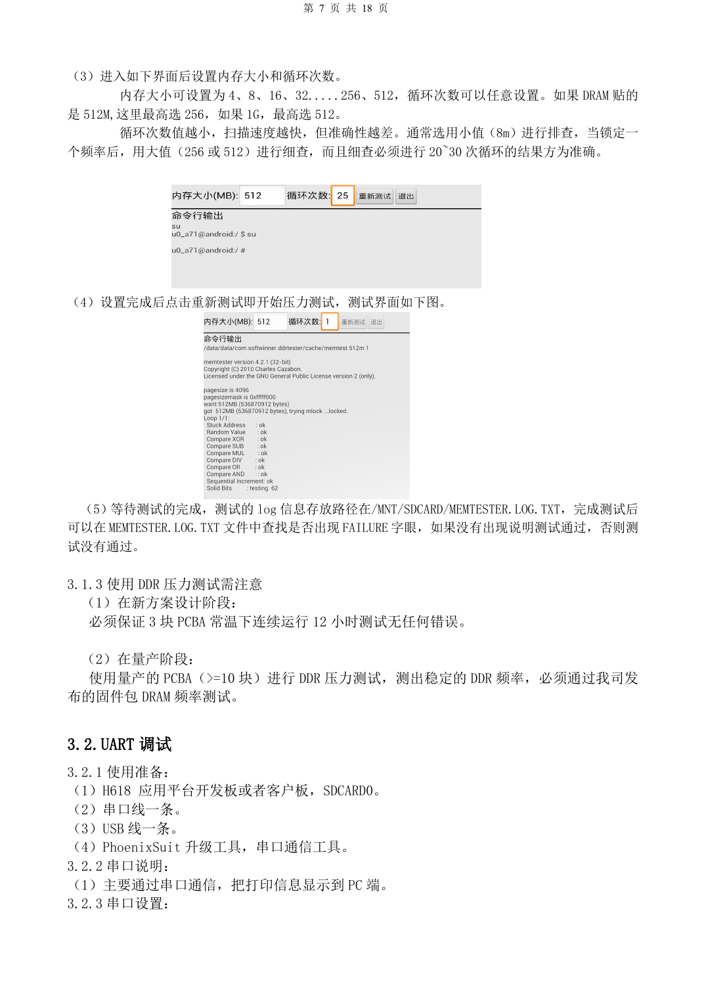
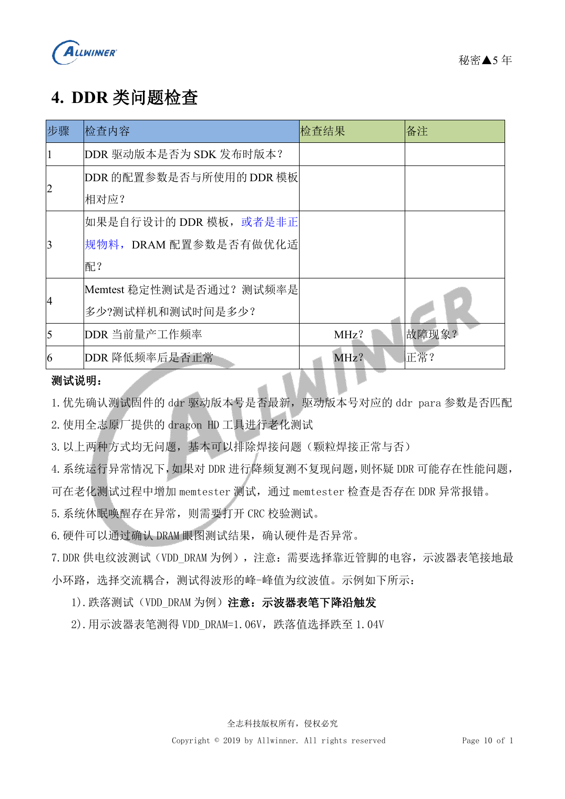

# H618 bring-up and stability: flashing, DDR and fault isolation

This is a source-based hardware design topic for platform reference; no corresponding ArmSoM board is confirmed. Parameters are source references, not ArmSoM measurements. Check silicon revision, PCB, SDK/BSP, kernel, firmware and peripheral specifications before implementation.

**Debug V1.1 PDF 4–17; stability checklist F01 PDF 5–12**

## Locate the failing stage

With power removed, check DCIN, CPU, GPU, SYS, DRAM and PLL for shorts and inspect solder joints. The source uses 5V with a 500mA limit for initial inspection, not as a full-load power rating. If a rail is absent, isolate regulator versus load faults with power removed and measurements on both sides of the inductor. Then check reset release, 24MHz oscillation and USB0 enumeration. Correct voltages pass a checkpoint; they do not prove that the whole system works.

## Flashing and serial diagnostics

The source uses PhoenixSuit, never simultaneously with PhoenixUSB Pro. Use USB0 without firmware; with firmware, power off and hold UBOOT while connecting USB. It also describes a service procedure pulling Flash CLK to ground for FEL; identify the correct board test point and power state before any such operation. Repeated automatic flashing calls for checking BOOT_Select and `need secure img` in the log. With SDCARD0 serial muxing, D3 is board TX and CLK board RX. Match actual IO levels; adapter VCC is not a universal power source.

## DDR and dynamic load

DDRTest1_2.apk examples select at most 256 for 512M RAM and 512 for 1G. Screen with small allocations, then perform 20–30 detailed cycles at 256/512. Preserve the source path `/MNT/SDCARD/MEMTESTER.LOG.TXT` and search for `FAILURE`; check case sensitivity on the target. The source requests three boards for 12h at room temperature during design and at least ten production boards for frequency assessment. These are requirements, not ArmSoM results. Add CRC for resume faults; recovery at lower frequency suggests a margin problem, not device qualification.

## Measurements and unresolved source issues

Measure at capacitors near load pins, with a short probe ground loop; use AC coupling for ripple and falling-edge triggers for droop. The checklist prints `1.05/1.1` for 1200000/1320000 under an mV heading; the next page explicitly says 1.05V/1.1V. Do not use the malformed table as programming values. Its Wi-Fi instruction “reflection greater than -20dB/-10dB” also needs confirmation. For HDMI, USB, audio, SD and Ethernet, inspect supply, enable, continuity, waveform and soldering, then record sample count and duration for reboot, resume and temperature tests.


## Source command example

Only for the source SDK with the corresponding cpufreq/debugfs nodes. Record the governor and frequency before testing and restore them afterward. These commands were not executed for this article.

```sh
echo userspace > /sys/devices/system/cpu/cpu0/cpufreq/scaling_governor
echo 1008000> /sys/devices/system/cpu/cpu0/cpufreq/scaling_setspeed
cat /sys/devices/system/cpu/cpu0/cpufreq/cpuinfo_cur_freq
cat /sys/kernel/debug/cpufreq_table
```

## Reference figures

These reference-page captures retain the original Chinese figure labels. No matching English edition was found; all four languages use the Chinese originals. Text parameters and steps remain copyable; captures support checking. Page numbers are physical PDF pages.

[](/assets/allwinner-hardware-series/h618-18-p8.png)

[](/assets/allwinner-hardware-series/h618-12-p10.png)

## Choosing an ArmSoM platform

For an ArmSoM project, select a platform through official products and documentation, then verify processor, interfaces and software support anew. A733/H618 circuits are not transferred to another SoC by assumption.

- [ArmSoM](https://www.armsom.org/)
- [ArmSoM Docs](https://docs.armsom.org/)

## Series reading

- [H618 minimum system: AXP313A, 24MHz clock and boot selection](/articles/h618-power-clock-boot-design/)
- [H618 DDR and eMMC: templates, impedance and PCB review](/articles/h618-dram-emmc-pcb-design/)
- [H618 interfaces: USB, HDMI, Ethernet and ESD layout](/articles/h618-interfaces-esd-layout/)
- [H618 · Series index](/articles/h618-hardware-design-series/)

<!-- editable-source-tables -->

## Appendix: source dynamic-test frequency/voltage table

Stability checklist F01 · PDF 9

Expected values of the source test firmware only, not universal H618 OPPs. Compare your firmware table; do not copy voltages manually. The preceding-page unit conflict is recorded above.

| Frequency kHz | Example voltage V |
| --- | --- |
| 480000 | 0.9 |
| 720000 | 0.9 |
| 936000 | 0.9 |
| 1008000 | 0.95 |
| 1104000 | 1.0 |
| 1200000 | 1.05 |
| 1320000 | 1.1 |
| 1416000 | 1.15 |
