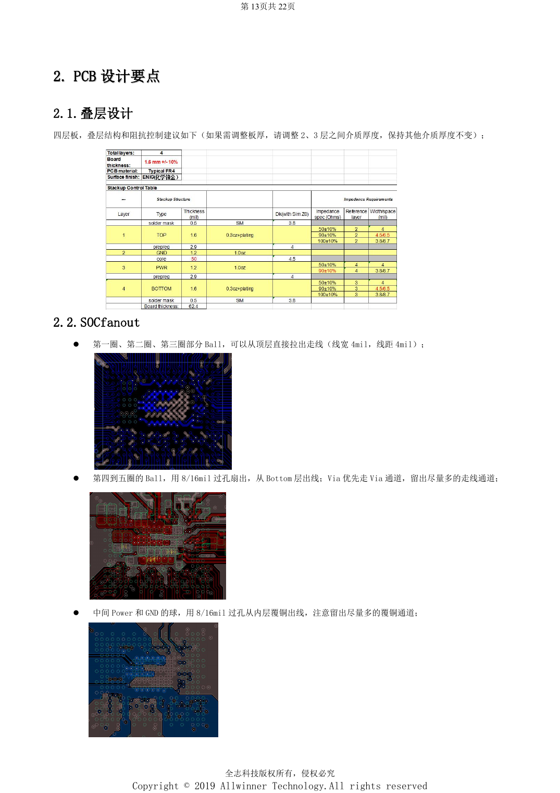
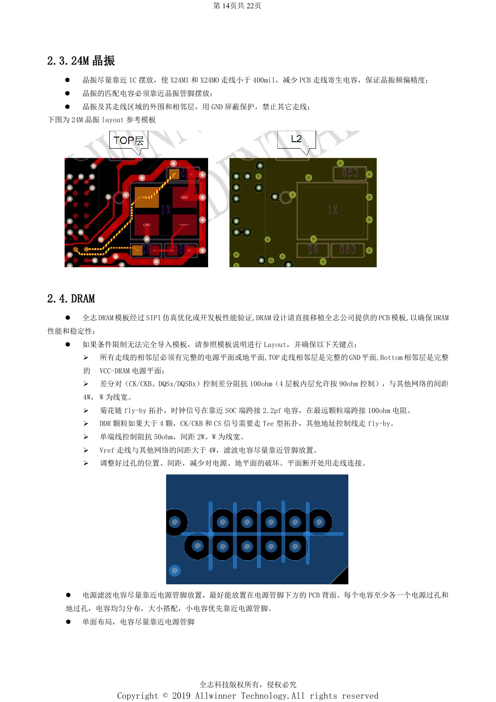

# H618 DDR and eMMC: templates, impedance and PCB review

This is a source-based hardware design topic for platform reference; no corresponding ArmSoM board is confirmed. Parameters are source references, not ArmSoM measurements. Check silicon revision, PCB, SDK/BSP, kernel, firmware and peripheral specifications before implementation.

**Design V1.0 §1.5–1.6, §2.1–2.5; PDF 9–10, 14–16; PCB checklist V1.0**

## Fix the memory configuration first

The guide lists DDR4, DDR3/3L, LPDDR3 and LPDDR4, a single 32-bit channel, two chip selects and up to 4GB. Match the template to the actual part and firmware. The source specifies 240Ω, 1% pull-downs at SoC and DRAM ZQ pins. When swapping 8-bit data groups, swap the associated DQM and differential DQS as well. The four-layer reference uses 4/4mil top escape and 8/16mil inner-row vias; board-thickness changes must preserve template reference geometry.

## DDR routing and return paths

Top signals reference continuous GND; bottom signals reference continuous VCC-DRAM. CK/DQS are 100Ω differential, with 90Ω allowed for inner routing on the four-layer design; the checklist separately states 100Ω±10%, so resolve this against the selected template. Keep differential signals 4W from other nets, single-ended traces 50Ω with 2W spacing, and Vref more than 4W away. The fly-by example uses 2.2pF across the SoC clock and 100Ω at the farthest device. Above four devices CK/CS use a Tee, while address/control remain fly-by. Give every decoupler a supply and ground via and prioritize small capacitors near pins.

## eMMC needs more than length matching

Use 33Ω in CLK and 10kΩ from CMD to VCC-PC. Supply the SoC GPIO domain and eMMC VCCQ from the same rail. Never connect NC/RFU for routing convenience. The text mentions grounded eMMC5.0 pins without a complete pin list: consult the actual device datasheet. Routing is ≤2000mil, D0–D7/DS mismatch to CLK ≤300mil, 50Ω and ≥2W spacing; shield CLK/DS or provide ≥3W. VCC/VCCQ width is ≥12mil with at least two vias at layer changes. Prefer point-to-point for high speed; dual-layout chains end at eMMC and minimize branches.

## Reference figures

These reference-page captures retain the original Chinese figure labels. No matching English edition was found; all four languages use the Chinese originals. Text parameters and steps remain copyable; captures support checking. Page numbers are physical PDF pages.

## Choosing an ArmSoM platform

For an ArmSoM project, select a platform through official products and documentation, then verify processor, interfaces and software support anew. A733/H618 circuits are not transferred to another SoC by assumption.

- [ArmSoM](https://www.armsom.org/)
- [ArmSoM Docs](https://docs.armsom.org/)

## Series reading

- [H618 minimum system: AXP313A, 24MHz clock and boot selection](/articles/h618-power-clock-boot-design/)
- [H618 interfaces: USB, HDMI, Ethernet and ESD layout](/articles/h618-interfaces-esd-layout/)
- [H618 bring-up and stability: flashing, DDR and fault isolation](/articles/h618-bringup-stability-validation/)
- [H618 · Series index](/articles/h618-hardware-design-series/)
