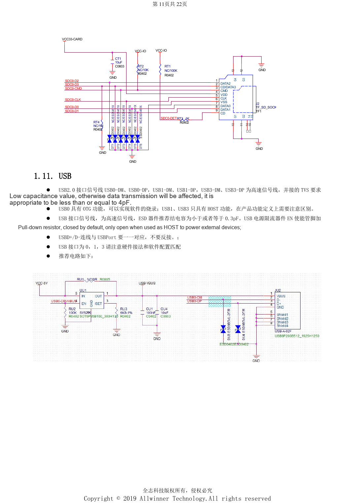
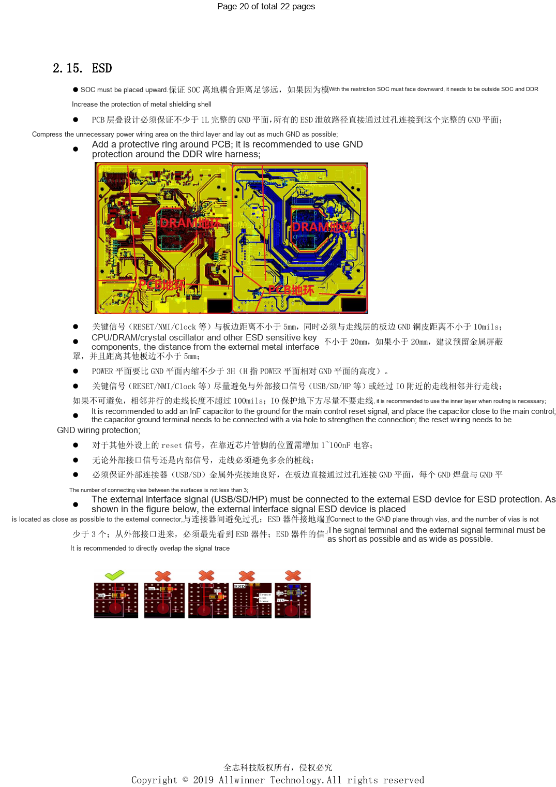

# H618 interfaces: USB, HDMI, Ethernet and ESD layout

This is a source-based hardware design topic for platform reference; no corresponding ArmSoM board is confirmed. Parameters are source references, not ArmSoM measurements. Check silicon revision, PCB, SDK/BSP, kernel, firmware and peripheral specifications before implementation.

**Design V1.0 §1.7–1.13, §2.6–2.15; PDF 10–13, 17–21; PCB checklist V1.0**

## USB and display interfaces

USB0 supports OTG/flashing; USB1 and USB3 are hosts. Port number 3 does not mean USB3.0. Pull the current-limit enable low by default and activate it only for host power. The same source page specifies both ≤4pF and ≤0.3pF for TVS capacitance; clarify the intended nets rather than choosing an arbitrary universal limit. HDMI includes IIC/CEC level shifting; use a low-drop Schottky on 5V to prevent backfeed and avoid falling below 4.75V. CVBS is a current output using an 0805 75Ω shunt and ground-shielded routing.

## Networking, Wi-Fi and audio

Ethernet high-voltage capacitors are at least 1206 and 2kV, with 0805 75Ω resistors; prohibit traces and copper beneath the transformer. The guide requires >50mil high/low-voltage separation while the checklist says at least 2mm: retain the stricter review item and check the enclosure. Match Wi-Fi IO to PG; the SDIO clock reference is 33Ω plus 5.6pF. Bluetooth wake requires an appropriate always-on supply. RF is 50Ω, preferably <6cm, >3mm from the edge, without branches or layer changes, with ground vias every 0.5–1mm. Audio AVCC is ≥25mil; VRA1/2 ≥10mil and ≤300mil; separate LINEOUT from DDR noise.

## Review ESD and thermal paths together

Keep at least one continuous ground layer. Place protection at the connector, ahead of the internal circuit, with at least three ground vias. RESET/NMI/Clock stay ≥5mm from the edge and ≥10mil from edge ground copper; CPU/DDR/crystals stay ≥20mm from exposed metal ports, otherwise consider shielding. SoC reset uses a 1nF reference; peripheral reset uses 1–100nF, not interchangeable rules. Recess power planes by at least 3H relative to ground. Central thermal vias reference 10–12mil holes and 30–40mil pitch; distribute heat sources and use the >2cm PMU/SoC reference spacing. Whole-product thermal and EMC tests remain necessary.

## Parameter reference

| Item | Source reference |
| --- | --- |
| USB routing | 90Ω; length <4000mil; vias ≤2; clearance >10mil |
| HDMI routing | 90–100Ω; intra-pair <10mil; inter-pair <100mil; length <3000mil |
| SD Card routing | 50Ω; data-to-CLK <500mil; CLK resistor within 300mil of SoC |

## Reference figures

These reference-page captures retain the original Chinese figure labels. No matching English edition was found; all four languages use the Chinese originals. Text parameters and steps remain copyable; captures support checking. Page numbers are physical PDF pages.

## Choosing an ArmSoM platform

For an ArmSoM project, select a platform through official products and documentation, then verify processor, interfaces and software support anew. A733/H618 circuits are not transferred to another SoC by assumption.

- [ArmSoM](https://www.armsom.org/)
- [ArmSoM Docs](https://docs.armsom.org/)

## Series reading

- [H618 minimum system: AXP313A, 24MHz clock and boot selection](/articles/h618-power-clock-boot-design/)
- [H618 DDR and eMMC: templates, impedance and PCB review](/articles/h618-dram-emmc-pcb-design/)
- [H618 bring-up and stability: flashing, DDR and fault isolation](/articles/h618-bringup-stability-validation/)
- [H618 · Series index](/articles/h618-hardware-design-series/)
