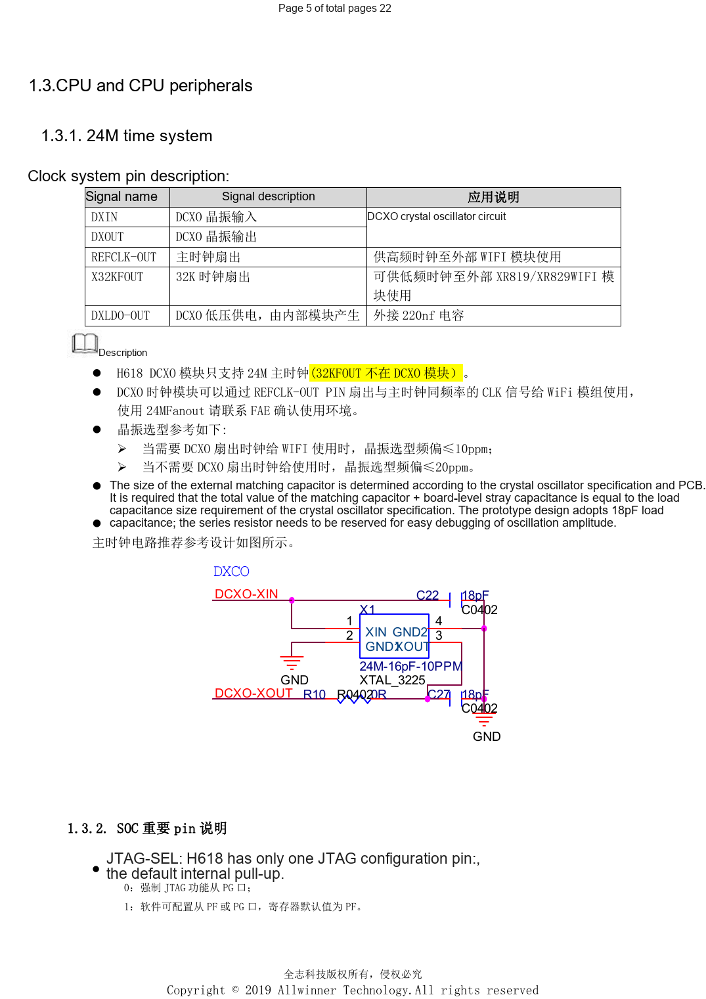
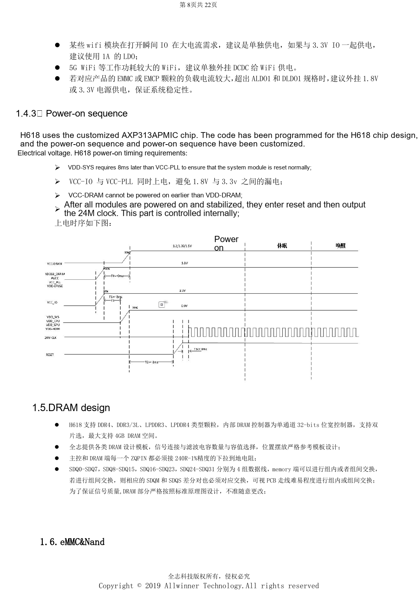

# H618 minimum system: AXP313A, 24MHz clock and boot selection

This is a source-based hardware design topic for platform reference; no corresponding ArmSoM board is confirmed. Parameters are source references, not ArmSoM measurements. Check silicon revision, PCB, SDK/BSP, kernel, firmware and peripheral specifications before implementation.

**Design V1.0 §1.1–1.4, §2.1–2.3, §2.11; PDF 5–9, 14–15, 19**

## From BROM to the operating system

After reset, BROM initializes power, clocks, buses, reset and storage. Initialization information for UART and DRAM is read into SRAM, followed by Boot0, U-Boot and the operating system with its peripherals. Accessible serial diagnostics, boot straps and recovery belong in the minimum system. JTAG-SEL has an internal pull-up: low forces PG; high allows software selection of PF/PG, defaulting to PF. Pull AP-RESET up to VCC-PLL and retain its RC and ESD protection.

## Power and sequencing

The reference uses a preprogrammed AXP313A. VDD-SYS follows VCC-PLL by 8ms; VCC-IO rises with VCC-PLL, and VCC-DRAM must not precede VDD-DRAM. Internal reset and the 24MHz clock follow stable supplies. CPU power is separate for DVFS; GPU and SYS share a rail that must not be independently voltage-scaled. The reference uses 22µF at the CPU regulator and load, two 22µF near SYS/GPU and at least 10µF near VCC-DRAM. Assess separate supplies for high-power Wi-Fi or eMMC loads exceeding the LDO rating.

## Clock and source inconsistencies

DCXO supports only 24MHz. Crystal tolerance is ≤10ppm with Wi-Fi fanout and ≤20ppm otherwise. Fit 220nF on DXLDO-OUT. The 18pF capacitors are prototype examples, not universal values; keep DXIN/DXOUT below 400mil with ground shielding. The source lists 1.6A SYS+GPU load against 1.5A PMU capability: this requires clarification, not a claim of headroom. Its contents page says V2.1 while the cover and revision record say V1.0; this series identifies the source as V1.0.

## Parameter reference

| Item | Source reference |
| --- | --- |
| Boot medium; PC3/4/5/6 | MLC NAND / SLC NAND: 1/1/1/1; eMMC USER: 0/1/1/1; eMMC BOOT: 1/0/1/1; SPI_NOR: 1/1/0/1; SPI_NAND: 1/1/1/0 |
| Module supply minimum | >=1.78V; nominal 1.8V ±1% |

## Reference figures

These reference-page captures retain the original Chinese figure labels. No matching English edition was found; all four languages use the Chinese originals. Text parameters and steps remain copyable; captures support checking. Page numbers are physical PDF pages.

## Choosing an ArmSoM platform

For an ArmSoM project, select a platform through official products and documentation, then verify processor, interfaces and software support anew. A733/H618 circuits are not transferred to another SoC by assumption.

- [ArmSoM](https://www.armsom.org/)
- [ArmSoM Docs](https://docs.armsom.org/)

## Series reading

- [H618 DDR and eMMC: templates, impedance and PCB review](/articles/h618-dram-emmc-pcb-design/)
- [H618 interfaces: USB, HDMI, Ethernet and ESD layout](/articles/h618-interfaces-esd-layout/)
- [H618 bring-up and stability: flashing, DDR and fault isolation](/articles/h618-bringup-stability-validation/)
- [H618 · Series index](/articles/h618-hardware-design-series/)

<!-- editable-source-tables -->

## Appendix: source AXP313A supply table

Design V1.0 · PDF 8

CPU/SYS use “+5%”, not “±5%”, in the source; the sign is not silently corrected. See the SYS+GPU current conflict above. The DRAM value is a DDR3 example, not universal.

| Rail | Voltage | Accuracy (source) | Ripple/noise | Scenario peak | PMU capacity |
| --- | --- | --- | --- | --- | --- |
| CPU | 0.9V | 0.9V+5% | <90mV | 1.8A | 3A |
| SYS+GPU | 0.94V | 0.94V+5% | <90mV | 1.6A | 1.5A |
| DRAM | 1.5V | 1.5V±10% | <125mV | 1A | 2A |
| Module | 1.8V | 1.8V±1% | <30mV | 100mA | 300mA |
| IO normal | 3.3V | 3.3V±10% | <125mV | 200mA | 500mA |
