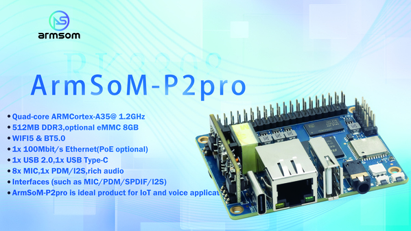

P2 Pro combines a small form factor, Linux and wired/wireless connectivity for lightweight acquisition and networking prototypes. Its purpose here is connecting equipment data to applications, not replacing high-throughput networking hardware. Define sample rates, buffering and protocols before choosing a software deployment.

## Select the configuration

| Item | Published information | Check before use |
|---|---|---|
| CPU | RK3308B-S, four Cortex-A35 | Actual clock and image architecture |
| RAM | Common product: 512MB DDR3; docs also list 256/512MB | Purchased and delivered revision |
| Storage | MicroSD; optional 8GB eMMC | eMMC is not universal standard equipment |
| Network | One Fast Ethernet port, AP6256 wireless module | Drivers, antenna, bands and coverage |
| Supply | Type-C 5V/2A; optional PoE module | Do not assume PoE is fitted |
| Size/temperature | 65×52.5mm; documented 0–70°C | Validate enclosure and complete system separately |

Official pages also differ between Bluetooth 4.2 and 5.0. This series confirms the module identity and connectivity, while leaving version and enabled features to the actual module, firmware and image.

## Sensor acquisition and status reporting

Read environmental or machine states through appropriate I2C, SPI or serial components. Validate ranges, timestamp locally and upload. Check voltages, level shifting, isolation and sensor power first. GPIO UART is not RS232/RS485; field buses require suitable transceivers.

## A lightweight message gateway

Evaluate a protocol such as MQTT, separating acquisition, queueing and reporting. Define retry intervals, queue limits and message expiry. Reconnection must not cause unlimited replay of obsolete records. Plan TLS, authentication, updates and logs even on an internal network.

## Connected audio notifications

Receive application events and play sounds or spoken feedback. Measure resource use when networking and playback run concurrently. If an external speech service is required, specify offline fallback behaviour.

## Network limits and software maintenance

One Fast Ethernet port does not make a dual-port router. Wired/wireless application communication can be evaluated, but bridging, routing and VPN throughput need separate measurements.

Documentation lists Debian 11, Buildroot and third-party OpenWrt/istoreos. These are documented options, not claims that they are all current releases or support every peripheral identically. Check source, board target, drivers and maintenance before using third-party images.

## Suggested validation sequence

1. Verify configuration, power, boot, storage and networking.
2. Connect a real sensor and log timestamps, invalid values and communication errors.
3. Add a bounded local queue; test disconnects, restarts and power loss.
4. Measure CPU, RAM, writes and sustained temperature; remove unnecessary services.
5. Test updates and rollback, recording image and application versions.

These are development paths, not production certification or stability-test conclusions. P2 Pro can turn lightweight connected ideas into prototypes; final products still require validation.

## Related articles and official resources

- [RK3308B-S explained: voice, audio and connected embedded devices](/articles/rk3308bs-chip-guide/)
- [ArmSoM P2 Pro: microphone capture, voice interaction and network audio](/articles/p2pro-voice-audio-applications/)
- [RK3308B-S Datasheet V1.0: download, audio architecture and electrical guide](/articles/rk3308bs-datasheet-v10/)
- [Rockchip Audio](/articles/023-rockchip-audio/)
- [Rockchip RK3308](https://www.rock-chips.com/a/cn/product/RK33xilie/2018/0614/908.html)
- [P2 Pro — Docs](https://docs.armsom.org/armsom-p2pro)
- [P2 Pro — ArmSoM](https://www.armsom.org/product-page/p2pro)
- [P2 Pro — BSP](https://github.com/ArmSoM/armsom-p2pro-bsp)
