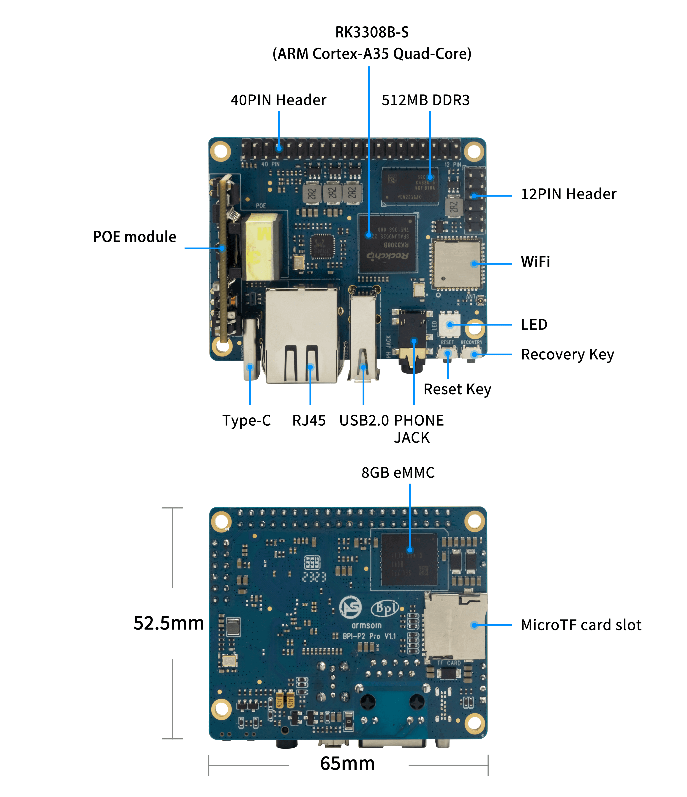

A voice development board is useful when microphones, output, networking and Linux software can be integrated. RK3308B-S-based ArmSoM P2 Pro suits voice prototypes, network audio nodes and multichannel capture experiments. Establish a stable signal chain before adding complex algorithms.

## Understand the exposed interfaces

P2 Pro documentation lists eight MIC inputs, PDM/I2S, two line outputs and SPDIF output on the 40-pin header, plus an audio jack. MIC interfaces do not mean a complete microphone array is fitted. Select microphones, geometry, cables and capture configuration separately.

This audio-oriented 40-pin header must not be assumed Raspberry Pi compatible. Check schematics, voltage, MICBIAS and differential inputs. Line output is not a speaker power output.

## Voice command terminal

Separate capture, preprocessing, event detection, recognition, actions and feedback. VAD supplies activity information; choose wake-word and recognition software separately. Evaluate limited-vocabulary local recognition or an explicitly selected remote service. Local processing needs CPU, memory and accuracy tests; remote processing adds networking, latency and data-handling considerations.

Test silence, background music, multiple speakers, the device's own playback and loss of connectivity. Record false triggers, misses and end-to-end latency rather than one successful wake-up. No recognition range or bundled algorithm licence is promised here.

## Network playback and notifications

Separate reception, buffering, decoding and playback. Test underruns, stream recovery and volume changes. When using an amplifier, verify line levels and grounding; headphone/line specifications are not finished-speaker output power.

Public-space notifications, desktop players and spoken equipment feedback are possible prototypes. Synchronised playback across devices additionally requires time synchronisation, clock-drift handling and buffering; Wi-Fi alone does not guarantee it.

## Multichannel capture

Validate polarity, gain and sample format with one microphone, check channel mapping individually, then capture together. The manual distinguishes external audio IO from internal codec connections. Controller counts are not independent external port counts; verify sample-rate/channel combinations for the selected interface.

These read-only enumeration commands require ALSA tools and do not record audio. Discover device numbers from their output rather than hardcoding them:

```sh
cat /proc/asound/cards
arecord -l
aplay -l
```

## Towards stable operation

Fix board revision, image, kernel, sound-card configuration, microphones and supply. Check capture interruptions, dropped samples, clock drift, playback coupling and temperature. Long recordings require capacity and flash-endurance planning. Conflicting published clock values cannot establish algorithm performance. Continue with the official BSP and the site's Audio guide; documented commands are not hardware tests performed for this series.

## Related articles and official resources

- [RK3308B-S explained: voice, audio and connected embedded devices](/articles/rk3308bs-chip-guide/)
- [ArmSoM P2 Pro: IoT acquisition and lightweight gateway development](/articles/p2pro-iot-lightweight-gateway/)
- [RK3308B-S Datasheet V1.0: download, audio architecture and electrical guide](/articles/rk3308bs-datasheet-v10/)
- [Rockchip Audio](/articles/023-rockchip-audio/)
- [Rockchip RK3308](https://www.rock-chips.com/a/cn/product/RK33xilie/2018/0614/908.html)
- [P2 Pro — Docs](https://docs.armsom.org/armsom-p2pro)
- [P2 Pro — ArmSoM](https://www.armsom.org/product-page/p2pro)
- [P2 Pro — BSP](https://github.com/ArmSoM/armsom-p2pro-bsp)
