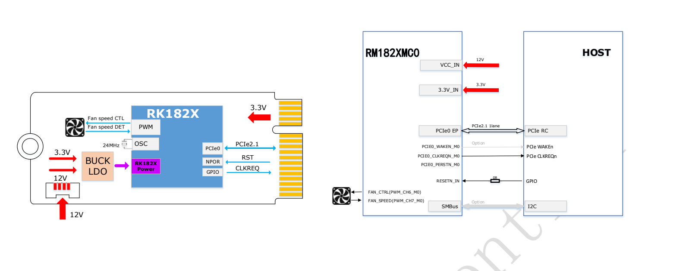
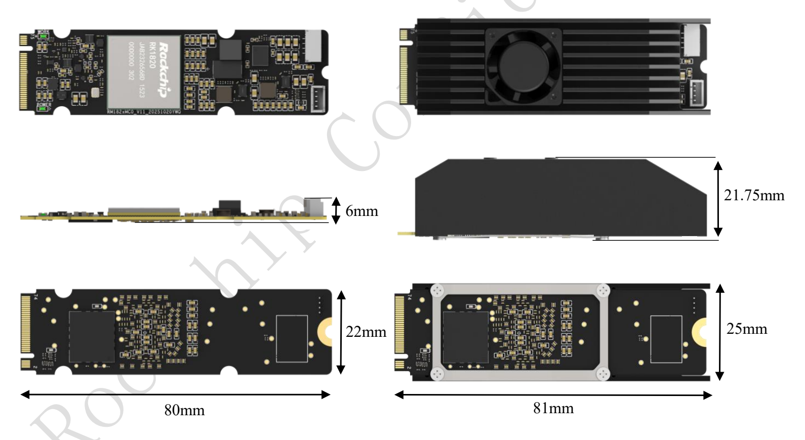

RM182XMC0 is the RK182X M.2 Key M AI-coprocessor family: RM1820MC0 and RM1828MC0. This article organises the supplied two-page Rev1.0 brief's specifications, performance table, power, figures and ordering data for ArmSoM-platform evaluation. Source measurements are not ArmSoM tests.

[Download the original two-page M.2 brief](/assets/rk182x/RK182X-M2-Brief-V1.0.pdf)

## 1. Models and compute

| Ordering model | Chip | Built-in DRAM | Source positioning | Interface |
|---|---|---|---|---|
| RM1820MC0 | RK1820 | 2.5GB | 3B | M.2 Key M, PCIe2.1 |
| RM1828MC0 | RK1828 | 5GB | 7B | M.2 Key M, PCIe2.1 |

The rating is20TOPS@INT8 with INT4/INT8/INT16/FP8/FP16/BF16. The Chinese brief describes built-in DRAM as having “hundreds of GB” high bandwidth without an explicit per-second unit, exact number or test conditions. No GB/s figure is invented here. Model size alone does not establish quantisation, context length or runtime memory suitability.

## 2. Listed models and software

The list names Qwen2.5 0.5B/1.5B/3B, Qwen3 0.6B/1.7B, FastVLM, MobilnetV1, MobilnetV2, Resnet50V2, yolov5s, yolov6s, yolov8s. `Mobilnet` preserves the source spelling. Qwen2.5 7B appears separately in the performance table despite being absent from that list; both are retained.

Software comprises development-host RKNN3 Toolkit, board-side RKNN3 Runtime and RKNN3 Model Zoo conversion/deployment examples. The brief gives no exact versions, installation commands, host OS matrix or quantisation configuration. Obtain matching packages and documentation for deployment.

## 3. Source performance and power

Both modes specify **Input tokens: 128**. TTFT is time to first token; TPS is generation rate. Values below reproduce the source.

| Model | Mode | TTFT (ms) | TPS (tokens/s) | Average power (W) | Peak power (W) |
|---|---|---|---|---|---|
| Qwen2.5 3B | Power-saving | 144.455 | 54.537 | 5.35 | 15.14 |
| Qwen2.5 3B | Standard | 96.05 | 77.945 | 7.2 | 24.86 |
| Qwen2.5 7B | Power-saving | 288.255 | 35.044 | 7.02 | 16.11 |
| Qwen2.5 7B | Standard | 186.435 | 51.476 | 10.4 | 27.28 |

Host, firmware, quantisation, output length, sampling, cooling and power-measurement boundaries are not fully disclosed. These figures do not promise speed for arbitrary3B/7B models; average power is not peak supply demand.

## 4. Power and host wiring

**An additional12V input is required alongside M.2-slot3.3V.** The diagram connects PCIe0 EP to host RC through PCIe2.1 x1, with CLKREQ, optional WAKE, RESETN_IN/0Ω, optional SMBus/I2C, and fan PWM/tachometer. Key M does not make this an NVMe SSD or guarantee arbitrary-slot power/software compatibility.

## 5. Mechanical clearance

The bare module is22×80mm with6mm marked in side view. The cooled assembly is marked81mm long, 25mm wide and21.75mm high. Allow for wiring, mounting and airflow beyond the2280 board outline. This illustration is not a complete manufacturing-tolerance drawing.

## 6. Difference from SO-DIMM

M.2 ordering codes are RM1820MC0/RM1828MC0; SO-DIMM codes are RM1820SA0/RM1828SA0. A shared chip family does not imply matching interfaces, power, mechanics or firmware. Do not transfer the SO-DIMM8–14.4V range, 260-pin definitions or thermal limits to M.2 without confirmation.

## 7. ArmSoM evaluation sequence

Confirm host RC and slot wiring → verify3.3V, additional12V and peak margin → check cooling clearance → match driver, firmware and RKNN3 → validate accuracy, TTFT/TPS and stability. These PDFs alone do not establish direct support on any particular ArmSoM board; validate the actual hardware revision.

## Related documentation

- [RK182X SO-DIMM module: architecture, 260-pin pinout, power and integration](/articles/rk182x-sodimm-module-datasheet/)
- [ArmSoM Docs](https://docs.armsom.org/)
