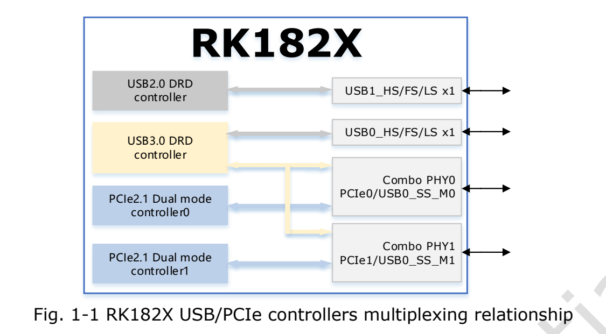
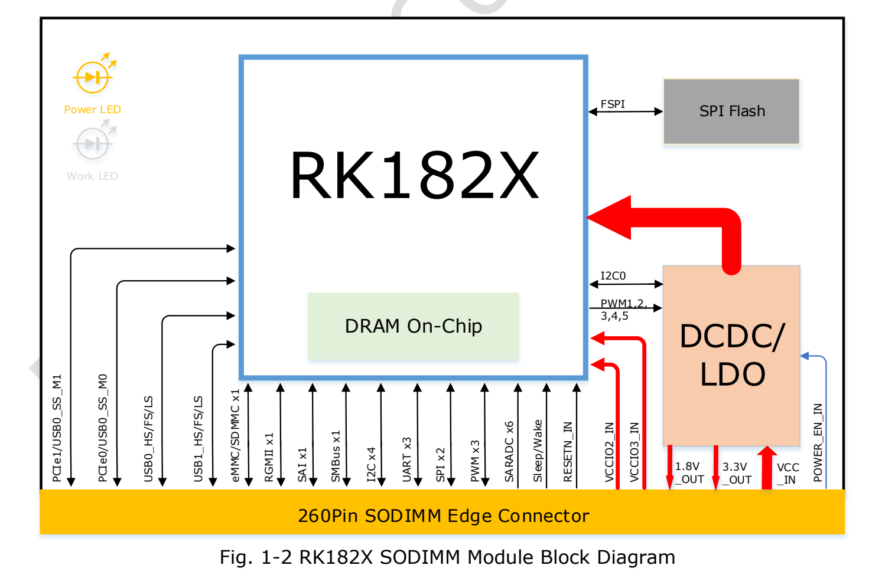
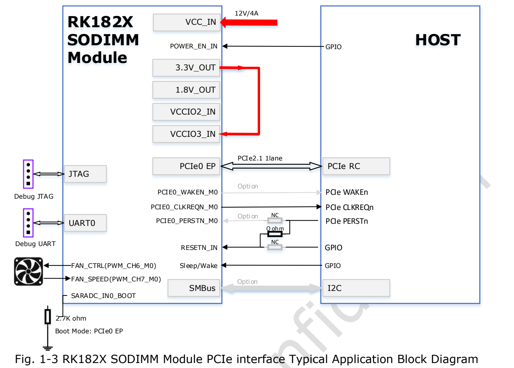
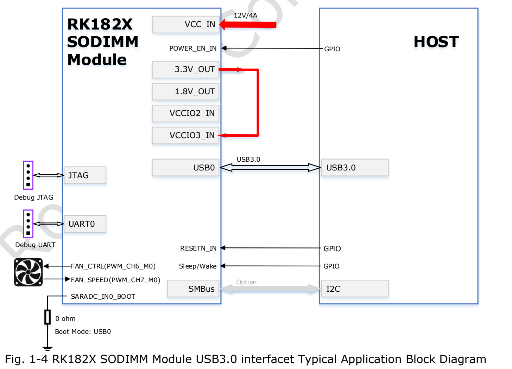
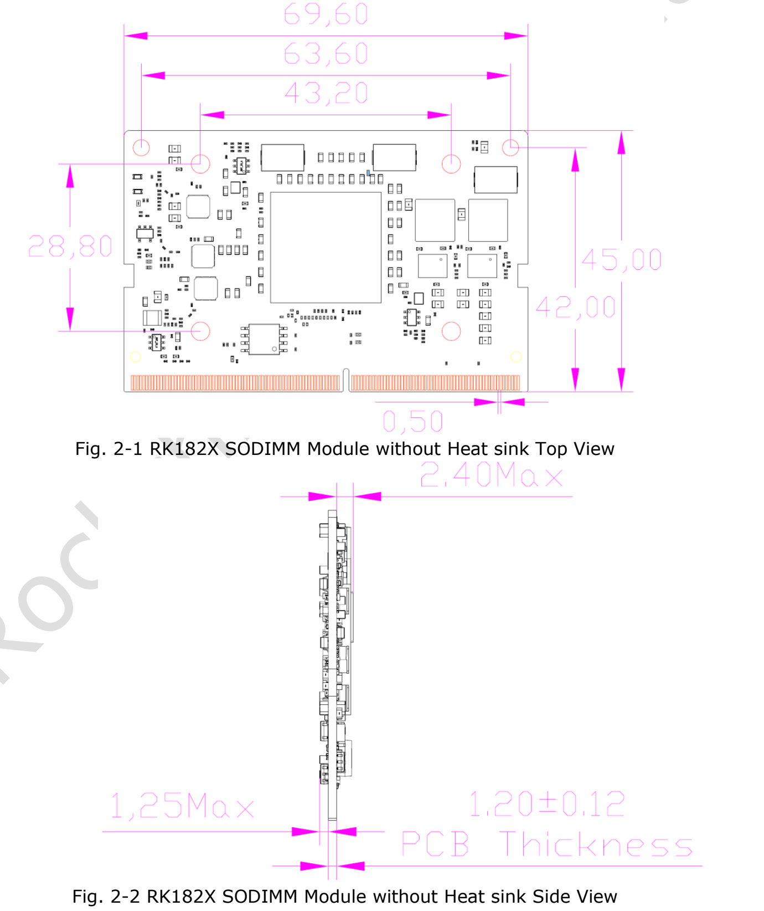
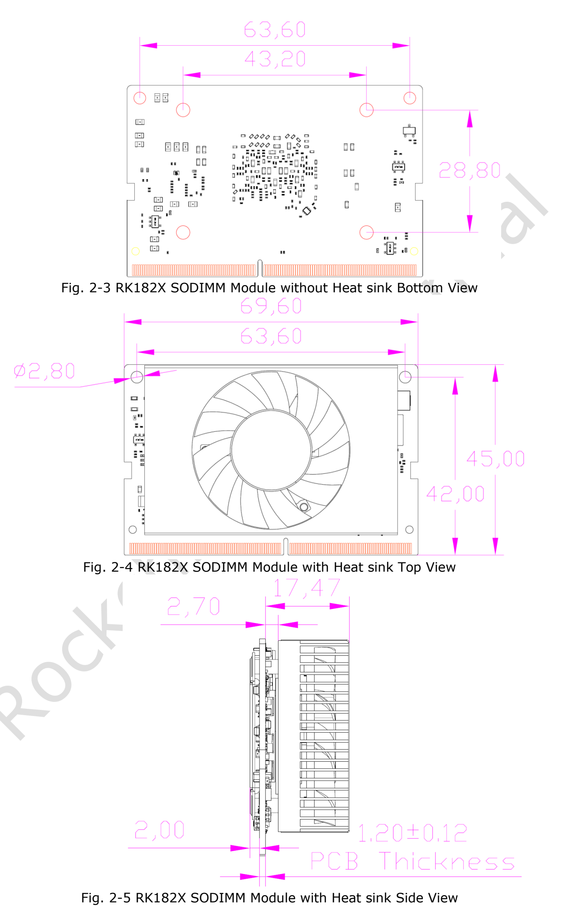
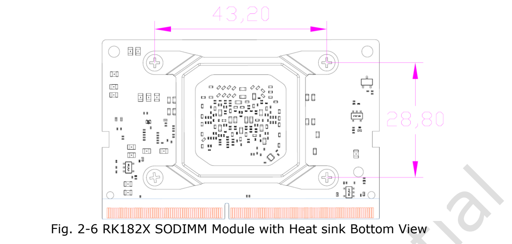

RK182X is an **AI coprocessor** for inference and machine vision. This guide uses the supplied RK182X SODIMM Module Datasheet Rev 1.1 for ArmSoM-host or custom-carrier evaluation. It is not a standalone general-purpose host, and a 260-pin SO-DIMM outline does not establish interchangeability with AIM7, Jetson or memory sockets.

[Download the complete original PDF, 24 pages](/assets/rk182x/RK182X-SODIMM-Datasheet-V1.1.pdf)

This engineering reading guide includes the complete 260-pin signal list and principal electrical limits. Consult the original for all feature details and interface test conditions. No ArmSoM compatibility or model-performance measurements were performed.

## 1. Models, compute and memory

| Module | Chip | Built-in DRAM | Source model positioning |
|---|---|---|---|
| RM1820SA0 | RK1820 | 2.5GB | 3B |
| RM1828SA0 | RK1828 | 5GB | 7B |

The three independent 64-bit RISC-V cores are SRV, VRV0 and VRV1. SRV implements RV64GCB and the vector cores RV64GCBV. Each has an H/F/D FPU, 32KB instruction cache, 32KB data cache and 128KB L2. VRV0/VRV1 add 128-bit vector units. One source line says VR0; VRV0 is used here from context, with the discrepancy recorded.

The NPU is rated up to **20 TOPS INT8**, supporting INT4/INT8/INT16/FP8/FP16/BF16. TensorFlow, MXNet, PyTorch, Caffe, Tflite, Onnx NN and Android NN are listed across the source. Listing a framework does not guarantee every version, operator or model.

BootROM supports FSPI/eMMC/SD/MMC boot and USB0/UART0/PCIe0 downloading. There is 512KB system SRAM and module SPI Flash. The combined SDMMC modes are exclusive: eMMC4.51 supports HS200 and 1/4/8-bit buses, without CMD Queue; SD3.0/MMC4.51 supports 1/4-bit.

## 2. System and image-processing blocks

The clock unit has four PLLs and a 24MHz input, individual gating and global/local software reset. PMU domains are VDD_TOP, VDD_LOGIC and VDD_PMU. There are six 64-bit timers, three 32-bit watchdogs and twelve inter-core mailboxes. DMA has two physical channels, 24 logical channels and 22 peripheral request groups, with memory/peripheral, linked-list and multi-block transfers.

Interrupt inputs number 160 for SRV and 64 for VRV, with M/S-mode software interrupts, high-level sensitivity and programmable priorities. The crypto engine lists AES-128/192/256, SM4, SHA-1, SHA-256/224, MD5, SM3, related HMAC, RSA up to4096-bit, ECC up to256-bit, SM2 and multistage Key-ladder. Presence is not a recommendation to adopt every legacy algorithm.

JPEG encoding uses Baseline/JFIF1.02 at16×16–65520×65520; decoding starts at48×48. The decoder's `RG888` source spelling is retained rather than silently changed to `RGB888`.

RGA lists BT.601/709 conversion, dithering, 8192×8192 source/4096×4096 destination, 1/16–16 scaling, 0/90/180/270-degree rotation, XY mirroring, BitBLT, Alpha blending, YUV2YUV CSC and OSD inversion. Upscaling uses bicubic filtering but the source switches to bilinear for source>1992; retain this threshold pending SDK confirmation. Several10-bit inputs are clipped to8-bit, so this is not a promise of an end-to-end10-bit output pipeline.

## 3. Interfaces and multiplexing

Two Combo PHYs serve two PCIe2.1 controllers and one USB3.0 DRD controller; USB SuperSpeed is multiplexed to one PHY. Each PCIe link is x1, RC/EP, 2.5/5.0Gbps per direction. Do not count all USB/PCIe functions as unconditionally simultaneous ports.

| Interface | Source capability |
|---|---|
| Ethernet | One MAC, RGMII, 10/100/1000Mbps, full/half duplex, TSO/USO, IEEE1588-2002/2008 |
| USB2.0 DRD | 480/12/1.5Mbps, EHCI1.0, OHCI1.0a |
| USB3.0 DRD | Static Device or static xHCI Host |
| SPI | Two controllers, two chip selects, configurable master/slave |
| I2C | Four masters, 7/10-bit addresses, 100k/400k/1M bit/s |
| SMBus | One slave, byte/word/32-bit/block operations, PEC, Alert, UDID, clock stretching |
| UART | Three, 64-byte TX/RX FIFOs, 5/6/7/8-bit, up to4Mbps; UART2 flow control/RS485 |
| PWM | Three, capture, continuous/one-shot, two-stage divider, power-key capture, frequency meter, counter |
| SAI | One, 4 TX+4 RX, I2S/PCM/TDM, up to128 slots, 8–32-bit slot/valid lengths |
| GPIO | Level/rising/falling/both-edge interrupts, polarity, weak pulls, drive strength |
| OTP | 8K bits, 6.5K for secure applications; Program/Read/Idle |

## 4. Typical host connections

The PCIe example uses host RC, module PCIe0 EP and12V/4A, with a2.7kΩ boot-selection resistor. The USB example selects USB0 with0Ω. Review reset, CLKREQ, optional WAKE/PERST, SMBus, debug UART/JTAG and fan PWM/tachometer against the diagrams and final reference design. Do not power an unverified carrier based on prose alone.

## 5. Mechanics and 260-pin list

The module measures69.6×45mm with a260-pin SO-DIMM connector at0.5mm pitch. Bare-board drawings show1.20±0.12mm PCB thickness and2.40mm/1.25mm maximum component heights on the two sides. Allow for the heatsink and socket; dimensions are in mm.

Complete260-pin list; preserve mux names, RSVD, NC and the source double slash on pin195.

| Pin | Original signal name |
|---|---|
| 1 | `GND` |
| 2 | `GND` |
| 3 | `RSVD` |
| 4 | `RSVD` |
| 5 | `RSVD` |
| 6 | `RSVD` |
| 7 | `GND` |
| 8 | `GND` |
| 9 | `RSVD` |
| 10 | `RSVD` |
| 11 | `RSVD` |
| 12 | `RSVD` |
| 13 | `GND` |
| 14 | `GND` |
| 15 | `RSVD` |
| 16 | `RSVD` |
| 17 | `RSVD` |
| 18 | `RSVD` |
| 19 | `GND` |
| 20 | `GND` |
| 21 | `3.3V OUT` |
| 22 | `RSVD` |
| 23 | `3.3V OUT` |
| 24 | `RSVD` |
| 25 | `GND` |
| 26 | `GND` |
| 27 | `1.8V OUT` |
| 28 | `RSVD` |
| 29 | `1.8V OUT` |
| 30 | `RSVD` |
| 31 | `GND` |
| 32 | `GND` |
| 33 | `VCCIO2_IN` |
| 34 | `RSVD` |
| 35 | `VCCIO3_IN` |
| 36 | `RSVD` |
| 37 | `GND` |
| 38 | `GND` |
| 39 | `RSVD` |
| 40 | `RSVD` |
| 41 | `RSVD` |
| 42 | `RSVD` |
| 43 | `GND` |
| 44 | `GND` |
| 45 | `RSVD` |
| 46 | `RSVD` |
| 47 | `RSVD` |
| 48 | `RSVD` |
| 49 | `GND` |
| 50 | `GND` |
| 51 | `RSVD` |
| 52 | `RSVD` |
| 53 | `RSVD` |
| 54 | `RSVD` |
| 55 | `GND` |
| 56 | `GND` |
| 57 | `RSVD` |
| 58 | `RSVD` |
| 59 | `RSVD` |
| 60 | `RSVD` |
| 61 | `GND` |
| 62 | `GND` |
| 63 | `RSVD` |
| 64 | `RSVD` |
| 65 | `RSVD` |
| 66 | `RSVD` |
| 67 | `GND` |
| 68 | `GND` |
| 69 | `RSVD` |
| 70 | `RSVD` |
| 71 | `RSVD` |
| 72 | `RSVD` |
| 73 | `GND` |
| 74 | `GND` |
| 75 | `RSVD` |
| 76 | `RSVD` |
| 77 | `RSVD` |
| 78 | `RSVD` |
| 79 | `GND` |
| 80 | `GND` |
| 81 | `RSVD` |
| 82 | `RSVD` |
| 83 | `RSVD` |
| 84 | `RSVD` |
| 85 | `GND` |
| 86 | `GND` |
| 87 | `USB0_DRD_VBUSDET` |
| 88 | `RSVD` |
| 89 | `ETH_TXD0/PCIE1_WAKEN_M2/PWM_CH0_M1/SPI0_MOSI_M2/GPIO1_A6_d` |
| 90 | `RSVD` |
| 91 | `ETH_TXCTL/PCIE1_CLKREQN_M2/SPI0_CLK_M2/GPIO1_B2_d` |
| 92 | `RSVD` |
| 93 | `ETH_TXD1/PCIE1_PERSTN_M2/SPI0_MISO_M2/GPIO1_A7_d` |
| 94 | `RSVD` |
| 95 | `ETH_RXD0/SPI0_CS0N_M2/GPIO1_B4_d` |
| 96 | `RSVD` |
| 97 | `ETH_RXD1/SPI0_CS1N_M2/GPIO1_B5_d` |
| 98 | `RSVD` |
| 99 | `SARADC_IN6/PCIE0_PERSTN_M1/I2C4_SCL_M0/SAI_SDI2_M2/UART2_TX_M0/PWM_CH6_M2/GPIO1_D6_d` |
| 100 | `RSVD` |
| 101 | `SARADC_IN7/PCIE0_WAKEN_M1/I2C4_SDA_M0/SAI_SDI3_M2/UART2_RX_M0/PWM_CH7_M2/GPIO1_D7_d` |
| 102 | `GND` |
| 103 | `RSVD` |
| 104 | `ETH_TXD2/SPI1_MOSI_M2/GPIO1_B0_d` |
| 105 | `RSVD` |
| 106 | `ETH_TXCLK/I2C1_SCL_M1/SPI1_CLK_M2/GPIO1_B3_d` |
| 107 | `GND` |
| 108 | `ETH_TXD3/SPI1_MISO_M2/GPIO1_B1_d` |
| 109 | `USB0_DRD_DM` |
| 110 | `ETH_RXD2/I2C1_SDA_M1/SPI1_CS0N_M2/GPIO1_B6_d` |
| 111 | `USB0_DRD_DP` |
| 112 | `ETH_RXD3/I2C4_SCL_M1/SPI1_CS1N_M2/GPIO1_B7_d` |
| 113 | `GND` |
| 114 | `RSVD` |
| 115 | `USB1_DRD_DM` |
| 116 | `RSVD` |
| 117 | `USB1_DRD_DP` |
| 118 | `SARADC_IN5/PCIE0_CLKREQN_M1/SAI_SDI1_M2/SPI0_CS1N_M1/GPIO1_D5_d` |
| 119 | `GND` |
| 120 | `RSVD` |
| 121 | `RSVD` |
| 122 | `RSVD` |
| 123 | `RSVD` |
| 124 | `ETH_RXCTL/PCIE0_WAKEN_M2/GPIO1_C0_d` |
| 125 | `GND` |
| 126 | `ETH_RXCLK/I2C4_SDA_M1/GPIO1_C1_d` |
| 127 | `USB0_DRD_ID` |
| 128 | `ETH_MDC/PCIE0_PERSTN_M2/GPIO1_C2_d` |
| 129 | `GND` |
| 130 | `ETH_MDIO/PCIE0_CLKREQN_M2/GPIO1_C3_d` |
| 131 | `PCIE0_RXN/USB0_DRD_SSRXN_M0` |
| 132 | `GND` |
| 133 | `PCIE0_RXP/USB0_DRD_SSRXP_M0` |
| 134 | `PCIE0_TXN/USB0_DRD_SSTXN_M0` |
| 135 | `GND` |
| 136 | `PCIE0_TXP/USB0_DRD_SSTXP_M0` |
| 137 | `RSVD` |
| 138 | `GND` |
| 139 | `RSVD` |
| 140 | `RSVD` |
| 141 | `GND` |
| 142 | `RSVD` |
| 143 | `RSVD` |
| 144 | `GND` |
| 145 | `RSVD` |
| 146 | `GND` |
| 147 | `GND` |
| 148 | `RSVD` |
| 149 | `RSVD` |
| 150 | `RSVD` |
| 151 | `RSVD` |
| 152 | `GND` |
| 153 | `GND` |
| 154 | `RSVD` |
| 155 | `RSVD` |
| 156 | `RSVD` |
| 157 | `RSVD` |
| 158 | `GND` |
| 159 | `GND` |
| 160 | `PCIE0_REFCLKN` |
| 161 | `PCIE1_RXN/USB0_DRD_SSRXN_M1` |
| 162 | `PCIE0_REFCLKP` |
| 163 | `PCIE1_RXP/USB0_DRD_SSRXP_M1` |
| 164 | `GND` |
| 165 | `GND` |
| 166 | `PCIE1_TXN/USB0_DRD_SSTXN_M1` |
| 167 | `RSVD` |
| 168 | `PCIE1_TXP/USB0_DRD_SSTXP_M1` |
| 169 | `RSVD` |
| 170 | `GND` |
| 171 | `GND` |
| 172 | `RSVD` |
| 173 | `PCIE1_REFCLKN` |
| 174 | `RSVD` |
| 175 | `PCIE1_REFCLKP` |
| 176 | `GND` |
| 177 | `GND` |
| 178 | `RSVD` |
| 179 | `I2C2_SCL_M0/UART1_CTSN_M0/PCIE0_WAKEN_M0/SMBUS_ALERT_M0/SAI_SDI0_M0/SAI_SDO3_M0/GPIO0_B5_d` |
| 180 | `PCIE0_CLKREQN_M0/SAI_LRCK_M0/GPIO0_B7_d` |
| 181 | `I2C2_SDA_M0/UART1_RTSN_M0/PCIE0_PERSTN_M0/SAI_SCLK_M0/GPIO0_B6_d` |
| 182 | `RSVD` |
| 183 | `RSVD` |
| 184 | `RSVD` |
| 185 | `ETH_CLK_25M_OUT/I2C2_SCL_M1/SAI_SDO2_M2/UART2_CTSN_M0/SPI1_CS1N_M1/GPIO1_C4_d` |
| 186 | `RSVD` |
| 187 | `ETH_MCLK/I2C2_SDA_M1/SAI_SDO1_M2/UART2_RTSN_M0/PWM_CH0_M2/SPI1_MOSI_M1/GPIO1_C5_d` |
| 188 | `RSVD` |
| 189 | `SARADC_IN2/SMBUS_SCL_M1/I2C3_SCL_M1/SAI_SDO3_M2/UART1_TX_M1/PWM_CH6_M1/SPI0_MOSI_M1/GPIO1_D2_d` |
| 190 | `RSVD` |
| 191 | `SARADC_IN3/SMBUS_SDA_M1/I2C3_SDA_M1/UART1_RX_M1/PWM_CH7_M1/SPI0_MISO_M1/GPIO1_D3_d` |
| 192 | `RSVD` |
| 193 | `SARADC_IN4/SMBUS_ALERT_M1/SAI_SDO0_M2/UART1_CTSN_M1/SPI0_CS0N_M1/GPIO1_D4_d` |
| 194 | `RSVD` |
| 195 | `PCIE1_CLKREQN_M0/SAI_SDI0_M2/UART1_RTSN_M1//SPI0_CLK_M1/GPIO1_D1_d` |
| 196 | `RSVD` |
| 197 | `ETH_PPSTRIG/PCIE1_PERSTN_M0/SAI_LRCK_M2/SPI1_CLK_M1/GPIO1_D0_d` |
| 198 | `RSVD` |
| 199 | `ETH_PPSCLK/PCIE1_WAKEN_M0/SAI_SCLK_M2/SPI1_CS0N_M1/GPIO1_C7_d` |
| 200 | `GND` |
| 201 | `GND` |
| 202 | `RSVD` |
| 203 | `JTAG_TCK_M0/UART1_TX_M0_d` |
| 204 | `RSVD` |
| 205 | `JTAG_TMS_M0/UART1_RX_M0_d` |
| 206 | `I2C3_SCL_M0/PWM_CH6_M0/SPI1_CLK_M0/SMBUS_SCL_M0/SAI_SDI2_M0/SAI_SDO1_M0/GPIO0_B3_d` |
| 207 | `RSVD` |
| 208 | `I2C3_SDA_M0/PWM_CH7_M0/SPI1_MOSI_M0/SMBUS_SDA_M0/SAI_SDI1_M0/SAI_SDO2_M0/GPIO0_B4_d` |
| 209 | `RSVD` |
| 210 | `RSVD` |
| 211 | `ETH_PTP_REFCLK/SAI_MCLK_M2/SPI1_MISO_M1/GPIO1_C6_d` |
| 212 | `RSVD` |
| 213 | `RSVD` |
| 214 | `SARADC_IN0_BOOT` |
| 215 | `RSVD` |
| 216 | `RSVD` |
| 217 | `NC(MODULE_ID)` |
| 218 | `PWR_CTRL1/PWM_CH0_M0/SPI1_CS1N_M0/GPIO0_A3_d` |
| 219 | `SDMMC_D0/SAI_SDO2_M1/UART1_CTSN_M2/GPIO0_D2_u` |
| 220 | `SDMMC_D7/I2C2_SDA_M2/SAI_SDO0_M1/UART2_RTSN_M2/PCIE1_WAKEN_M1/GPIO1_A1_u` |
| 221 | `SDMMC_D1/SAI_SDO3_M1/UART1_RTSN_M2/GPIO0_D3_u` |
| 222 | `SDMMC_D6/I2C2_SCL_M2/SAI_SDI0_M1/UART2_CTSN_M2/SMBUS_ALERT_M2/GPIO1_A0_u` |
| 223 | `SDMMC_D2/SAI_SDI2_M1/UART1_TX_M2/GPIO0_D4_u` |
| 224 | `SDMMC_D5/I2C4_SDA_M2/SAI_LRCK_M1/UART2_RX_M2/SMBUS_SDA_M2/GPIO0_D7_u` |
| 225 | `SDMMC_D3/SAI_SDI3_M1/UART1_RX_M2/GPIO0_D5_u` |
| 226 | `SDMMC_D4/I2C4_SCL_M2/SAI_SCLK_M1/UART2_TX_M2/SMBUS_SCL_M2/GPIO0_D6_u` |
| 227 | `SDMMC_CMD/GPIO1_A2_u` |
| 228 | `RSVD` |
| 229 | `SDMMC_CLK_OUT/SAI_SDO1_M1/GPIO1_A3_d` |
| 230 | `RSVD` |
| 231 | `GND` |
| 232 | `SDMMC_RSTN/I2C3_SCL_M2/SAI_SDI1_M1/PCIE1_PERSTN_M1/GPIO1_A4_u` |
| 233 | `RSVD` |
| 234 | `SDMMC_DETN/I2C3_SDA_M2/SAI_MCLK_M1/PCIE1_CLKREQN_M1/GPIO1_A5_u` |
| 235 | `RSVD` |
| 236 | `JTAG_TCK_M1/UART0_TX_u` |
| 237 | `POWER_EN_IN` |
| 238 | `JTAG_TMS_M1/UART0_RX_u` |
| 239 | `RESETN_IN_u` |
| 240 | `Sleep/Wake(GPIO0_A0)_d` |
| 241 | `GND` |
| 242 | `GND` |
| 243 | `GND` |
| 244 | `GND` |
| 245 | `GND` |
| 246 | `GND` |
| 247 | `GND` |
| 248 | `GND` |
| 249 | `GND` |
| 250 | `GND` |
| 251 | `VCC_IN` |
| 252 | `VCC_IN` |
| 253 | `VCC_IN` |
| 254 | `VCC_IN` |
| 255 | `VCC_IN` |
| 256 | `VCC_IN` |
| 257 | `VCC_IN` |
| 258 | `VCC_IN` |
| 259 | `VCC_IN` |
| 260 | `VCC_IN` |

## 6. Power, control and operating conditions

VCC_IN occupies pins251–260. POWER_EN_IN237 is high-on/low-off, with100kΩ pulldown and input type1.5V to VCC_IN. RESETN_IN239 is active-low with1kΩ pullup to3.3V. Sleep/Wake240 is an optional3.3V-domain GPIO. SARADC_IN0_BOOT214 has10kΩ pullup to1.8V. MODULE_ID217 is reserved and unused.

Pins21/23 output3.3V and27/29 output1.8V, primarily for VCCIO2/VCCIO3 and associated peripherals; pins33/35 are their inputs. External loads increase VCC_IN demand. Relevant GPIO0 pins use fixed3.3V; the SDMMC group GPIO0_D2 through GPIO1_A5 uses VCCIO2; the GPIO1_A6–GPIO1_D7 group uses VCCIO3. Check full membership in source Table2-4.

| Parameter/condition | Min | Typ | Max | Unit |
|---|---|---|---|---|
| Operating input voltage | 8.0 | 12.0 | 14.4 | V |
| Supply current | 4.0 | - | 5.0 | A |
| 3.3V output peak current | - | - | 0.8 | A |
| 1.8V output peak current | - | - | 0.3 | A |
| VCCIO1.8V domain | 1.62 | 1.8 | 1.98 | V |
| VCCIO3.3V domain | 2.97 | 3.3 | 3.63 | V |
| Storage temperature | -20 | - | 70 | °C |
| Storage humidity, non-condensing | 30 | - | 70 | % |
| Ambient operating temperature | TBD | 25 | TBD | °C |
| Recommended junction temperature | - | - | 95 | °C |
| Absolute VCC_IN | -0.3 | - | 18 | V |
| Absolute VCCIO | -0.3 | - | 3.8 | V |
| Absolute junction temperature | NA | - | 105 | °C |
| Output voltage accuracy | -3 | - | 3 | % |

The4–5A supply-current entry is not a claim of constant consumption in every mode. The source recommends12V considering a typical0.5A socket-contact rating, and says each contact must remain below0.5A when supply capability exceeds40W. Average inference power is insufficient for supply sizing.

## 7. Revision issues, SARADC and thermal limits

- Filename date20251016, cover Rev1.1/August2025, revision history only2025-08-20 Rev1.0: no publication date or full revision history is inferred.
- SARADC features say seven channels including boot selection, 13-bit, up to2MS/s; diagram says×6; Table3-6 says eight channels and typical1MS/s, ENOB11.2 typical/13 maximum. All statements remain distinct pending clarification.
- Analog range is0–1.8V with a separately listed3.3V maximum, not a guaranteed measurement range. DNL is±1/±3LSB and INL±2/±6LSB typical/maximum; SINAD69.2dB, THD77.3dB. Conditions include fS=1MS/s, fclk=24MHz; SINAD also lists fOUT=1.17KHz.
- Table3-7 pairs `Tx de-emphasis level ratio` with80–120ohm; wording/unit need confirmation. AC coupling75–200nF and UI399.88–400.12ps require mode context, not application to every rate.
- Recommended junction maximum is95°C; absolute rating105°C. Ambient operating limits are TBD. Storage temperature is not operating temperature.
- Chapter4 only references the separate Thermal Design Guide, not supplied here. Detailed cooling selection and power modes cannot be reconstructed from it.

## 8. Before ArmSoM integration

Confirm host RC/USB Host, connector and levels, then drivers, firmware, RKNN3, model conversion and cooling. Do not equate RKNN-Toolkit2/RK3588 onboard-NPU deployment with RK182X. AIM7/Sige7/LM7 are evaluation directions, not verified plug-in compatibility claims.

## Related documentation

- [RK182X M.2 module: 20 TOPS, 3B/7B models and dual power inputs](/articles/rk182x-m2-module-guide/)
- [ArmSoM Docs](https://docs.armsom.org/)
