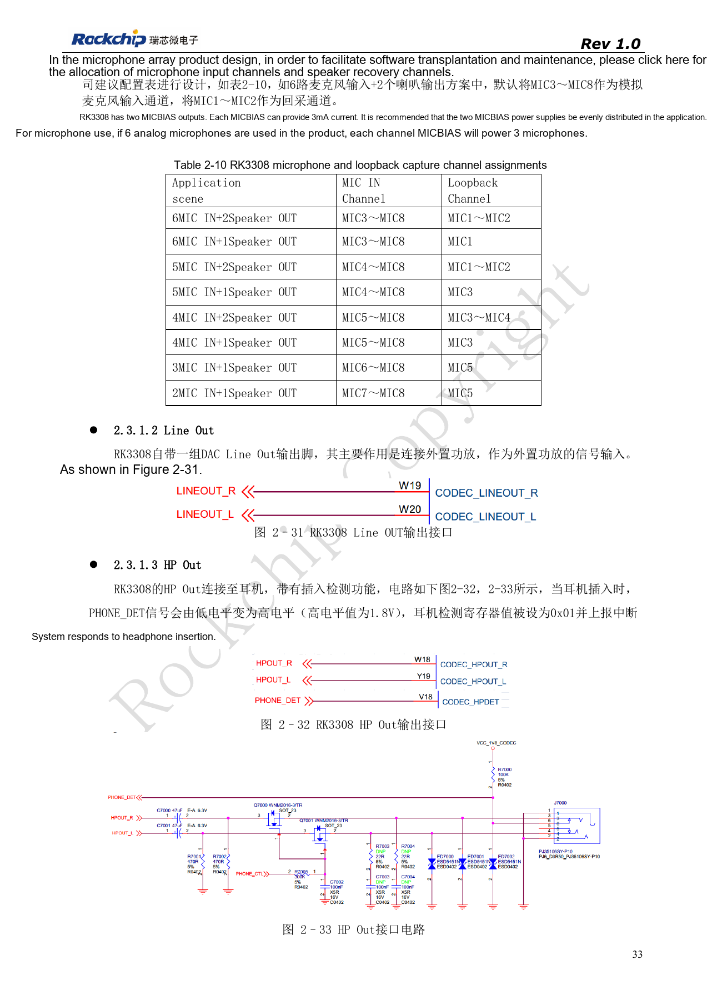
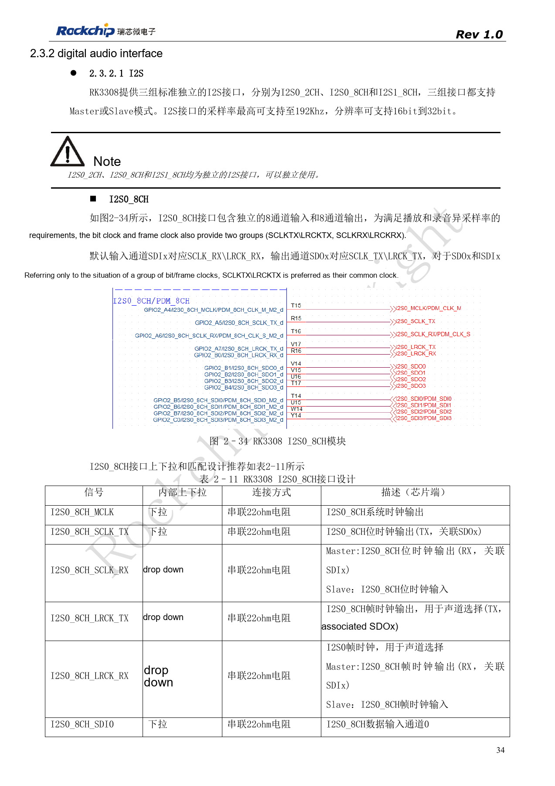
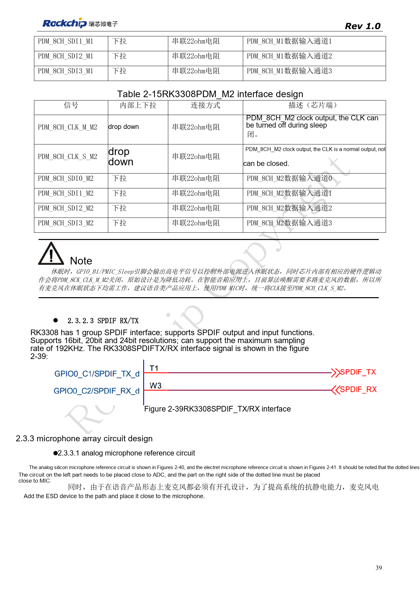
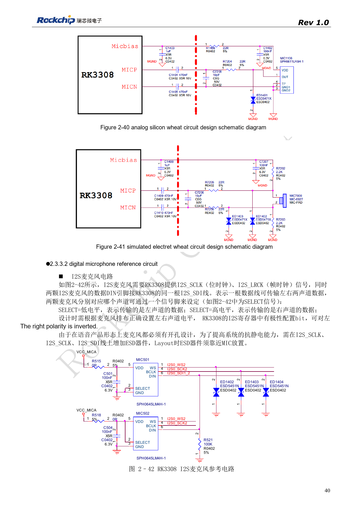
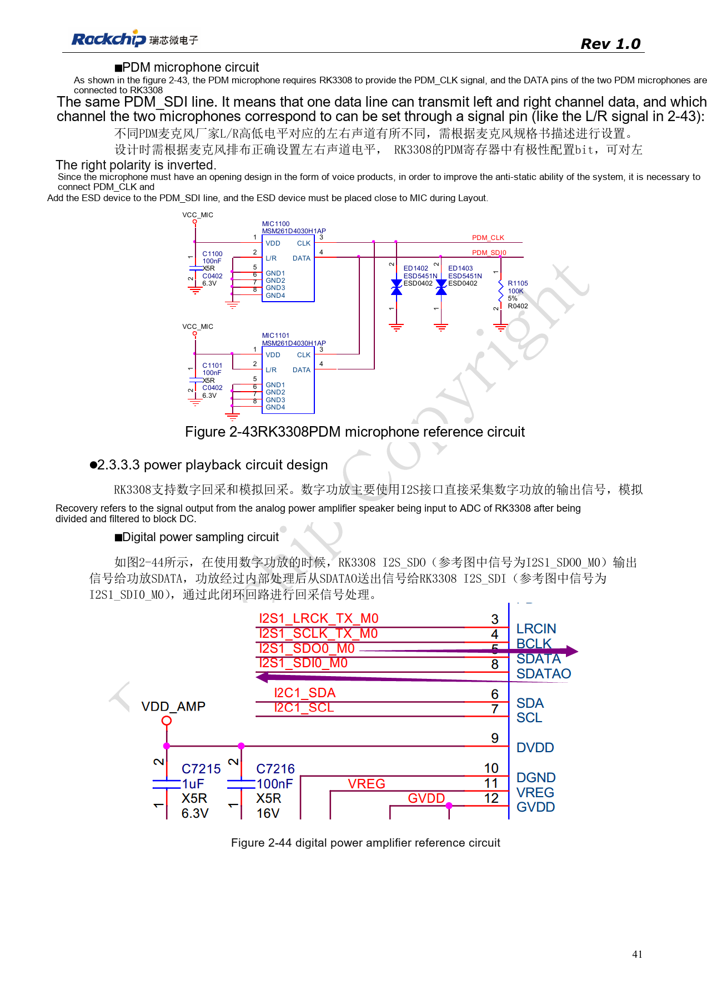
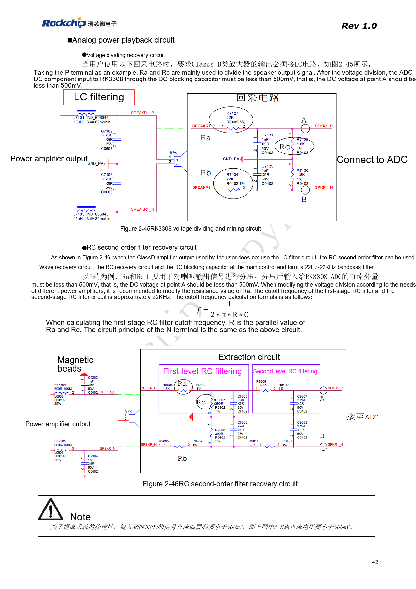

# RK3308 microphone arrays: analog, I2S, PDM and loopback

Based on RK3308 Hardware Design Guide V1.0 (2018-09-14), with the 2023 V1.1 compatibility note used to identify variant boundaries. P2 Pro uses RK3308B-S; the historical reference does not replace its board design. This topic article is not a complete page-by-page translation. Source values are not ArmSoM measurements. Check actual interfaces, SDK/BSP, kernel and firmware for the board revision.

**RK3308硬件设计指南_V1.0_20180914.pdf** · §2.3

## Align analog channels with the algorithm

The original RK3308 provides eight ADC and two DAC channels. The six-microphone/two-speaker example uses MIC3–MIC8 for capture and MIC1–MIC2 for loopback. Each of two MICBIAS outputs supplies 3mA; the reference divides six microphones evenly, but actual microphone current still matters. Line Out feeds an external amplifier and must not be treated as a speaker-power output. HP Out PHONE_DET is 1.8V when high. Check P2 Pro schematics for exposed channels and connectors.

## Do not double-count I2S and PDM resources

I2S0_2CH, I2S0_8CH and I2S1_8CH are three independent interfaces with master/slave support, up to 192kHz and 16–32bit in the source. I2S1_8CH M0/M1 are mux alternatives, not two interfaces. PDM has one controller and only one of M0/M1/M2 may be selected. Each SDI can carry two microphones; check the microphone’s L/R polarity. For continuous standby voice capture, the guide recommends PDM_8CH_CLK_S_M2 instead of CLK_M_M2, which stops during sleep. A continuous clock does not prove that the SDK implements a complete wake algorithm.

## Choose loopback for the amplifier output

A digital amplifier can form an I2S output/return loop. Analog loopback needs attenuation, filtering and DC blocking. Use the source divider scheme when Class D output has LC filtering, or its second-order RC reference without LC. The source requires DC voltage at A/B below 500mV: never connect speaker power output directly to an ADC. The second-order RC reference plus SoC coupling capacitor forms about a 22Hz–22kHz band-pass; verify values for the actual amplifier. Protect microphone openings with local ESD. Record each channel first, checking physical order, polarity and level, then test playback concurrency, echo cancellation and sleep/wake.

## Source microphone and loopback allocation

| Application | Microphone input | Loopback |
| --- | --- | --- |
| 6 MIC + 2 Speaker | MIC3–MIC8 | MIC1–MIC2 |
| 6 MIC + 1 Speaker | MIC3–MIC8 | MIC1 |
| 5 MIC + 2 Speaker | MIC4–MIC8 | MIC1–MIC2 |
| 5 MIC + 1 Speaker | MIC4–MIC8 | MIC3 |
| 4 MIC + 2 Speaker | MIC5–MIC8 | MIC3–MIC4 |
| 4 MIC + 1 Speaker | MIC5–MIC8 | MIC3 |
| 3 MIC + 1 Speaker | MIC6–MIC8 | MIC5 |
| 2 MIC + 1 Speaker | MIC7–MIC8 | MIC5 |

Source: table 2-10, PDF33. Preserve the different loopback assignments rather than normalizing everything to MIC1/2. This is a silicon reference, not proof that P2 Pro exposes or validates every combination.

## Source figures and review pages

Only Chinese originals are available in this batch. All four languages use the same source images, retaining figure context; image labels are not translated. Prose is editable. Page numbers are physical PDF pages.

PDF 33

PDF 34

PDF 39

PDF 40

PDF 41

PDF 42

## ArmSoM products and documentation

- [ArmSoM P2 Pro](https://www.armsom.org/product-page/p2pro) · [P2 Pro Docs](https://docs.armsom.org/armsom-p2pro)

## Continue reading

- [Series contents](/articles/rk3308-hardware-design-series/)
- [RK3308 boot and storage: clocks, FLASH_SEL and recovery](/articles/rk3308-clock-boot-storage-design/)
- [RK3308 power and DDR: rails, standby and S variants](/articles/rk3308-power-ddr-hardware-design/)
- [RK3308 peripherals: USB, RMII, display and debug](/articles/rk3308-usb-network-peripheral-design/)
- [RK3308 thermal, ESD and production review](/articles/rk3308-thermal-esd-production-design/)
