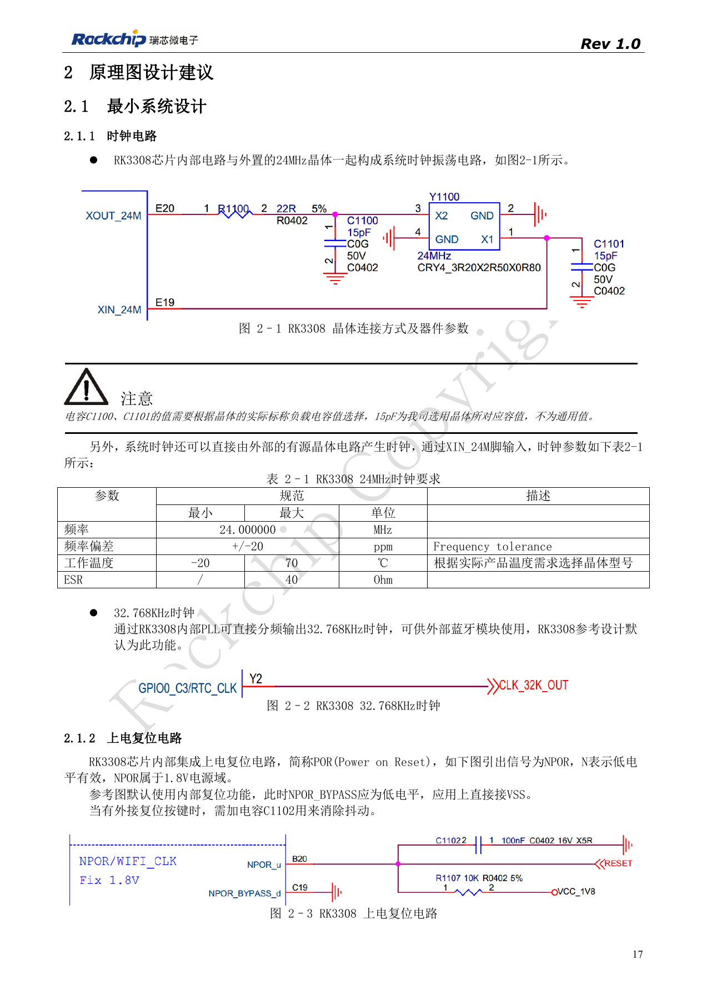
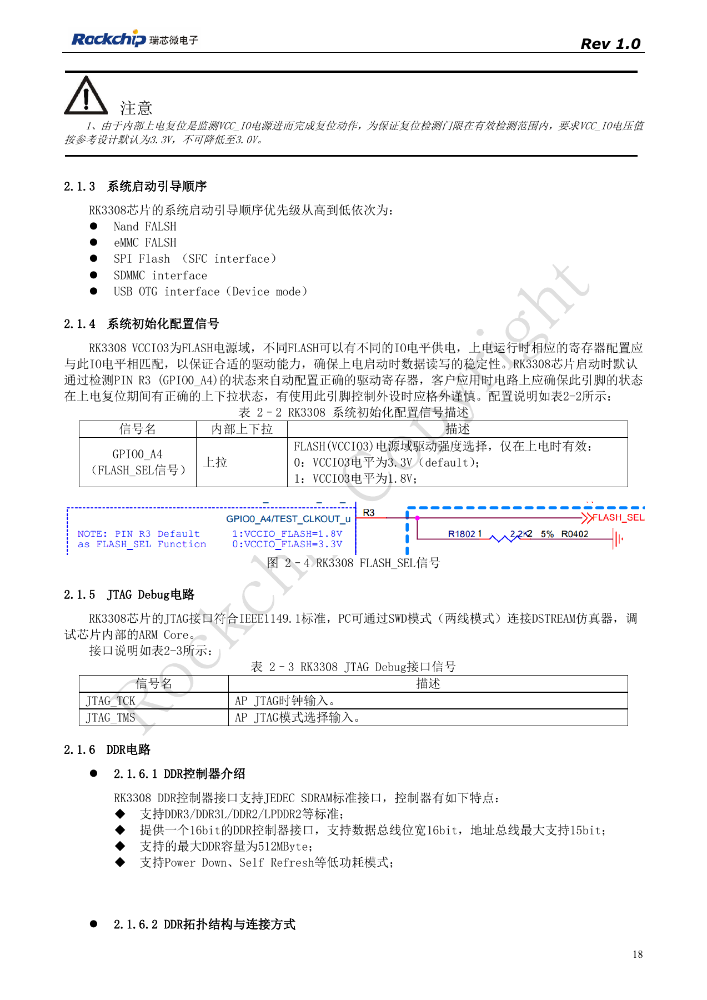
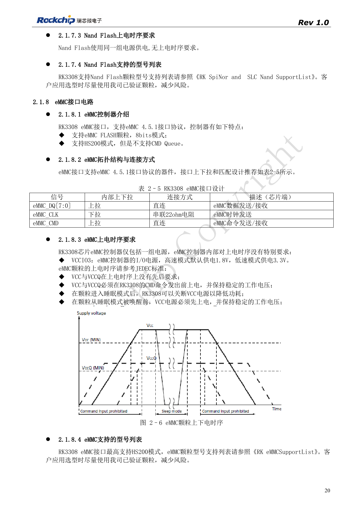
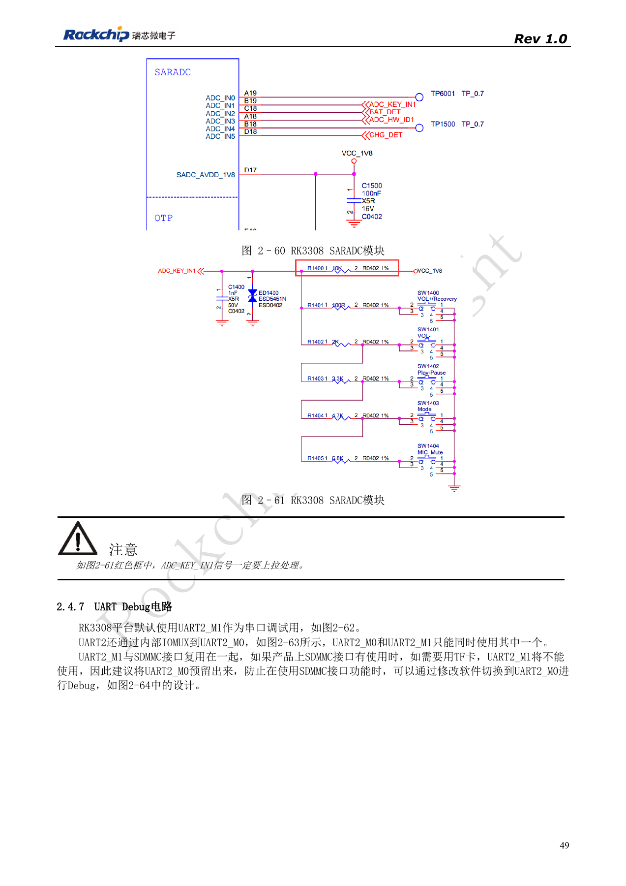
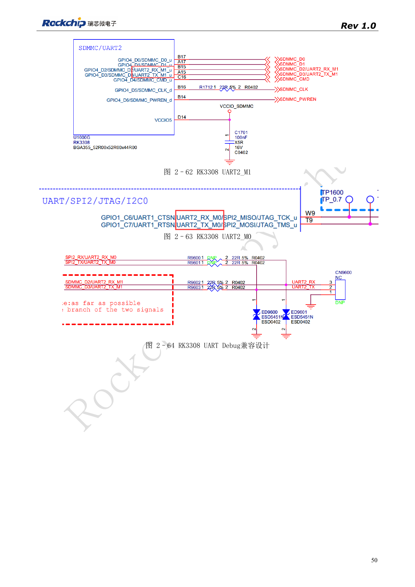

# RK3308 boot and storage: clocks, FLASH_SEL and recovery

Based on RK3308 Hardware Design Guide V1.0 (2018-09-14), with the 2023 V1.1 compatibility note used to identify variant boundaries. P2 Pro uses RK3308B-S; the historical reference does not replace its board design. This topic article is not a complete page-by-page translation. Source values are not ArmSoM measurements. Check actual interfaces, SDK/BSP, kernel and firmware for the board revision.

**RK3308硬件设计指南_V1.0_20180914.pdf** · §2.1; §2.4.1; §2.4.6–2.4.7

## Keep the historical scope explicit

The 2018 V1.0 guide describes RK3308/RK3308G, not the complete requirements for the RK3308B-S used by P2 Pro. Its clock reference is 24MHz, ±20ppm and ESR≤40Ω. The 15pF loading is a crystal-specific example. NPOR is active low in the 1.8V domain; the reference grounds NPOR_BYPASS to enable internal reset. It requires the VCC_IO monitored for internal reset to remain at the reference 3.3V, not 3.0V. For S variants, also check the newer compatibility document.

## Check boot media and voltage together

The documented boot priority is NAND, eMMC, SPI Flash/SFC, SDMMC, then USB OTG Device. FLASH_SEL is GPIO0_A4 (R3), sampled at power-on: 0 corresponds to VCCIO3=3.3V and 1 to 1.8V. A peripheral must not disturb this level during reset. eMMC is 8bit, 4.5.1 and HS200 without CMD Queue; place 22Ω in CLK while CMD/data connect directly. SFC supports NOR/NAND boot and also uses 22Ω in CLK. Match the flash device to bootloader, DDR initialization and support lists; a matching interface standard alone does not establish support.

## SD card versus UART debugging

Default UART2_M1 shares pins with SDMMC. When a TF card is used, reserve UART2_M0 and switch it in software rather than assuming the original debug port remains usable. SARADC_IN1 also serves Recovery: with firmware present, hold it at 0V, no more than 100mV, during startup; release it to 1.8V after the PC detects Rockusb. Preserve the pull-up and use ADC key-code spacing greater than 35. During bring-up identify whether failure occurs in ROM, DDR initialization, storage or the kernel before replacing devices blindly.

## Source figures and review pages

Only Chinese originals are available in this batch. All four languages use the same source images, retaining figure context; image labels are not translated. Prose is editable. Page numbers are physical PDF pages.

PDF 17

PDF 18

PDF 20

PDF 49

PDF 50

## ArmSoM products and documentation

- [ArmSoM P2 Pro](https://www.armsom.org/product-page/p2pro) · [P2 Pro Docs](https://docs.armsom.org/armsom-p2pro)

## Continue reading

- [Series contents](/articles/rk3308-hardware-design-series/)
- [RK3308 power and DDR: rails, standby and S variants](/articles/rk3308-power-ddr-hardware-design/)
- [RK3308 microphone arrays: analog, I2S, PDM and loopback](/articles/rk3308-audio-array-hardware-design/)
- [RK3308 peripherals: USB, RMII, display and debug](/articles/rk3308-usb-network-peripheral-design/)
- [RK3308 thermal, ESD and production review](/articles/rk3308-thermal-esd-production-design/)
