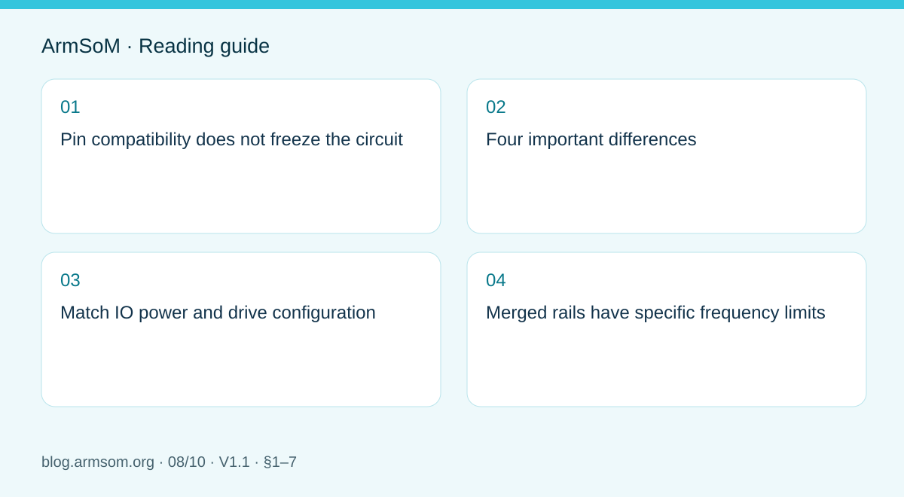
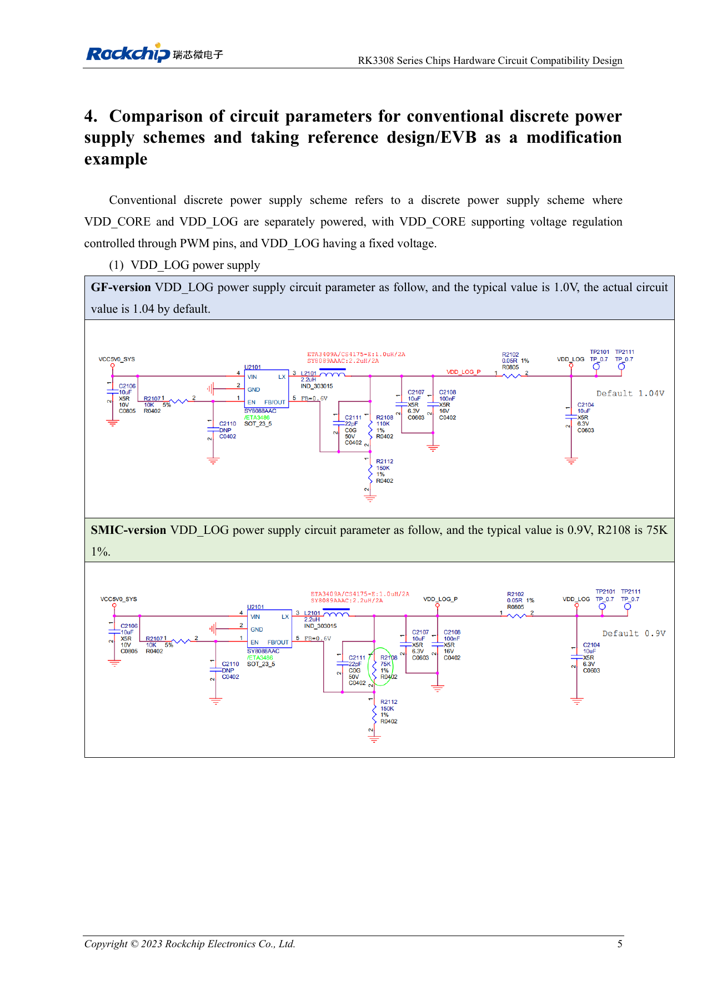

# RK3308 hardware variants: compatibility checks for P2 Pro audio projects

## Scope and sources

This is a task-focused engineering guide, not a page-by-page translation of the complete PDF. Source examples are not ArmSoM measurements. Check voltages, pins, SDK/BSP and kernel against the actual board revision.

**Rockchip:** `RK3308系列芯片硬件电路兼容设计与差异化说明_V1.1_20230728_CN.pdf` · V1.1 · §1–7

## Pin compatibility does not freeze the circuit

The source groups RK3308B/H as GF and RK3308B-S/H-S as SMIC variants. Compatible ball positions still require associated circuit and software changes. P2 Pro uses RK3308B-S; this is background for design evaluation, not an instruction to modify a finished P2 Pro.

## Four important differences

| Area | Source statement | Action |
| --- | --- | --- |
| Typical rails | §1 shows 1.0V versus 0.9V for rails including VDD_LOG and VDD_CORE | Match topology, BOM and frequency–voltage tables |
| IO drive | GF has 4 settings; SMIC has 7 | Equal mA labels do not imply equal cross-version drive; measure loaded waveforms |
| PMIC | RK816B-3 for GF; RK816B-6 for S reference designs | Check suffix, default voltage and sequencing together |
| USB_EXTR | GF C15 uses 133R 1%; SMIC C15 is NC | The reference R1400 is unpopulated; its designator is not universal |

Typical voltages are not full operating limits. Section 4 separately describes reference-circuit defaults and component changes. Match the schematic, populated BOM and software.

## Match IO power and drive configuration

Determine the rail actually connected before setting the software domain. Optional resistor positions do not mean every branch is populated. Weak drive can cause slow edges and level errors; excessive drive can cause overshoot and ringing. Test the real load again after changing peripherals, traces or silicon.

## Merged rails have specific frequency limits

For the particular VDD_CORE/VDD_LOG merged discrete supply, §6 lists GF at up to 1.1V and 912MHz, and SMIC at up to 1.0V and 816MHz. These limits belong to that topology, not every RK3308 or P2 Pro. Do not confuse them with separate-rail designs or a board's advertised frequency.

## Validate the audio product

Use P2 Pro to establish capture, playback, storage and networking software. After changing hardware, test audio noise, concurrent transfers, USB stability, cold boot and suspend recovery. Preserve chip markings, BOM, firmware and waveforms to diagnose revision-dependent failures.

## Source illustration

Original from the English document, shared by EN/RU/DE. Reference design, not an ArmSoM board schematic.

`RK3308 Series Chips Hardware Circuit Compatibility Design and Differentiation Explanation_V1.1_20230728_EN.pdf` · PDF p. 11.

## Products and development resources

- **P2 Pro** — [Product page](https://www.armsom.org/product-page/p2pro) · [Documentation](https://docs.armsom.org/armsom-p2pro)

## Continue this series

- [RK3576 hardware bring-up: minimum system and first-power checks](/articles/rk3576-hardware-bringup/)
- [ArmSoM CM5 carrier-board checklist: power, boot and interface planning](/articles/019-cm5-carrier-production/)
- [RK3576 high-speed interfaces: review schematics and PCB together](/articles/rk3576-high-speed-interface-design/)
- [RK3588S hardware design: from a reference circuit to a CM7s carrier](/articles/rk3588s-cm7s-carrier-design/)
- [RK3588 edge-AI hardware: plan power, cooling and expansion together](/articles/rk3588-edge-ai-hardware-design/)
- [RK3588 high-speed PCB review: stackup, impedance and routing](/articles/rk3588-high-speed-pcb-review/)
- [RK3506 industrial HMI hardware: choosing a CM1 or Forge1 development path](/articles/rk3506-industrial-hmi-hardware/)
- [RK3588S versus RK3588S2: what to check before a hardware revision](/articles/rk3588s-rk3588s2-hardware-differences/)
- [Rockchip prototype to production: process requirements and test records](/articles/rockchip-hardware-production-checklist/)

## Continue reading

- [RK3308 hardware design series](/articles/rk3308-hardware-design-series/)
