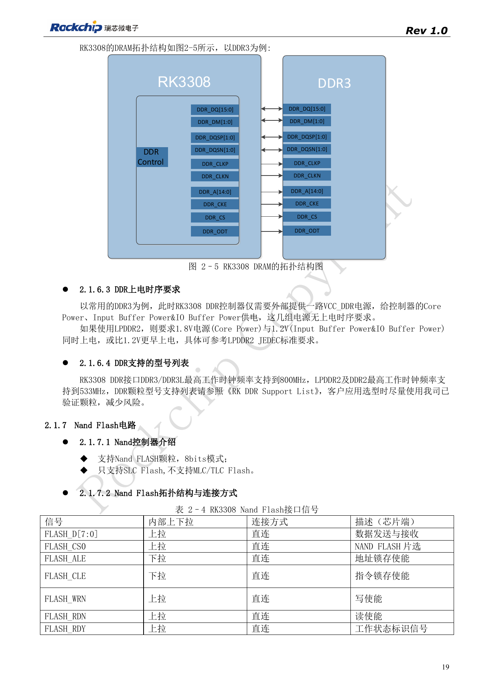
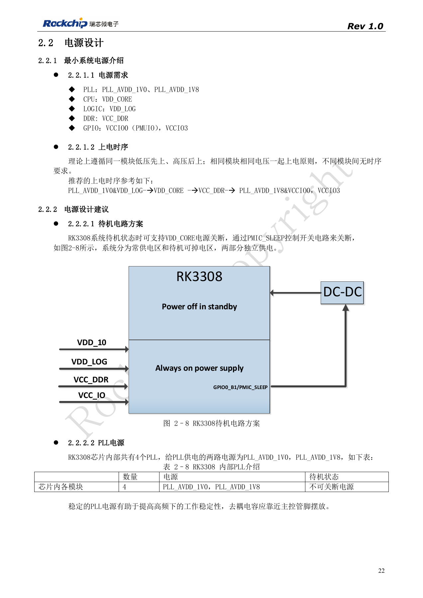
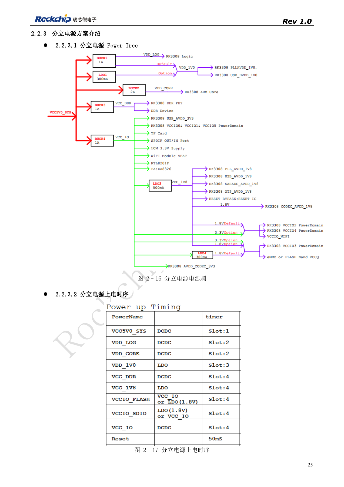
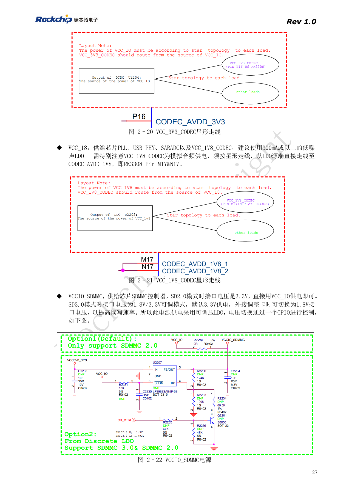
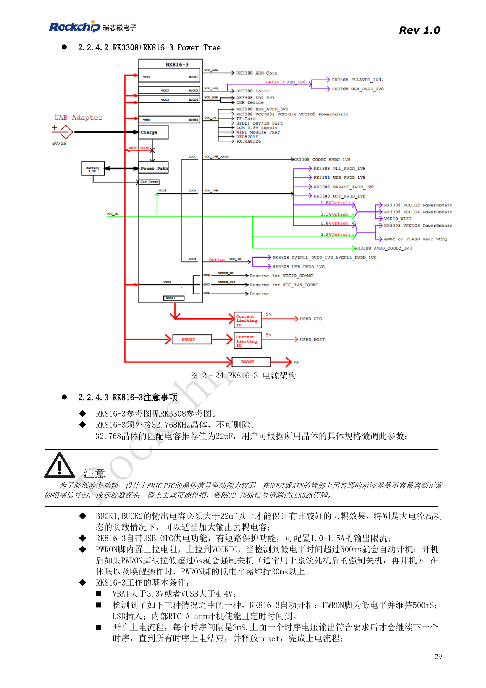

# RK3308 power and DDR: rails, standby and S variants

Based on RK3308 Hardware Design Guide V1.0 (2018-09-14), with the 2023 V1.1 compatibility note used to identify variant boundaries. P2 Pro uses RK3308B-S; the historical reference does not replace its board design. This topic article is not a complete page-by-page translation. Source values are not ArmSoM measurements. Check actual interfaces, SDK/BSP, kernel and firmware for the board revision.

**RK3308硬件设计指南_V1.0_20180914.pdf** · §2.1.6; §2.2; compatibility V1.1

## DDR and power depend on the variant

The original RK3308 supports DDR3/DDR3L/DDR2/LPDDR2 on a 16bit channel, up to 512MB; RK3308G integrates 64MB DDR2. LPDDR2 requires 1.8V to rise before or with 1.2V. The guide lists up to 800MHz for DDR3/3L and 533MHz for DDR2/LPDDR2. These are historical platform references, not the installed memory or DDR frequency of P2 Pro.

## Keep CPU supply and analog star paths distinct

The old discrete reference uses four bucks and one LDO. CPU VDD_CORE supports DVFS; when replacing its buck, the guide recommends 1.5–2A capability and a 0.6V feedback reference without arbitrary PWM-network changes. VDD_LOG and VDD_1V0 are coupled through a bead, which does not authorize merging CPU power. Route analog 3.3V from the buck source and analog 1.8V from the low-noise LDO source as separate star branches to the codec, avoiding Wi-Fi load current in those paths. PMIC_SLEEP separates always-on and switchable domains; do not switch PLL power off with the CPU.

## Review old references against the newer differences

The 2018 RK816-3 scheme requires an external 32.768kHz crystal. Probe CLK32K: touching the crystal with an ordinary probe may stop oscillation. The 2023 compatibility note distinguishes RK816B-3 for GF from RK816B-6 for SMIC S, along with supply and drive-strength changes; select by the complete suffix. Old EVB current measurements used CPU 1.3GHz, DDR 589MHz, 20MHz oscilloscope bandwidth and a specified audio/Wi-Fi workload, not P2 Pro conditions. Validate startup, voltage transitions, audio noise and resume, retaining board revision and measurement conditions.

## RK3308 EVB peak current and test conditions

| Net | Voltage / V | Peak current / mA |
| --- | --- | --- |
| VDD_CORE | 0.95–1.34 | 1055 |
| VDD_LOG | 1.04 | 204 |
| VDD_1V0 | 1.04 | 9.8 |
| VCC_DDR | 1.5 | 289 |
| VCC_1V8 | 1.8 | 83.8 |
| VCC_IO (including WiFi) | 3.3 | 709 |

Source: table 2–9, PDF31. Vendor RK3308 EVB, CPU up to 1.3GHz, DDR fixed at 589MHz, oscilloscope bandwidth limited to 20MHz. Cases include memory stresstest and a six-microphone monitoring algorithm with concurrent online music over WiFi. The source calls the data reference-only. Do not transfer old-EVB current, DDR voltage or maximum frequency directly to P2 Pro RK3308B-S: first verify the exact component, power design, software and workload.

## Source figures and review pages

Only Chinese originals are available in this batch. All four languages use the same source images, retaining figure context; image labels are not translated. Prose is editable. Page numbers are physical PDF pages.

PDF 19

PDF 22

PDF 25

PDF 27

PDF 29

## ArmSoM products and documentation

- [ArmSoM P2 Pro](https://www.armsom.org/product-page/p2pro) · [P2 Pro Docs](https://docs.armsom.org/armsom-p2pro)

## Continue reading

- [Series contents](/articles/rk3308-hardware-design-series/)
- [RK3308 boot and storage: clocks, FLASH_SEL and recovery](/articles/rk3308-clock-boot-storage-design/)
- [RK3308 microphone arrays: analog, I2S, PDM and loopback](/articles/rk3308-audio-array-hardware-design/)
- [RK3308 peripherals: USB, RMII, display and debug](/articles/rk3308-usb-network-peripheral-design/)
- [RK3308 thermal, ESD and production review](/articles/rk3308-thermal-esd-production-design/)
