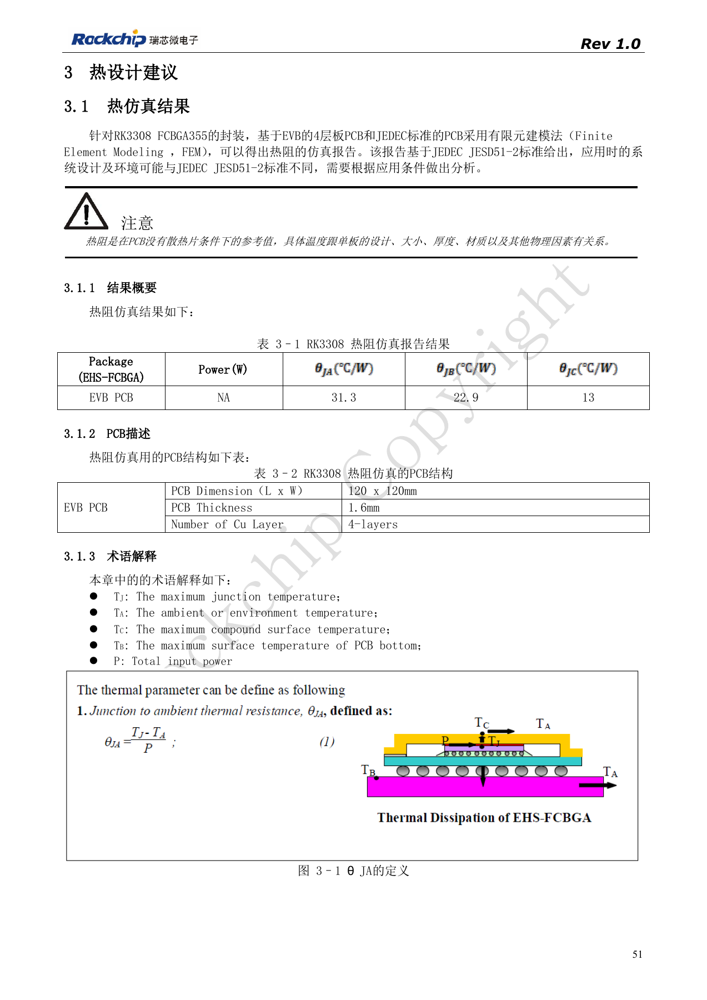
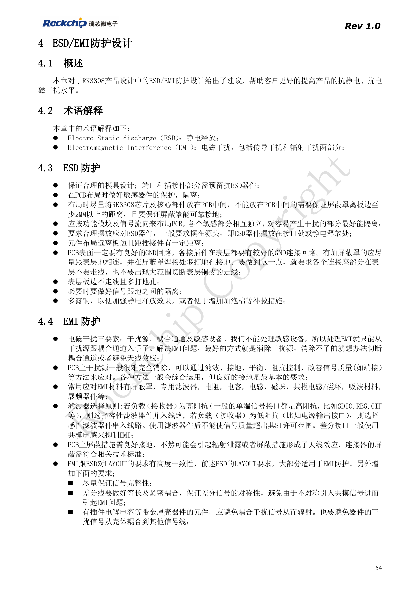
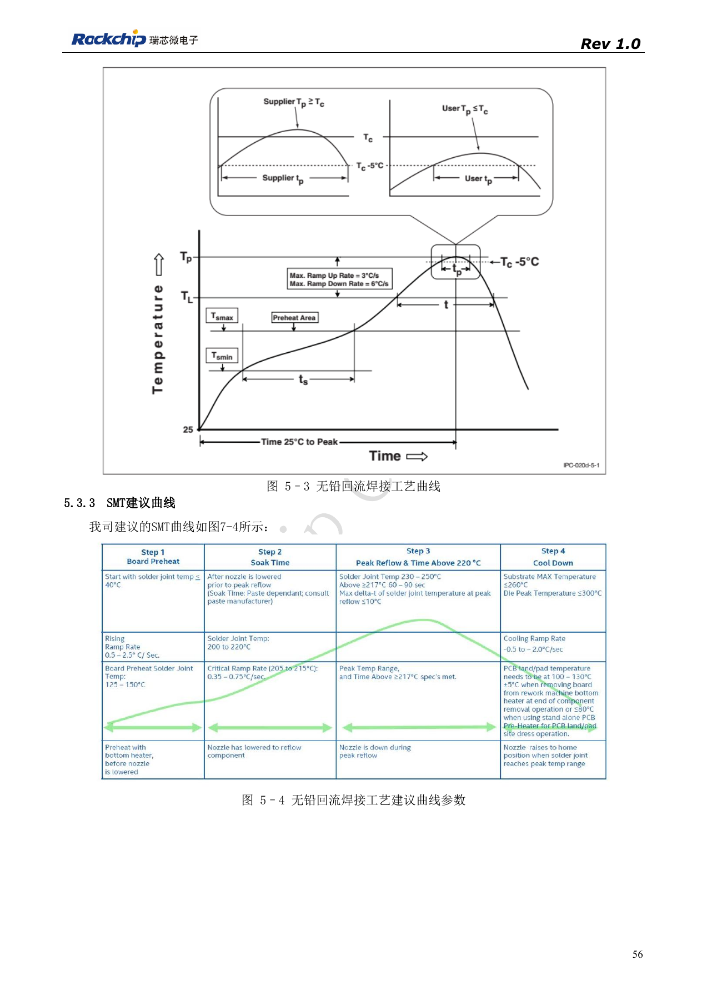
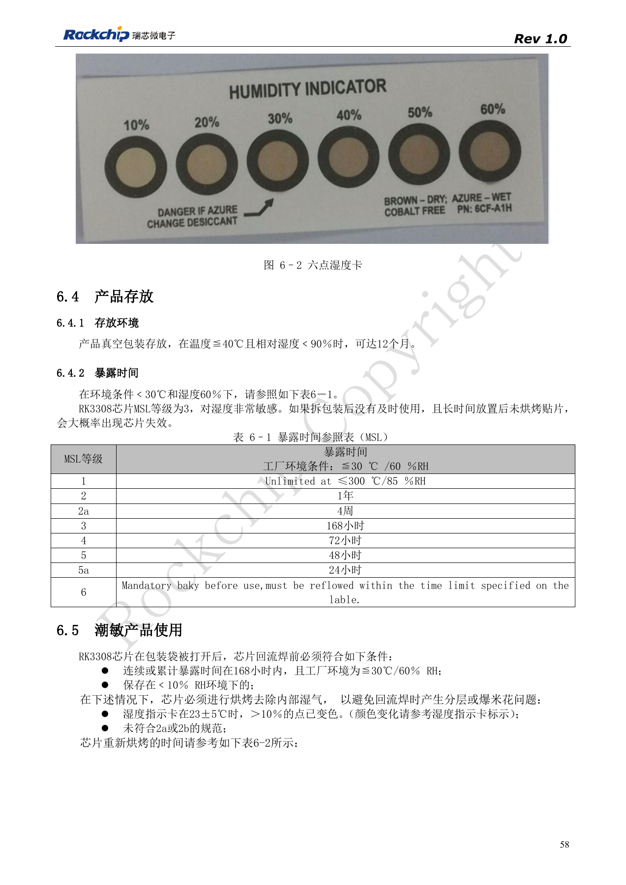
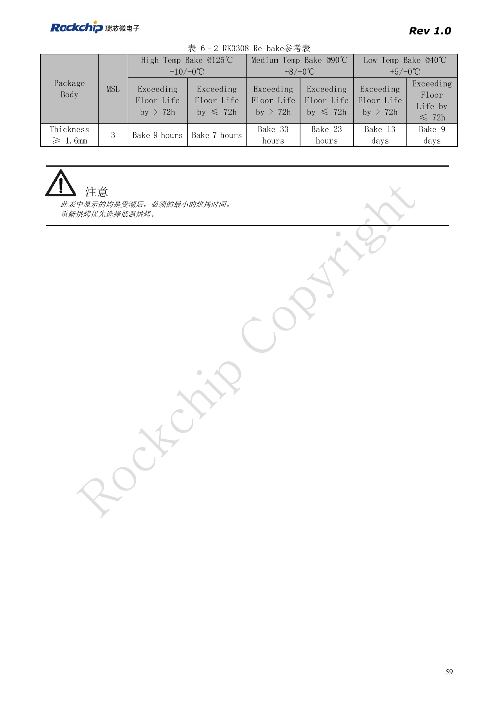

# RK3308 thermal, ESD and production review

Based on RK3308 Hardware Design Guide V1.0 (2018-09-14), with the 2023 V1.1 compatibility note used to identify variant boundaries. P2 Pro uses RK3308B-S; the historical reference does not replace its board design. This topic article is not a complete page-by-page translation. Source values are not ArmSoM measurements. Check actual interfaces, SDK/BSP, kernel and firmware for the board revision.

**RK3308硬件设计指南_V1.0_20180914.pdf** · §3–6

## Thermal data has a test-board boundary

Source thermal resistance is a simulation reference for a specified package, PCB and environment, not an ArmSoM board measurement. Board area, copper, airflow, neighboring power devices and heatsinks change temperature; a single θJA cannot determine cooling needs. Record maximum ambient, enclosure, real workload, frequency and thermal policy, then measure both die temperature and critical component surfaces. Software throttling, emergency shutdown and normal-operation cooling are different safeguards and do not replace one another.

## ESD needs a discharge path, not just a component

Place protection near connectors and discharge entry points with a short, continuous return to ground. Ground connectors and shields reliably; keep sensitive clocks, reset and audio away from noise and board edges. Do not increase filter capacitance for EMI at the expense of high-speed integrity. Recheck signal quality after changes to TVS devices, common-mode chokes or connectors. System acceptance should include hot-plug, recovery after ESD and sustained workload, recording resets, audio noise and communication errors.

## Track cumulative moisture exposure

The guide specifies MSL3 with 168 hours cumulative floor life at ≤30°C/60%RH. The clock does not restart each time a lot returns to the line. Sealed-storage reference is ≤40°C, <90%RH and 12 months. If exposure limits are exceeded or the humidity indicator is abnormal, choose rebake conditions for package thickness, excess exposure and temperature. Both guides contain a suspect “≤300°C” entry for MSL1; never use it as a storage setting. Qualify the reflow profile for solder paste, board thermal mass and package process, retaining measured profiles and lot records.

## Source rebake reference

| Temperature | Floor-life overrun >72h | Floor-life overrun ≤72h |
| --- | --- | --- |
| 125°C +10/-0°C | 9h | 7h |
| 90°C +8/-0°C | 33h | 23h |
| 40°C +5/-0°C | 13d | 9d |

Only for the source conditions: MSL3, package body thickness ≥1.6mm. Times are the stated minimums, with low-temperature baking preferred. Check tray and component temperature limits. Do not infer a procedure for another package or an assembled board.

## Source figures and review pages

Only Chinese originals are available in this batch. All four languages use the same source images, retaining figure context; image labels are not translated. Prose is editable. Page numbers are physical PDF pages.

PDF 51

PDF 54

PDF 56

PDF 58

PDF 59

## ArmSoM products and documentation

- [ArmSoM P2 Pro](https://www.armsom.org/product-page/p2pro) · [P2 Pro Docs](https://docs.armsom.org/armsom-p2pro)

## Continue reading

- [Series contents](/articles/rk3308-hardware-design-series/)
- [RK3308 boot and storage: clocks, FLASH_SEL and recovery](/articles/rk3308-clock-boot-storage-design/)
- [RK3308 power and DDR: rails, standby and S variants](/articles/rk3308-power-ddr-hardware-design/)
- [RK3308 microphone arrays: analog, I2S, PDM and loopback](/articles/rk3308-audio-array-hardware-design/)
- [RK3308 peripherals: USB, RMII, display and debug](/articles/rk3308-usb-network-peripheral-design/)
