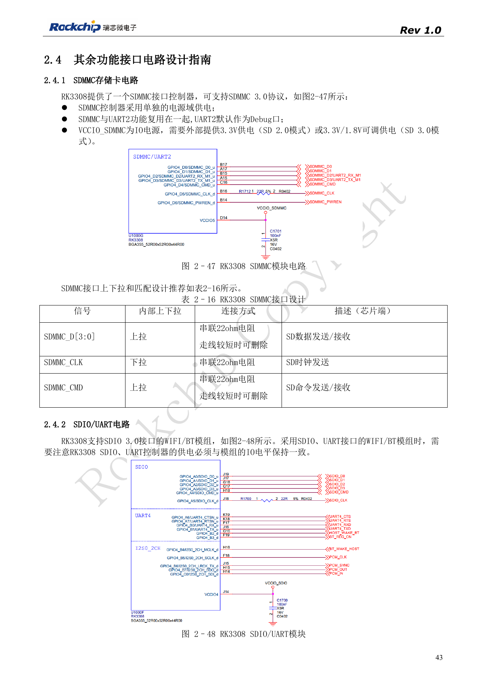
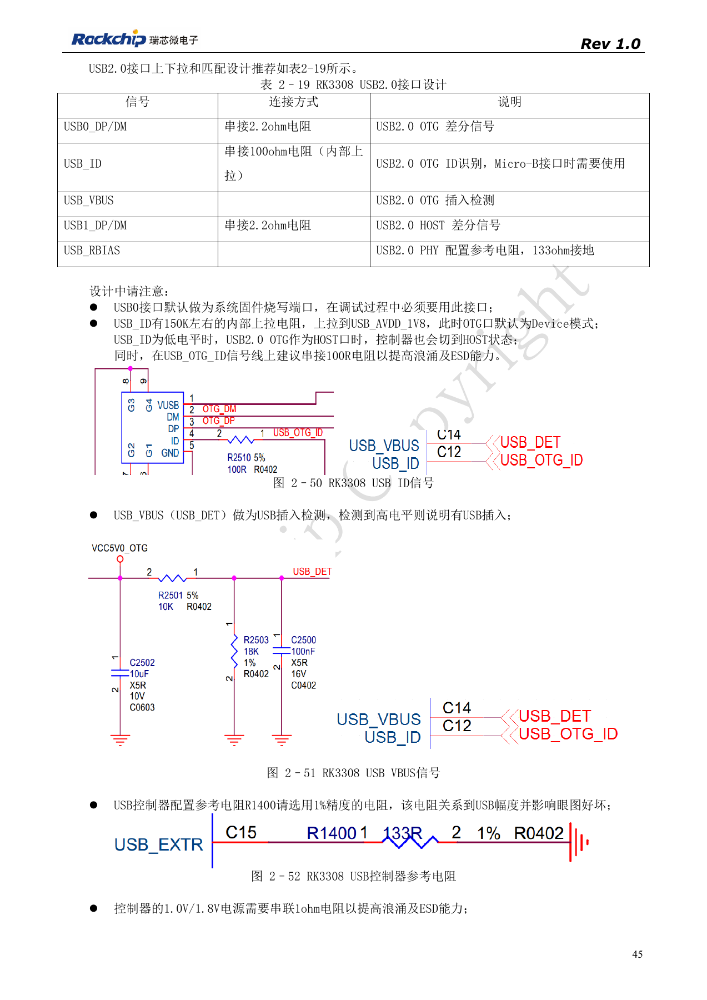
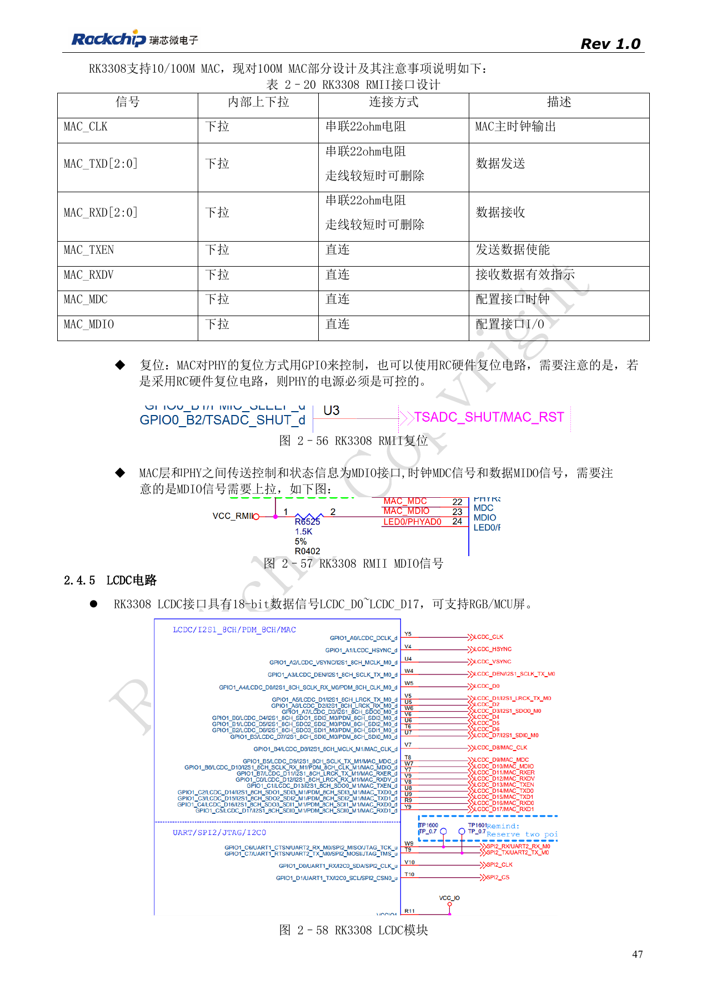
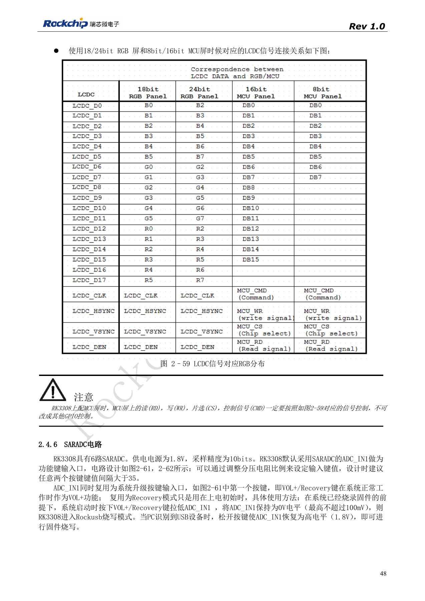

# RK3308 peripherals: USB, RMII, display and debug

Based on RK3308 Hardware Design Guide V1.0 (2018-09-14), with the 2023 V1.1 compatibility note used to identify variant boundaries. P2 Pro uses RK3308B-S; the historical reference does not replace its board design. This topic article is not a complete page-by-page translation. Source values are not ArmSoM measurements. Check actual interfaces, SDK/BSP, kernel and firmware for the board revision.

**RK3308硬件设计指南_V1.0_20180914.pdf** · §2.4; compatibility V1.1 §7

## Check the suffix before USB design

On the original RK3308, USB0 is OTG/flashing and USB1 is host. The reference uses 2.2Ω in DP/DM and 100Ω in ID. The 2018 USB_RBIAS requirement of 133Ω 1% belongs to older silicon: the 2023 note marks C15 as NC on SMIC S, requiring the corresponding GF external resistor arrangement to change. P2 Pro uses B-S; inspect its actual schematic before judging component population rather than adding a resistor from the old drawing.

## Review networking as a system

100Mbps RMII needs an external PHY. Its clock may come from a crystal or MAC_CLK; define the direction from the chosen reference. If PHY reset uses an RC circuit, the guide requires controllable PHY power. MDIO still needs a pull-up. SDIO 3.0 Wi-Fi/BT must match the SoC SDIO/UART levels, CTS/RTS direction and PCM path. Source table 2-20 labels RMII data MAC_TXD[2:0]/RXD[2:0]. Treat this as unresolved and consult PinOut/TRM rather than inventing a third RMII data wire.

## Keep display and service access coherent

LCDC exposes 18 data signals; select RGB/MCU mapping from the source diagram. MCU-panel RD, WR, CS and CMD require their defined functional mapping, not arbitrary GPIO substitution. Reserve UART2_M0 when SDMMC conflicts with UART2_M1. External connectors also need series protection, ESD return paths and unpowered-state checks. Validate sustained network traffic, USB hot-plug, display refresh and audio concurrently, since isolated interface success does not prove system stability.

## Source figures and review pages

Only Chinese originals are available in this batch. All four languages use the same source images, retaining figure context; image labels are not translated. Prose is editable. Page numbers are physical PDF pages.

PDF 43

PDF 45

PDF 47

PDF 48

## ArmSoM products and documentation

- [ArmSoM P2 Pro](https://www.armsom.org/product-page/p2pro) · [P2 Pro Docs](https://docs.armsom.org/armsom-p2pro)

## Continue reading

- [Series contents](/articles/rk3308-hardware-design-series/)
- [RK3308 boot and storage: clocks, FLASH_SEL and recovery](/articles/rk3308-clock-boot-storage-design/)
- [RK3308 power and DDR: rails, standby and S variants](/articles/rk3308-power-ddr-hardware-design/)
- [RK3308 microphone arrays: analog, I2S, PDM and loopback](/articles/rk3308-audio-array-hardware-design/)
- [RK3308 thermal, ESD and production review](/articles/rk3308-thermal-esd-production-design/)
