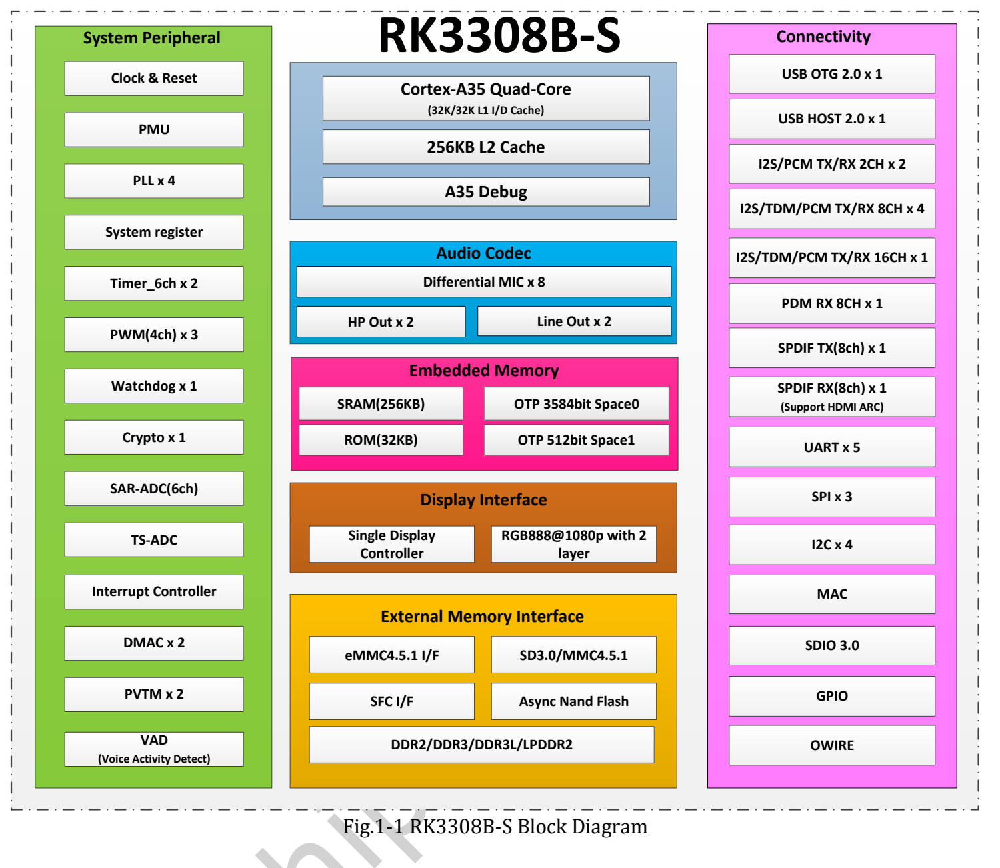

RK3308B-S focuses on audio capture, playback and embedded connectivity. Four Cortex-A35 cores, an audio codec and digital audio interfaces make it a candidate for voice terminals, network audio nodes and equipment gateways. ArmSoM P2 Pro supplies board interfaces and Linux development resources for moving from chip capability to an application prototype.

## Architecture and positioning

| Block | RK3308B-S V1.0 capability | Application role |
|---|---|---|
| CPU | Four Cortex-A35, Armv8-A, NEON | Applications, protocols and audio processing |
| Cache | 32KB L1 instruction, 32KB L1 data, 256KB L2 | Performance also depends on workload |
| Memory | 16-bit DDR2/DDR3/DDR3L/LPDDR2, up to 512MB address space | Embedded software with controlled memory use |
| Codec | Up to eight microphone ADC channels, stereo DAC | Capture, headphone and line output |
| Digital audio | I2S/PCM/TDM, PDM, SPDIF, including internal links | Check actual external board connections |
| VAD | Voice activity detection and associated storage | Event input for later recognition stages |
| Network/USB | 10/100M MAC, USB2.0 | PHY, wireless module and drivers complete the connection |

Do not transfer RK3506J or RK3588 CPU, NPU, video or expansion claims to this chip. A 64-bit CPU does not make every image's userspace 64-bit. P2 Pro wireless connectivity comes from a separate onboard module, not integrated SoC radio hardware.

## Why examine audio before clock speed

Multi-microphone work begins with synchronisation, channel order, clocks, gain and noise. The B-S manual describes up to eight analogue microphone inputs and PDM digital microphones; these are not automatically additive, plug-and-play resources. Components, pin multiplexing, drivers and bandwidth determine usable configurations.

VAD detects activity, not the meaning of a command. Wake words, speech recognition, echo cancellation, beamforming and speech synthesis require algorithms and software integration. Without tests, do not promise recognition distance, accuracy or complete-board standby power.

## Three development paths

**Voice terminal:** capture → preprocessing → activity/wake decision → command handling → spoken feedback. Start with one channel, then expand the array and test with the real enclosure and background noise.

**Network audio node:** receive → buffer/decode → audio output. Explore notification terminals, desktop players or broadcast prototypes. Validate codecs, jitter, volume and amplifier circuitry separately.

**Lightweight IoT gateway:** sensor/serial input → validation and buffering → upload. Limit services and log growth. Fast Ethernet does not make this a Gigabit router or high-speed storage platform.

## Frequency and display discrepancies

The supplied B-S V1.0 electrical table on page 67 lists **1.1GHz** maximum A35 frequency. P2 Pro documentation contains both **1.2GHz and 1.3GHz**. Do not silently adopt the highest figure; verify silicon revision, BSP and operating conditions.

Rockchip's generic RK3308 page states RGB/MCU up to 720P, while this B-S manual says 1080p. Retain that source distinction. A chip display controller is not an HDMI video connector on P2 Pro; confirm the required signals are actually exposed.

## Start with P2 Pro

Use an image matching the hardware revision to verify audio, networking and storage, then freeze software versions. Check optional eMMC and PoE against the purchased configuration. The companion articles cover audio, gateways and the manual. All scenarios are development proposals, not customer deployments or measured results.

## Related articles and official resources

- [ArmSoM P2 Pro: microphone capture, voice interaction and network audio](/articles/p2pro-voice-audio-applications/)
- [ArmSoM P2 Pro: IoT acquisition and lightweight gateway development](/articles/p2pro-iot-lightweight-gateway/)
- [RK3308B-S Datasheet V1.0: download, audio architecture and electrical guide](/articles/rk3308bs-datasheet-v10/)
- [Rockchip Audio](/articles/023-rockchip-audio/)
- [Rockchip RK3308](https://www.rock-chips.com/a/cn/product/RK33xilie/2018/0614/908.html)
- [P2 Pro — Docs](https://docs.armsom.org/armsom-p2pro)
- [P2 Pro — ArmSoM](https://www.armsom.org/product-page/p2pro)
- [P2 Pro — BSP](https://github.com/ArmSoM/armsom-p2pro-bsp)
