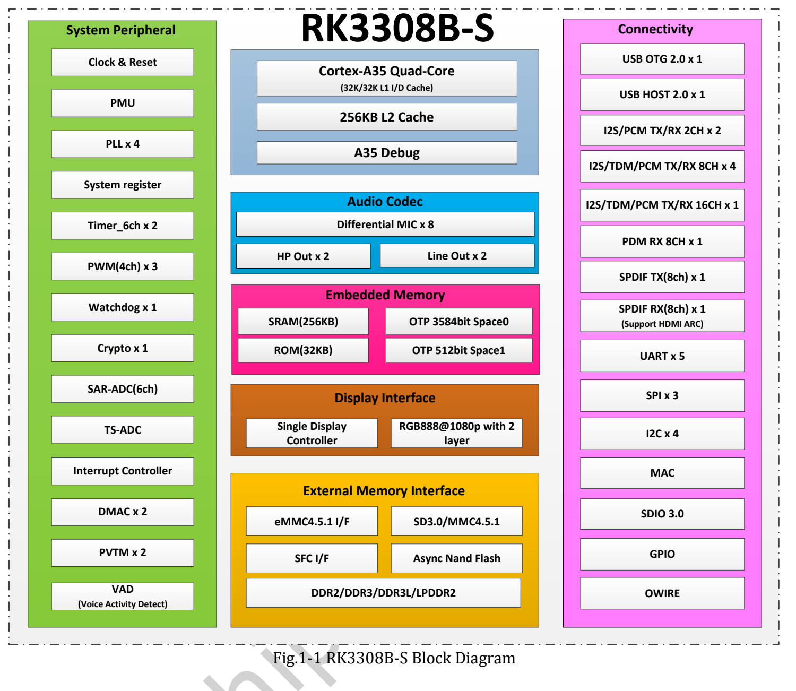
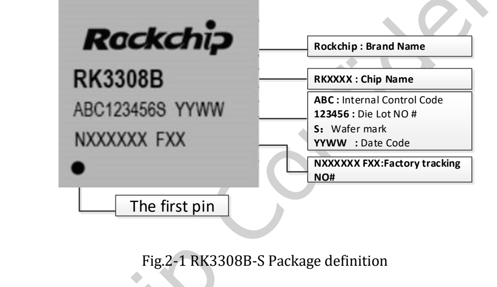
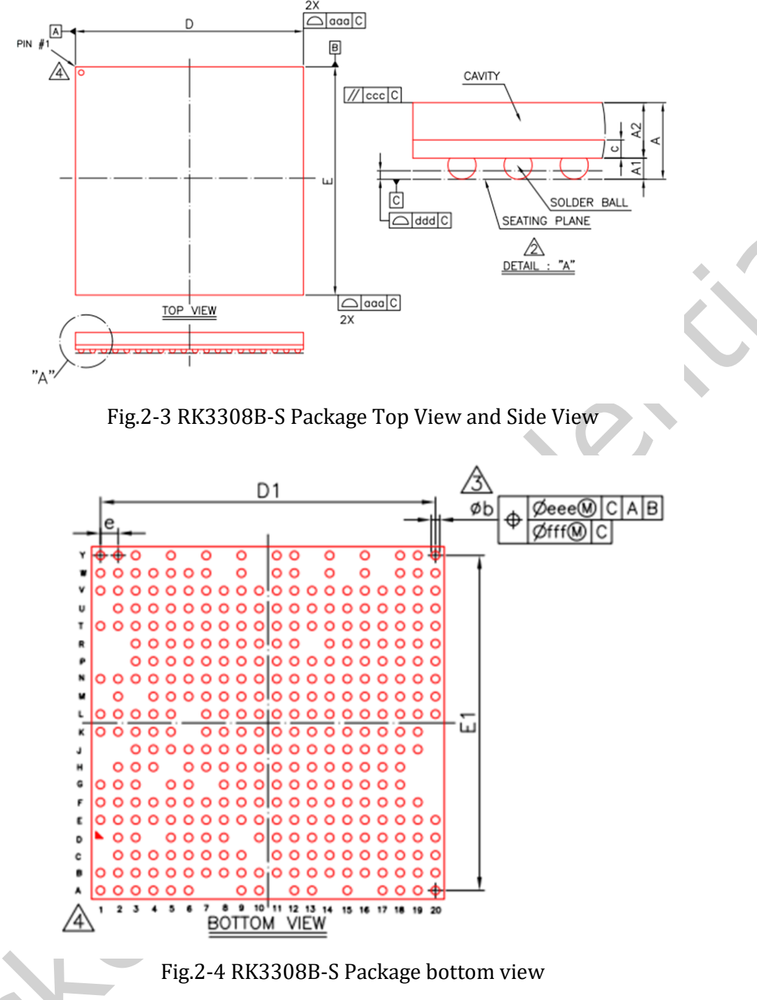

Download the original **RK3308B-S Datasheet V1.0, 2021-10-10, 72 pages**, with this engineering guide to architecture, audio, packaging, electrical limits and thermal data. This is not a line-by-line translation; complete ball maps, pin multiplexing and electrical tables remain in the PDF.

## Download and variant scope

[Download the original RK3308B-S Datasheet V1.0](/assets/rk3308bs/Rockchip-RK3308B-S-Datasheet-V1.0-20211010.pdf)

The document covers both **RK3308B-S and RK3308H-S**. H-S's integrated 64MB DDR2 is not a B-S feature. Read variant headings on package, ball-map and thermal tables. P2 Pro uses B-S; installed DDR and optional storage depend on its configuration.

| Pages | Content |
|---|---|
| 7–14 | CPU, storage, display, audio and connectivity |
| 15 / 16 | B-S / H-S block diagrams |
| 17–20 | Variant marking, package and dimensions |
| 21–28 | Variant-specific ball maps |
| 29–33 | B-S pin number list |
| 34–65 | Power, functional IO, multiplexing and IO types |
| 66–71 | Absolute limits, recommended conditions and interface/audio electrical data |
| 72 | Thermal references for both variants |

## Compute, memory and storage

Four Armv8-A Cortex-A35 cores support NEON. The manual lists 32KB L1 instruction cache, 32KB L1 data cache, 256KB L2 and 256KB SRAM. External 16-bit DDR2/DDR3/DDR3L/LPDDR2 addresses up to 512MB.

eMMC supports 4.41/4.51/5.0/5.1, 1/4/8-bit and up to HS200, explicitly without CMD Queue. Asynchronous NAND, SPI NOR/NAND and SD are also listed; this does not mean every board populates them all.

## Follow the audio connection path

| Function | V1.0 description and qualification |
|---|---|
| Codec | 24-bit ADC, up to eight microphone channels; 24-bit stereo DAC |
| PDM | Up to eight mono or four stereo microphones |
| I2S_8CH | Four components: 0/1 connect to external IO, 2/3 to the internal codec |
| TDM | Shares the corresponding I2S controllers; 192kHz@2CH, 48kHz@8CH listed |
| VAD | Single-microphone activity detection with multichannel pre/post-event storage options |
| SPDIF | TX/RX and HDMI ARC capability, not an onboard HDMI video port |

Controllers, internal links and board ports are different levels. Do not multiply maximum channel counts and rates or add every interface together. VAD is not a wake-word or complete recognition algorithm.

## Original package illustrations

The manual specifies TFBGA355. Use official dimensions and tolerances for PCB footprints rather than measuring web images. Adjacent H-S package drawings must not be substituted.

## Preserve electrical and thermal conditions

| Parameter | B-S V1.0 |
|---|---|
| Maximum A35 frequency, page 67 | 1.1GHz |
| Recommended CPU supply | Min TBD, typ 0.90V, max TBD |
| Recommended ambient Ta | 0 / 25 / 85°C, min/typ/max |
| Maximum junction temperature | 125°C; thermal chapter requires staying below it |
| θJA / θJB / θJC | 45 / 35 / 15°C/W, manufacturer reference values |

Thermal conditions: four-layer test PCB, 101.6×114.3mm, 1.6mm thick, ambient 25°C. These are not P2 Pro board measurements and do not directly predict enclosed-product temperature. Codec currents refer to the specified codec supply domain and mode, not whole-board power.

## Differences from public webpages

P2 Pro pages state 1.2GHz/1.3GHz; this electrical table says 1.1GHz. The generic RK3308 page says 720P display, while B-S says 1080p. Preserve the sources rather than guessing which applies to delivered hardware. P2 Pro's documented 0–70°C range must not become the chip's 0–85°C range.

The original file and watermarks are unchanged. Verify silicon revision, released documents, BSP, supply, schematic and measurements before implementation. No hardware testing was performed for this series.

## Related articles and official resources

- [RK3308B-S explained: voice, audio and connected embedded devices](/articles/rk3308bs-chip-guide/)
- [ArmSoM P2 Pro: microphone capture, voice interaction and network audio](/articles/p2pro-voice-audio-applications/)
- [ArmSoM P2 Pro: IoT acquisition and lightweight gateway development](/articles/p2pro-iot-lightweight-gateway/)
- [Rockchip Audio](/articles/023-rockchip-audio/)
- [Rockchip RK3308](https://www.rock-chips.com/a/cn/product/RK33xilie/2018/0614/908.html)
- [P2 Pro — Docs](https://docs.armsom.org/armsom-p2pro)
- [P2 Pro — ArmSoM](https://www.armsom.org/product-page/p2pro)
- [P2 Pro — BSP](https://github.com/ArmSoM/armsom-p2pro-bsp)
