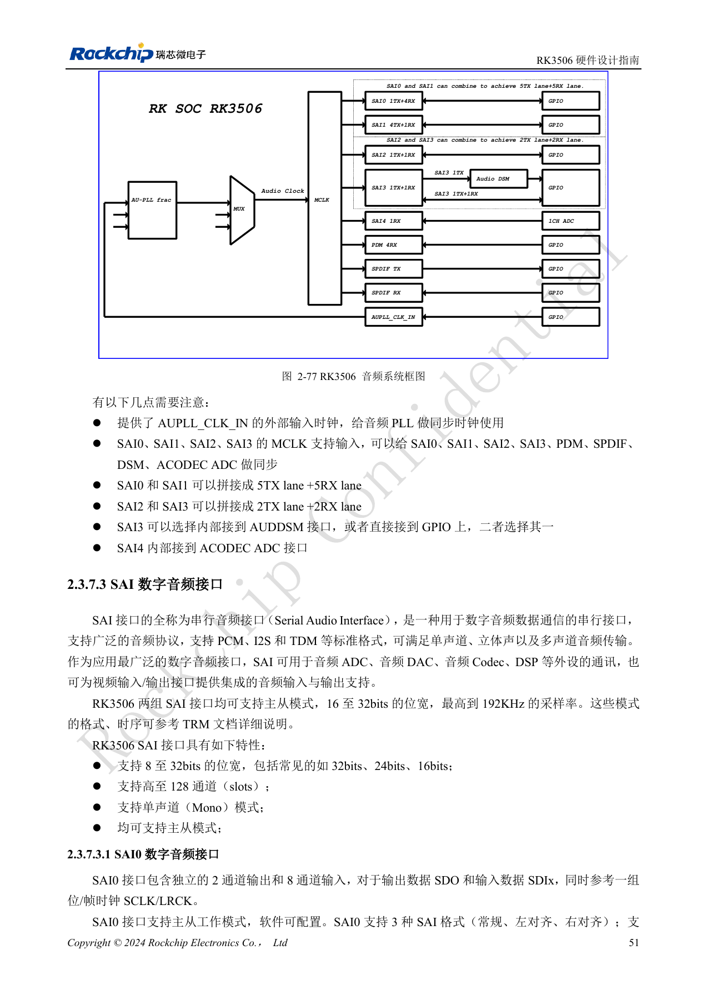
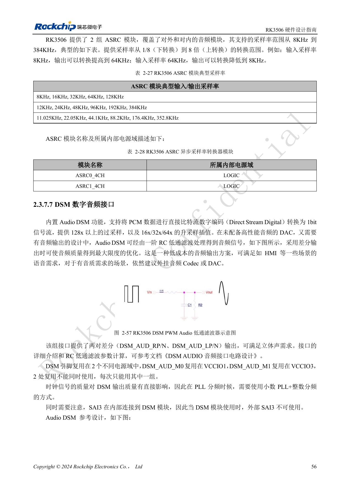
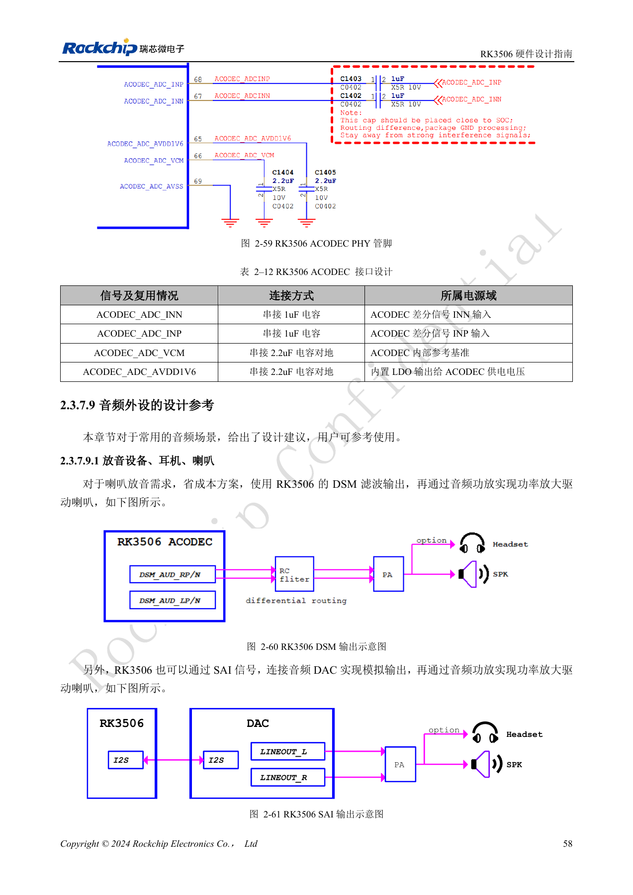
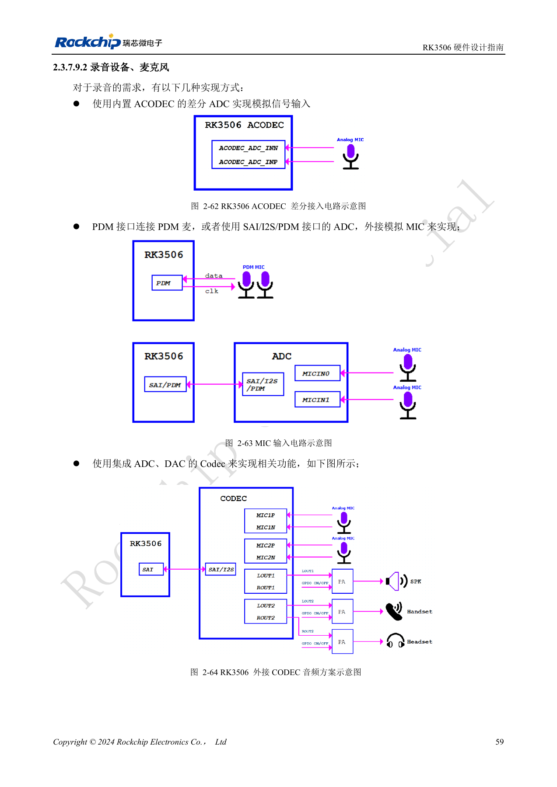

# RK3506 audio design: SAI, PDM, ASRC and DSM

Based on RK3506 Hardware Design Guide V1.0 (2024-09), covering G2 and B/J. Verify package, memory, rails and pins by variant and CM1/Forge1 interfaces against board documentation. This is an engineering topic article, not a complete page-by-page translation. Values are source references, not ArmSoM hardware measurements. Validate the actual SDK/BSP, kernel and firmware.

**RK3506 Hardware Design Guide_V1.0_20240904_CN.pdf** · §2.3.7; §3.3.13

## Draw clock and data paths first

Only SAI0–3 are external; SAI4 connects internally to ACODEC ADC. SAI0/1 can combine into 5TX+5RX lanes and SAI2/3 into 2TX+2RX lanes, but these modes are not additional controllers. SAI2 M0/M1 are alternatives for the same interface. SAI3 selects internal DSM or external IO; DSM excludes external SAI3. The source first states 16–32bit SAI samples and later 8–32bit. Confirm the selected mode in the TRM and actual SDK.

## Digital microphones and asynchronous clocks

PDM operates as master receiver, with two channels on each of four data lines: up to eight microphones, or six microphones plus two loopback channels. PDM_CLK recommends 33Ω series termination, while SAI MCLK/SCLK/LRCK usually recommends 22Ω. Do not merge distinct interface rules. Two ASRC blocks cover 8–384kHz and conversion ratios 1/8–8, handling different sample rates or equal nominal rates from unsynchronized clocks. ASRC is an internal processing resource, not another external port.

## Choose the analog path for the quality target

Low-cost HMI prompts can use DSM through an RC filter and amplifier; higher fidelity favors an external codec/DAC. ACODEC provides one differential microphone input. Preserve its 2.2µF VCM and AVDD1V6 capacitors; the input reference uses 1µF series capacitors. Plan multi-device SAI/PDM clocks as daisy chains, guard clocks separately with ground vias no more than 300mil apart and keep audio away from LCD, DDR, switching power and RF. Validate mute noise, channel mapping, simultaneous capture/playback, long-term synchronization and wake-up, not just one sound clip.

## Source figures and review pages

Only Chinese originals are available in this batch. All four languages use the same source images, retaining figure context; image labels are not translated. Prose is editable. Page numbers are physical PDF pages.

PDF 66

PDF 71

PDF 73

PDF 74

## ArmSoM products and documentation

- [ArmSoM CM1](https://www.armsom.org/product-page/cm1) · [CM1 Docs](https://docs.armsom.org/armsom-cm1)
- [ArmSoM Forge1](https://www.armsom.org/armsom-forge1) · [Forge1 Docs](https://docs.armsom.org/armsom-forge1)

## Continue reading

- [Series contents](/articles/rk3506-hardware-design-series/)
- [RK3506 minimum system: clocks, reset and recovery](/articles/rk3506-clock-boot-reset-design/)
- [RK3506 power domains: G2, B/J and carrier boundaries](/articles/rk3506-power-domains-design/)
- [RK3506 DDR, eMMC and FSPI: circuits and routing](/articles/rk3506-ddr-storage-hardware-design/)
- [RK3506 display, USB and RM_IO allocation](/articles/rk3506-display-usb-io-design/)
- [RK3506 industrial interfaces: RMII, FlexBus, DSMC and controls](/articles/rk3506-industrial-bus-hardware-design/)
- [RK3506 thermal, ESD and production review](/articles/rk3506-thermal-esd-production-design/)
