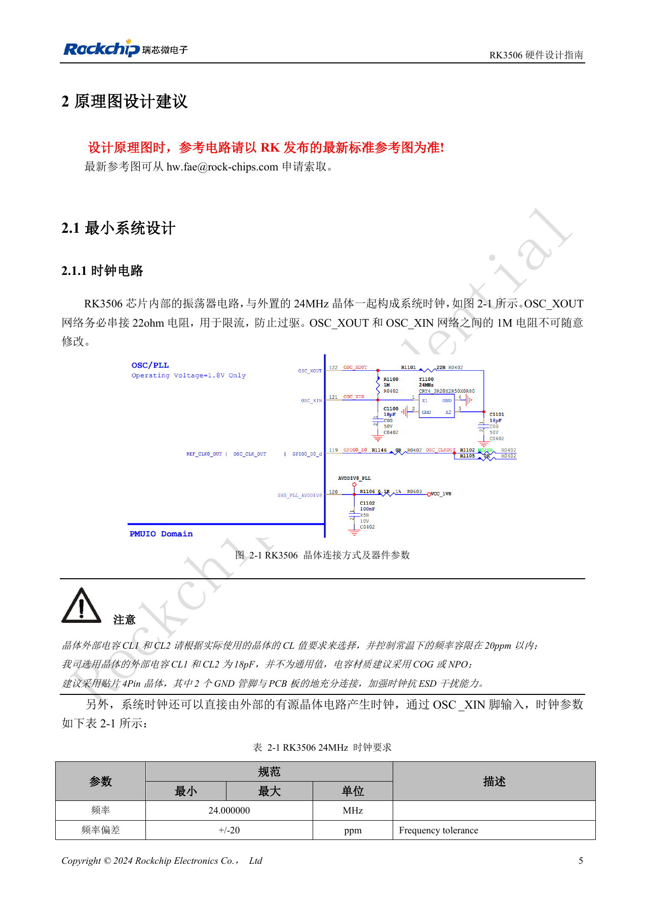
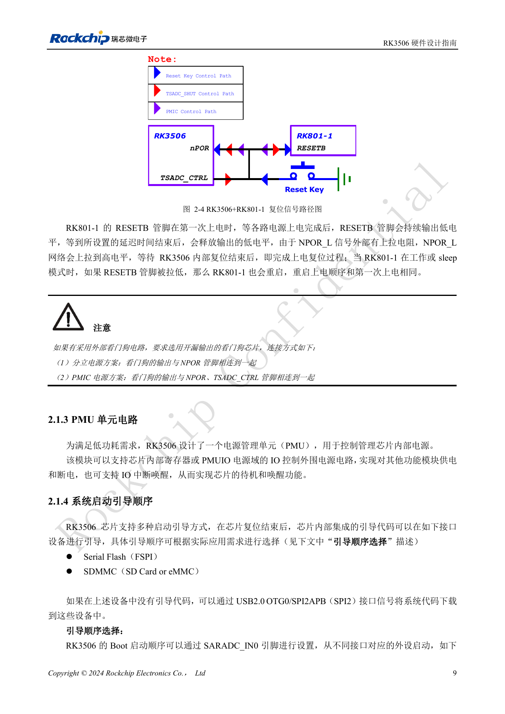
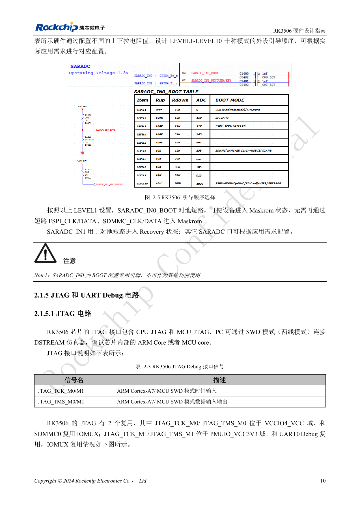
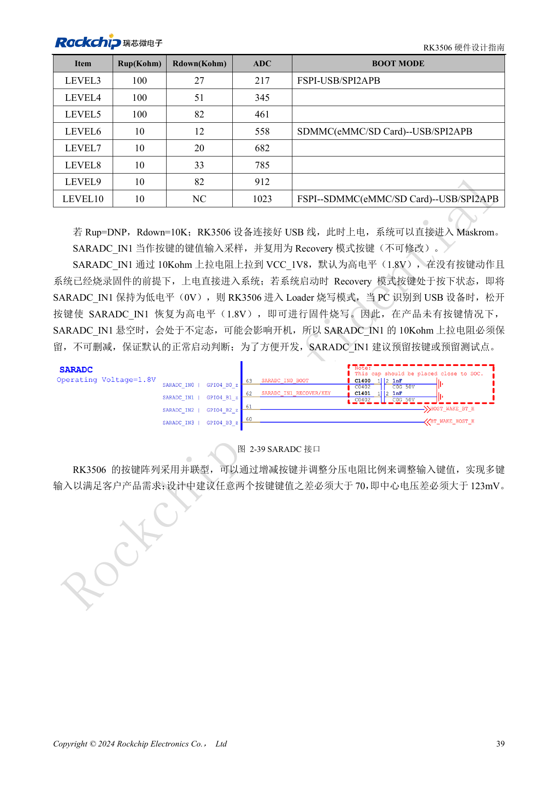
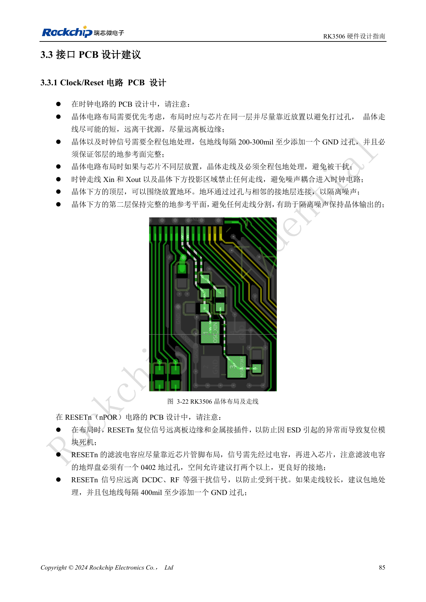

# RK3506 minimum system: clocks, reset and recovery

Based on RK3506 Hardware Design Guide V1.0 (2024-09), covering G2 and B/J. Verify package, memory, rails and pins by variant and CM1/Forge1 interfaces against board documentation. This is an engineering topic article, not a complete page-by-page translation. Values are source references, not ArmSoM hardware measurements. Validate the actual SDK/BSP, kernel and firmware.

**RK3506 Hardware Design Guide_V1.0_20240904_CN.pdf** · §2.1.1–2.1.5; §2.3.2; §3.3.1

## 24MHz and the sleep clock

Keep the 22Ω resistor in OSC_XOUT and do not arbitrarily change the 1MΩ resistor between XOUT and XIN. The illustrated 18pF load capacitors belong to the reference crystal, not every crystal: calculate them from CL and parasitics. Keep room-temperature tolerance within ±20ppm; C0G/NP0 capacitors and a four-pin crystal are recommended. Place the crystal close on the same side, keep unrelated routes out of its projection and XIN/XOUT region, maintain continuous adjacent ground and stitch the guard every 200–300mil.

## Match reset to the power architecture

NPOR is active low. Place its 10nF filter at the pin rather than filtering only at the remote button. An external open-drain watchdog connects to NPOR in a discrete-supply design; the RK801-1 scheme also involves TSADC_CTRL as shown in the reference circuit. TSADC_CTRL is fixed at RM_IO21 and cannot be moved. Match peripheral clocks to their IO-domain voltage. Before stopping 24MHz, check that the wake source does not depend on it. External 32.768kHz requires ±30ppm, 45–55% duty and amplitude from 0.7×VDD to VDD.

## Keep recovery accessible

SARADC_IN0 is reserved for boot selection, not a general input; the grounded LEVEL1 configuration enters Maskrom. Keep the SARADC_IN1 Recovery input pulled to 1.8V through 10kΩ and expose a button or test point. Used ADC pins need 1nF near the SoC; the button path passes ESD protection before 100Ω. USB OTG0 is the implemented download port in this guide. Although SPI2APB appears in the boot table, the text says its software was not yet developed: do not replace the USB recovery path with it. Record rails, 24MHz, NPOR, serial output and PC enumeration during bring-up.

## Source figures and review pages

Only Chinese originals are available in this batch. All four languages use the same source images, retaining figure context; image labels are not translated. Prose is editable. Page numbers are physical PDF pages.

PDF 20

PDF 24

PDF 25

PDF 54

PDF 100

## ArmSoM products and documentation

- [ArmSoM CM1](https://www.armsom.org/product-page/cm1) · [CM1 Docs](https://docs.armsom.org/armsom-cm1)
- [ArmSoM Forge1](https://www.armsom.org/armsom-forge1) · [Forge1 Docs](https://docs.armsom.org/armsom-forge1)

## Continue reading

- [Series contents](/articles/rk3506-hardware-design-series/)
- [RK3506 power domains: G2, B/J and carrier boundaries](/articles/rk3506-power-domains-design/)
- [RK3506 DDR, eMMC and FSPI: circuits and routing](/articles/rk3506-ddr-storage-hardware-design/)
- [RK3506 display, USB and RM_IO allocation](/articles/rk3506-display-usb-io-design/)
- [RK3506 audio design: SAI, PDM, ASRC and DSM](/articles/rk3506-audio-hardware-design/)
- [RK3506 industrial interfaces: RMII, FlexBus, DSMC and controls](/articles/rk3506-industrial-bus-hardware-design/)
- [RK3506 thermal, ESD and production review](/articles/rk3506-thermal-esd-production-design/)
