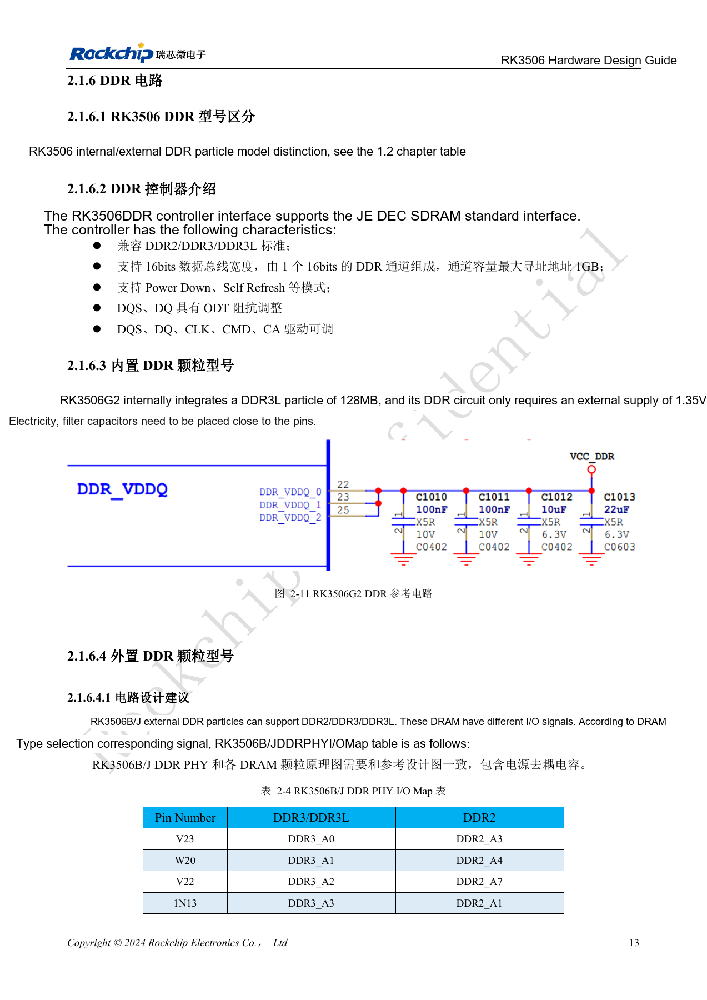
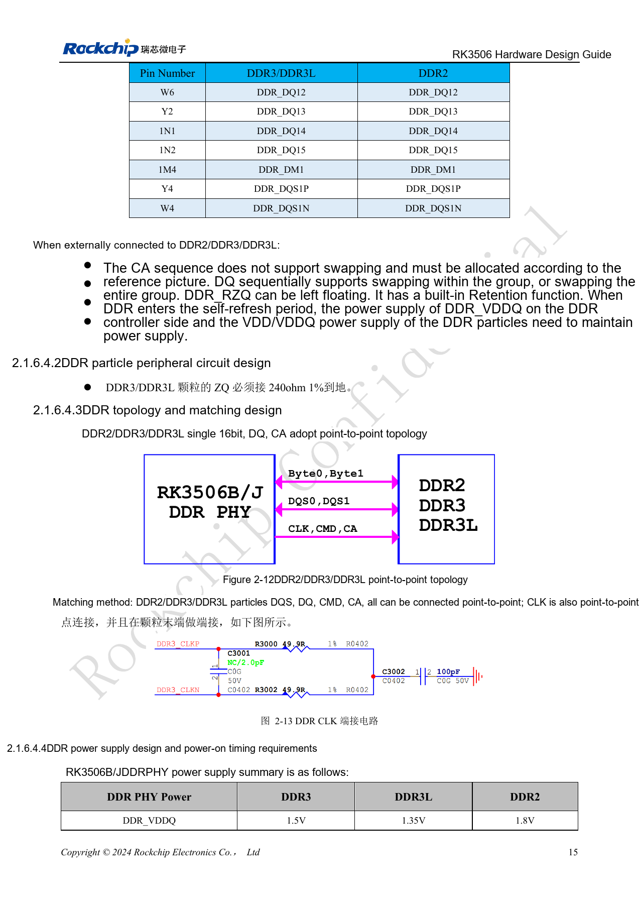
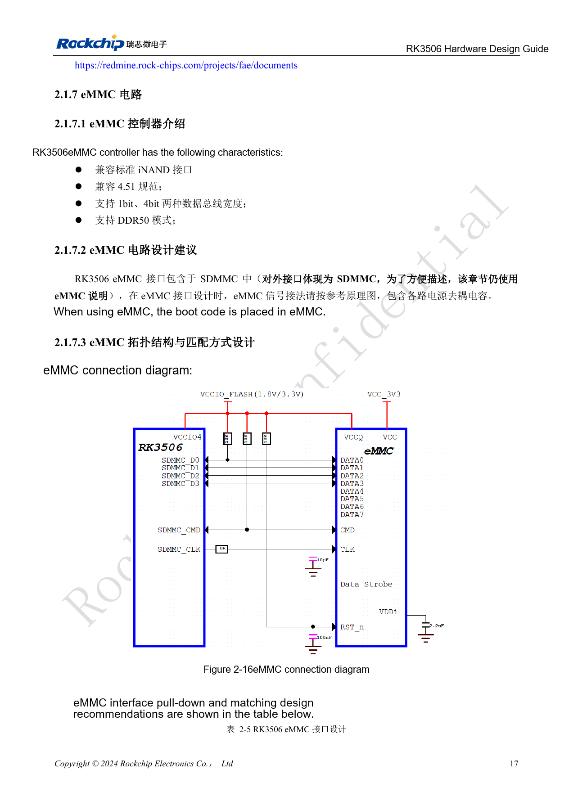
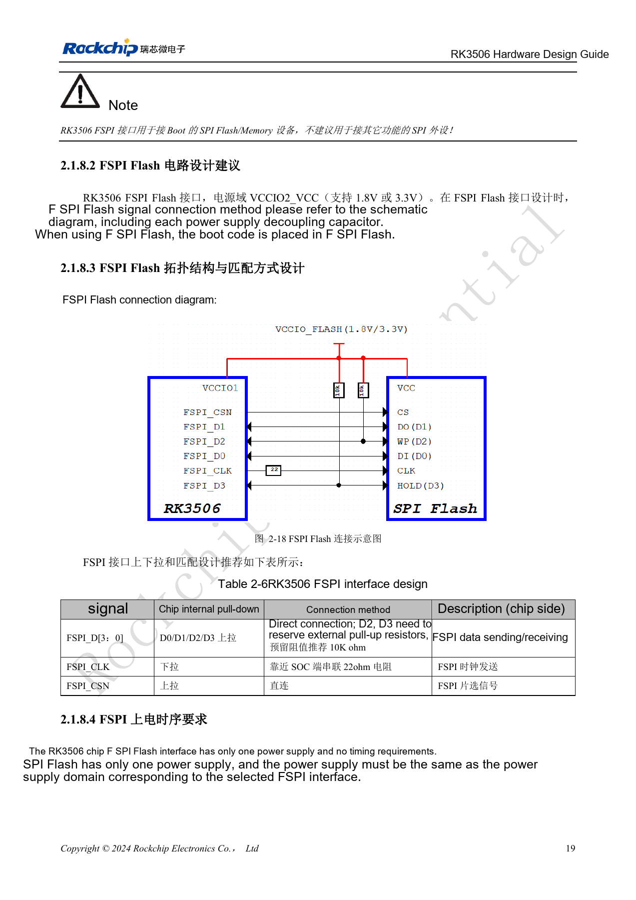
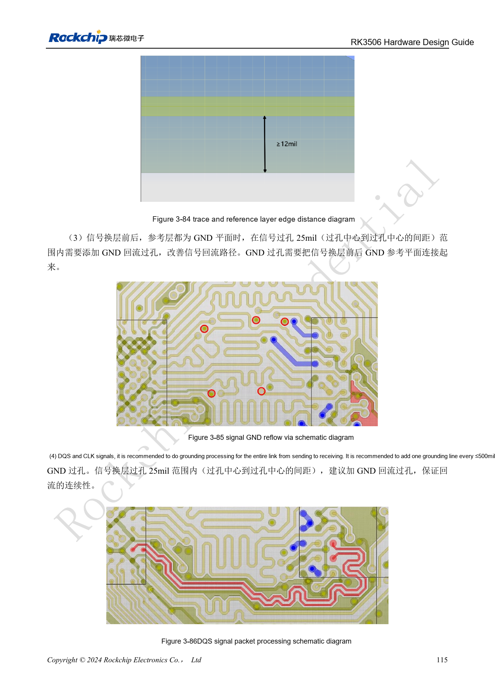

# RK3506 DDR, eMMC and FSPI: circuits and routing

Based on RK3506 Hardware Design Guide V1.0 (2024-09), covering G2 and B/J. Verify package, memory, rails and pins by variant and CM1/Forge1 interfaces against board documentation. This is an engineering topic article, not a complete page-by-page translation. Values are source references, not ArmSoM hardware measurements. Validate the actual SDK/BSP, kernel and firmware.

**RK3506 Hardware Design Guide_V1.0_20240904_CN.pdf** · §2.1.6–2.1.8; §3.3.9–3.3.12

## Internal versus external DDR

G2 integrates 128MB DDR3L, supplied externally at 1.35V with local decoupling. B/J uses external DDR2/DDR3/DDR3L on one 16bit channel; the documented 1GB address limit is a controller capability, not installed CM1 or Forge1 memory. Typical DDR_VDDQ is 1.5V for DDR3, 1.35V for DDR3L and 1.8V for DDR2. Do not reorder CA. DQ swaps are allowed within a group or as complete groups, not arbitrary remapping. Leave the controller DDR_RZQ open, but connect the DDR3/3L device ZQ to ground through 240Ω 1%. Keep controller DDR_VDDQ and DRAM VDD/VDDQ powered during self-refresh.

## Put DDR limits into the PCB rules

The DDR2/3/3L tables specify 50Ω±10% single-ended and 100Ω±10% differential. Within a byte, DQ/DM-to-DQS mismatch is ≤50mil; address/control-to-CLK ≤100mil; DQS and CLK intra-pair mismatch ≤12mil; DQS-to-CLK ≤450mil. Place a ground return via within 25mil center-to-center of a signal via when changing layers, maintain reference continuity and use ≥3W serpentine spacing. A vendor template must also match the DDR device and firmware; its qualification does not qualify a new board.

## Do not describe this eMMC as eight-bit HS400

Here eMMC uses SDMMC, specification 4.51, 1/4bit width and DDR50. Add the recommended 10kΩ pull-ups on D0 and CMD and 22Ω at the SoC clock output; other data uses internal pull-ups. Boot FSPI supports NOR/NAND, SDR and 1/2/4 wires on VCCIO2. Reserve 10kΩ pull-ups on D2/D3 and 22Ω near the SoC on CLK; power flash from the same domain supply. PCB references: eMMC <3in, FSPI <4in, both 50Ω±10% single-ended with clock/data mismatch <100mil. Validate cold boot, recovery, sustained reads/writes and power-loss recovery against the device list for the actual SDK.

## DDR2 / DDR3 / DDR3L routing parameters

| Check | Source requirement |
| --- | --- |
| Single-ended impedance | 50Ω ±10% |
| Differential impedance | 100Ω ±10% |
| Within byte: DQ / DM to DQS mismatch | ≤50mil |
| CS / ODT / CKE to CLK mismatch | ≤100mil |
| Other address/control to CLK mismatch | ≤100mil |
| DQS_P / DQS_N; CLK_P / CLK_N intra-pair mismatch | ≤12mil |
| DQS to CLK mismatch | ≤450mil |
| Between bytes; DQ-to-DQ within a byte | ≥2W |
| DQ-to-DQS and CLK-to-other spacing | Recommended ≥3W; minimum 2W |

Source: tables 3-17 and 3-18, PDF132–133. W is trace width. Some source headings call length mismatch “delay difference” while specifying mil; retain the length unit rather than treating it as time.

## Complete RK3506B/J DDR PHY signal map

| Package pin | DDR3 / DDR3L | DDR2 |
| --- | --- | --- |
| V23 | DDR3_A0 | DDR2_A3 |
| W20 | DDR3_A1 | DDR2_A4 |
| V22 | DDR3_A2 | DDR2_A7 |
| 1N13 | DDR3_A3 | DDR2_A1 |
| W18 | DDR3_A4 | DDR2_A2 |
| 1N14 | DDR3_A5 | DDR2_A5 |
| Y20 | DDR3_A6 | DDR2_A6 |
| T22 | DDR3_A7 | DDR2_A9 |
| Y21 | DDR3_A8 | DDR2_A8 |
| U22 | DDR3_A9 | DDR2_A12 |
| W17 | DDR3_A10 | DDR2_RASN |
| W22 | DDR3_A11 | DDR2_A11 |
| W23 | DDR3_A12 | DDR2_A0 |
| T23 | DDR3_A13 | DDR2_A13 |
| Y22 | DDR3_A14 | DDR2_A14 |
| Y17 | DDR3_A15 | DDR2_A15 |
| 1M9 | DDR3_WEN | DDR2_BA1 |
| 1N8 | DDR3_CASN | DDR2_BA0 |
| 1M8 | DDR3_RASN | DDR2_WEN |
| 1N12 | DDR3_BA0 | DDR2_A10 |
| Y18 | DDR3_BA1 | DDR2_CASN |
| 1N9 | DDR3_BA2 | DDR2_BA2 |
| W15 | DDR_CKE | DDR_CKE |
| 1M11 | DDR_CSN | DDR_CSN |
| 1N10 | DDR_ODT | DDR_ODT |
| 1M13 | DDR3_RESET | -- |
| Y14 | DDR_CLKP | DDR_CLKP |
| W14 | DDR_CLKN | DDR_CLKN |
| Y13 | DDR_DQ0 | DDR_DQ0 |
| Y12 | DDR_DQ1 | DDR_DQ1 |
| Y11 | DDR_DQ2 | DDR_DQ2 |
| 1M6 | DDR_DQ3 | DDR_DQ3 |
| 1M5 | DDR_DQ4 | DDR_DQ4 |
| 1N6 | DDR_DQ5 | DDR_DQ5 |
| W9 | DDR_DQ6 | DDR_DQ6 |
| 1N5 | DDR_DQ7 | DDR_DQ7 |
| 1N4 | DDR_DM0 | DDR_DM0 |
| Y10 | DDR_DQS0P | DDR_DQS0P |
| W10 | DDR_DQS0N | DDR_DQS0N |
| Y7 | DDR_DQ8 | DDR_DQ8 |
| W7 | DDR_DQ9 | DDR_DQ9 |
| Y6 | DDR_DQ10 | DDR_DQ10 |
| Y3 | DDR_DQ11 | DDR_DQ11 |
| W6 | DDR_DQ12 | DDR_DQ12 |
| Y2 | DDR_DQ13 | DDR_DQ13 |
| 1N1 | DDR_DQ14 | DDR_DQ14 |
| 1N2 | DDR_DQ15 | DDR_DQ15 |
| 1M4 | DDR_DM1 | DDR_DM1 |
| Y4 | DDR_DQS1P | DDR_DQS1P |
| W4 | DDR_DQS1N | DDR_DQS1N |

Source: table 2-4, PDF28–30. Pin spellings such as `1N13` and `1M9` are retained exactly; verify the official B/J package PinOut before PCB manufacture rather than removing a leading character. CA address/command signals cannot be swapped. DQ can be swapped within a group or as whole groups, subject to the reference design and initialization configuration. Leave `DDR_RZQ` open; connect the DDR3/DDR3L device ZQ to ground through 240Ω, 1%. Self-refresh retention requires both controller `DDR_VDDQ` and device `VDD/VDDQ` to remain powered. This table does not describe external DDR pins on G2 or prove that CM1/Forge1 exposes these signals.

## Source figures and review pages

Only Chinese originals are available in this batch. All four languages use the same source images, retaining figure context; image labels are not translated. Prose is editable. Page numbers are physical PDF pages.

PDF 28

PDF 30

PDF 32

PDF 34

PDF 130

## ArmSoM products and documentation

- [ArmSoM CM1](https://www.armsom.org/product-page/cm1) · [CM1 Docs](https://docs.armsom.org/armsom-cm1)
- [ArmSoM Forge1](https://www.armsom.org/armsom-forge1) · [Forge1 Docs](https://docs.armsom.org/armsom-forge1)

## Continue reading

- [Series contents](/articles/rk3506-hardware-design-series/)
- [RK3506 minimum system: clocks, reset and recovery](/articles/rk3506-clock-boot-reset-design/)
- [RK3506 power domains: G2, B/J and carrier boundaries](/articles/rk3506-power-domains-design/)
- [RK3506 display, USB and RM_IO allocation](/articles/rk3506-display-usb-io-design/)
- [RK3506 audio design: SAI, PDM, ASRC and DSM](/articles/rk3506-audio-hardware-design/)
- [RK3506 industrial interfaces: RMII, FlexBus, DSMC and controls](/articles/rk3506-industrial-bus-hardware-design/)
- [RK3506 thermal, ESD and production review](/articles/rk3506-thermal-esd-production-design/)
