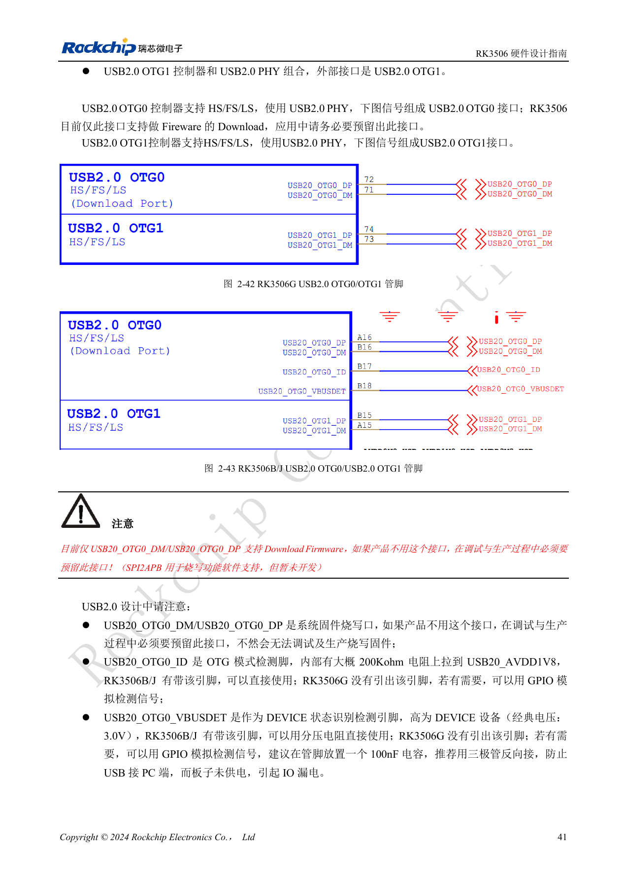
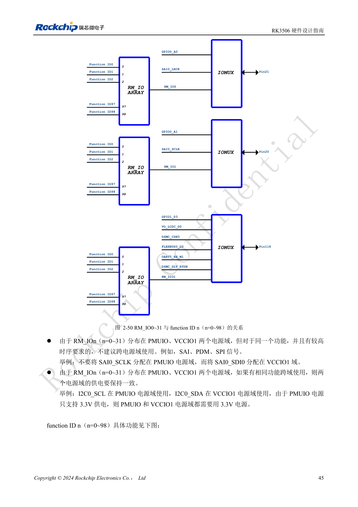
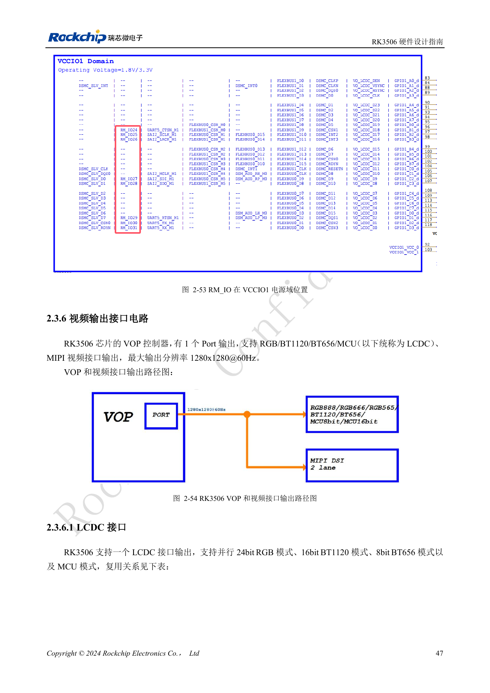
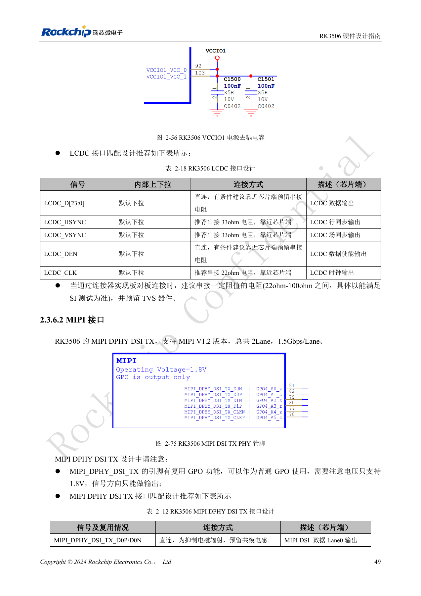
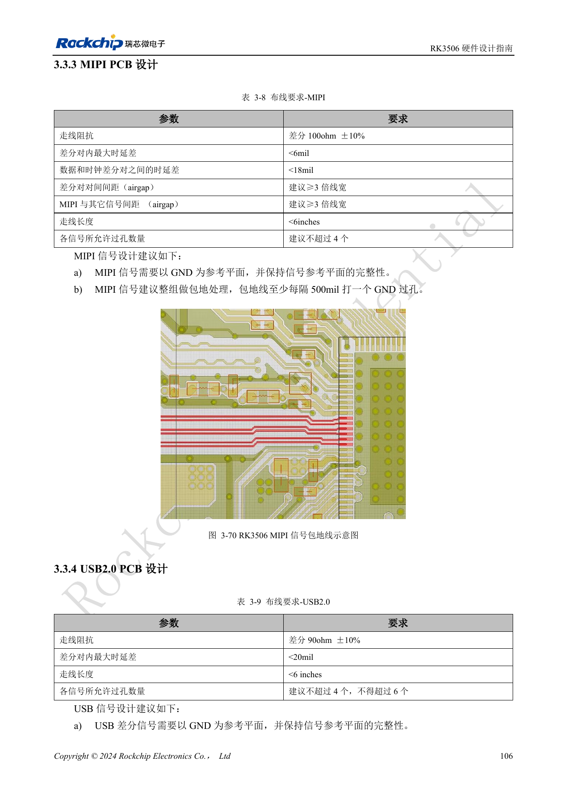
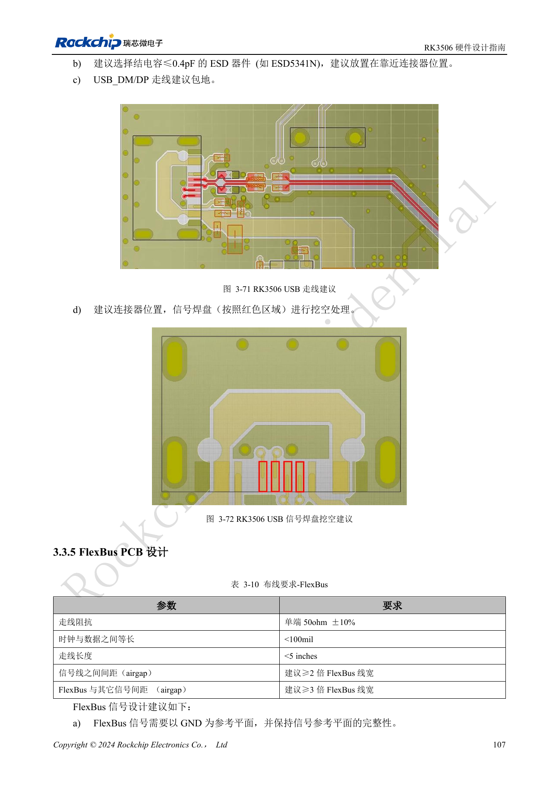

# RK3506 display, USB and RM_IO allocation

Based on RK3506 Hardware Design Guide V1.0 (2024-09), covering G2 and B/J. Verify package, memory, rails and pins by variant and CM1/Forge1 interfaces against board documentation. This is an engineering topic article, not a complete page-by-page translation. Values are source references, not ArmSoM hardware measurements. Validate the actual SDK/BSP, kernel and firmware.

**RK3506 Hardware Design Guide_V1.0_20240904_CN.pdf** · §2.3.4–2.3.6; §3.3.3–3.3.4; §3.3.11

## Select one display path first

The VOP has one port, supporting RGB/BT1120/BT656/MCU or MIPI, with a documented maximum of 1280×1280@60Hz. Interface names cannot be added together to promise simultaneous displays. LCDC belongs to VCCIO1 and must match the panel voltage; source-side 33Ω on HSYNC/VSYNC and 22Ω on CLK are recommended. MIPI DSI TX has two data lanes at 1.5Gbps/Lane. Reusing MIPI pins as GPO provides 1.8V outputs only, not general bidirectional GPIO.

## USB ports and protection

Of the two USB2.0 OTG ports, preserve OTG0 for flashing. G2 does not expose OTG0 ID/VBUSDET, while B/J does; GPIO-based detection must avoid back-powering when the PC is connected but the board is off. Retain 2.2Ω in DP/DM and 100Ω in ID; use a current-limited switch for host 5V. The circuit chapter allows ESD capacitance up to 3pF, whereas the PCB chapter recommends ≤0.4pF. Keep both references visible and use the stricter budget with eye-diagram verification. USB routing: 90Ω±10%, intra-pair mismatch <20mil, length <6in, preferably at most four vias and never more than six.

## RM_IO flexibility still has limits

RM_IO0–31 can select function ID0–98, but a given function maps to only one RM_IO pin. The matrix spans PMUIO and VCCIO1; avoid splitting timing-sensitive SAI/PDM/SPI across domains. An I2C split requires equal voltages, and PMUIO is fixed at 3.3V. MIPI PCB references are 100Ω±10% differential, intra-pair mismatch <6mil, data-pair to clock-pair mismatch <18mil, length <6in and preferably ≤4 vias. Build a signal/function/power-domain matrix before assigning the connector, then verify the complete channel rather than only bare-board length.

## Source figures and review pages

Only Chinese originals are available in this batch. All four languages use the same source images, retaining figure context; image labels are not translated. Prose is editable. Page numbers are physical PDF pages.

PDF 56

PDF 60

PDF 62

PDF 64

PDF 121

PDF 122

## ArmSoM products and documentation

- [ArmSoM CM1](https://www.armsom.org/product-page/cm1) · [CM1 Docs](https://docs.armsom.org/armsom-cm1)
- [ArmSoM Forge1](https://www.armsom.org/armsom-forge1) · [Forge1 Docs](https://docs.armsom.org/armsom-forge1)

## Continue reading

- [Series contents](/articles/rk3506-hardware-design-series/)
- [RK3506 minimum system: clocks, reset and recovery](/articles/rk3506-clock-boot-reset-design/)
- [RK3506 power domains: G2, B/J and carrier boundaries](/articles/rk3506-power-domains-design/)
- [RK3506 DDR, eMMC and FSPI: circuits and routing](/articles/rk3506-ddr-storage-hardware-design/)
- [RK3506 audio design: SAI, PDM, ASRC and DSM](/articles/rk3506-audio-hardware-design/)
- [RK3506 industrial interfaces: RMII, FlexBus, DSMC and controls](/articles/rk3506-industrial-bus-hardware-design/)
- [RK3506 thermal, ESD and production review](/articles/rk3506-thermal-esd-production-design/)
