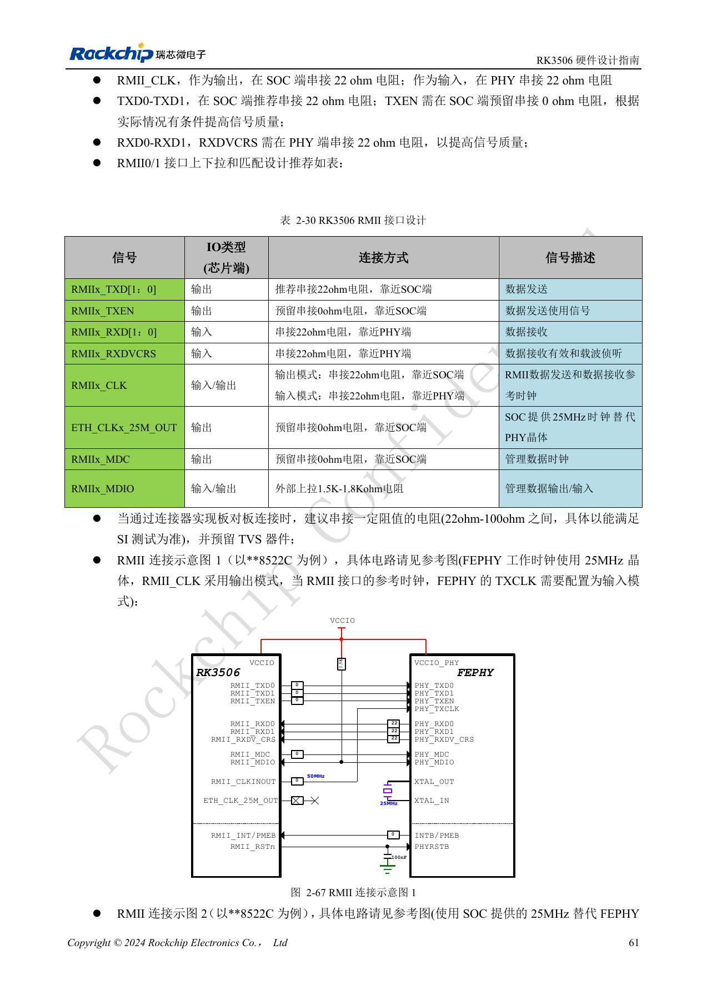
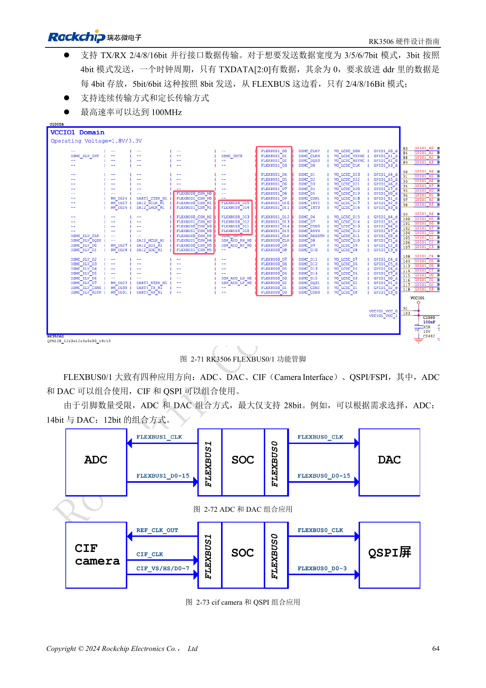
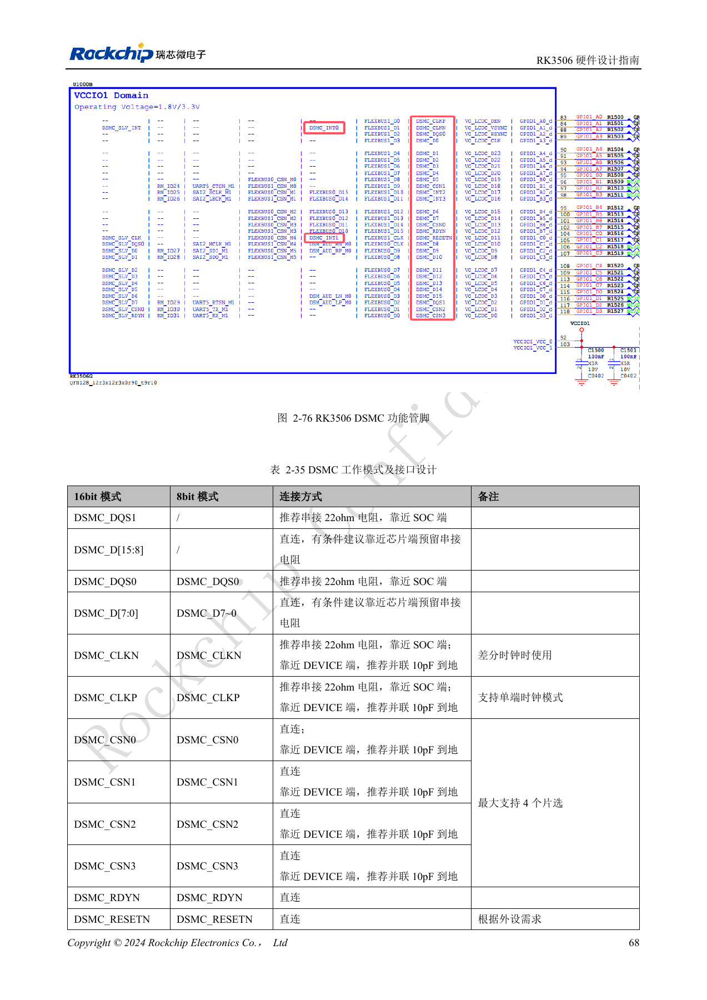
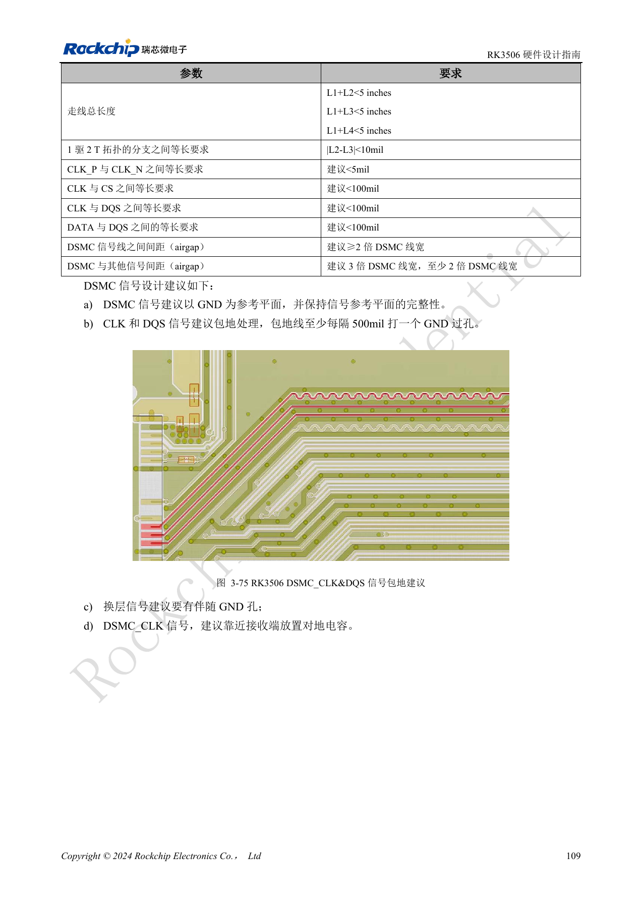
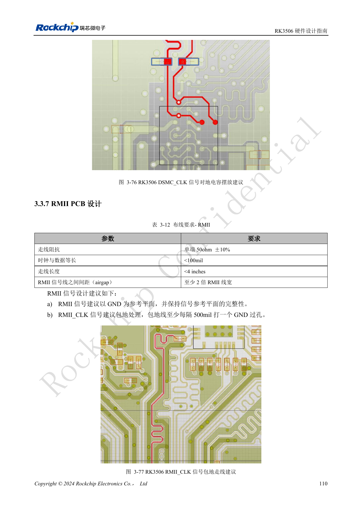

# RK3506 industrial interfaces: RMII, FlexBus, DSMC and controls

Based on RK3506 Hardware Design Guide V1.0 (2024-09), covering G2 and B/J. Verify package, memory, rails and pins by variant and CM1/Forge1 interfaces against board documentation. This is an engineering topic article, not a complete page-by-page translation. Values are source references, not ArmSoM hardware measurements. Validate the actual SDK/BSP, kernel and firmware.

**RK3506 Hardware Design Guide_V1.0_20240904_CN.pdf** · §2.3.8–2.3.17; §3.3.5–3.3.7

## Two MACs are not two finished Ethernet ports

RK3506 integrates two 10/100Mbps EMACs: RMII0 on VCCIO3, RMII1 on VCCIO4. PHY, magnetics, RJ45, reset and protection still come from the board design. Define one driver for the 50MHz reference: place 22Ω at the SoC when it drives, at the PHY when the PHY drives. Pull MDIO up through 1.5–1.8kΩ to the corresponding IO supply. A PHY’s 25MHz crystal and the 50MHz RMII clock are different signals. When changing PHY, review transformer center taps, straps and Tab-up/Tab-down connector pin order.

## Check parallel-bus direction and packing

FlexBus0 data is bidirectional but its clock is output-only; FlexBus1 data is input-only with an input/output clock. Transfers use 2/4/8/16bit packing: 3bit data uses 4bit storage, and 5/6/7bit uses 8bit. Wiring fewer pins does not create an arbitrary-width mode. The documented maximum is 100MHz; combined ADC/DAC use is further limited to 28 pins of data. DSMC routing follows the selected topology: a one-to-two T branch mismatch <10mil, CLK P/N preferably <5mil, CLK-to-CS/DQS and DATA-to-DQS preferably <100mil, and complete paths <5in.

## Include the carrier in validation

RMII references are 50Ω±10%, clock/data mismatch <100mil and length <4in; FlexBus uses 50Ω±10%, <100mil and <5in. Review muxing, levels and external devices separately for UART, SPI, I2C, PWM, touch and CAN; CAN controller signals cannot connect directly to the field bus. Start a CM1 carrier from the module’s exposed functions and evaluate Forge1 using its actual interfaces. Test buses separately, then simultaneous display updates, networking and field traffic. Record errors and recovery rather than accepting one successful transaction.

## DSMC master-interface connection checklist

| Signal | Connection and use |
| --- | --- |
| DSMC_DQS1 | 16-bit only; recommended 22Ω at SoC |
| DSMC_D[15:8] | 16-bit only; direct, reserve series-resistor footprint |
| DSMC_DQS0 | 8/16-bit; recommended 22Ω at SoC |
| DSMC_D[7:0] | Direct; reserve series-resistor footprint |
| DSMC_CLKN | Differential mode only; 22Ω at SoC, 10pF to ground at device |
| DSMC_CLKP | Supports single-ended mode; 22Ω at SoC, 10pF to ground at device |
| DSMC_CSN0–3 | Up to four chip selects; direct, reserve 10pF to ground at device |
| DSMC_RDYN / DSMC_RESETN | Direct; use according to device requirements |
| DSMC_INT0/1 | Hardware interrupt; direct |
| DSMC_INT2/3 | Software interrupt, slower; direct |

Source: §2.3.8, table 2-35, PDF82–84. The master supports x8/x16 DDR at up to 150MHz clock for Xccela/Hyperbus PSRAM or FPGA. The slave supports x8 DDR up to 100MHz; connect DQS0, D[7:0], CLKP, CSN0, RDYN and INT according to the HOST requirements. These resistor/capacitor values are reference-circuit recommendations requiring device and timing validation. Maximum clock is not a guaranteed operating frequency for every board.

## Low-speed buses and multiplexing boundaries

| Interface | Source constraints |
| --- | --- |
| UART0–5 | UART0 uses PMUIO for debug; UART1–4 use RM_IO; UART5 selects M0/VCCIO4 or M1/VCCIO1. UART3/4/5 provide corresponding flow-control multiplexing. 64-byte TX/RX FIFO, 5–8-bit data. |
| SPI0/1 | Master/slave, full/half duplex, 4/8/16-bit, RM_IO on PMUIO/VCCIO1; 22Ω at clock source, data/chip-select direct. |
| SPI2APB | Slave-only, half-duplex, 8/16-bit, VCCIO3, proprietary protocol; not a general SPI master. |
| I2C0–2 | Master, 7/10-bit address, up to 1Mbit/s; RM_IO, recommended 2.2kΩ pull-ups sized for bus load. Table 2-42 omits n=2; prose and table 2-43 list 0/1/2. |
| CAN0/1 | CAN 2.0B standard/extended frames via RM_IO; external 4.7kΩ pull-up required on CANn_TX, RX direct to transceiver. |

Source: PDF85–90. Check PinMux, I/O-domain voltage and software DTS together; one physical pin cannot provide all alternate functions simultaneously. Listed UART rates include 115.2kbps, 460.8kbps, 921.6kbps, 1.5Mbps, 3Mbps and 4Mbps; select according to the clock and peer device. Disable unpowered analog PHY functions in DTS so software does not enable an unpowered block.

## Source figures and review pages

Only Chinese originals are available in this batch. All four languages use the same source images, retaining figure context; image labels are not translated. Prose is editable. Page numbers are physical PDF pages.

PDF 76

PDF 79

PDF 83

PDF 124

PDF 125

## ArmSoM products and documentation

- [ArmSoM CM1](https://www.armsom.org/product-page/cm1) · [CM1 Docs](https://docs.armsom.org/armsom-cm1)
- [ArmSoM Forge1](https://www.armsom.org/armsom-forge1) · [Forge1 Docs](https://docs.armsom.org/armsom-forge1)

## Continue reading

- [Series contents](/articles/rk3506-hardware-design-series/)
- [RK3506 minimum system: clocks, reset and recovery](/articles/rk3506-clock-boot-reset-design/)
- [RK3506 power domains: G2, B/J and carrier boundaries](/articles/rk3506-power-domains-design/)
- [RK3506 DDR, eMMC and FSPI: circuits and routing](/articles/rk3506-ddr-storage-hardware-design/)
- [RK3506 display, USB and RM_IO allocation](/articles/rk3506-display-usb-io-design/)
- [RK3506 audio design: SAI, PDM, ASRC and DSM](/articles/rk3506-audio-hardware-design/)
- [RK3506 thermal, ESD and production review](/articles/rk3506-thermal-esd-production-design/)
