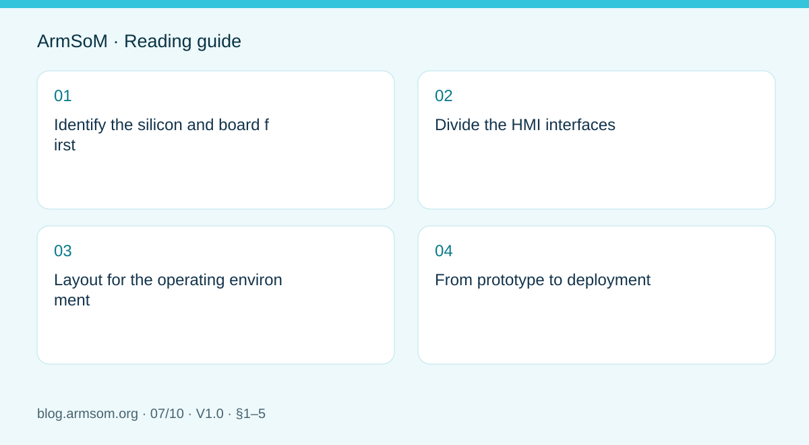
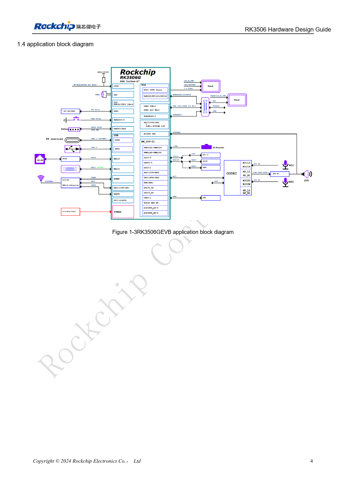

# RK3506 industrial HMI hardware: choosing a CM1 or Forge1 development path

## Scope and sources

This is a task-focused engineering guide, not a page-by-page translation of the complete PDF. Source examples are not ArmSoM measurements. Check voltages, pins, SDK/BSP and kernel against the actual board revision.

**Rockchip:** `RK3506 Hardware Design Guide_V1.0_20240904_CN.pdf` · V1.0 · §1–5

## Identify the silicon and board first

PDF page 3 of V1.0 explicitly lists RK3506G2 and RK3506B/J, so J is included. Storage in a B/G directory does not restrict the whole guide to B/G. Pinout, power, DDR and board connections still require variant-specific checks.

CM1 suits custom interfaces and mechanics through a module approach; Forge1 provides an industrial application platform. List display, touch, networking, field communication, audio and enclosure requirements before choosing.

## Divide the HMI interfaces

| Function | Review together |
| --- | --- |
| Display and touch | Video interface, timing, backlight, touch controller, driver |
| Ethernet | MAC/PHY clocks, power, reset, connector, isolation |
| Field communication | Transceiver, isolation, termination and grounding |
| Audio | Levels, ground loops, analog/digital noise coupling |
| Maintenance | Serial access, programming, version identification, enclosure access |

Chapter 3 separately covers MIPI, USB2.0, FlexBus, DSMC, RMII, storage and audio PCB design. These chapters do not mean every board exposes every function.

## Layout for the operating environment

Review external connectors, protection devices and sensitive circuits as complete paths. ESD parts need appropriate return paths; display cables, switching regulators and audio routes need deliberate placement. Chapters 4–5 provide thermal and ESD/EMI review inputs, not finished-product certification.

## From prototype to deployment

Validate each interface alone, then combine screen updates, networking and field-data acquisition. Record startup time, response, communication errors and heat. Test startup and recovery within the specified supply range. An unsupported industrial-grade label cannot replace testing.

For CM1, establish software and peripheral operation on its IO board. For Forge1, verify the interfaces already implemented. A custom carrier still requires its own supply, protection and connector validation.

## Source illustration

Chinese original; no matching English figure was found in the supplied materials. RK3506G EVB ≠ RK3506J / CM1 / Forge1. Reference design, not an ArmSoM board schematic.

`RK3506 Hardware Design Guide_V1.0_20240904_CN.pdf` · PDF p. 19.

## Products and development resources

- **CM1** — [Product page](https://www.armsom.org/product-page/cm1) · [Documentation](https://docs.armsom.org/armsom-cm1)
- **Forge1** — [Product page](https://www.armsom.org/armsom-forge1) · [Documentation](https://docs.armsom.org/armsom-forge1)

## Continue this series

- [RK3576 hardware bring-up: minimum system and first-power checks](/articles/rk3576-hardware-bringup/)
- [ArmSoM CM5 carrier-board checklist: power, boot and interface planning](/articles/019-cm5-carrier-production/)
- [RK3576 high-speed interfaces: review schematics and PCB together](/articles/rk3576-high-speed-interface-design/)
- [RK3588S hardware design: from a reference circuit to a CM7s carrier](/articles/rk3588s-cm7s-carrier-design/)
- [RK3588 edge-AI hardware: plan power, cooling and expansion together](/articles/rk3588-edge-ai-hardware-design/)
- [RK3588 high-speed PCB review: stackup, impedance and routing](/articles/rk3588-high-speed-pcb-review/)
- [RK3308 hardware variants: compatibility checks for P2 Pro audio projects](/articles/rk3308-hardware-variant-compatibility/)
- [RK3588S versus RK3588S2: what to check before a hardware revision](/articles/rk3588s-rk3588s2-hardware-differences/)
- [Rockchip prototype to production: process requirements and test records](/articles/rockchip-hardware-production-checklist/)

## Continue reading

- [RK3506 hardware design series](/articles/rk3506-hardware-design-series/)
