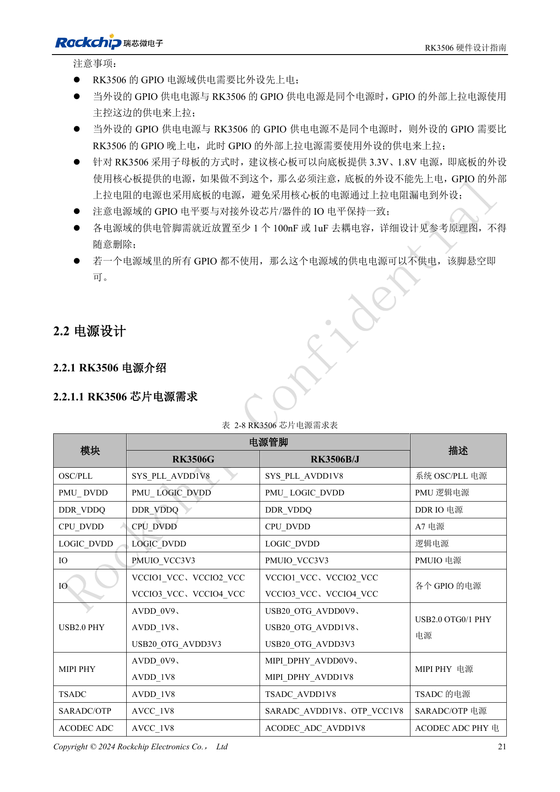
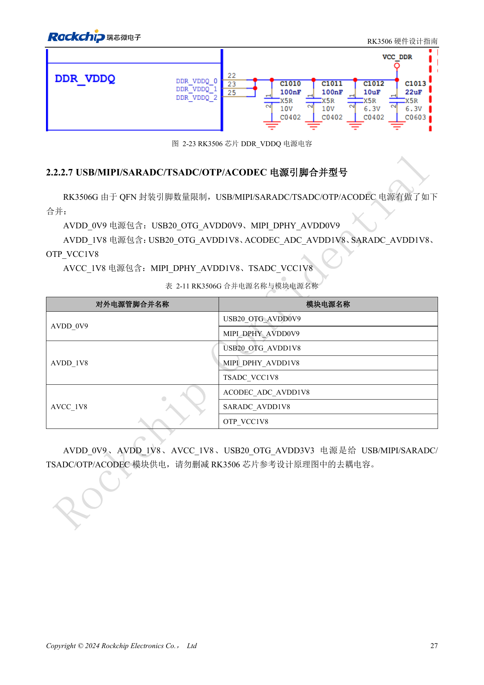
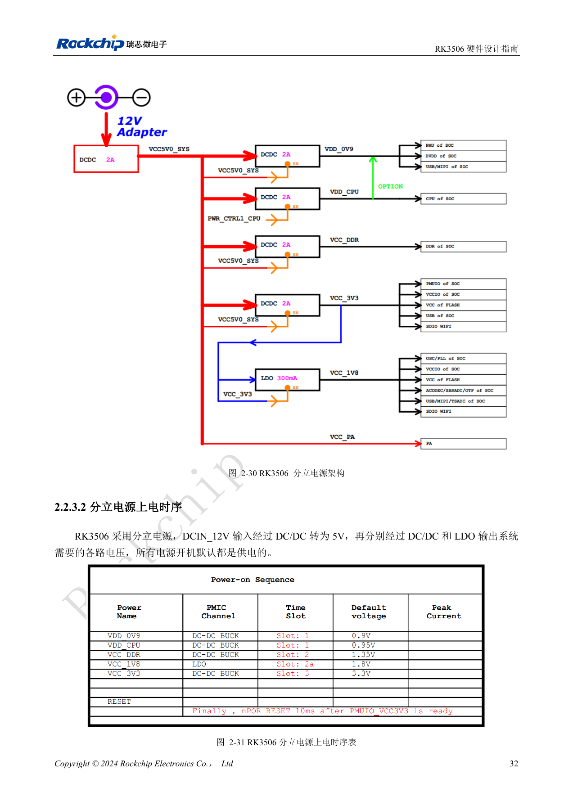
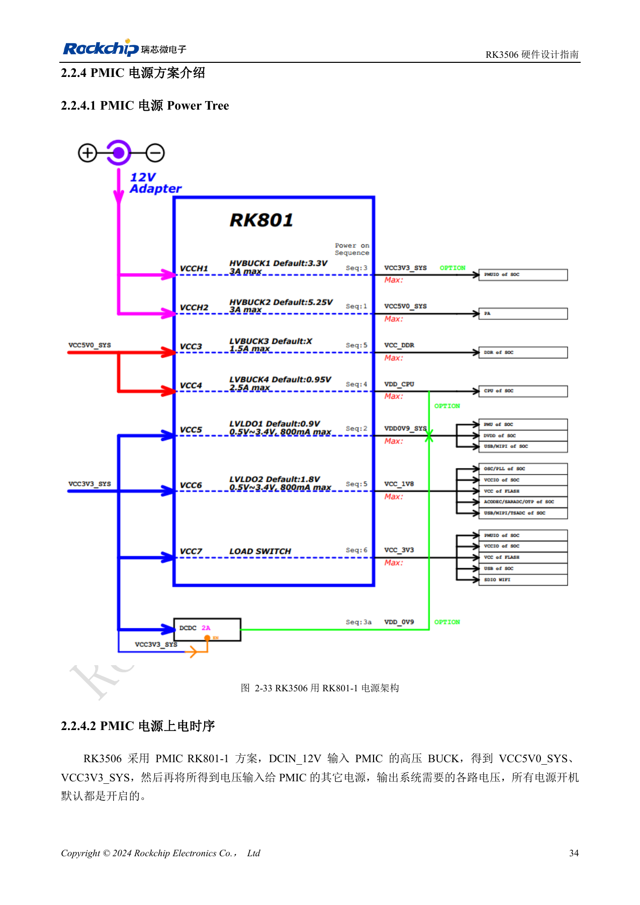

# RK3506 power domains: G2, B/J and carrier boundaries

Based on RK3506 Hardware Design Guide V1.0 (2024-09), covering G2 and B/J. Verify package, memory, rails and pins by variant and CM1/Forge1 interfaces against board documentation. This is an engineering topic article, not a complete page-by-page translation. Values are source references, not ArmSoM hardware measurements. Validate the actual SDK/BSP, kernel and firmware.

**RK3506 Hardware Design Guide_V1.0_20240904_CN.pdf** · §1.2; §2.1.9; §2.2; §3.3.2

## Start with the package

The guide explicitly covers RK3506G2 and RK3506B/J. G2 uses QFN128L with 128MB DDR3L inside the package; B/J uses FBGA333L with external DDR. G2 combines some analog supplies, whereas B/J has separate pins for USB, MIPI, SARADC, OTP and ACODEC. Identical logical block names therefore do not justify copying the other package’s power netlist. CM1 and Forge1 development with the J variant can use this guide, together with the actual product schematic and connector definitions.

## Sequence and back-powering

The source rule is lower voltage before higher voltage within one block, with equal-voltage supplies rising together. Looser dependencies between internal blocks do not authorize peripherals to power up first. Power SoC GPIO before the peripheral; with separate supplies, connect pull-ups to the peripheral supply to avoid leakage into an unpowered device. PMUIO is fixed at 3.3V; VCCIO1–4 accept 1.8V/3.3V with hardware detection according to the guide. Still review levels, sequencing and unpowered states; this is not a reason to omit level translation. Keep at least one 100nF or 1µF local decoupler at each domain supply pin.

## A power tree is more than DC voltage

Discrete and RK801-1 PMIC schemes have distinct sequences and reset paths; use the matching reference as a whole. LOGIC_DVDD and DDR_VDDQ each require more than 30µF total capacitance. The DDR buck example specifies at least 1000mA, ±1.5% accuracy and ripple within ±5% during a 10%→80% maximum-load step at 1A/µs. B/J USB reference AC limits are 0.9V <25mV, 1.8V <50mV and 3.3V <200mV. These are source requirements, not product measurements. On printed page 27, the G2 combined-supply prose conflicts with table 2-11: resolve the mapping using the actual PinOut and reference schematic, not a guessed correction.

## Seven PDN target-impedance groups

| Source table / target | 100kHz–1MHz / Ω | 1–30MHz / Ω | 30–100MHz / Ω |
| --- | --- | --- | --- |
| 3-1 RK3506B VDD_CPU | ≤0.045 | ≤0.08 | ≤0.25 |
| 3-2 RK3506G VDD_CPU | ≤0.045 | ≤0.08 | ≤0.25 |
| 3-3 RK3506B VDD_0V9 | ≤0.05 | ≤0.06 | ≤0.15 |
| 3-4 RK3506G VDD_0V9 | ≤0.05 | ≤0.1 | ≤0.35 |
| 3-5 RK3562B VCC_DDR * | ≤0.045 | ≤0.1 | ≤0.3 |
| 3-6 RK3562G VCC_DDR * | ≤0.06 | ≤0.09 | ≤0.25 |
| 3-7 DDR device VCC_DDR | ≤0.04 | ≤0.04 | ≤0.08 |

Source: PDF107–108, 113, 118–119. * Tables 3-5/3-6 and their introductory text say RK3562B/G, whereas adjacent curves 3-65/3-66 say RK3506B/G. This is a source model-name conflict: preserve both the values and original labels, and do not treat these two rows as confirmed RK3506 DDR acceptance limits. Other tables retain the source spelling RK3506G rather than silently changing it to G2. Target impedance is a power-network design recommendation to validate with the stack-up, package, decoupling and load spectrum; it is not board power consumption or processor performance.

## Power copper and decoupling distances

| Rail | DCDC-to-SoC width | Effective width under SoC | DCR |
| --- | --- | --- | --- |
| VDD_CPU | ≥160mil | ≥55mil | ≤30mΩ |
| VDD_0V9 | ≥100mil | ≥30mil | ≤30mΩ |
| VCC_DDR | ≥80mil | ≥30mil | ≤30mΩ |

Source: §3.3.2. At the DCDC output, use at least four 0503 layer-transition vias; ≥6 are recommended. Provide a power via for each power pin. The distance from a 100nF decoupling pad edge to the power-via center is ≤12mil; for 1µF it is ≤50mil. Give each decoupling ground pad a ground via. Place the critical B-device capacitors behind the corresponding power pins and do not casually delete reference decoupling. The prose places GND vias within 40mil of some power pins, but captions 3-44 and 3-58 say 50mil: record the conflict and follow a confirmed template.

## Vendor development-board peak-current record

| Net | Voltage / V | Peak current / A | Source peak power / W | Frequency |
| --- | --- | --- | --- | --- |
| VDD_CPU | 0.95 | 0.7 | 0.76 | 1.5GHz |
| VDD_0V9 | 0.9 | 0.5 | 0.54 | — |
| VCC_DDR | 1.35 | 0.6 | 0.945 | 800MHz |

Source: table 2-12, PDF51. The device is RK3506G2 at 100°C junction temperature on a bare board without a heatsink; readings were recorded after 15 minutes of stable operation. Each module ran its own extreme workload, so adding rows does not establish simultaneous board consumption. `VCC_DDR` includes `DDR_VDDQ` and integrated DDR power. The listed power does not equal the tabulated voltage × current, and the source does not explain the accounting basis. Preserve and flag the numbers rather than calculating a supposedly corrected power. These are neither ArmSoM measurements nor final guaranteed silicon limits.

## Source figures and review pages

Only Chinese originals are available in this batch. All four languages use the same source images, retaining figure context; image labels are not translated. Prose is editable. Page numbers are physical PDF pages.

PDF 36

PDF 42

PDF 47

PDF 49

## ArmSoM products and documentation

- [ArmSoM CM1](https://www.armsom.org/product-page/cm1) · [CM1 Docs](https://docs.armsom.org/armsom-cm1)
- [ArmSoM Forge1](https://www.armsom.org/armsom-forge1) · [Forge1 Docs](https://docs.armsom.org/armsom-forge1)

## Continue reading

- [Series contents](/articles/rk3506-hardware-design-series/)
- [RK3506 minimum system: clocks, reset and recovery](/articles/rk3506-clock-boot-reset-design/)
- [RK3506 DDR, eMMC and FSPI: circuits and routing](/articles/rk3506-ddr-storage-hardware-design/)
- [RK3506 display, USB and RM_IO allocation](/articles/rk3506-display-usb-io-design/)
- [RK3506 audio design: SAI, PDM, ASRC and DSM](/articles/rk3506-audio-hardware-design/)
- [RK3506 industrial interfaces: RMII, FlexBus, DSMC and controls](/articles/rk3506-industrial-bus-hardware-design/)
- [RK3506 thermal, ESD and production review](/articles/rk3506-thermal-esd-production-design/)
