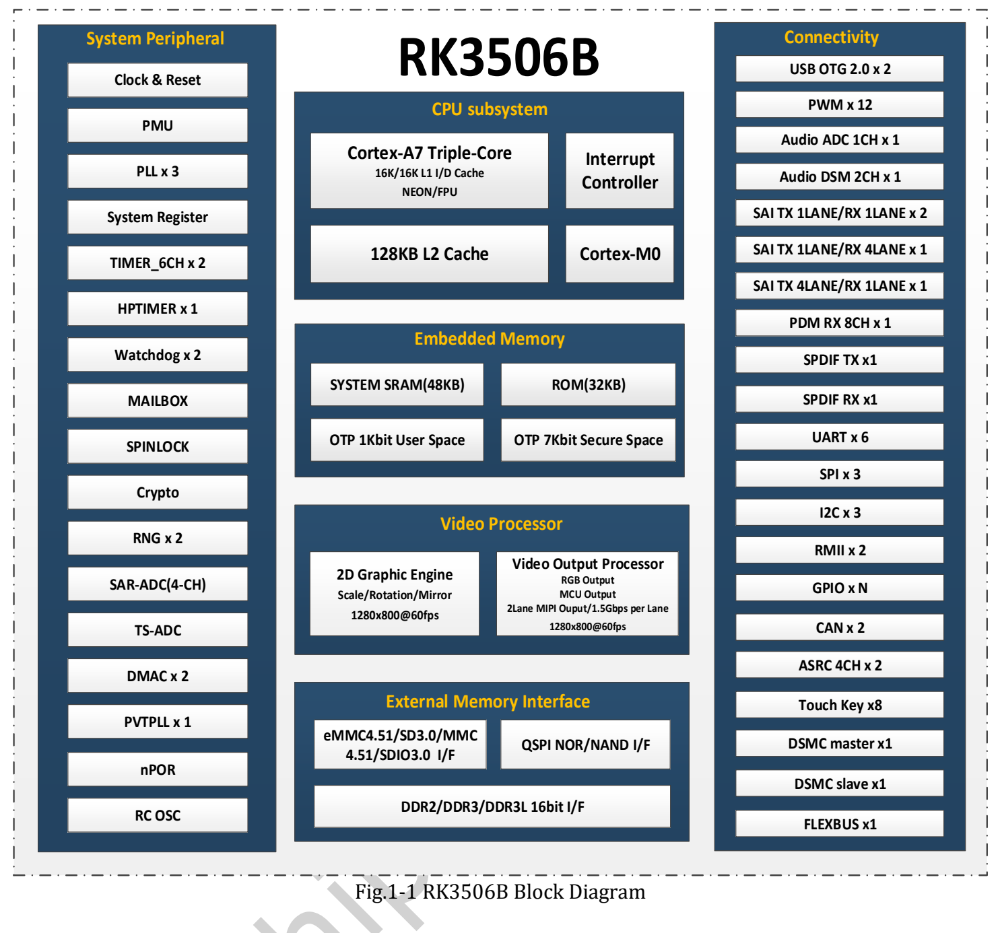
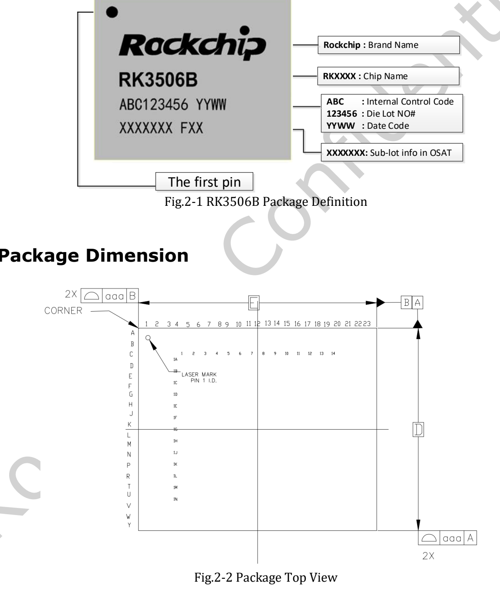
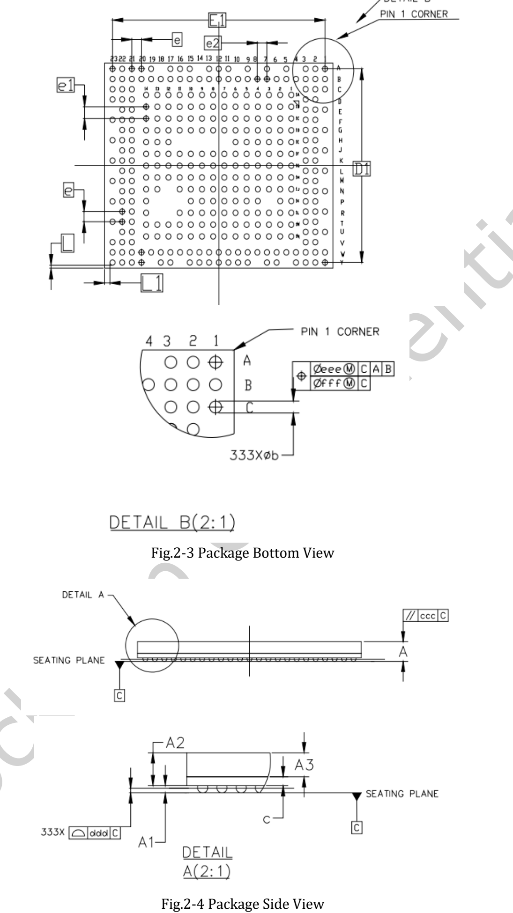

This article provides the uploaded **RK3506B Datasheet V1.0, dated 2024-08-16, 50 pages**, and an engineering reading guide covering architecture, package, pins, electrical conditions and thermal design. It is not a line-by-line translation; consult the original PDF for complete pin-multiplexing and electrical tables.

**CM1 and Forge1 use RK3506J. This RK3506B document cannot approve J-variant voltage, temperature, frequency or pin compatibility.**

## Download and reading map

[Download the original RK3506B Datasheet V1.0 PDF](/assets/rk3506/Rockchip-RK3506B-Datasheet-V1.0-20240816.pdf)

| Pages | Content | Review focus |
|---|---|---|
| 7–14 | Architecture and features | CPU, memory, display, audio, peripherals |
| 15–17 | Package and marking | FBGA333L, orientation, dimensions, tolerances |
| 17–26 | Pin number list | Ball assignments and multiplexed names |
| 26–41 | Power and functional IO | Domains, pulls, multiplexing |
| 41–44 | Matrix IO and FLEXBUS | ADC/DAC/DVP/QSPI LCD mapping examples |
| 45–49 | Electrical specification | Absolute limits, recommended conditions, levels |
| 50 | Thermal management | Junction temperature and unspecified parameters |

## RK3506B architecture

Three Armv7-A Cortex-A7 cores support NEON and VFPv4-D32. The document lists 16KB L1 instruction cache, 16KB L1 data cache and 128KB L2, plus Cortex-M0, Mailbox, Spinlock and DMA. Consult the matching SDK for task allocation.

The 16-bit DDR2/DDR3/DDR3L interface addresses up to 1024MB. Storage includes SPI NOR/NAND and SD/MMC; the document lists eMMC 4.51, SD3.0, SDIO3.0 and a 4-bit bus. A board need not populate every medium.

Display capabilities include up to 1280×1280@60fps, two-lane MIPI at 1.5Gbps/lane, RGB/MCU and BT.656/BT.1120. The 2D engine supports scaling, rotation, mirroring and alpha blending. Check concurrency and pin sharing separately.

## Package and PCB design

The package is FBGA333L, moisture sensitivity level 3, with SnAgCu ball material. Use drawings to understand orientation, but create footprints from the dimension table and current package files, not measurements taken from a web image.

## Recommended conditions versus limits

| Item | RK3506B V1.0 |
|---|---|
| Recommended ambient Ta | −20 / 25 / 80°C, min/typ/max |
| Storage temperature | −40 to 125°C |
| Maximum junction temperature | 125°C; thermal chapter requires staying below it |
| CPU supply | Recommended min 0.81V, typ 0.9V, max TBD |
| θJA, θJB, θJC, ψJT | All TBD |

Do not replace TBD with estimates. Junction maximum is not ambient operating temperature; storage conditions are not powered operation. The unspecified CPU supply maximum must not be borrowed from another variant.

## Source issues retained

On page 49 the CODEC ADC Resolution row gives 24 with unit °C, while the feature section states a 24-bit ADC. Treat this as an unresolved source-unit issue, not a temperature specification. Five SAI components include internal connections and do not mean five independent external audio ports.

Before implementation, verify the exact chip, released documentation, BSP, power sequencing, multiplexing, schematic and measurements. No ArmSoM electrical or thermal hardware tests were performed for this article.

## Related articles and official resources

- [RK3506J explained: industrial HMI and connected equipment](/articles/rk3506j-chip-guide/)
- [ArmSoM CM1: an RK3506J module for your industrial terminal](/articles/cm1-rk3506j-industrial-module/)
- [ArmSoM Forge1: develop industrial gateways, HMI and data acquisition](/articles/forge1-industrial-hmi-gateway/)
- [Rockchip RK3506](https://www.rock-chips.com/a/cn/product/RK35xilie/2025/1208/2125.html)
- [ArmSoM CM1](https://docs.armsom.org/armsom-cm1)
- [ArmSoM Forge1](https://docs.armsom.org/armsom-forge1)
- [ArmSoM](https://www.armsom.org/)

<!-- datasheet-related-20261110 -->
## Other chip datasheets

These links support cross-platform reading; electrical conditions and pins are not interchangeable.

- [RK3576](/articles/rk3576-datasheet-v10/)
- [RK3588](/articles/rk3588-datasheet-v14/)
- [RK3528](/articles/rk3528-datasheet-v10/)
- [RK3568](/articles/rk3568-datasheet-v12/)
- [RK730](/articles/rk730-audio-codec-design/)
