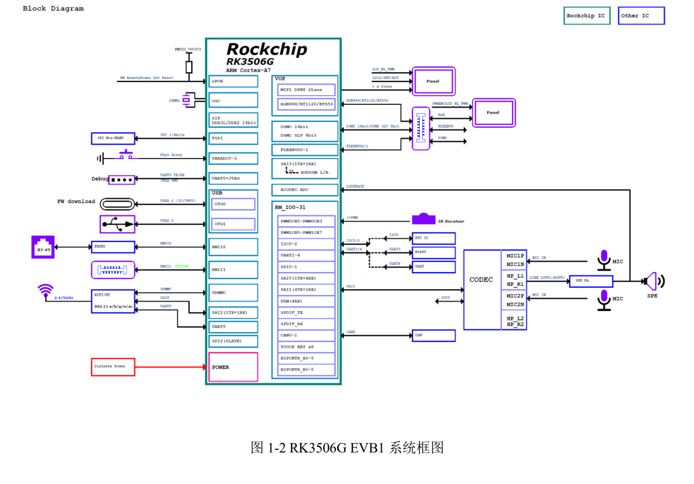
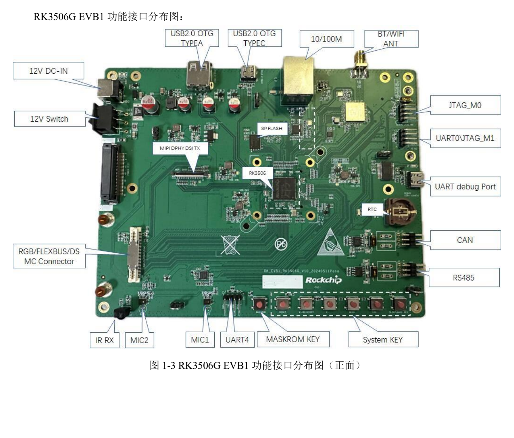

This task-focused guide explains the source with key specifications, limitations and original figures. It is not a page-by-page translation or a complete pin/register manual. Vendor examples are not ArmSoM measurements. Check the actual board revision, schematic, SDK/BSP, kernel and drivers before applying them; no new hardware validation was performed for this article.

**Primary source：** `Rockchip_RK3506G_EVB1_User_Guide_V1.0_20240719_CN.pdf` · PDF 40 pages.

## Separate the G reference from J products

The manual targets `RK_EVB1_RK3506G_V10_20240511Pana.brd`. Its table gives 128MB DDR3L and optional eMMC; the kit has a 12V/3A supply and a 1280×720 MIPI panel. CM1 and Forge1 are documented RK3506J products. Do not transfer the G EVB's memory, temperature grade, supply or pins directly.


[](/assets/hardware-reference-20261110/rk3506g-evb-p12.png)

*RK3506G EVB1 system diagram — Original Chinese figure; no corresponding English figure was found in this batch. `Rockchip_RK3506G_EVB1_User_Guide_V1.0_20240719_CN.pdf`, PDF p. 12.*


## Development paths on the reference board

| Path | Source implementation | Check before connecting |
| --- | --- | --- |
| HMI | 2-lane MIPI DSI plus RGB expansion | Panel timing, backlight, touch and cable |
| Equipment network | 1 Fast Ethernet RJ45; second FEPHY via 60pin | Expansion PHY, power, multiplexing and driver |
| Control expansion | RGB/FLEXBUS/DSMC share 60pin | Resistor configuration and pinmux for the selected function |
| Field communication | CAN and RS485 | Transceiver, termination, wiring and ground reference |
| Audio | 1 speaker, 2 analogue MICs and onboard codec | Actual routes, clocks and mixer |
| USB | OTG0 Type-C for downloading; OTG1 Type-A | Role, supply and driver, not connector shape |


[](/assets/hardware-reference-20261110/rk3506g-evb-p14.png)

*RK3506G EVB1 interface layout — Original Chinese figure; no corresponding English figure was found in this batch. `Rockchip_RK3506G_EVB1_User_Guide_V1.0_20240719_CN.pdf`, PDF p. 14.*


## Establish download and serial access first

The source uses download tool v3.28 or later. Enter the appropriate mode with MASKROM or V+(RECOVERY), confirm detection and select matching Loader, Parameter, Uboot and other files. Loader uses low `SARADC_IN1`. Follow the actual board's supply/button instructions and back up before writing.

Debug Type-C is USB-UART at `1500000` (1.5M) baud, distinct from OTG0 downloading. Keep logs from power-on to userspace. Check supply, cables and ports before investigating kernel faults. An ADB-enabled image can additionally use:

```sh
adb devices
adb shell
```

## Optional eMMC is a population choice

Page 27 gives this modification table only for the named reference board:

| Net | Source jumper direction |
| --- | --- |
| eMMC_CLKOUT | `R1614→R1644` |
| eMMC_CMD | `R1615→R1639` |
| eMMC_D0 | `R1616→R1640` |
| eMMC_D1 | `R1617→R1641` |
| eMMC_D2 | `R1645→R1642` |
| eMMC_D3 | `R1146→R1143` |

The final row's numbering differs from the earlier rows; it is preserved, not silently changed to R16xx. Check schematic, BOM, assembly procedure and Loader/partition configuration before modification. This is not an instruction to modify CM1 or Forge1 at those positions.

## I2C, termination and JTAG have conditions

I2C0 hosts HYM8563TS at `0x51` and ES8388 at `0x11`, both 3.3V. Touch uses I2C2 at `0x28/0x29`, 3.3V. This EVB's audio section therefore cannot automatically serve as RK730 wiring documentation.

RS485 provides a 120Ω termination switch. Enable it according to the complete bus topology, not unconditionally at every node. Check CAN/RS485 wiring and supplies against the circuit with power removed.

JTAG_M0 shares Wi-Fi SDIO resources; the manual requires the corresponding switch configuration. The two JTAG headers swap TMS/TCK positions: M0 is GND, TMS, TCK, VCC; M1 is GND, TCK, TMS, VCC. Identical header shape is insufficient for connection.

## Source issues and migration to products

The Wi-Fi table prints `1T21` while the overview says 1T1R. The last page retains an RK3576 header and labels a UART figure JTAG. These are recorded inconsistencies, not additional hardware capabilities.

Forge1 can be evaluated for HMI, gateways and interfaces; CM1 for a custom carrier. Rebuild the checklist for memory, boot medium, input supply, display, buses and software versions. Complete individual-interface and recovery tests before combining UI, networking, storage and field-bus load, then assess temperature and long-term stability.


## Products and development resources

- **CM1** — [Product](https://www.armsom.org/cm1) · [Documentation](https://docs.armsom.org/armsom-cm1)
- **Forge1** — [Product](https://www.armsom.org/forge1) · [Documentation](https://docs.armsom.org/armsom-forge1)


## Further reading

- [Forge1 application planning](/articles/forge1-industrial-hmi-gateway/)
- [RK730 audio codec](/articles/rk730-audio-codec-design/)
