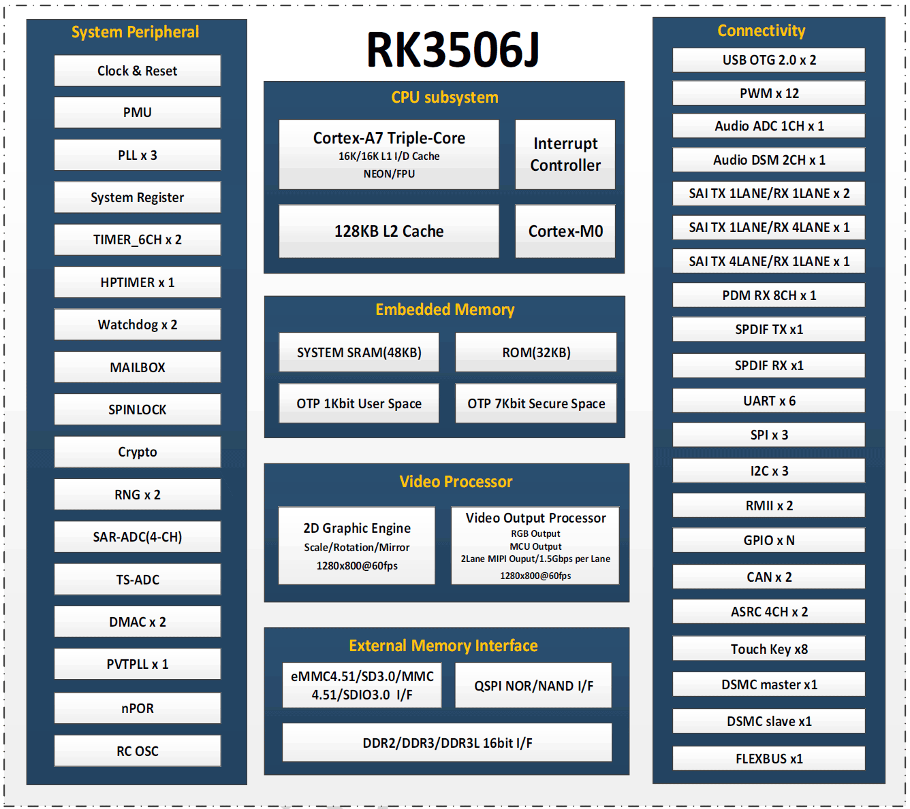

RK3506J brings display, equipment communication and control software into compact embedded terminals. ArmSoM CM1 offers a module route for custom products, while Forge1 provides a complete development board for evaluating displays, protocols and applications. Begin with data flows and interface requirements rather than CPU frequency alone.

## How the blocks divide the work

| Block | Publicly documented capability | Engineering role |
|---|---|---|
| CPU | Three Cortex-A7 cores; ArmSoM also shows Cortex-M0 | Linux applications and system management; M0 allocation depends on BSP support |
| Graphics | 2D engine and display processor | Composition, scaling and rotation |
| Memory | RK3506B/J: 16-bit DDR2/DDR3/DDR3L | Installed capacity depends on the board |
| Networking | Two RMII interfaces | External PHYs and board connections are required |
| Connectivity | USB2.0 OTG, UART, SPI, I2C, CAN, PWM | Displays, sensors and equipment |
| Expansion | DSMC, FLEXBUS and matrix IO | Check multiplexing, timing and drivers |

Three Cortex-A7 cores plus Cortex-M0 are not four equivalent Linux cores. The graphics engine is 2D acceleration, not a general-purpose 3D GPU. The official product page gives no NPU throughput, so this platform should not be promoted as a large-language-model inference board.

## Five product directions

### Industrial touch HMI

Combine status, settings, trends and alarms on one panel. Validate touch response with a lightweight UI such as LVGL, then connect the actual equipment protocol. Resolution, refresh rate, fonts and image assets affect memory and latency. Test animations under real workload rather than relying on a static demonstration.

### Equipment protocol gateway

Collect serial or CAN data and forward structured records over Ethernet. Separate acquisition, validation, buffering and reporting; handle reconnects and duplicates. Dual Fast Ethernet is useful for evaluation but does not establish full-rate forwarding, protocol certification or hard real-time performance.

### Appliance and building controls

Manage temperature, lighting, fans and local interaction. Keep essential controls available offline and account for NAND endurance and power-loss recovery. Relays, analogue inputs and field voltages require external circuitry rather than direct GPIO wiring.

### Production data terminal

Record output counts, operating states and alarms for local display and periodic upload. Define sampling rate, timestamps, offline retention and storage budget before choosing a database. This is an application proposal, not a completed ArmSoM customer deployment.

### Voice and audio interaction

Rockchip lists audio ADC, DSM, SAI and PDM. Microphone arrays, echo processing, voice algorithms and audio components still need integration. Available interfaces do not establish ready-to-use offline speech recognition.

## From Forge1 evaluation to CM1 integration

Use Forge1 to validate interfaces, UI and communications. Consider CM1 and a custom carrier when dimensions, connectors or power must change. Sharing RK3506J does not make images interchangeable: device trees, storage layout, displays and power settings still need review.

## Clock and variant boundaries

Published board frequencies differ. This series promises no fixed maximum clock for CM1 or Forge1; use the delivered image's frequency table, operating mode and temperature conditions. The accompanying PDF is **RK3506B V1.0**, not the electrical specification for RK3506J.

## Related articles and official resources

- [ArmSoM CM1: an RK3506J module for your industrial terminal](/articles/cm1-rk3506j-industrial-module/)
- [ArmSoM Forge1: develop industrial gateways, HMI and data acquisition](/articles/forge1-industrial-hmi-gateway/)
- [RK3506B Datasheet V1.0: download, architecture, pins and electrical design](/articles/rk3506b-datasheet-v10/)
- [Rockchip RK3506](https://www.rock-chips.com/a/cn/product/RK35xilie/2025/1208/2125.html)
- [ArmSoM CM1](https://docs.armsom.org/armsom-cm1)
- [ArmSoM Forge1](https://docs.armsom.org/armsom-forge1)
- [ArmSoM](https://www.armsom.org/)
