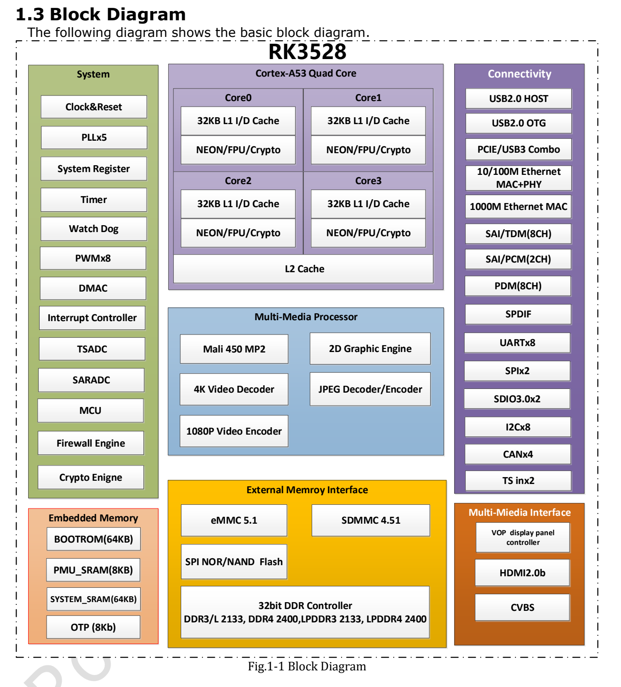

This article uses the specified datasheet revision. Values are vendor specifications, not ArmSoM measurements; no new hardware validation was performed. Check the actual silicon revision, board schematic, SDK/BSP, kernel and drivers. The explanations and editable tables assist reading; consult the original PDF for the complete specification and bit definitions not expanded here.

**RK3528 · Rockchip RK3528 Datasheet V1.0-20230522.pdf · PDF 6–14.**

*Original English figure, source PDF p. 14.*

## Compute and boot resources

RK3528 targets media processing and connectivity. This revision does not list a dedicated NPU; another chip’s AI specifications cannot be transferred to it.

| Item | Specification / source note |
|---|---|
| CPU | 4 × Cortex-A53 · Armv8-A · NEON/FPU · TrustZone |
| GPU | Mali-450 · OpenGL ES 1.1/2.0 · OpenVG 1.1 |
| SRAM | 64 KB + PMU 8 KB |
| MCU | Cortex-M0 · 8 KB TCM |
| Boot | SPI / eMMC / SDMMC; USB download |
| Clocks | 24 MHz reference · 5 PLL |
| Voltage domains | ARM / GPU / LOGIC / PMU |
| DMA | 3 DMAC; 8 channels / 32 requests / 2 interrupt outputs each |
| Security | SHA-1/224/256, MD5, SM3, HMAC, AES-128/192/256, DES/TDES, SM4; PKA ≤4096 bit; 16 DDR regions |

## Memory and storage

The 32-bit interface and 4 GB ceiling describe the controller, not every Sige1’s fitted memory. DDR types are alternative designs. Boot support, bus voltage and firmware must match the board.

| Item | Specification / source note |
|---|---|
| DDR | 32 bit · ≤4 GB · DDR3/DDR3L/LPDDR3/DDR4/LPDDR4/LPDDR4X |
| eMMC | 5.1 · HS400 · command queue · 1/4/8 bit |
| SDMMC | SD 3.0 / MMC 4.51 · 4 bit |
| FSPI | 1/2/4 bit |

## Video, graphics and display

Decode, encode and display are separate limits. Check codec, bit depth, frame rate, bandwidth and output together; 4K decoding does not prove every concurrent combination.

| Item | Specification / source note |
|---|---|
| 4K decoding | H.264 BP/MP/HP L5.1 + MVC; H.265 Main/Main10 L5.1 High Tier; AVS2 · 4K×2K @60 |
| Other decoding | MPEG-1/2/4, AVS/AVS+, VC-1 · 1080p60; H.263 · 576p60 |
| Video encoding | H.264 HP L4.2 / H.265 Main L4.1 High Tier · 1080p60 |
| JPEG | 48×48–8176×8176 · 76 Mpixel/s · ROI · 400/420/422/440/411/444 |
| 2D | Input ≤8192×8192; output ≤4096×4096; rotation 0/90/180/270°, mirror, alpha |
| VDPP | YUV420/422 input; YUV444 output also listed; deinterlace width ≤1920; DMSR / ZME |
| HDMI | 2.0b · 4K 10-bit @60 · HDR10 / HLG / HDR Vivid |
| CVBS | 480i / 576i |
| Display layers | 1 cluster + 4 smart layers |

## Shared PHYs and control interfaces

The source gives USB 2.0 Host + USB 2.0 OTG + PCIe, or USB 2.0 Host + USB 3. Do not add USB 3 and PCIe across these alternatives. Although the PCIe section mentions both 2.1 and Base Specification 3.0, explicit rates are only 2.5/5.0 Gbit/s, one lane, RC mode; Gen3 speed is not established.

| Item | Specification / source note |
|---|---|
| Ethernet | 1 × 10/100/1000 MAC (RGMII/RMII) + 1 × 10/100 MAC/PHY |
| PCIe | x1 RC · 2.5 / 5.0 Gbit/s |
| UART | 8 · ≤4 Mbit/s |
| I2C | 8 · 100/400 kbit/s · 7/10-bit address |
| SPI | 2 |
| PWM | 8 × 32 bit; IR: PWM3/PWM7 |
| SARADC | 10 bit · 4 single-ended inputs · ≤1 MS/s |
| TS | 2 inputs; 2 PTI, each 96 PID / 32 PES-ES / 16 PCR / 96 section filters; 1 PVR |
| ISO7816 | T0 / T1 |

## Audio routing and source issues

SAI0/1 use GPIO, SAI2 is the internal Codec transmit path and SAI3 is the HDMI transmit path; four blocks are not four external ports. CAN×4 appears in the diagram without matching feature detail. The HDMI text’s 10.2bps unit is incomplete. Temperature resolution also differs between sections; see the electrical article. These are not silently converted into confirmed specifications.

| Item | Specification / source note |
|---|---|
| SAI0/2 | 2 channels; SAI2 TX only |
| SAI1/3 | 8 channels; SAI3 TX only |
| SAI | 16–32 bit · ≤192 kHz |
| PDM | 8 channels · 16–24 bit · ≤192 kHz |
| SPDIF | HDMI / GPIO |
| DAC | 24 bit · 8/12/16/24/32/44.1/48/96 kHz |

## ArmSoM products and application limits

Sige1 is the RK3528 product entry point. Chip capabilities do not mean every interface is exposed on the board; use the Sige1 documentation for connectors, voltages, images and pin assignments.

- [Sige1](https://www.armsom.org/sige1) · [Docs](https://docs.armsom.org/armsom-sige1)

## Datasheet series and original PDF

- [RK3528 overview](/articles/rk3528-datasheet-v10/)
- [RK3528 architecture: memory, 4K video and shared PHYs](/articles/rk3528-architecture-memory-media/)
- [RK3528 package and pins: all 401 ball assignments](/articles/rk3528-package-pin-reference/)
- [RK3528 electrical and thermal guide: supplies, I/O and thermal resistance](/articles/rk3528-electrical-power-thermal/)
- [Download the complete original PDF](/assets/datasheet-series-20261110/Rockchip-RK3528-Datasheet-V1.0-20230522.pdf)
