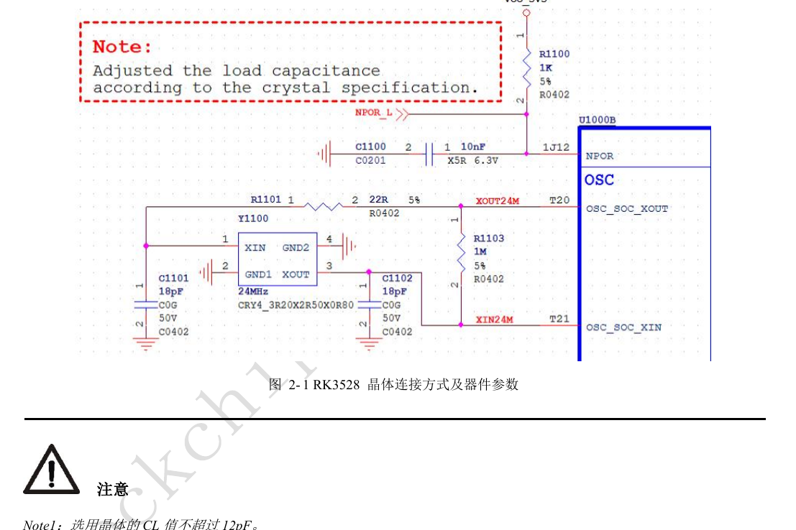
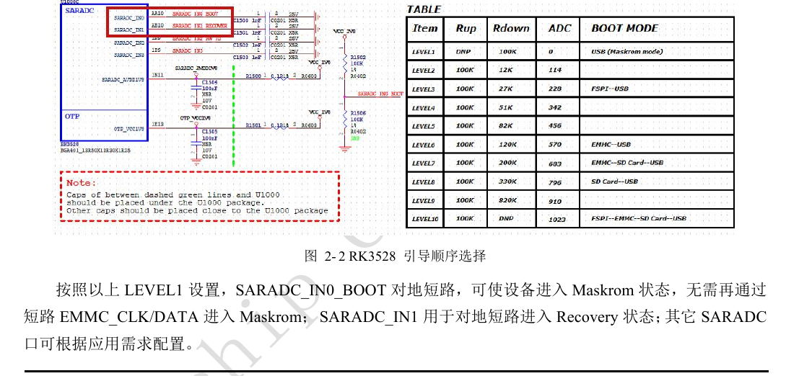
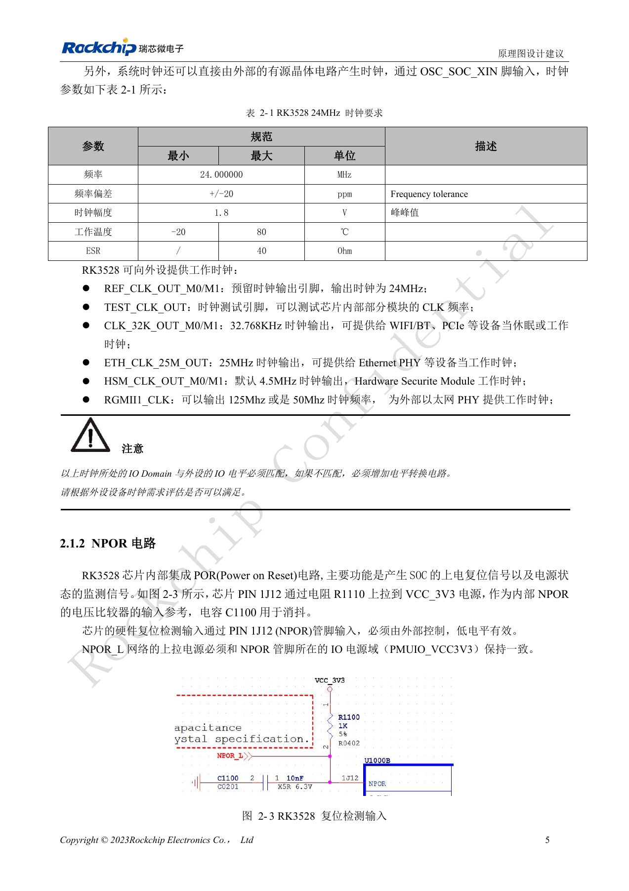
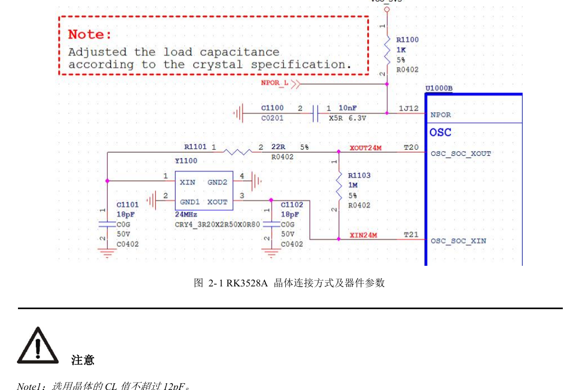
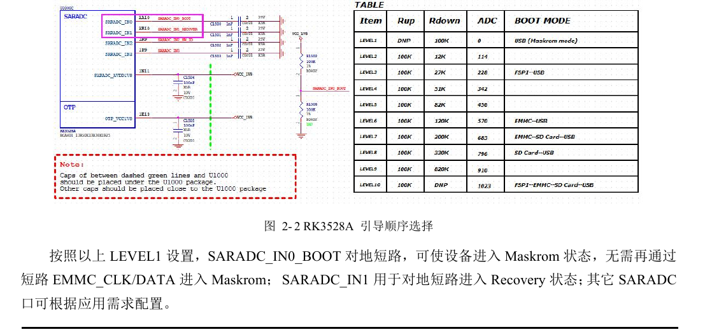
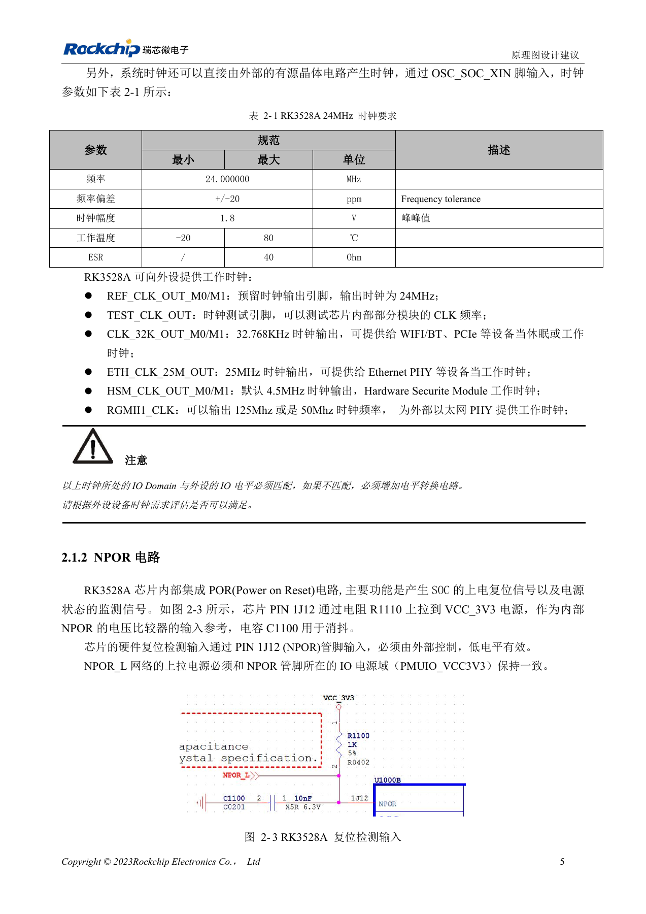

# RK3528 / RK3528A boot and debug: clocks, reset, Maskrom and UART

This engineering topic is based on the Chinese RK3528 V1.0 (2023-05-25) and RK3528A V1.0 (2023-07-12) hardware guides; it is not a verbatim translation of both PDFs. The discussed chapters are closely aligned, which does not establish drop-in chip compatibility. The official [Sige1 board documentation](https://docs.armsom.org/armsom-sige1) identifies RK3528 in ArmSoM [Sige1](https://www.armsom.org/sige1), providing a product for evaluating related applications. This does not identify Sige1 as an RK3528A board or establish interchangeability of the chips. SoC reference circuits are not the Sige1 schematic. Confirm pins, package, BSP/SDK, kernel and board revision for the actual product. Values are source references, not ArmSoM hardware measurements.

**§2.1.1–2.1.5; §2.3.2; PDF 18–23, 54–55**

## A 24MHz oscillator needs more than a startup check

Keep the 22Ω current-limiting resistor on XOUT24M and do not arbitrarily change the 1MΩ resistor between XOUT24M and XIN24M. Crystal CL must not exceed 12pF. The illustrated 18pF capacitors belong to the reference crystal; recalculate loading for the selected crystal and PCB parasitics. The guides recommend C0G/NP0 capacitors and a four-pad crystal with both ground pads well connected. Check startup, frequency, amplitude and temperature behavior; probe loading can alter the result.

## Preserve boot configuration through production

NPOR is active low and its external pull-up must use the PMUIO_VCC3V3 domain. Boot media include FSPI, eMMC and SDMMC; USB2 OTG downloads code when no valid boot image is available. SARADC_IN0 is reserved for boot order and must not be reassigned. The LEVEL1 source configuration pulls it low for Maskrom; SARADC_IN1 serves Recovery and requires its 10kΩ pull-up to 1.8V. Preserve these signals, OTG and VBUSDET as an accessible recovery path after enclosure assembly.

## SD detection also selects the debug function

At reset release, SDMMC_DETN low selects SDMMC and high selects CPU JTAG, so establish the level before power-up. Software can later take control of IOMUX. The default debug port is UART0_RX_M0 / UART0_TX_M0 at 1500000bps; use the same M0 group for both signals. The guide recommends 100Ω series resistance and a 2.54mm header, or test points larger than 0.7mm if a header is impractical. MCU JTAG is not exposed for customer use in these guide revisions.

## Reference parameters

| Item | Source value |
| --- | --- |
| Crystal CL limit | 12pF |
| 24MHz tolerance | ±20ppm |
| SARADC input range | 0–1.8V; 10bit; 1MS/s |
| Debug UART | UART0_M0; 1500000bps |

## Source illustrations and locations

No corresponding English original was supplied. All four languages use the Chinese PDF figures below, labeled separately by chip and physical page; RK3528 images are not presented as RK3528A images.

RK3528 · CN · PDF 18

RK3528 · CN · PDF 20

RK3528 · CN · PDF 19

RK3528A · CN · PDF 18

RK3528A · CN · PDF 20

RK3528A · CN · PDF 19

## Development and documentation

Choose ArmSoM products from their own documentation; this series does not claim that ArmSoM offers an RK3528/RK3528A board. Interface and software experience from existing ArmSoM boards may inform your workflow, but does not make these voltage, pin or PCB rules interchangeable.

- [ArmSoM](https://www.armsom.org/) · [ArmSoM Docs](https://docs.armsom.org/)
- [RK3528 / RK3528A hardware design: nine engineering topics](/articles/rk3528-rk3528a-hardware-design-series/)
- [RK3528 / RK3528A power design: discrete rails, sequencing and load checks](/articles/rk3528-rk3528a-power-sequencing/)
