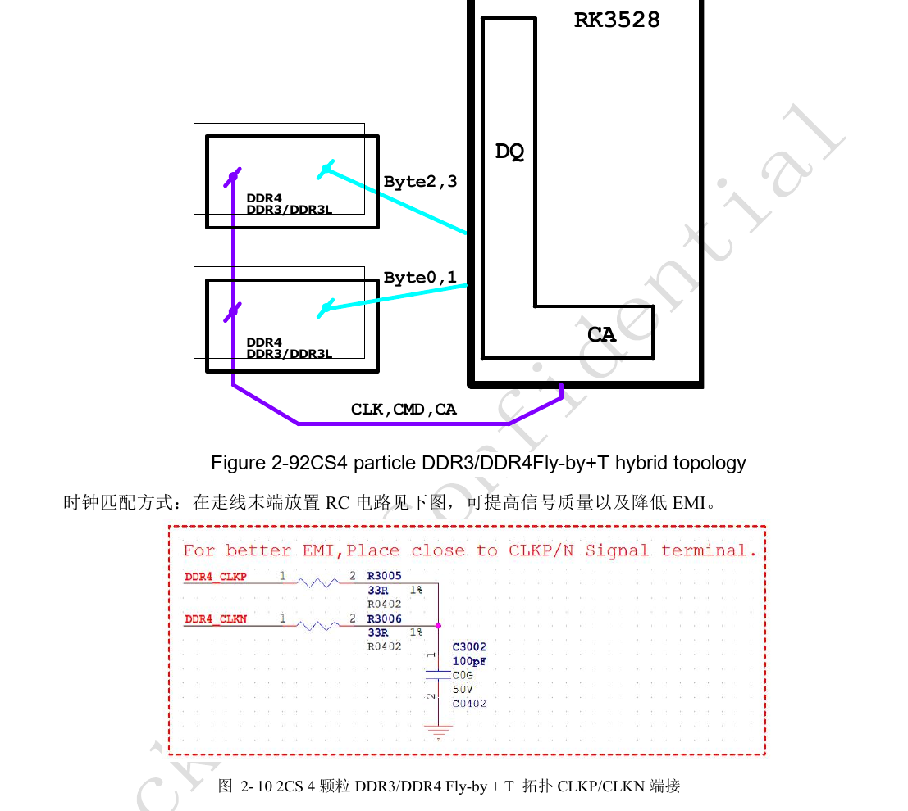
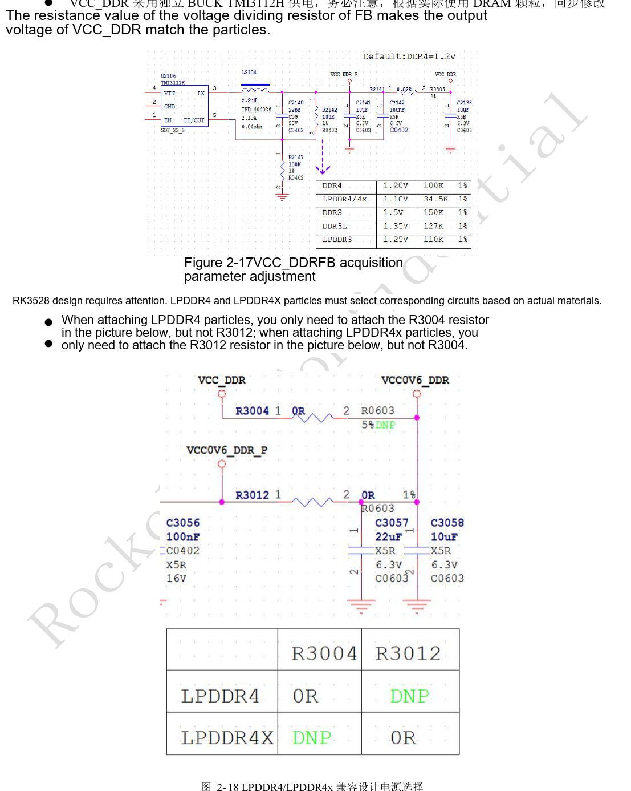
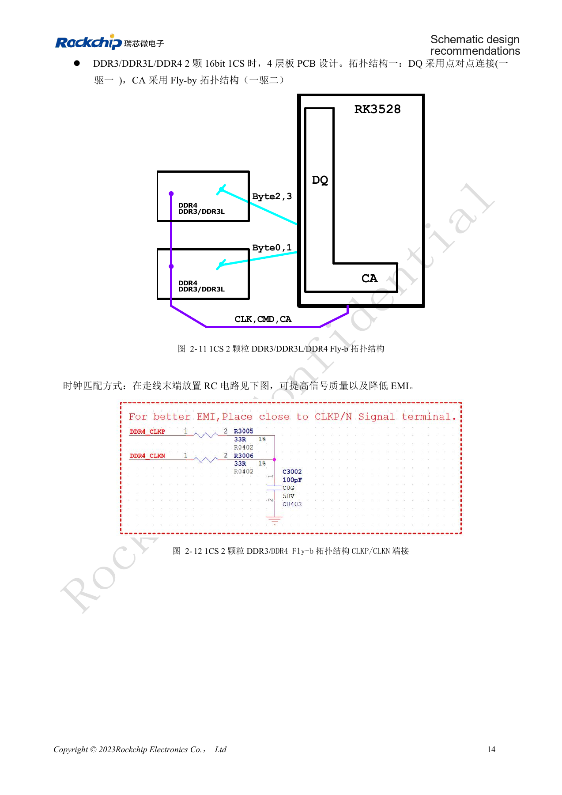
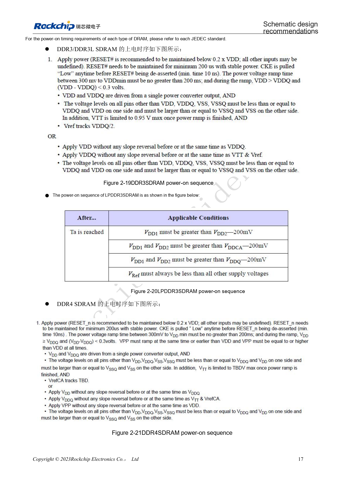
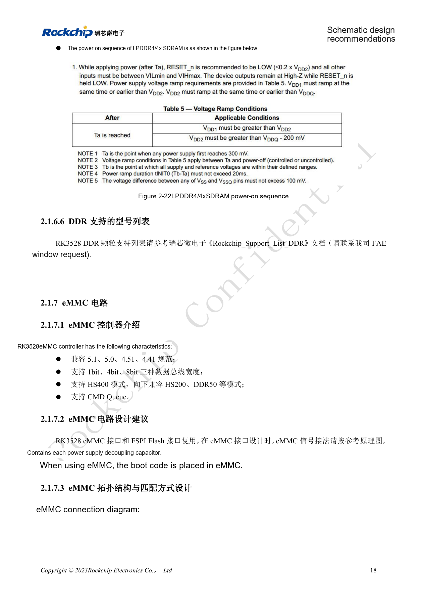
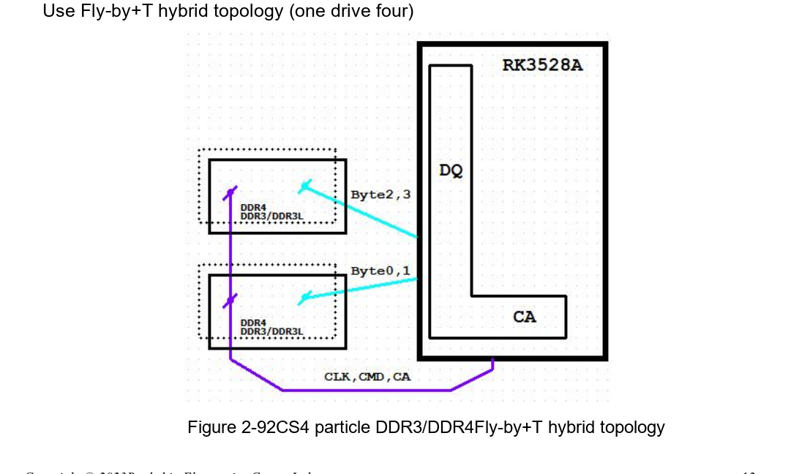
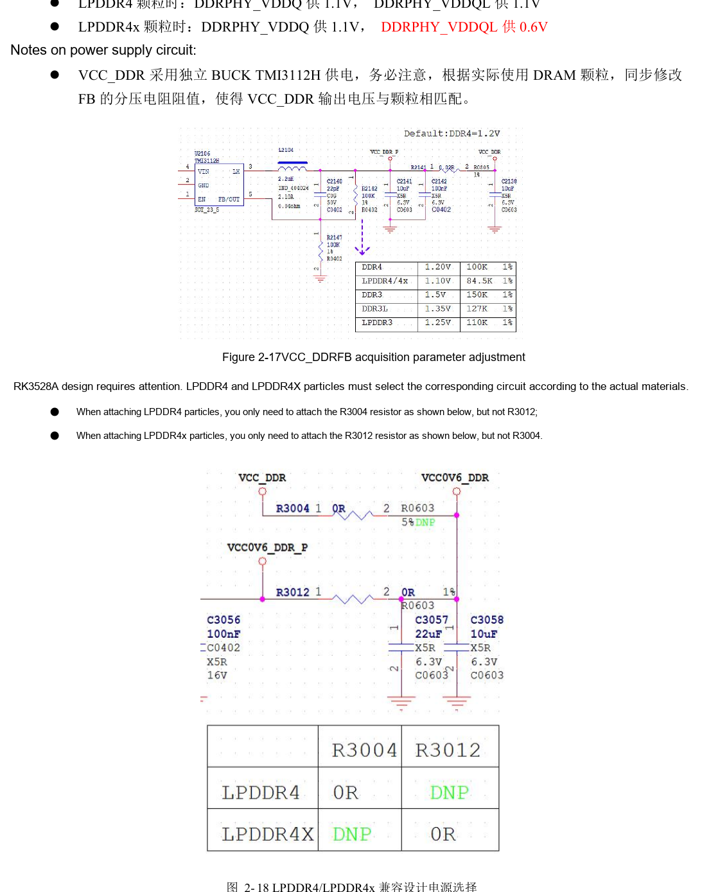
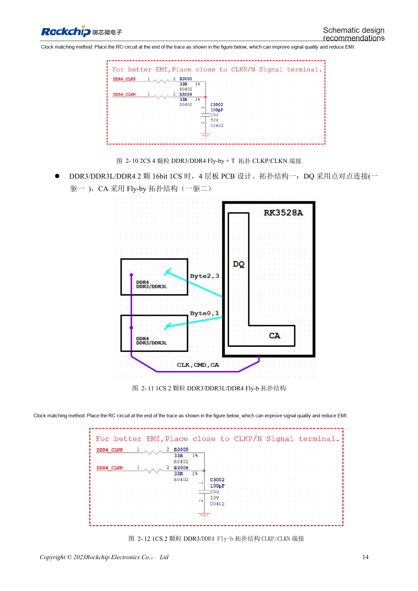
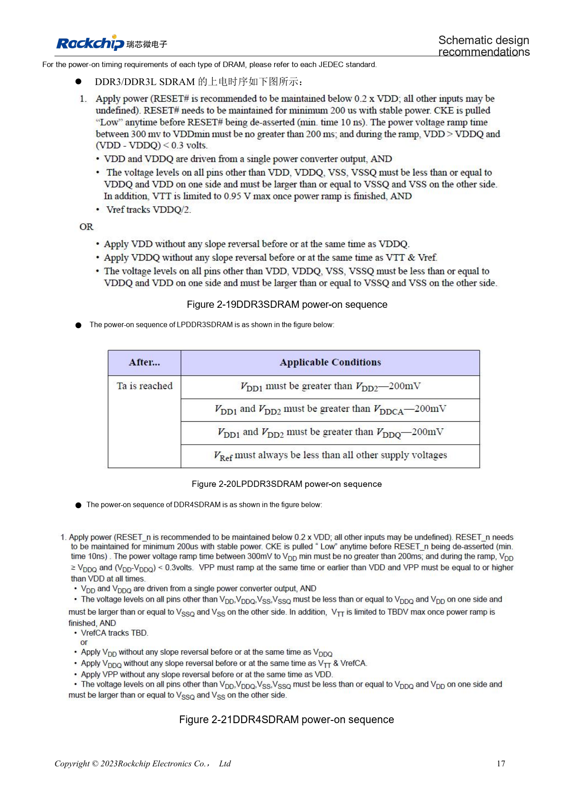
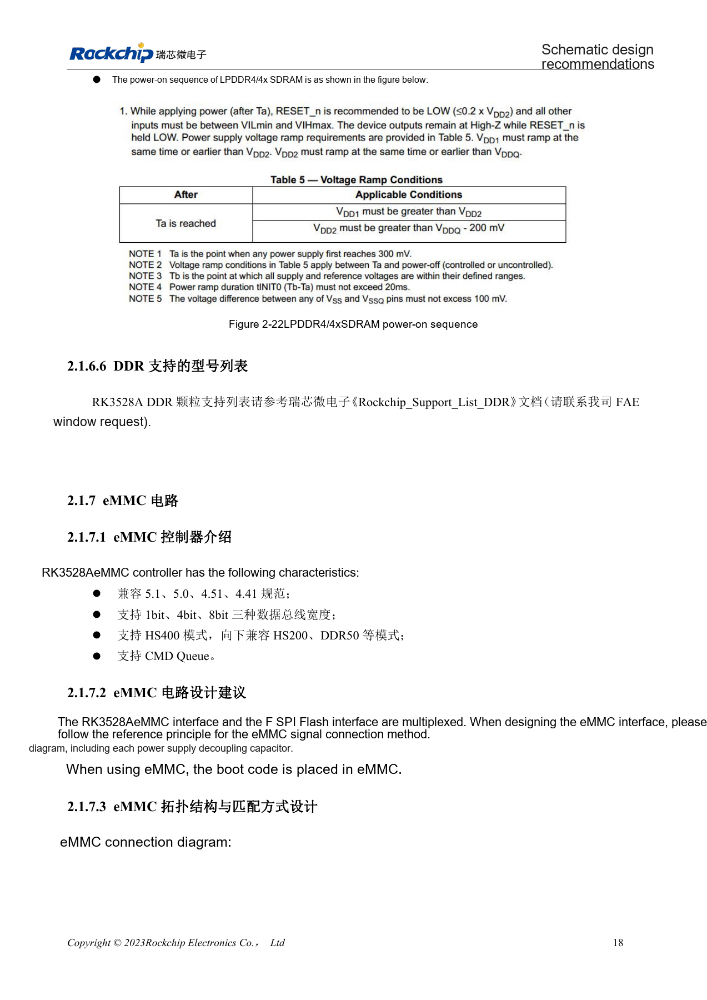

# RK3528 / RK3528A DDR: topology, rails, swapping rules and PCB

This engineering topic is based on the Chinese RK3528 V1.0 (2023-05-25) and RK3528A V1.0 (2023-07-12) hardware guides; it is not a verbatim translation of both PDFs. The discussed chapters are closely aligned, which does not establish drop-in chip compatibility. The official [Sige1 board documentation](https://docs.armsom.org/armsom-sige1) identifies RK3528 in ArmSoM [Sige1](https://www.armsom.org/sige1), providing a product for evaluating related applications. This does not identify Sige1 as an RK3528A board or establish interchangeability of the chips. SoC reference circuits are not the Sige1 schematic. Confirm pins, package, BSP/SDK, kernel and board revision for the actual product. Values are source references, not ArmSoM hardware measurements.

**§2.1.6; §3.3.3; PDF 23–32, 127–141**

## Freeze the topology when selecting memory

The controller supports DDR3/DDR3L/LPDDR3/DDR4/LPDDR4/LPDDR4X, a 32bit aggregate bus, two ranks and up to 4GB addressing. Two 16bit halves form one 32bit channel; the source mentions asymmetric 1GB+2GB arrangements. Four DDR3/DDR4 devices use T topology for DQ and hybrid Fly-by+T for CA; two 16bit devices use point-to-point DQ and Fly-by CA. A single LPDDR device uses its matching point-to-point template. Capacity or package-count changes affect topology, termination and training, not just the BOM.

## Do not import swapping and ZQ rules from another SoC

DDR3/DDR3L/DDR4 allow whole-byte swaps and DQ swaps within a byte, but not CA swaps; 16bit and 16/32bit-compatible designs require the vendor template. LPDDR3 D0–D7 and their DQS/DM associations must remain fixed; other bytes follow the stated swapping rules. LPDDR4/4X permit neither DQ nor CA swaps. SoC DDR_RZQ is 120Ω, 1%: to ground for DDR3/3L/4/LPDDR3 and to DDRPHY_VDDQ for LPDDR4/4X. Memory-device ZQ uses 240Ω, 1%, connected to ground, VCC_DDR or VCC0V6_DDR according to device type.

## Separate rail and matching rules by memory type

LPDDR4 uses 1.1V for both DDRPHY_VDDQ and VDDQL; LPDDR4X uses 1.1V/0.6V. Reference resistors R3004 and R3012 are mutually exclusive population options. DDR3/DDR3L use 1.5V/1.35V, DDR4 1.2V. For LPDDR3 the source lists nominal 1.2V and an actual 1.25V compatibility setting; verify the selected device limits. The LPDDR4X PCB table specifies 50Ω single-ended and 100Ω differential, both ±10%; DQ/DM-to-DQS within a byte ≤600mil, intra-DQS and intra-CLK ≤12mil, and DQS-to-CLK ≤1700mil. Other memory types have separate tables.

## Reference parameters

| Item | Source value |
| --- | --- |
| Aggregate bus / addressing | 32bit / 4GB |
| SoC RZQ | 120Ω ±1% |
| Memory-device ZQ | 240Ω ±1% |
| LPDDR4X VDDQ / VDDQL | 1.1V / 0.6V |

## Complete DDR PHY signal mapping

PDF pages 24–26 contain 74 rows, identical between the two extracted source tables. Identifiers are preserved, including the apparent source typos `DDR33_A15` and `DDR33_ODT1`; resolve these against PinOut/TRM rather than creating new net names. `------` means the source provides no mapping. The table does not override the signal-swapping restrictions above.

| DDRPHY | DDR4 | LPDDR4 / LPDDR4X | DDR3 | LPDDR3 |
| --- | --- | --- | --- | --- |
| DDRPHY_A_DQ0 | DDR4_DQL6_A | LPDDR4_DQ0_A | DDR3_D4 | LPDDR3_D0 |
| DDRPHY_A_DQ1 | DDR4_DQL2_A | LPDDR4_DQ1_A | DDR3_D0 | LPDDR3_D1 |
| DDRPHY_A_DQ2 | DDR4_DQL0_A | LPDDR4_DQ2_A | DDR3_D2 | LPDDR3_D2 |
| DDRPHY_A_DQ3 | DDR4_DQL1_A | LPDDR4_DQ3_A | DDR3_D1 | LPDDR3_D3 |
| DDRPHY_A_DQ4 | DDR4_DQL4_A | LPDDR4_DQ4_A | DDR3_D6 | LPDDR3_D4 |
| DDRPHY_A_DQ5 | DDR4_DQL5_A | LPDDR4_DQ5_A | DDR3_D7 | LPDDR3_D5 |
| DDRPHY_A_DQ6 | DDR4_DQL7_A | LPDDR4_DQ6_A | DDR3_D5 | LPDDR3_D6 |
| DDRPHY_A_DQ7 | DDR4_DQL3_A | LPDDR4_DQ7_A | DDR3_D3 | LPDDR3_D7 |
| DDRPHY_A_DM0 | DDR4_DML_A | LPDDR4_DM0_A | DDR3_DM0 | LPDDR3_DM0 |
| DDRPHY_A_DQS0 | DDR4_DQSL_P_A | LPDDR4_DQS0P_A | DDR3_DQS0P | LPDDR3_DQS0P |
| DDRPHY_A_DQSB0 | DDR4_DQSL_N_A | LPDDR4_DQS0N_A | DDR3_DQS0N | LPDDR3_DQS0N |
| DDRPHY_A_DQ8 | DDR4_DQU1_A | LPDDR4_DQ8_A | DDR3_D12 | LPDDR3_D19 |
| DDRPHY_A_DQ9 | DDR4_DQU5_A | LPDDR4_DQ9_A | DDR3_D14 | LPDDR3_D16 |
| DDRPHY_A_DQ10 | DDR4_DQU0_A | LPDDR4_DQ10_A | DDR3_D15 | LPDDR3_D21 |
| DDRPHY_A_DQ11 | DDR4_DQU2_A | LPDDR4_DQ11_A | DDR3_D9 | LPDDR3_D17 |
| DDRPHY_A_DQ12 | DDR4_DQU7_A | LPDDR4_DQ12_A | DDR3_D10 | LPDDR3_D20 |
| DDRPHY_A_DQ13 | DDR4_DQU3_A | LPDDR4_DQ13_A | DDR3_D8 | LPDDR3_D23 |
| DDRPHY_A_DQ14 | DDR4_DQU4_A | LPDDR4_DQ14_A | DDR3_D13 | LPDDR3_D22 |
| DDRPHY_A_DQ15 | DDR4_DQU6_A | LPDDR4_DQ15_A | DDR3_D11 | LPDDR3_D18 |
| DDRPHY_A_DM1 | DDR4_DMU_A | LPDDR4_DM1_A | DDR3_DM1 | LPDDR3_DM2 |
| DDRPHY_A_DQS1 | DDR4_DQSU_P_A | LPDDR4_DQS1P_A | DDR3_DQS1P | LPDDR3_DQS2P |
| DDRPHY_A_DQSB1 | DDR4_DQSU_N_A | LPDDR4_DQS1N_A | DDR3_DQS1N | LPDDR3_DQS2N |
| DDRPHY_B_DQ0 | DDR4_DQU4_B | LPDDR4_DQ0_B | DDR3_D29 | LPDDR3_D14 |
| DDRPHY_B_DQ1 | DDR4_DQU0_B | LPDDR4_DQ1_B | DDR3_D31 | LPDDR3_D12 |
| DDRPHY_B_DQ2 | DDR4_DQU1_B | LPDDR4_DQ2_B | DDR3_D28 | LPDDR3_D13 |
| DDRPHY_B_DQ3 | DDR4_DQU5_B | LPDDR4_DQ3_B | DDR3_D30 | LPDDR3_D8 |
| DDRPHY_B_DQ4 | DDR4_DQU7_B | LPDDR4_DQ4_B | DDR3_D26 | LPDDR3_D9 |
| DDRPHY_B_DQ5 | DDR4_DQU3_B | LPDDR4_DQ5_B | DDR3_D24 | LPDDR3_D15 |
| DDRPHY_B_DQ6 | DDR4_DQU6_B | LPDDR4_DQ6_B | DDR3_D27 | LPDDR3_D10 |
| DDRPHY_B_DQ7 | DDR4_DQU2_B | LPDDR4_DQ7_B | DDR3_D25 | LPDDR3_D11 |
| DDRPHY_B_DM0 | DDR4_DMU_B | LPDDR4_DM0_B | DDR3_DM3 | LPDDR3_DM1 |
| DDRPHY_B_DQS0 | DDR4_DQSU_P_B | LPDDR4_DQS0P_B | DDR3_DQS3P | LPDDR3_DQS1P |
| DDRPHY_B_DQSB0 | DDR4_DQSU_N_B | LPDDR4_DQS0N_B | DDR3_DQS3N | LPDDR3_DQS1N |
| DDRPHY_B_DQ8 | DDR4_DQL1_B | LPDDR4_DQ8_B | DDR3_D17 | LPDDR3_D27 |
| DDRPHY_B_DQ9 | DDR4_DQL3_B | LPDDR4_DQ9_B | DDR3_D19 | LPDDR3_D26 |
| DDRPHY_B_DQ10 | DDR4_DQL4_B | LPDDR4_DQ10_B | DDR3_D18 | LPDDR3_D30 |
| DDRPHY_B_DQ11 | DDR4_DQL6_B | LPDDR4_DQ11_B | DDR3_D22 | LPDDR3_D31 |
| DDRPHY_B_DQ12 | DDR4_DQL0_B | LPDDR4_DQ12_B | DDR3_D16 | LPDDR3_D28 |
| DDRPHY_B_DQ13 | DDR4_DQL2_B | LPDDR4_DQ13_B | DDR3_D20 | LPDDR3_D24 |
| DDRPHY_B_DQ14 | DDR4_DQL7_B | LPDDR4_DQ14_B | DDR3_D21 | LPDDR3_D25 |
| DDRPHY_B_DQ15 | DDR4_DQL5_B | LPDDR4_DQ15_B | DDR3_D23 | LPDDR3_D29 |
| DDRPHY_B_DM1 | DDR4_DML_B | LPDDR4_DM1_B | DDR3_DM2 | LPDDR3_DM3 |
| DDRPHY_B_DQS1 | DDR4_DQSL_P_B | LPDDR4_DQS1P_B | DDR3_DQS2P | LPDDR3_DQS3P |
| DDRPHY_B_DQSB1 | DDR4_DQSL_N_B | LPDDR4_DQS1N_B | DDR3_DQS2N | LPDDR3_DQS3N |
| DDRPHY_A0 | DDR4_A0 | LPDDR4_ODT1_CA_B | DDR3_A9 | LPDDR3_ODT2 |
| DDRPHY_A1 | DDR4_A1 | LPDDR4_CKE1_A | DDR3_A14 | ------ |
| DDRPHY_A2 | DDR4_A2 | LPDDR4_ODT0_CA_B | DDR3_A13 | LPDDR3_ODT3 |
| DDRPHY_A3 | DDR4_A3 | LPDDR4_CKE0_A | DDR3_A1 | ------ |
| DDRPHY_A4 | DDR4_A4 | LPDDR4_A0_B | DDR3_A2 | LPDDR3_A5 |
| DDRPHY_A5 | DDR4_A5 | LPDDR4_A1_A | DDR3_A4 | ------ |
| DDRPHY_A6 | DDR4_A6 | LPDDR4_CS1N_B | DDR3_A3 | LPDDR3_CSN2 |
| DDRPHY_A7 | DDR4_A7 | LPDDR4_A4_A | DDR3_A6 | ------ |
| DDRPHY_A8 | DDR4_A8 | LPDDR4_A4_B | DDR3_A5 | LPDDR3_A6 |
| DDRPHY_A9 | DDR4_A9 | LPDDR4_CLKP_A | DDR3_A11 | LPDDR3_A2 |
| DDRPHY_A10 | DDR4_A10 | LPDDR4_A1_B | DDR3_A0 | ------ |
| DDRPHY_A11 | DDR4_A11 | LPDDR4_A5_B | DDR3_A7 | LPDDR3_A7 |
| DDRPHY_A12 | DDR4_A12 | LPDDR4_A2_A | DDR3_A10 | LPDDR3_A4 |
| DDRPHY_A13 | DDR4_A13 | LPDDR4_CLKN_A | DDR3_A8 | LPDDR3_A3 |
| DDRPHY_A14 | DDR4_WEN/A14 | LPDDR4_CS0N_B | DDR3_ODT0 | LPDDR3_CSN3 |
| DDRPHY_A15 | DDR4_CASN/A15 | LPDDR4_A3_A | DDR3_BA1 | LPDDR3_A0 |
| DDRPHY_A16 | DDR4_RASN/A16 | LPDDR4_A0_A | DDR3_CKE0 | ------ |
| DDRPHY_ACTN | DDR4_ACTN | LPDDR4_A2_B | DDR3_CSN0 | LPDDR3_A9 |
| DDRPHY_BA0 | DDR4_BA0 | LPDDR4_CKE0_B | DDR3_BA2 | LPDDR3_CKE0 |
| DDRPHY_BA1 | DDR4_BA1 | LPDDR4_A5_A | DDR3_A12 | LPDDR3_A1 |
| DDRPHY_BG0 | DDR4_BG0 | LPDDR4_A3_B | DDR3_BA0 | LPDDR3_A8 |
| DDRPHY_BG1 | DDR4_BG1 | ------ | DDR33_A15 | ------ |
| DDRPHY_CKE | DDR4_CKE | LPDDR4_CKE1_B | DDR3_RASN | ------ |
| DDRPHY_CK | DDR4_CLKP | LPDDR4_CLKP_B | DDR3_CLKP | LPDDR3_CLKP |
| DDRPHY_CKB | DDR4_CLKN | LPDDR4_CLKN_B | DDR3_CLKN | LPDDR3_CLKN |
| DDRPHY_CSB0 | DDR4_CSN0 | LPDDR4_CS1N_A | DDR3_CASN | LPDDR3_CSN1 |
| DDRPHY_CSB1 | DDR4_CSN1 | LPDDR4_CS0N_A | DDR3_CSN1 | LPDDR3_CSN0 |
| DDRPHY_ODT0 | DDR4_ODT0 | LPDDR4_ODT1_CA_A | DDR3_WEN | LPDDR3_ODT0 |
| DDRPHY_ODT1 | DDR4_ODT1 | LPDDR4_ODT0_CA_A | DDR33_ODT1 | LPDDR3_ODT1 |
| DDRPHY_RESETN | DDR4_RESETN | LPDDR4_RESETN | DDR3_RESETN | ------ |

## Source illustrations and locations

No corresponding English original was supplied. All four languages use the Chinese PDF figures below, labeled separately by chip and physical page; RK3528 images are not presented as RK3528A images.

RK3528 · CN · PDF 27

RK3528 · CN · PDF 30

RK3528 · CN · PDF 28

RK3528 · CN · PDF 31

RK3528 · CN · PDF 32

RK3528A · CN · PDF 27

RK3528A · CN · PDF 30

RK3528A · CN · PDF 28

RK3528A · CN · PDF 31

RK3528A · CN · PDF 32

## Development and documentation

Choose ArmSoM products from their own documentation; this series does not claim that ArmSoM offers an RK3528/RK3528A board. Interface and software experience from existing ArmSoM boards may inform your workflow, but does not make these voltage, pin or PCB rules interchangeable.

- [ArmSoM](https://www.armsom.org/) · [ArmSoM Docs](https://docs.armsom.org/)
- [RK3528 / RK3528A hardware design: nine engineering topics](/articles/rk3528-rk3528a-hardware-design-series/)
- [RK3528 / RK3528A power design: discrete rails, sequencing and load checks](/articles/rk3528-rk3528a-power-sequencing/)
- [RK3528 / RK3528A storage and wireless interfaces: eMMC, FSPI, SDMMC and SDIO](/articles/rk3528-rk3528a-storage-sdio-design/)
