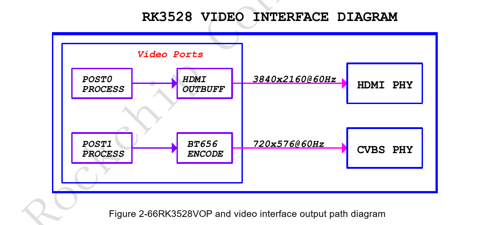
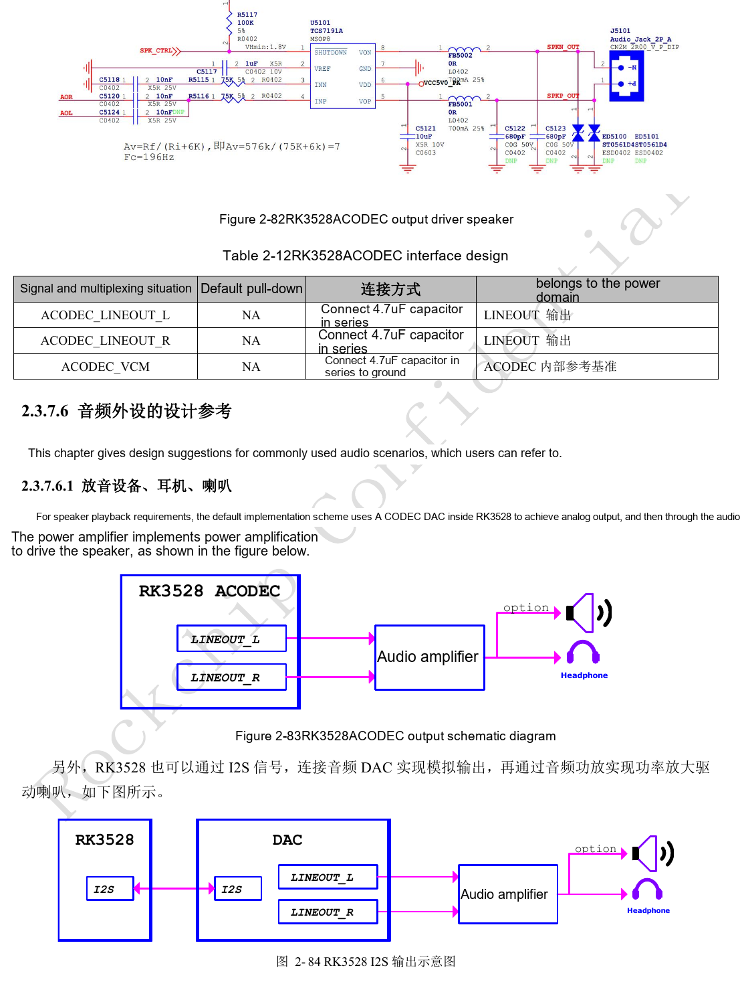
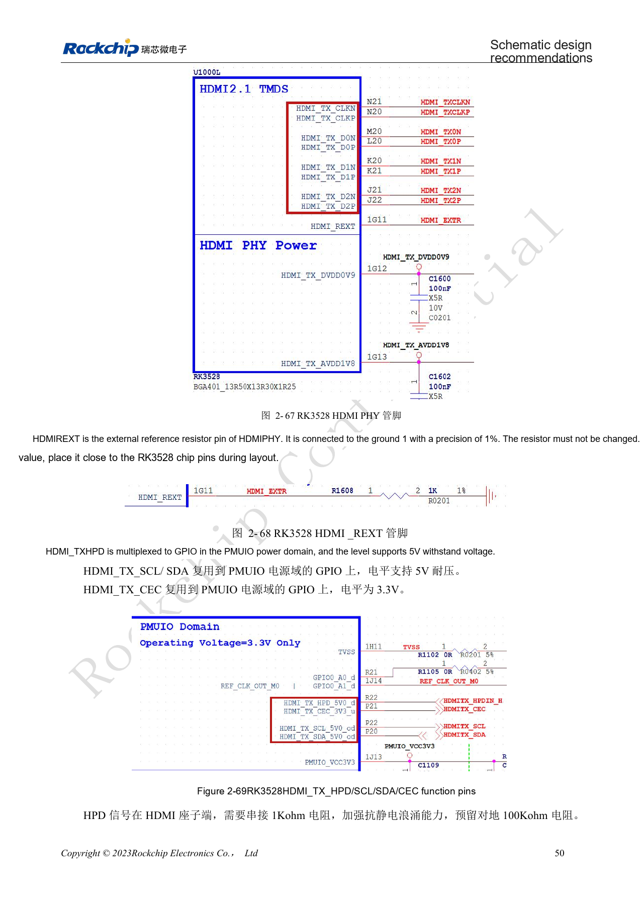
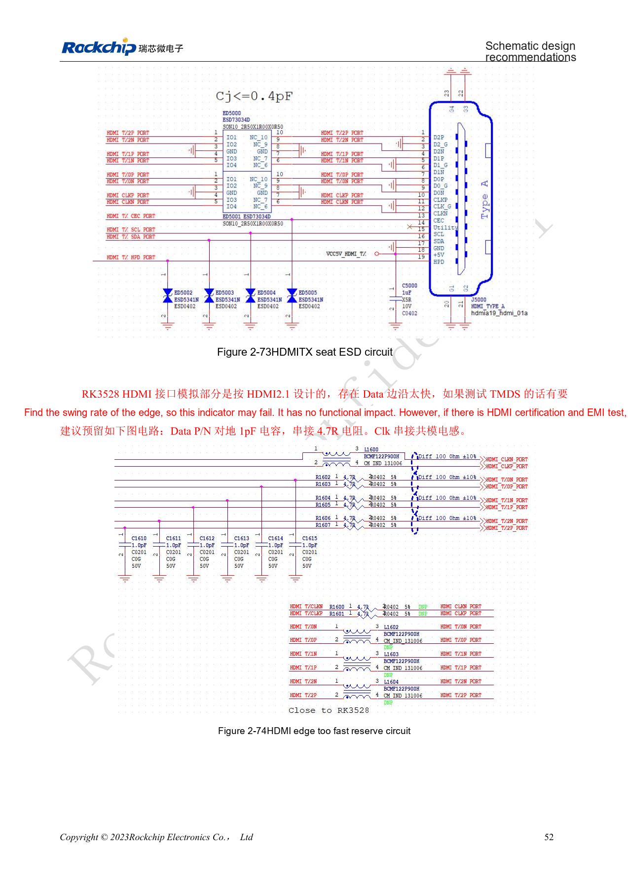
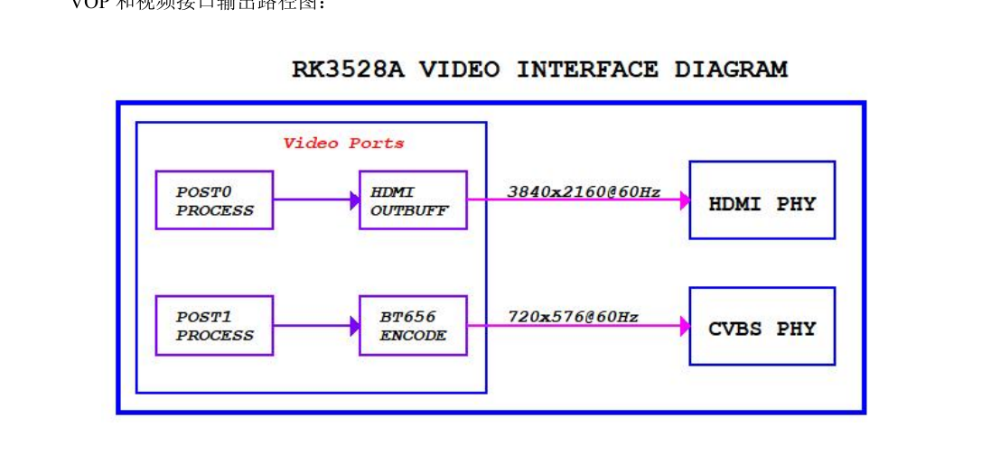
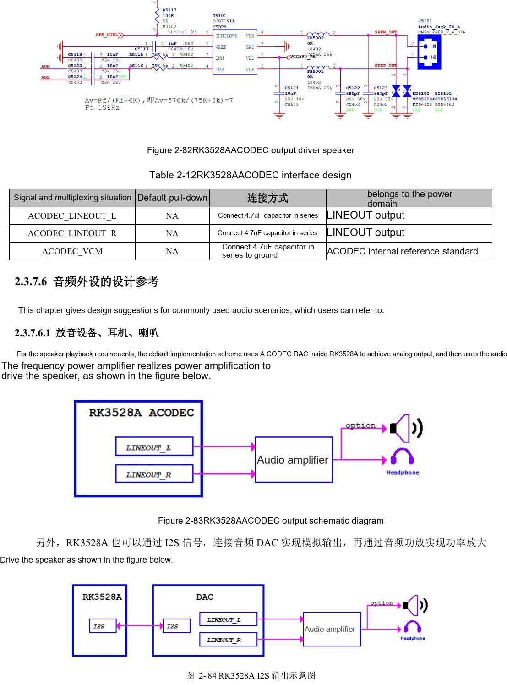
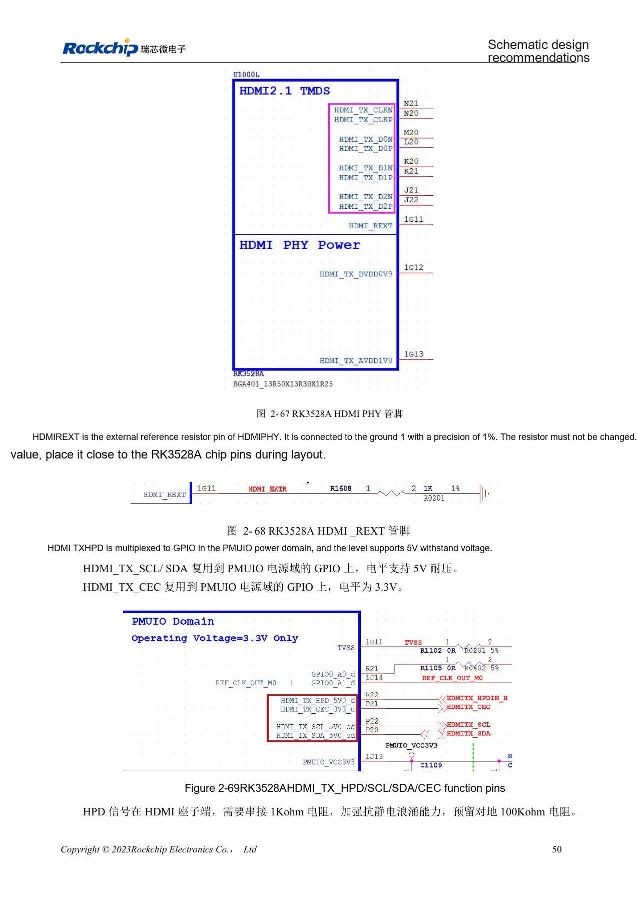
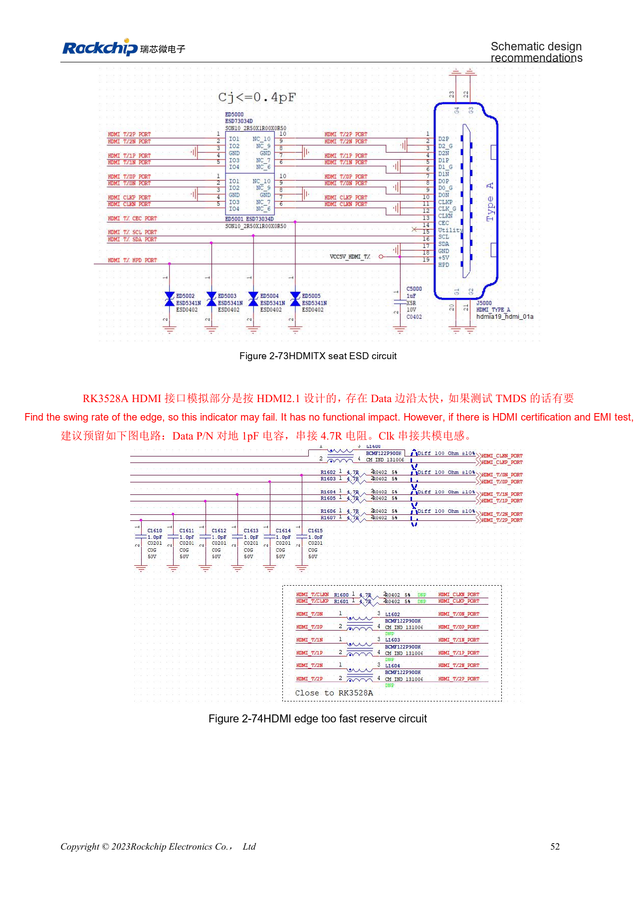

# RK3528 / RK3528A display and audio: HDMI, CVBS, TSI and analog layout

This engineering topic is based on the Chinese RK3528 V1.0 (2023-05-25) and RK3528A V1.0 (2023-07-12) hardware guides; it is not a verbatim translation of both PDFs. The discussed chapters are closely aligned, which does not establish drop-in chip compatibility. The official [Sige1 board documentation](https://docs.armsom.org/armsom-sige1) identifies RK3528 in ArmSoM [Sige1](https://www.armsom.org/sige1), providing a product for evaluating related applications. This does not identify Sige1 as an RK3528A board or establish interchangeability of the chips. SoC reference circuits are not the Sige1 schematic. Confirm pins, package, BSP/SDK, kernel and board revision for the actual product. Values are source references, not ArmSoM hardware measurements.

**§2.3.5–2.3.7; §3.3 HDMI/ACODEC/audio; PDF 62–75, 143, 148–149**

## Read HDMI capability together with its circuit

The VOP has two output ports and the guides show HDMI and CVBS paths. HDMI2.0 TX reaches 4K@60Hz with RGB/YCbCr444/YCbCr420 up to 10bit. HDMI_REXT requires 1kΩ, 1%, to ground close to the SoC; do not alter it arbitrarily. HPD and DDC pins are described as 5V tolerant, while CEC is 3.3V: this does not make every associated IO 5V compatible. Place 1kΩ in HPD at the connector and reserve a 100kΩ pull-down; validate 5V supply behavior and hot-plugging.

## Reserve adjustment options for compliance

The source says the HDMI analog portion was designed for HDMI2.1 but describes the exposed function as HDMI2.0; this is not evidence of HDMI2.1 features. For fast TMDS edges it suggests optional 1pF to ground on data P/N, 4.7Ω in series and a clock common-mode choke, populated according to eye and EMI results. PCB references are 100Ω±10%, intra-pair mismatch <6mil, inter-pair <480mil, length <5in, ESD capacitance ≤0.2pF and preferably at most two vias. TSI is a transport-stream input; a table mislabeled CIF does not establish a camera interface.

## Review analog and digital audio separately

ACODEC analog outputs need an amplifier to drive speakers. Recording can use PDM microphones, external I2S/PDM ADCs or a separate codec. Analog ACODEC/CVBS traces should exceed 12mil, reference a continuous ground layer and avoid DDR, switching inductors and RF. Put CVBS 75Ω near the SoC and filtering near the AV connector; guard left and right audio separately. Digital-audio clocks use source-side 22Ω and daisy-chain topology for multiple devices; both clocks in a PDM group can reduce branching when pins permit. Test channels individually, then measure noise with display and wireless activity.

## Reference parameters

| Item | Source value |
| --- | --- |
| HDMI_REXT | 1kΩ ±1% |
| HDMI differential impedance | 100Ω ±10% |
| HDMI length | <5in |
| CVBS termination | 75Ω |

## Source illustrations and locations

No corresponding English original was supplied. All four languages use the Chinese PDF figures below, labeled separately by chip and physical page; RK3528 images are not presented as RK3528A images.

RK3528 · CN · PDF 63

RK3528 · CN · PDF 74

RK3528 · CN · PDF 64

RK3528 · CN · PDF 66

RK3528A · CN · PDF 63

RK3528A · CN · PDF 74

RK3528A · CN · PDF 64

RK3528A · CN · PDF 66

## Development and documentation

Choose ArmSoM products from their own documentation; this series does not claim that ArmSoM offers an RK3528/RK3528A board. Interface and software experience from existing ArmSoM boards may inform your workflow, but does not make these voltage, pin or PCB rules interchangeable.

- [ArmSoM](https://www.armsom.org/) · [ArmSoM Docs](https://docs.armsom.org/)
- [RK3528 / RK3528A hardware design: nine engineering topics](/articles/rk3528-rk3528a-hardware-design-series/)
- [RK3528 / RK3528A USB and PCIe: shared PHY and channel review](/articles/rk3528-rk3528a-usb-pcie-design/)
- [RK3528 / RK3528A networking and control: RGMII, PHY, UART, I2C and PWM](/articles/rk3528-rk3528a-ethernet-control-interfaces/)
