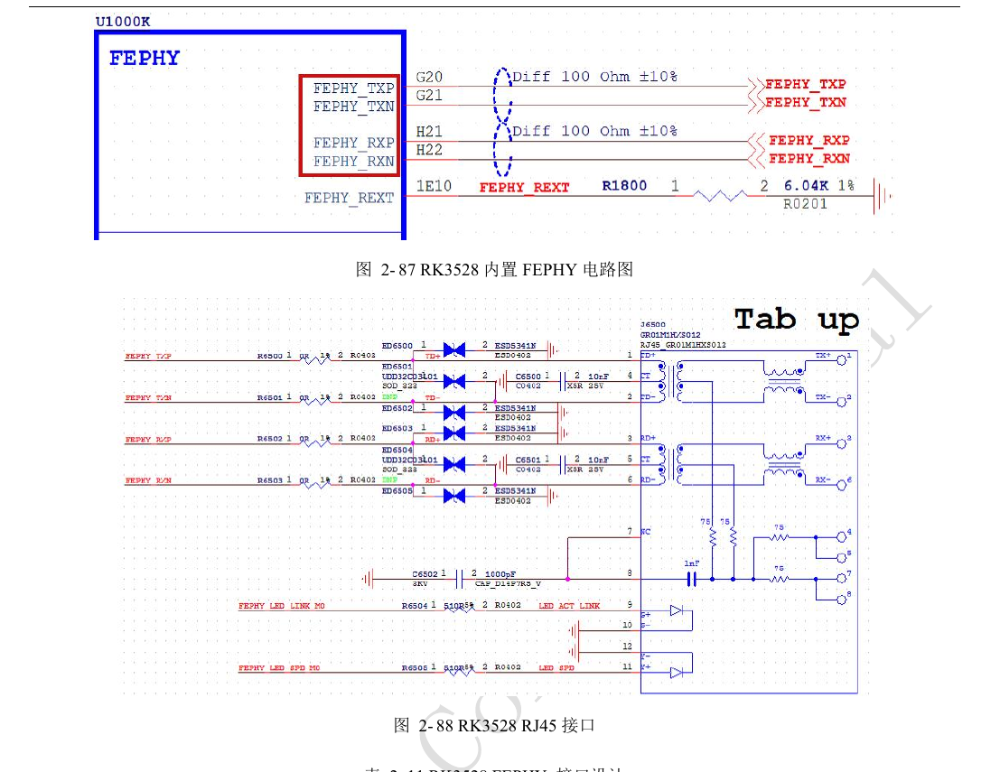
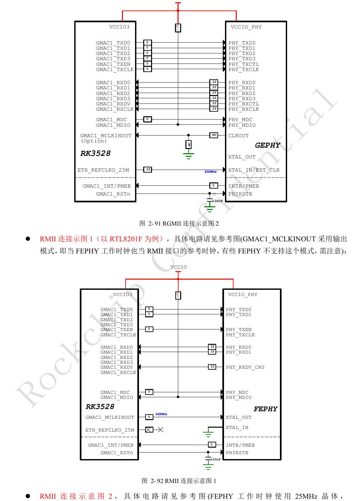
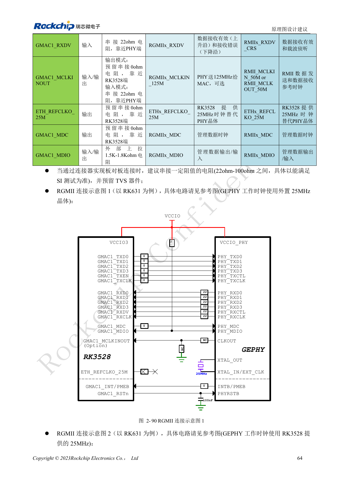
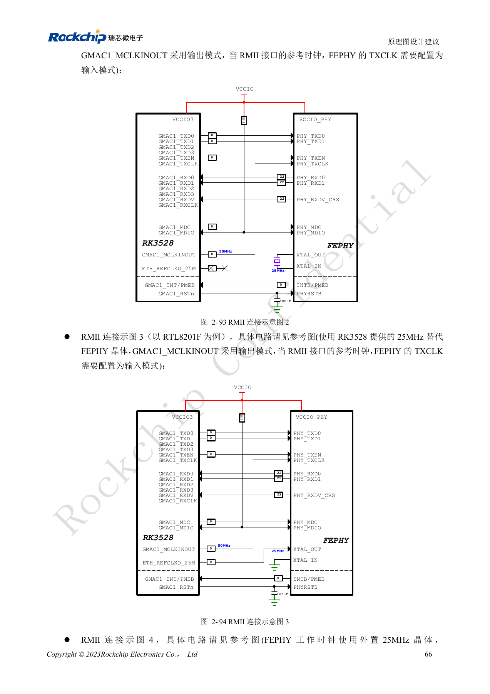
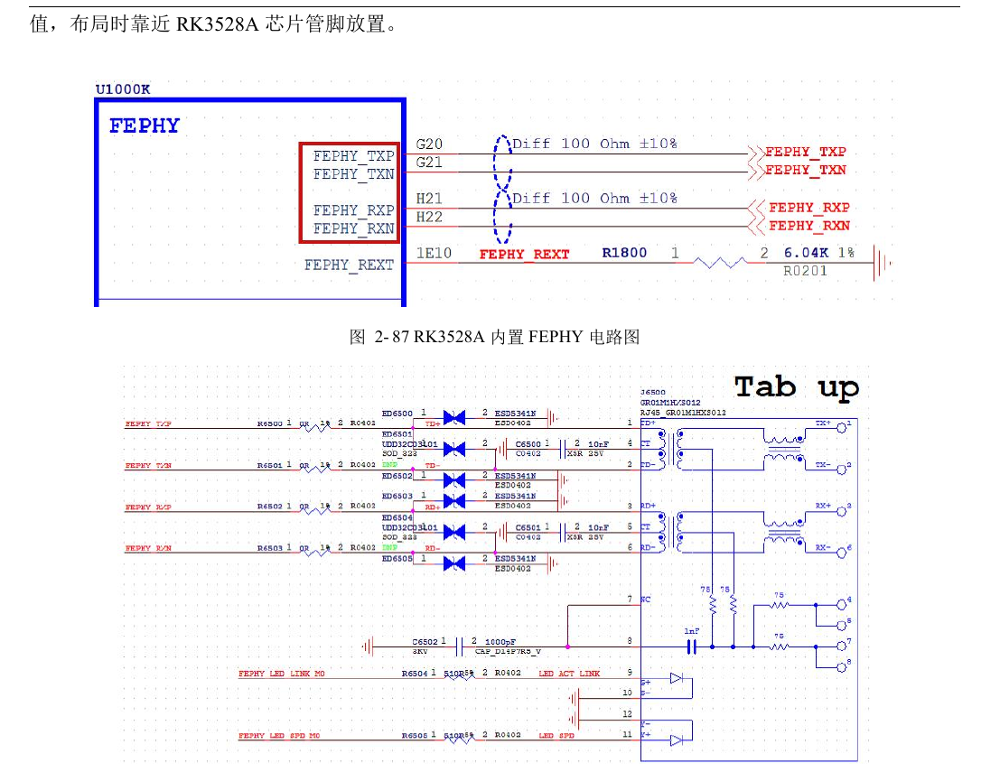
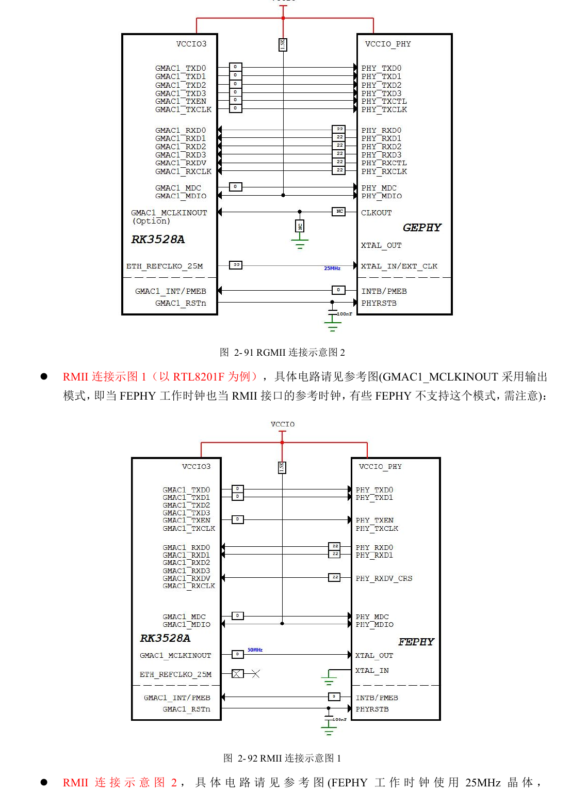
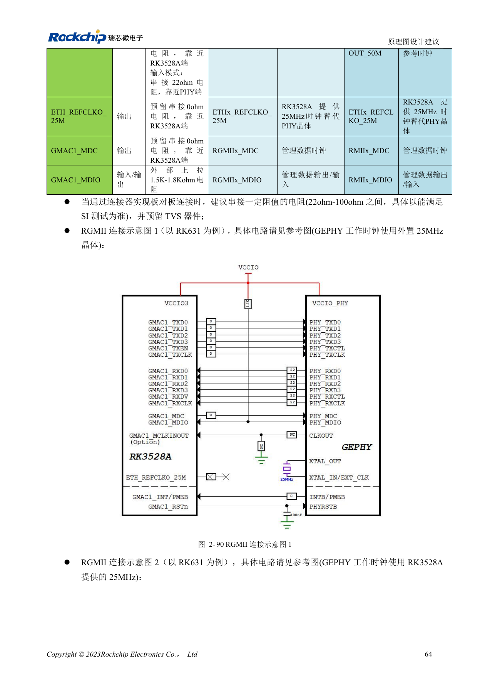
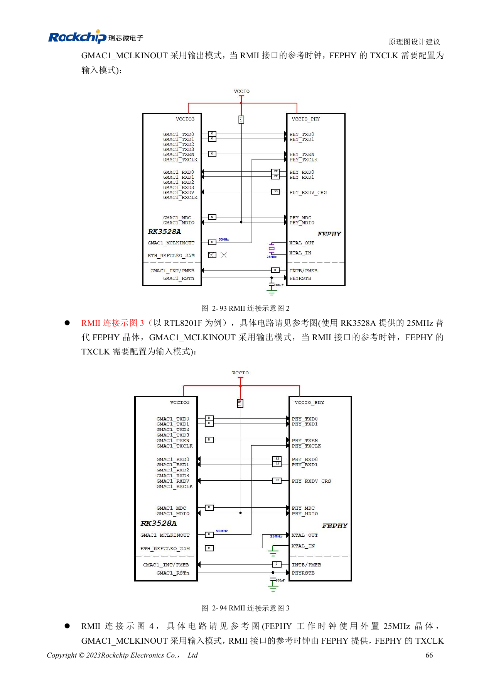

# RK3528 / RK3528A networking and control: RGMII, PHY, UART, I2C and PWM

This engineering topic is based on the Chinese RK3528 V1.0 (2023-05-25) and RK3528A V1.0 (2023-07-12) hardware guides; it is not a verbatim translation of both PDFs. The discussed chapters are closely aligned, which does not establish drop-in chip compatibility. The official [Sige1 board documentation](https://docs.armsom.org/armsom-sige1) identifies RK3528 in ArmSoM [Sige1](https://www.armsom.org/sige1), providing a product for evaluating related applications. This does not identify Sige1 as an RK3528A board or establish interchangeability of the chips. SoC reference circuits are not the Sige1 schematic. Confirm pins, package, BSP/SDK, kernel and board revision for the actual product. Values are source references, not ArmSoM hardware measurements.

**§2.3.8–2.3.13; PDF 75–87, 147–148**

## Integrated Fast Ethernet and external PHYs are separate paths

The guides list one GMAC, one EMAC and an integrated FEPHY. The FEPHY connects through MDI to magnetics and RJ45; REXT is 6.04kΩ, 1%, near the chip, with the reserved 0Ω differential-series positions retained. GMAC supports 10/100/1000Mbps RGMII or 10/100Mbps RMII in VCCIO3. For an external PHY, verify IO voltage, reset, straps and transformer center taps rather than copying another vendor’s circuit. RJ45 tab-up/tab-down changes pin ordering: inspect symbol and footprint together.

## Configure clock direction and delay as a pair

The reference assigns TXCLK-to-data delay to the MAC and RXCLK-to-data delay to the PHY; RK631 enables a 2ns RX delay in the example. When replacing the PHY, avoid inserting the same delay at both ends. RMII offers several 50MHz input/output arrangements; do not confuse the PHY’s 25MHz operating clock with the 50MHz bus reference. MDIO requires an external 1.5–1.8kΩ pull-up to the IO supply; add 100nF at PHY reset. RGMII PCB references are 50Ω±10%, TX and RX data matched to their own clocks within <120mil, length <6in.

## Allocate control buses by IO domain and mux group

Eight UARTs, eight I2Cs, two general-purpose SPIs and up to eight PWMs do not guarantee simultaneous pin availability. UART TX/RX must use one Mx group. The UART7 table lists M1/M2 in one column but M0/M1 in the voltage-domain column; resolve it against the PinOut before implementation, without guessing. SPI0 belongs to VCCIO4 and SPI1 to VCCIO0. I2C supports up to 400Kbit/s with a reference 2.2kΩ external pull-up checked against bus capacitance. PWM3/PWM7 accept IR; the guide’s default is 38kHz. Keep receivers away from antennas and direct LED light and match their output voltage.

## Reference parameters

| Item | Source value |
| --- | --- |
| Integrated PHY REXT | 6.04kΩ ±1% |
| MDIO pull-up | 1.5–1.8kΩ |
| I2C rate reference | ≤400Kbit/s |
| I2C pull-up reference | 2.2kΩ |

## Control-interface mux and supply tables

Source tables 2-24, 2-25, 2-27, 2-29 and 2-31, PDF pages 82–86. All interface rows are retained; the asterisk marks the UART7 source conflict. Identifiers remain unchanged, including PMUIO0 for HDMI_TX_I2C as printed.

### UART

| Interface | Mux group: supply domain |
| --- | --- |
| UART0 | M0: VCCIO0; M1: VCCIO1 |
| UART1 | M0: VCCIO4; M1: VCCIO4 |
| UART2 | M0: VCCIO3; M1: VCCIO0 |
| UART3 | M0: VCCIO4; M1: VCCIO4 |
| UART4 | VCCIO2 |
| UART5 | M0: VCCIO0; M1: VCCIO1 |
| UART6 | M0: VCCIO3; M1: VCCIO3 |
| UART7 | M1/M2 ↔ M0: VCCIO3; M1: VCCIO0 * |

### UART RTSN / CTSN

| Interface | Mux group: supply domain |
| --- | --- |
| UART0_RTSN / UART0_CTSN | -- |
| UART1_RTSN / UART1_CTSN | VCCIO4 |
| UART2_RTSN / UART2_CTSN | M0: VCCIO3; M1: VCCIO0 |
| UART3_RTSN / UART3_CTSN | VCCIO4 |
| UART4_RTSN / UART4_CTSN | VCCIO2 |
| UART5_RTSN / UART5_CTSN | M0: VCCIO0; M1: VCCIO1 |
| UART6_RTSN / UART6_CTSN | VCCIO3 |
| UART7_RTSN / UART7_CTSN | M0: VCCIO3; M1: VCCIO0 |

### SPI

| Interface | Mux group: supply domain |
| --- | --- |
| SPI0 | VCCIO4 |
| SPI1 | VCCIO0 |

### I2C

| Interface | Mux group: supply domain |
| --- | --- |
| I2C0 | M0: VCCIO4; M1: VCCIO4 |
| I2C1 | M0: VCCIO4; M1: VCCIO4 |
| I2C2 | M1: VCCIO0 |
| I2C3 | M0: VCCIO0; M1: VCCIO3 |
| I2C4 | VCCIO2 |
| I2C5 | M0: VCCIO0; M1: VCCIO1 |
| I2C6 | M0: VCCIO3; M1: VCCIO1 |
| I2C7 | VCCIO2 |
| HDMI_TX_I2C | PMUIO0 |

### PWM

| Interface | Mux group: supply domain |
| --- | --- |
| PWM0 | M0: VCCIO4; M1: VCCIO0 |
| PWM1 | M0: VCCIO4; M1: VCCIO0 |
| PWM2 | M0: VCCIO4; M1: VCCIO0 |
| PWM3 | M0: VCCIO4; M1: VCCIO2 |
| PWM4 | M0: VCCIO4; M1: VCCIO0 |
| PWM5 | M0: VCCIO4; M1: VCCIO3 |
| PWM6 | M0: VCCIO4; M1: VCCIO0; M2: VCCIO3 |
| PWM7 | M0: VCCIO4; M1: VCCIO0 |

## Source illustrations and locations

No corresponding English original was supplied. All four languages use the Chinese PDF figures below, labeled separately by chip and physical page; RK3528 images are not presented as RK3528A images.

RK3528 · CN · PDF 76

RK3528 · CN · PDF 79

RK3528 · CN · PDF 78

RK3528 · CN · PDF 80

RK3528A · CN · PDF 76

RK3528A · CN · PDF 79

RK3528A · CN · PDF 78

RK3528A · CN · PDF 80

## Development and documentation

Choose ArmSoM products from their own documentation; this series does not claim that ArmSoM offers an RK3528/RK3528A board. Interface and software experience from existing ArmSoM boards may inform your workflow, but does not make these voltage, pin or PCB rules interchangeable.

- [ArmSoM](https://www.armsom.org/) · [ArmSoM Docs](https://docs.armsom.org/)
- [RK3528 / RK3528A hardware design: nine engineering topics](/articles/rk3528-rk3528a-hardware-design-series/)
- [RK3528 / RK3528A display and audio: HDMI, CVBS, TSI and analog layout](/articles/rk3528-rk3528a-display-audio-design/)
- [RK3528 / RK3528A PCB review: stackup, fanout, return paths and protection](/articles/rk3528-rk3528a-pcb-stackup-signal-integrity/)
